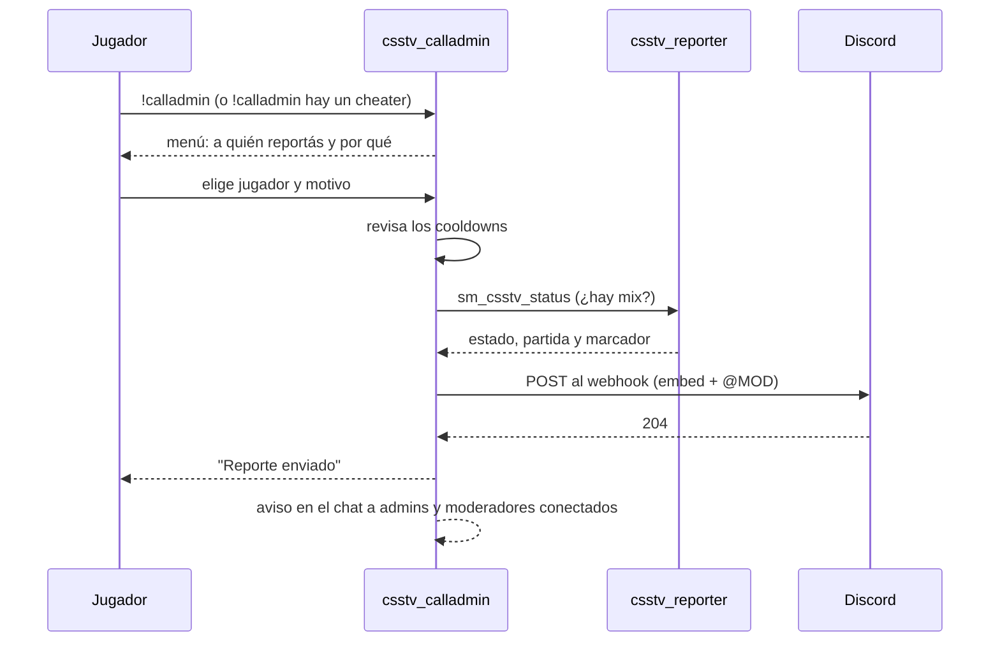
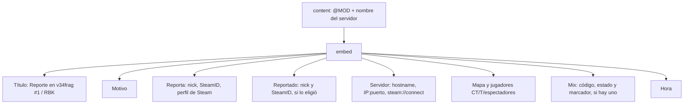
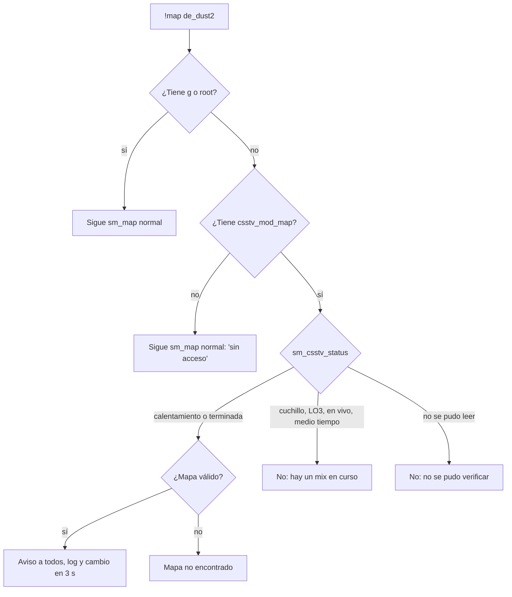

# Plan: `!calladmin` con Discord y rol de moderador

> Planeación original. Estado: **propuesta**, pendiente de aprobación.

## El pedido

Daniel, 2026-10-19:
- Hoy hay solo 2 admins y no quiere darle admin a cualquiera: un rol nuevo, **moderador**, con menos permisos.
- Un `!calladmin <motivo>` que llegue a un canal de Discord por webhook, etiquete al rol `@MOD` y diga quién lo mandó y desde qué servidor.
- RBK también lo usa y manda **al mismo canal**, así que el mensaje tiene que dejar claro de qué servidor viene.
- El moderador puede cambiar de mapa, **pero solo si no hay un mix en curso**.

## Decisiones tomadas

| Tema | Decisión | Origen |
|---|---|---|
| Plugin | Uno nuevo, `csstv_calladmin` 1.0.0, como `csstv_allchat` y `csstv_sell`: no toca `csstv_reporter` (congelado hasta el final) y se puede apagar solo | Propuesta |
| Rol | Grupo `Moderador` de SourceMod con flags `bcdfj` e inmunidad 50. Los admins actuales, root e inmunidad 99 | Propuesta, aprobada por Daniel |
| Bans | Como los maneja SourceMod: con `d` y sin `e`, el moderador solo banea por tiempo (no permanente) y no desbanea. Sin tope de duración | Daniel |
| Votos (`k`) | No | Propuesta, aprobada por Daniel |
| `sm_cancelmatch` | Solo admins: `admin_overrides.cfg` lo pasa al flag `g`, que el moderador no tiene | Propuesta |
| Cambio de mapa | El moderador **no** tiene `g`. `csstv_calladmin` intercepta `sm_map` (`!map`) y, si quien lo usa es moderador, lo deja pasar solo sin mix en curso | Daniel (regla) y propuesta (forma) |
| Cómo se sabe si hay mix | Leyendo `sm_csstv_status` del plugin de los mixes con `ServerCommandEx`. Sin cambiar `csstv_reporter` (y sin rearmar el build licenciado de RBK) | Propuesta |
| Mención | Solo `@MOD` (rol `1561742511045738526`) | Daniel |
| Canal | Uno solo para los dos servidores, con el nombre del servidor en el título del mensaje | Daniel |
| `!report` como alias | No, por ahora | Daniel |
| Webhook | En una cvar protegida, cargada en un cfg que **no se versiona**. Copia en el `.env` (`DISCORD_CALLADMIN_WEBHOOK`) | Propuesta |
| Despliegue | Servidor real y RBK en la misma tanda. Mismo `.smx`, sin licencia, como `csstv_allchat` | Regla del proyecto |

## 1. El flujo completo



## 2. El rol de moderador

### Grupo (`configs/admin_groups.cfg`)

```
"Groups"
{
    "Moderador"
    {
        "flags"     "bcdfj"
        "immunity"  "50"
        "Overrides"
        {
            "csstv_mod_map"   "allow"
        }
    }
}
```

`csstv_mod_map` no es un comando: es el permiso que `csstv_calladmin` revisa para dejar cambiar de mapa sin `g`.

### Quiénes son (`configs/admins_simple.ini`)

```
"STEAM_0:1:12345678"  "@Moderador"
```

Antes de tocar nada se baja por SFTP la config de admins de cada servidor (`admins_simple.ini`, `admins.cfg`, `admin_groups.cfg`, `admin_overrides.cfg`), se guarda una copia con la fecha y se revisa cómo están cargados los 2 admins actuales: tienen que quedar con `z` e inmunidad 99.

### Qué puede hacer

| Flag | Comandos |
|---|---|
| `b` genérico | `sm_admin` (menú), `sm_who`, `sm_live`, `sm_swap` |
| `c` kick | `sm_kick` |
| `d` ban | `sm_ban` (solo por tiempo), `sm_addban` |
| `f` slay | `sm_slay`, `sm_slap`, `sm_rename`, `sm_beacon` |
| `j` chat | `sm_mute`, `sm_gag`, `sm_silence` y sus `un-`, `sm_say`, `sm_csay`, `sm_psay` |
| `csstv_mod_map` | `!map <mapa>` sin mix en curso (ver la sección 4) |

**No puede:** cancelar un mix, cambiar de mapa con un mix en curso, cvars y configs, contraseña, rcon, cheats, desbanear, banear para siempre ni tocar a un admin (inmunidad).

### `configs/admin_overrides.cfg`

```
"Overrides"
{
    "sm_cancelmatch"   "g"
}
```

## 3. `!calladmin`

| Uso | Qué hace |
|---|---|
| `!calladmin` | Menú 1: jugadores conectados (sin bots ni uno mismo). Menú 2: motivo (Cheats, Tóxico, Molesta al equipo, Otro). "Otro" explica que se escribe `!calladmin <motivo>` |
| `!calladmin <texto>` | Manda el texto directo, sin jugador reportado |

- **Cooldowns:** 120 s por jugador (`csstv_calladmin_cooldown`) y 30 s entre dos reportes del servidor (`csstv_calladmin_global_cooldown`). Si toca esperar, se le dice cuánto.
- **Texto:** hasta 128 caracteres.
- **Respuesta:** "Reporte enviado. Un moderador lo va a revisar." Si Discord falla, "No se pudo enviar el reporte, probá de nuevo en un rato" y el cooldown no corre.
- **Aviso en el juego:** los conectados con acceso a `csstv_calladmin_notify` (por defecto `b`: admins y moderadores) reciben el reporte por el chat.
- **Log:** cada reporte queda en `logs/calladmin.log`.

### El mensaje en Discord



- El servidor sale de `csstv_calladmin_server` (ej. `v34frag #1`, `RBK`). El `IP:puerto` sale de `csstv_calladmin_address`: detrás de Pterodactyl la cvar `ip` puede decir `0.0.0.0`, así que se pone a mano en cada servidor.
- Con mix en curso se agregan el código de la partida y el marcador que da `sm_csstv_status`. Con eso se busca la demo y la ronda para revisar un cheater.
- **Menciones seguras:** se envía `allowed_mentions: {"parse": [], "roles": ["1561742511045738526"]}`. Si un jugador escribe `@everyone` o `<@&…>`, no hace sonar nada. Además se escapan las comillas y las barras del JSON.
- Si Discord responde 429 (límite de mensajes), se reintenta una vez después del `retry_after`.

### Cvars (`cfg/sourcemod/csstv_calladmin.cfg`)

| Cvar | Por defecto | Qué es |
|---|---|---|
| `csstv_calladmin_enabled` | `1` | Apaga el plugin sin descargarlo |
| `csstv_calladmin_webhook` | vacío | URL del webhook (`FCVAR_PROTECTED`). Sin ella, `!calladmin` avisa que no está configurado |
| `csstv_calladmin_role` | `1561742511045738526` | Rol a mencionar |
| `csstv_calladmin_server` | `hostname` | Nombre del servidor en el título |
| `csstv_calladmin_address` | vacío | `IP:puerto` público para el link de conexión |
| `csstv_calladmin_cooldown` | `120` | Segundos por jugador |
| `csstv_calladmin_global_cooldown` | `30` | Segundos entre reportes del servidor |

En el repo el cfg va sin la URL. La URL se escribe a mano en cada servidor.

## 4. Cambio de mapa del moderador



- `AddCommandListener("sm_map")` atrapa tanto `sm_map` en la consola como `!map` en el chat. A los admins no los toca.
- Si `sm_csstv_status` no responde (plugin descargado o salida distinta), se bloquea: mejor que un moderador no pueda cambiar el mapa a que corte un mix.
- `!map` sin mapa abre un menú con la lista de mapas de la sección `csstv` de `configs/maplists.cfg` (la misma que usa la votación de los jugadores), o del mapcycle si no existe.
- El moderador no ve "Cambiar mapa" en `sm_admin`: ese menú de SourceMod cambia el mapa sin pasar por `sm_map`, así que no se puede controlar.

## 5. Lo que hay que preparar en Discord (Daniel)

1. El webhook del canal (hecho, en el `.env`).
2. El rol `MOD`, con "Permitir que cualquiera mencione este rol" activado. Si no, el webhook escribe la mención pero no avisa a nadie.

## 6. Requisitos antes de empezar

- La lista de SteamID de los moderadores. ¿Los mismos en RBK, o RBK pone los suyos?
- El nombre que tiene que salir para cada servidor y su `IP:puerto` público.
- System2 ya está en los dos servidores (la usa `csstv_reporter`).

## 7. Orden de implementación

1. Bajar por SFTP la config de admins de los dos servidores y guardar copias.
2. Escribir `csstv_calladmin.sp`: `!calladmin`, menús, cooldowns, webhook y `!map` del moderador.
3. Probar en el servidor local con bots: los menús, los cooldowns, un `@everyone` en el texto, la URL vacía y un mensaje real al canal (marcado como prueba). Para `!map`, con un mix de bots en curso y en el calentamiento, como moderador y como admin.
4. Escribir `DOCUMENTACION.md`, `GUIA_IMPLEMENTACION.md` y `CHANGELOG_DISCORD.txt`.
5. Subir a los dos servidores en la misma tanda: `.smx`, cfg con la URL, `admin_groups.cfg`, `admin_overrides.cfg` y los moderadores, y `sm_reloadadmins`. El plugin se carga con `sm plugins load` (no toca el mix) o en el próximo cambio de mapa.
6. Probar en cada servidor: un `!calladmin` real y `sm_who` con un moderador.
