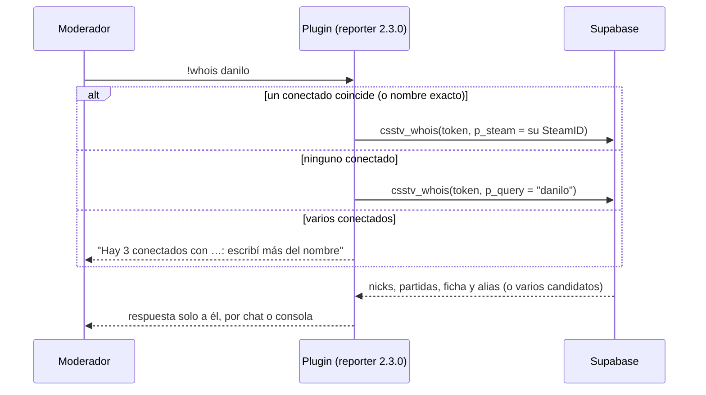
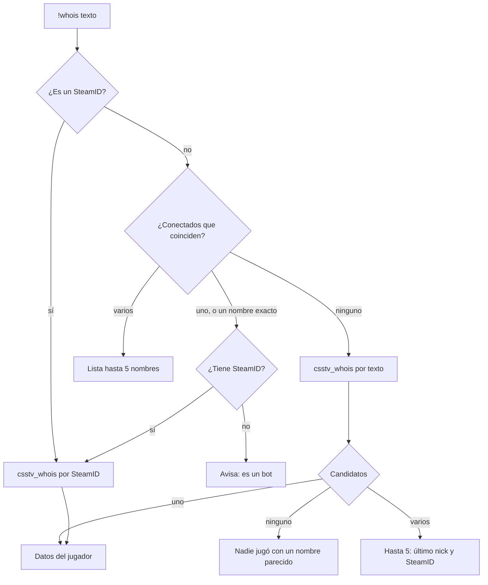

# `!whois` en el servidor: documentación

> **Actualizado el 2026-10-20** por [`2026-10-20-whois-menu`](../2026-10-20-whois-menu/DOCUMENTACION.md) (reporter 2.3.1): la búsqueda por texto junta los conectados y la base, y con varias coincidencias abre un menú. Lo de abajo describe la 2.3.0.

## Qué hace

`!whois <nombre | SteamID>` les dice a los admins y moderadores **qué nicks usó un jugador en las partidas** y **qué perfil tiene vinculado en la web**, si lo tiene. Sirve para jugadores conectados y desconectados.

```
!whois danilo
[v34frag] daniloev (STEAM_0:1:12345)
  Nicks (5, en 42 partidas, la última el 2026-10-18): daniloev, dani, xX_danilo_Xx, d4n1, danilo
  En la web: ficha Danilo · cuenta danilo
```

Va en el reporter **2.3.0** (`csstv/whois.inc`) y usa una función nueva de la base, `csstv_whois`, que existe en producción desde su migración: **funciona antes del corte**. La 2.3.0 trae también el cvar `csstv_claim` para apagar `!claim` hasta el corte.

## 1. El flujo





## 2. El comando

| Regla | Detalle |
|---|---|
| Quién | `ADMFLAG_GENERIC` (flag `b`): los admins y el grupo `Moderador` (`bcdfj`). También la consola del servidor |
| Argumento | Un nombre (de 2 caracteres en adelante) o un SteamID (`STEAM_X:Y:Z` o SteamID64) |
| Conectados | Busca la parte del nombre sin distinguir mayúsculas. Si un nombre es igual al texto, gana ese. Con varios, los lista (hasta 5) y no consulta |
| Desconectados | Si ningún conectado coincide, la base busca en los nicks de las partidas, el nick de la ficha y el alias de la cuenta |
| Respuesta | Solo al que preguntó, por donde preguntó (chat o consola). Los textos de la base pasan sin colores (`{` → `(`) |
| Espera | 3 segundos entre consultas del mismo admin |
| Registro | El log de SourceMod anota quién buscó qué (`!whois de <admin>: <SteamID o texto>`) |
| Licencia | Como `!claim`: sin licencia vigente o sin System2, no está disponible |
| Fichas privadas | Se muestran igual (decisión de Daniel) |

### Lo que muestra

1. **Encabezado:** el nombre del conectado consultado o, si fue por texto o SteamID, el último nick usado, con el `STEAM_0:X:Y`. Después del corte, si la ficha tiene varios SteamID, "y N SteamID más en su ficha".
2. **Nicks:** los 6 usados más recientemente, cuántos distintos usó, en cuántas partidas y la fecha de la última (hora de Colombia). Sin partidas: "Sin partidas registradas".
3. **Web:** el nick de la ficha y el alias de la cuenta (si la ficha tiene cuenta), sin link. Sin ficha: "Sin perfil en la web".

## 3. La base: `csstv_whois(p_token, p_steam, p_query)`

`security definer`, ejecutable por `anon` (el plugin usa la anon key). Valida el token del servidor con `csstv_auth`, como la ingesta: con un token inválido, revocado, de otra IP o con la licencia vencida da error (HTTP 4xx).

| Entrada | Respuesta |
|---|---|
| `p_steam` (`STEAM_X:Y:Z`, SteamID64, `[U:1:N]`) | `{ ok, multiple: false, steam_id (STEAM_0), nicks, nick_count, matches, last_played, player_id, player_nick, alias }` y, después del corte, `steam_count` |
| `p_steam` inválido | `{ ok: false, message: "SteamID inválido" }` |
| `p_query` de 2 a 32 caracteres, un candidato | Igual que por SteamID |
| `p_query`, varios candidatos | `{ ok, multiple: true, total, candidates: "nick (STEAM_0:…), …" }`: hasta 5, el que jugó más recientemente primero |
| `p_query`, ninguno | `{ ok: false, message: "Nadie jugó con un nombre parecido a \"…\"" }` |
| `p_query` corto o largo | `{ ok: false, message: "Escribí entre 2 y 32 caracteres del nombre" }` |

- **Nicks:** solo de `match_player_stats.nick`: partidas terminadas y también canceladas que guardaron stats. Los SteamID que no son SteamID64 (bots, "desconocido") no son candidatos.
- **Búsqueda:** `ilike` con `%`, `_` y `\` escapados (no son comodines).
- **Respuesta plana:** sin listas, para que el plugin la lea con el lector de `!claim` (`Claim_JsonField`).
- **`csstv_steam0(p_s64)`:** función nueva que pasa un SteamID64 a `STEAM_0:X:Y` (lo que ve el admin en el juego).

### Antes y después del corte

| | Producción hoy (`supabase/migrations/20261019180000_whois.sql`) | Después del corte (`supabase/replanteo/23_whois.sql`) |
|---|---|---|
| SteamID por ficha | Uno (`players.steam_id`) | Todos (`player_steam_all`) |
| Nicks y partidas | Del SteamID consultado | De todos los SteamID de la ficha |
| Candidatos por texto | Uno por SteamID | Los SteamID de una misma ficha cuentan como uno (su principal) |
| `steam_count` | No viene | Cuántos SteamID tiene la ficha |

El plugin funciona igual con las dos: si no viene `steam_count`, no muestra los SteamID de más.

## 4. Cvar

| Cvar | Por defecto | Qué hace |
|---|---|---|
| `csstv_claim` | `1` | `!claim` habilitado. **Va en `0` hasta el corte** (`cfg/sourcemod/csstv_reporter.cfg`): `claim_with_code` no existe en producción. Con `0`, `!claim` responde "todavía no está disponible: llega con la web nueva" |

## Dónde está cada cosa

| Qué | Archivo |
|---|---|
| Función en producción | `supabase/migrations/20261019180000_whois.sql` |
| Función después del corte | `supabase/replanteo/23_whois.sql` |
| Inversa de la `23` | `docs/bitacora/2026-10-14-replanteo-modelo-datos/reversas/23_whois.sql` |
| Pruebas SQL de la `23` | `docs/bitacora/2026-10-14-replanteo-modelo-datos/pruebas/23_whois.sql` |
| Comando | `server/addons/sourcemod/scripting/csstv/whois.inc` |
| `csstv_claim` | `server/addons/sourcemod/scripting/csstv/claim.inc` |
| Versión, include e inicio | `server/addons/sourcemod/scripting/csstv_reporter.sp` |
| Plugin compilado | `server/addons/sourcemod/plugins/csstv_reporter.smx` |
| Configuración | `server/cfg/sourcemod/csstv_reporter.cfg` |
