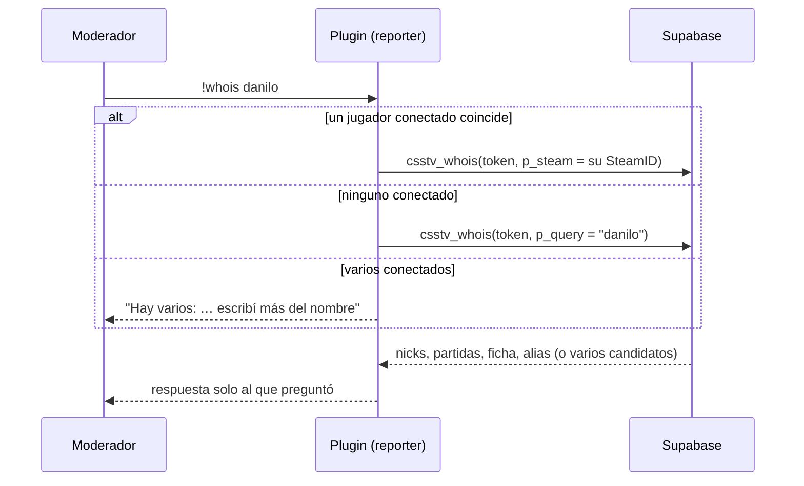
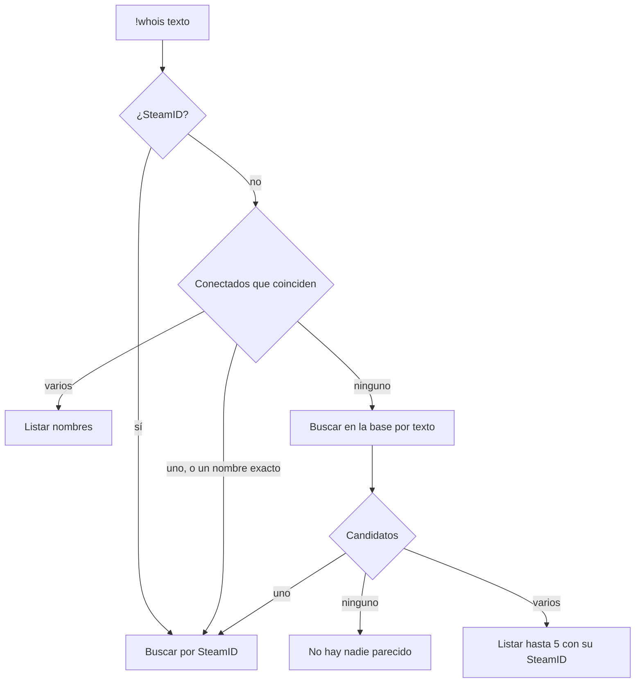

# Plan: `!whois` en el servidor (nicks usados y perfil de la web)

> Planeación original. Estado: **aprobado** por Daniel el 2026-10-19 ("sí, me parece bien así"). Pidió implementarlo sin probar en su local ni desplegar todavía. Las decisiones marcadas como "Propuesta de Claude" no las eligió él.

## El pedido

Daniel, el 2026-10-19: un comando `!whois daniloev` que diga **los nicks que usó ese jugador en el servidor** y **el perfil que tiene vinculado en la página**, si lo tiene. Es una **excepción** al orden de trabajo (los plugins quedaban para después de la web), como `!sell`.

## Decisiones tomadas

| Tema | Decisión | Origen |
|---|---|---|
| Quién lo usa | Admins y moderadores: `ADMFLAG_GENERIC` (flag `b`, que tiene el grupo `Moderador`) | Daniel |
| Fichas privadas | Se muestran igual | Daniel |
| A quién se busca | A los jugadores conectados (por nombre parcial) y también a los **desconectados** (por un nick viejo, el nick de la ficha o el alias de la cuenta) | Daniel |
| De dónde salen los nicks | **Solo de las partidas** (`match_player_stats.nick`), no de las conexiones | Daniel |
| Dónde va | En `csstv_reporter` (nuevo `csstv/whois.inc`), que ya tiene el token, la conexión y la licencia. Versión **2.3.0** | Daniel |
| Base | Una función nueva `csstv_whois` como **migración normal de producción** (`supabase/migrations/`), escrita contra el esquema de hoy: solo agrega una función y no rompe la web vieja. Así funciona antes del corte | Propuesta de Claude, aceptada |
| Después del corte | El replanteo `23` la redefine para juntar todos los SteamID de la ficha (`player_steam_all`) | Propuesta de Claude, aceptada |
| `!claim` antes del corte | Cvar nuevo `csstv_claim` (por defecto `1`). Va en `0` en los servidores hasta el corte, porque `claim_with_code` no existe en producción | Propuesta de Claude, aceptada |
| Link a la web | Cvar `csstv_whois_url` con `{id}` (id de la ficha). Hoy la web vieja (`#jugador/<id>`); en el corte se cambia el cfg sin recompilar. Vacío: no se muestra el link | Propuesta de Claude, aceptada |
| Partidas canceladas | Cuentan: si tienen stats guardadas, el nick se usó en el servidor | Propuesta de Claude, aceptada |
| Pruebas y despliegue | No en esta tanda: Daniel pidió solo implementar | Daniel |

## 1. El flujo

## 2. Base de datos

### Producción: `supabase/migrations/20261019180000_whois.sql`

`csstv_whois(p_token, p_steam default null, p_query default null) returns jsonb`, `security definer`, para `anon` (la usa el plugin con la anon key y el token del servidor, que valida `csstv_auth`).

- **Por SteamID** (acepta `STEAM_0:X:Y` o SteamID64): `{ ok, steam_id (STEAM_0), nicks (los 6 más recientes, separados por coma), nick_count, matches, last_played, player_id, player_nick, alias }`.
- **Por texto** (de 2 a 32 caracteres): busca en los nicks de las partidas, el nick de la ficha y el alias de la cuenta.
  - Ninguno: `{ ok: false, message }`.
  - Uno: como la búsqueda por SteamID.
  - Varios: `{ ok, multiple: true, total, candidates: "nick (STEAM_0:…), …" }` con los 5 que jugaron más recientemente.
- Respuesta plana (sin listas) para que el plugin la lea con el mismo lector que `!claim`.

### Replanteo: `supabase/replanteo/23_whois.sql`

La misma función con varios SteamID por ficha: los nicks y las partidas son de **todos los SteamID de la ficha** (suma `steam_count`), y los candidatos se juntan por ficha. Inversa: vuelve a la versión de producción. Pruebas SQL en `pruebas/23_whois.sql`.

## 3. Plugin 2.3.0

- `csstv/whois.inc`: `sm_whois` (`!whois`), con espera de 3 segundos por admin, respuesta solo al que pregunta (chat o consola) y registro en el log de quién buscó a quién.
- Cvar `csstv_whois_url` (link a la ficha, con `{id}`).
- `csstv/claim.inc`: cvar `csstv_claim`; con `0`, `!claim` responde que todavía no está disponible.
- `cfg/sourcemod/csstv_reporter.cfg`: los dos cvars nuevos.

## 4. Documentación

- `supabase/replanteo/README.md` (fila de la `23` y nota de la migración de producción).
- `docs/PENDIENTES.md` y el índice de la bitácora.
- `CHANGELOG_DISCORD.txt` en esta carpeta.

## 5. Requisitos antes de empezar

- Ninguno para implementar. Para probar y desplegar (después): Docker para la Supabase local, el servidor local, correr la migración en producción y subir el plugin al servidor real (genérico) y a RBK (licenciado).

## 6. Orden de implementación

1. Migración de producción.
2. Replanteo `23`, su inversa y sus pruebas SQL.
3. Plugin: `whois.inc`, `csstv_claim`, versión y cfg.
4. Bitácora (documentación y guía con los pasos de prueba y despliegue), pendientes.
