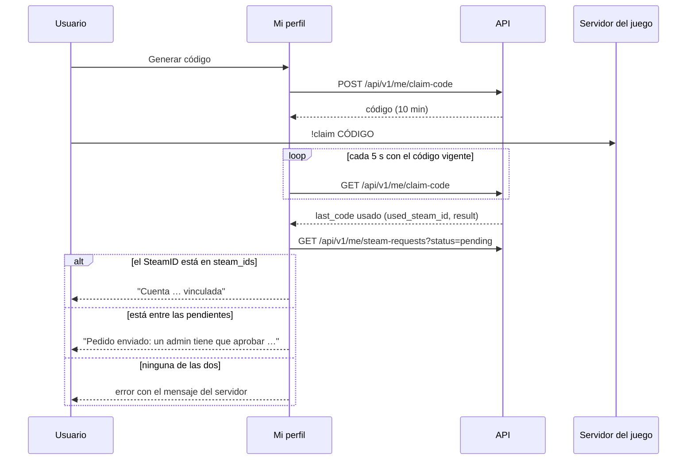
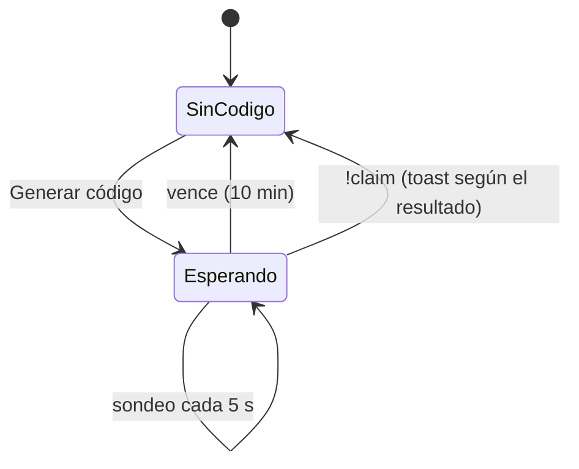

# Vinculación con varios SteamID, cambio de contraseña y efectos de tema en la cuenta: documentación

## Qué hace

En **Mi perfil → Vinculación**, la tarjeta "Cuentas de juego" muestra:
- los SteamID64 vinculados a la cuenta, con la principal marcada;
- las solicitudes de SteamID adicional que esperan la aprobación de un admin;
- el código para vincular uno nuevo con `!claim` desde el juego.

Mientras hay un código vigente, la página consulta cada 5 s y avisa apenas el jugador escribe el comando en el servidor.

En **Mi perfil → Cuenta**, la tarjeta "Contraseña" permite cambiarla con la contraseña actual. El cambio cierra la sesión en los otros dispositivos, y este sigue conectado con una sesión nueva.

La preferencia de **efectos al cambiar de tema** (flashbang y smoke) se guarda en la cuenta, además del navegador. Al entrar desde otro navegador, se aplica la de la cuenta.

## Cuentas de juego

| Elemento | Regla |
|---|---|
| Contador `{n}/{tope}` | `n` son los SteamID vinculados; el tope es `max_steam_ids` de la API (configurable, hoy 3) |
| Orden | La principal primero, después las demás vinculadas y al final las pendientes |
| Fila vinculada | SteamID en mono, badge "Principal" si corresponde y "Vinculada ago 2026" (`added_at`), o "Fecha desconocida" si no hay fecha |
| "Hacer principal" | En las no principales. Sin aprobación, una vez cada 24 horas. Toast "Cuenta principal actualizada", o el mensaje del backend si lo rechaza |
| "Desvincular" | Abre una confirmación debajo de la fila: "Un admin tiene que aprobar la desvinculación", motivo opcional ("¿Por qué?"), "Cancelar" y "Enviar solicitud". El único SteamID no lo tiene, porque la ficha no puede quedar sin SteamID |
| Pedido en revisión | Badge naranja "Desvinculación en revisión"; sin "Hacer principal" ni "Desvincular"; "Cancelar solicitud" lo cancela (`DELETE …/unlink`, toast "Solicitud cancelada") y la cuenta vuelve a la normalidad |
| Fila pendiente | Badge ámbar "Pendiente de aprobación" y "Pedida hace X · como {nick}" |
| Vacío | "Todavía no vinculaste ninguna cuenta". El nav lateral marca Vinculación con un punto |
| Límite | Si vinculadas más pendientes llegan al tope, el pie solo dice "Llegaste al límite de {tope} cuentas. Desvincula una para enlazar otra." |
| Código | Caja `!claim {código}`, "Esperando que lo escribas en el chat · vence en X" y "Copiar". Al vencer desaparece |

**Cómo se decide el resultado del `!claim`.** El backend marca el código como usado también cuando el comando falla (por ejemplo, "Ese SteamID pertenece a otra cuenta"). Por eso el resultado sale de dónde quedó el SteamID y no del texto del mensaje (`claimOutcome` en `accounts.ts`):
- si está en `steam_ids`, se vinculó: toast de éxito;
- si está entre las solicitudes pendientes, es un pedido para un admin;
- si no está en ninguna, el toast de error muestra el mensaje que vio el jugador (`last_code.result`).

"Cuentas conectadas" (los links de Steam, Discord y FACEIT) no cambió: Steam es solo el link del perfil, distinto de los SteamID64.

## Contraseña

| Campo o regla | Comportamiento |
|---|---|
| Contraseña actual | Obligatoria. Si el backend responde `WRONG_PASSWORD`: "La contraseña actual no es correcta.", y se borra al escribir |
| Contraseña nueva | Medidor de 4 barras: 1 punto por cada uno de ≥ 8 caracteres, mayúscula, número y símbolo. Verde con 3 o más puntos. Etiquetas: "Muy débil" a "Fuerte" |
| Validez | ≥ 8 caracteres, al menos 2 puntos y distinta de la actual. El backend acepta desde 6, pero el frontend pide más |
| Repetición | "Coinciden" en verde. "No coinciden" recién cuando llega al mismo largo o se intentó guardar |
| Ojo | Muestra u oculta los tres campos a la vez |
| Guardar | Atenuado hasta que todo es válido. Si se toca igual, muestra todos los errores sin llamar a la API |
| Éxito | Se guarda la sesión nueva que devuelve la API, con el mismo "Recordarme". Se cierra el formulario y sale el toast "Contraseña actualizada · cerramos las otras sesiones" |
| Otras sesiones | Aviso fijo: el backend las cierra siempre, así que no hay casilla para elegir |

- **"Último cambio hace X"** debajo del título, desde `password_changed_at` de `/auth/me`: "hace un momento" el primer minuto, después el tiempo relativo. Sin fecha (no la cambió desde el 2026-10-19, cuando se empezó a guardar) no se muestra. Después de un cambio aparece enseguida, porque la sesión nueva ya trae la fecha.
- **"¿No la recuerdas?"** no se muestra: el backend todavía no tiene la recuperación de contraseña.

## Efectos de tema en la cuenta

- **Preferencias:** al elegir "Con sonido", "Sin sonido" o "Desactivados", se aplica enseguida en el navegador y se guarda con `PATCH /api/v1/me/profile` (`preferences.theme_fx`). Si falla, vuelve al valor anterior y muestra el error.
- **`useSyncThemeFx`** (en el shell autenticado): cuando el perfil trae un valor que no es `null` y es distinto del navegador, lo copia al navegador. Con `null` queda el del navegador.
- **Sin sesión** (la landing) se usa solo el del navegador, que después de haber entrado ya tiene el de la cuenta.

## Servidores en vivo (landing y Bienvenida)

Una sola consulta pública, `GET /api/v1/servers/status`, cada 30 s (el backend la guarda 20 s). La usan tres lugares:

| Lugar | Qué muestra |
|---|---|
| Pill del hero | "N partidas en vivo · N jugadores en el servidor" (`totals.live_matches`, `totals.players`) |
| Sección Servidores | KPIs `online/servers` y jugadores. Por servidor: nombre, modo traducido, región e IP copiable, mapa, jugadores con su barra, **latencia** y "Conectar" (`steam://connect/`) |
| Bienvenida → Vinculación | El `connect <ip>` del primer servidor de mix en línea; si no hay, cualquiera en línea con IP |

- **Latencia:** se mide desde el backend; el ping del jugador no se puede medir desde el navegador. Por eso la columna se llama así y lleva un tooltip.
- **Servidor que no responde:** fila atenuada, guiones y "Offline". Sin IP no hay "Conectar".
- **Discord:** sigue fijo en `config/site.ts`, porque la API no lo expone.

## Dónde está cada cosa

Todo dentro de `web/frontend/`.

| Qué | Archivo |
|---|---|
| Tarjeta "Cuentas de juego" y "Cuentas conectadas" | `src/features/profile/sections/LinkSection.tsx` |
| Filas, tope y resultado del `!claim` (lógica pura) | `src/features/profile/accounts.ts` |
| Solicitudes pendientes, hacer principal y pedir desvincular | `mySteamRequestsOptions`, `useMakePrimary` y `useRequestUnlink` en `src/features/onboarding/queries.ts` |
| Estado de los servidores, modos y servidor del `!claim` | `serverStatusOptions`, `SERVER_MODE` y `claimServer` en `src/features/public/queries.ts` |
| Tabla de servidores y pill del hero | `src/features/landing/ServersSection.tsx` y `Hero.tsx` |
| Tarjeta "Contraseña" | `src/features/profile/sections/PasswordCard.tsx` |
| Reglas y textos de la contraseña (lógica pura) | `src/features/profile/password.ts` |
| Cambio de contraseña (guarda la sesión nueva) | `useChangePassword` en `src/features/profile/queries.ts` |
| Códigos `WRONG_PASSWORD`, `SAME_PASSWORD` y `NOT_AVAILABLE` | `src/api/errors.ts` |
| Preferencia de efectos | `src/features/profile/sections/PreferencesSection.tsx`, `src/features/theme-fx/pref.ts` y `useSyncThemeFx.ts` |
