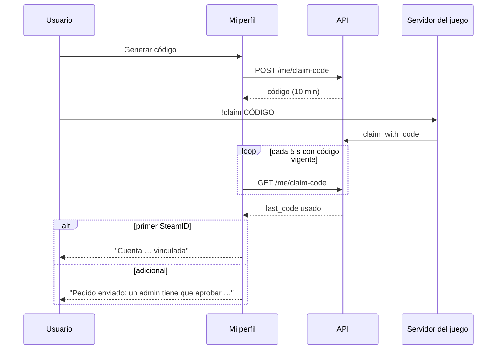

# Plan: Vinculación con varios SteamID, cambio de contraseña y efectos de tema en la cuenta

> Planeación original. Estado: **aprobado** el 2026-10-19.

Handoff: `CSSTV/desings/handoff_vinculacion_contrasena/`:
- `README.md`;
- `Pedidos al backend.md`;
- `referencia-visual/MyProfile.dc.html`, secciones Vinculación y Cuenta.

Reemplaza la sección Vinculación del handoff de perfil y suma el bloque Contraseña en Cuenta. Además, como el backend ya tiene `preferences.theme_fx` (rebase del 2026-10-19), la preferencia de efectos de tema se guarda en la cuenta.

## Decisiones tomadas

| Tema | Decisión | Por qué |
|---|---|---|
| "Hacer principal", "Desvincular" y meta "{n} partidas · vinculada {mes}" | Se muestran **deshabilitados** (tooltip "Próximamente") y la meta con "—" | Respuesta de Esteban. El backend no tiene endpoints ni esos datos: va a pedidos |
| Tope de cuentas | El que manda la API (`max_steam_ids`, hoy 3), no 5 | Lo configura el backend |
| SteamID adicionales | Filas con badge ámbar **"Pendiente de aprobación"** (`GET /me/steam-requests?status=pending`) | Respuesta de Esteban. En el backend real, cada SteamID adicional lo aprueba un admin; el handoff no lo contempla |
| Vencimiento del código | El real, de `expires_at` (10 min): "vence en X" | El handoff dice 15 min |
| Checkbox "Cerrar sesión en los otros dispositivos" | Aviso fijo: "Se va a cerrar la sesión en tus otros dispositivos." / "Este dispositivo sigue con la sesión iniciada." | Respuesta de Esteban. `POST /me/password` siempre cierra todas las sesiones y devuelve una nueva |
| "Último cambio hace X" y "¿No la recuerdas?" | Ocultos | Respuesta de Esteban. No hay `password_changed_at` ni recuperación de contraseña (llega con el envío de correos) |
| Reglas de la contraseña nueva | Las del handoff en el frontend: ≥ 8 caracteres, puntaje ≥ 2 y distinta de la actual | El backend acepta de 6 a 72; el frontend puede pedir más |
| Efectos de tema | Preferencias guarda en el navegador y en la cuenta. Al entrar, el valor de la cuenta (si no es `null`) reemplaza al del navegador | Regla del contrato (`cuenta.md`) |
| Servidores de la landing | Sin cambios | Respuesta de Esteban: lo va a hablar con el backend |

## 1. El flujo

## 2. Vinculación → "Cuentas de juego"

- **Cabecera:** título, subtítulo y pill `{vinculadas}/{max_steam_ids}` en mono.
- **Filas vinculadas:** ícono `Monitor`, SteamID en mono, badge "Principal" y meta "— partidas · vinculada —". Botones "Hacer principal" y "Desvincular" deshabilitados.
- **Filas pendientes:** badge "Pendiente de aprobación" y "Pedida {hace X}".
- **Vacío:** ícono `Unlink` con los textos del handoff.
- **Pie:**
  - "¿Quieres enlazar otro SteamID?" (o "Vincula tu primera cuenta desde el juego");
  - "Generar código" / "Generar otro código";
  - la caja `!claim {código}` con "Copiar";
  - con el tope alcanzado, el aviso del límite.
- **Detección:** sondeo cada 5 s mientras hay un código vigente. El toast lleva como descripción el mensaje que vio el jugador (`last_code.result`).
- **Lógica pura** en `features/profile/accounts.ts`.
- "Cuentas conectadas" no cambia.

## 3. Cuenta → Contraseña

- **Tarjeta:** `KeyRound`, "Contraseña" y "Cambiar contraseña", que despliega el formulario.
- **Campos:** actual, nueva y repetición, con un ojo que alterna los tres a la vez.
- **Ayudas:** medidor de 4 barras con su etiqueta, y "Coinciden" / "No coinciden".
- **Aviso** de cierre de las otras sesiones.
- **Acciones:** "Cancelar" y "Guardar contraseña" (atenuado hasta que todo sea válido).
- **Lógica pura** en `features/profile/password.ts`.
- **`POST /me/password`:**
  - éxito: se guarda la sesión nueva (`tokenStore.setSession`) y sale el toast "Contraseña actualizada · cerramos las otras sesiones";
  - `WRONG_PASSWORD` y `SAME_PASSWORD`: el error va en su campo;
  - el resto: `ErrorAlert`.

## 4. Efectos de tema en la cuenta

- **Preferencias:** `PATCH /me/profile` con `preferences.theme_fx`. Si falla, vuelve al valor anterior.
- **Hook `useSyncThemeFx`** en el shell: copia al navegador el valor de la cuenta cuando no es `null`. Al cerrar sesión, la landing usa esa preferencia.

## 5. Requisitos antes de empezar

- API local con el backend del rebase del 2026-10-19 (`5b1c934`), ya levantada.
- Nada nuevo que instalar.

## 6. Orden de implementación

1. Lógica pura y sus pruebas (`password.ts`, `accounts.ts`).
2. Consultas y mutaciones (`mySteamRequestsOptions`, `useChangePassword`).
3. Tarjeta "Cuentas de juego" y prueba de componente.
4. Tarjeta "Contraseña" y prueba de componente.
5. Efectos de tema en la cuenta.
6. e2e, capturas contra el prototipo y desborde.
7. Documentación, guía y fila del índice.
