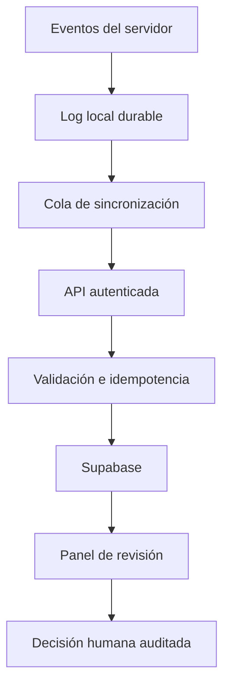

# Anticheat v34FRAGNATION: documentación

## Estado

**Etapa 0 iniciada (2026-10-20).** El entorno declarado es CS:S v34 en Linux, SourceMod 1.10.x y ClientMod. Las versiones exactas y la disponibilidad de hooks siguen pendientes de verificación en el servidor. Esta documentación describe el alcance inicial, no afirma que el anticheat esté desplegado.

## Qué hace

El sistema está diseñado para reunir señales observables por el servidor y, en etapas posteriores, por un agente de cliente, para que el personal autorizado revise posibles irregularidades. La primera entrega se limita a captura de eventos y logs locales en modo observación.

No se ejecutan bans ni kicks automáticos. Ninguna señal aislada se considera prueba concluyente. Los casos deben conservar contexto, referencias de demo cuando estén disponibles, procedencia de los datos y resolución administrativa.

## Módulos previstos

| Módulo | Señales candidatas | Límite |
|---|---|---|
| `aim` | Secuencias de mira y disparo, cambios de ángulo, impactos | No demuestra aimbot por sí solo |
| `trigger` | Secuencias repetidas entre adquisición del objetivo y disparo | El servidor no observa exactamente cuándo el cliente percibe al rival |
| `bhop` | Secuencias de salto, aterrizaje y movimiento | Latencia y habilidad legítima pueden producir patrones parecidos |
| `movement` | Velocidad/desplazamiento incompatibles con límites validados | Requiere conocer físicas y tolerancias del build v34 |
| `wall` | Patrones repetidos de seguimiento o preapuntado de rivales ocultos | Evidencia indirecta; requiere revisión de demo/contexto |
| `recoil` | Patrones de compensación, cadencia y dispersión | La compensación manual puede parecer automatizada |

Los detectores quedan desactivados hasta contar con pruebas de referencia y umbrales calibrados. Los nombres anteriores son identificadores de diseño, no detecciones ya implementadas.

## Persistencia y seguridad

- Los eventos deben escribirse primero en disco y luego sincronizarse.
- La ingesta central debe autenticar el servidor, validar el tamaño y la forma del evento y evitar duplicados.
- Las credenciales privilegiadas permanecen en el backend.
- Las tablas expuestas deben tener RLS y grants mínimos.
- Los administradores deben tener permisos explícitos para revisar evidencia y registrar decisiones.
- Las demos deben almacenarse de forma privada y consultarse con autorización.
- La cola local debe tolerar fallos temporales de red y reintentar sin perder el identificador original del evento.

## Dónde está cada cosa

| Qué | Archivo / ubicación | Estado |
|---|---|---|
| Plan de trabajo y checklist | `PLAN.md` | Preparado; auditoría real pendiente |
| Plugin de captura | `server/addons/sourcemod/scripting/v34frag_anticheat.sp` | Prototipo pasivo; requiere compilación en el entorno objetivo |
| Esquema de Supabase | `supabase/migrations/` | Pendiente de revisión e implementación |
| API de ingesta | `supabase/functions/ac-ingest/` | Pendiente |
| Panel de revisión | Web v34frag | Pendiente |
| Cliente | Integración ClientMod/Windows | Pendiente de auditoría de APIs |
