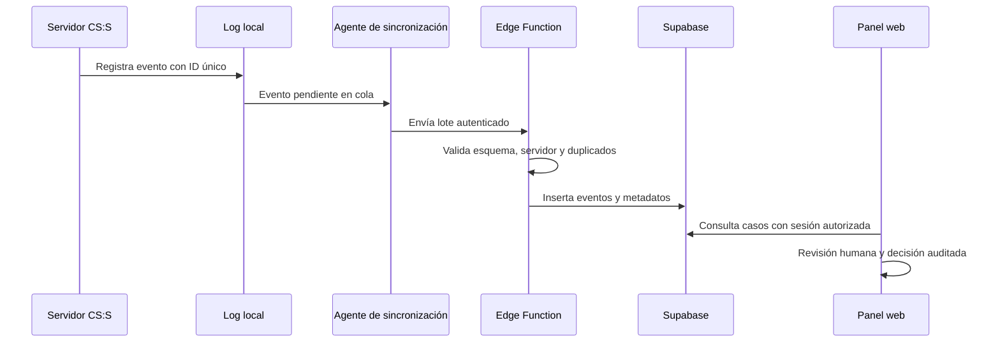

# Plan: anticheat v34FRAGNATION

> Planeación original. Estado: **propuesta técnica inicial**, pendiente de completar la auditoría del servidor y validar en entorno de pruebas. Fecha: 2026-10-20.

## Decisiones tomadas

| Tema | Decisión | Motivo |
|---|---|---|
| Servidor objetivo | CS:S v34 en Linux, SourceMod 1.10.x informado por el usuario | Base del entorno declarado; falta verificar versión exacta y build |
| Cliente | ClientMod | Integración cliente se investigará por separado; no se asume que ClientMod ofrezca una API anticheat confiable |
| Respuesta | Solo evidencia y revisión manual | Evitar falsos positivos y sanciones automáticas |
| Persistencia inmediata | Logs locales | La captura debe seguir operativa si la red o Supabase fallan |
| Backend | Supabase con Edge Function de ingesta | Centralizar validación y persistencia sin exponer credenciales privilegiadas al cliente |
| Integración web | Rama `main` de `mchssj/v34frag`, mediante cambios aislados | No modificar directamente la lógica de matchmaking/ELO |
| Detección | Módulos independientes: aim, trigger, bhop, movement, wall y recoil | Poder calibrar, desactivar y probar cada señal de forma independiente |
| Sanciones | Sin kick/ban automáticos | Las alertas son indicios, no veredictos |
| Despliegue | Primero rama de trabajo y servidor de pruebas | Evitar riesgo para los servidores competitivos activos |

## 1. El flujo completo

Los logs locales son la fuente de recuperación para eventos no sincronizados. La ingesta debe ser idempotente. Si Supabase no está disponible, el servidor sigue registrando y no modifica el comportamiento de la partida.

## 2. Auditoría técnica previa

- [ ] Ejecutar `sm version`, `sm plugins list` y `meta version` en el servidor real y registrar la salida completa.
- [ ] Confirmar que el binario activo de SourceMod corresponde a 1.10.x y anotar el build exacto.
- [ ] Confirmar versión/build del motor CS:S v34, sistema operativo, arquitectura y ruta real de `cstrike`.
- [ ] Registrar versión de Metamod:Source, ClientMod y extensiones cargadas.
- [ ] Confirmar compilador `spcomp` 1.10.x e includes usados; no asumir que los archivos del repositorio coinciden con el servidor.
- [ ] Revisar eventos disponibles en el juego v34 y comprobar que los hooks opcionales no impidan cargar el plugin.
- [ ] Verificar permisos de escritura y rotación de `addons/sourcemod/logs`.
- [ ] Identificar el servidor de pruebas y un procedimiento de rollback.
- [ ] Inspeccionar tablas, políticas RLS, migraciones y funciones existentes de Supabase antes de agregar esquema.
- [ ] Confirmar el mecanismo de autenticación del servidor/agente; no incrustar `service_role` ni secretos maestros en el plugin o cliente.
- [ ] Confirmar cómo se relacionan los identificadores de partida actuales con los eventos anticheat, sin depender de una tabla no verificada.
- [ ] Documentar retención, acceso administrativo y tratamiento de demos/datos de jugadores.

## 3. Entregables

### Entregable A — Captura local en modo observación

Crear `server/addons/sourcemod/scripting/v34frag_anticheat.sp` con metadatos de plugin, estado consultable y registro de eventos base. No puntúa sospechas, no bloquea jugadores y no sanciona.

Criterio de aceptación:
- Compila con el compilador real de SourceMod 1.10.x.
- Carga en el servidor de pruebas sin errores.
- Registra conexión/desconexión, disparos y eventos de ronda cuando el motor los expone.
- Un evento ausente no impide cargar el plugin.
- `sm_ac_status` confirma el modo de observación.
- No contiene comandos de ban/kick ni lógica de sanción.

### Entregable B — Esquema y API de ingesta

Agregar migración revisable y Edge Function para eventos, servidores, casos, evidencias y auditoría. No aplicar la migración a producción durante esta etapa.

Criterio de aceptación:
- RLS habilitado y permisos mínimos verificados.
- Ingesta autenticada por servidor, validación de tamaño y esquema, límite de frecuencia y clave de idempotencia.
- Pruebas de acceso autorizado y denegado.
- No se expone una clave privilegiada en el navegador, cliente ni plugin.

### Entregable C — Detectores pasivos

Añadir módulos independientes después de disponer de datos de referencia legítimos. Cada alerta incluirá señal, ventana, datos disponibles y limitaciones.

Criterio de aceptación:
- Pruebas repetibles y revisión de falsos positivos.
- No se toman medidas automáticas contra jugadores.

### Entregable D — Cliente ClientMod y panel web

Auditar las interfaces públicas de ClientMod antes de elegir integración. El panel solo permitirá acceso según rol, revisión, resolución y apelación.

Criterio de aceptación:
- La falta del cliente no provoca sanción automática.
- Toda decisión humana queda auditada.
- Las demos y evidencias se sirven mediante acceso privado.

## 4. Límites conocidos

- Un servidor SourceMod no puede demostrar de forma universal la presencia de wallhack.
- Las señales de aim, trigger y recoil son probabilísticas y dependen de datos, latencia, arma y contexto.
- El cliente puede ser manipulado; su telemetría no es autoridad definitiva.
- La compatibilidad de hooks, eventos y API debe probarse en la build v34 real.
- No se desplegará un driver de kernel ni técnicas de inspección invasiva en la primera versión.

## 5. Requisitos antes de empezar

- Acceso a consola/RCON y SFTP del servidor de pruebas.
- Salida real de `sm version`, `sm plugins list`, `meta version` y build del juego.
- Compilador e includes SourceMod 1.10.x.
- Acceso de lectura al esquema y migraciones de Supabase.
- Proyecto de Supabase de pruebas o mecanismo aprobado para probar sin tocar producción.
- Acceso al repositorio `mchssj/v34frag` y rama `feat/anticheat-etapa-0`.

## 6. Orden de implementación

1. Completar checklist de auditoría y guardar salidas sin secretos.
2. Compilar y cargar el plugin pasivo en un servidor de pruebas.
3. Verificar escritura de logs, eventos disponibles y comportamiento ante reinicio/desconexión.
4. Diseñar migración Supabase tras inspeccionar el esquema actual.
5. Implementar ingesta autenticada e idempotente con pruebas.
6. Añadir detectores de a uno, comparándolos con partidas legítimas.
7. Auditar ClientMod y definir el agente de cliente según APIs verificadas.
8. Implementar panel, permisos, auditoría de decisiones y apelaciones.
9. Revisar falsos positivos y documentar rollback antes de cualquier despliegue competitivo.
