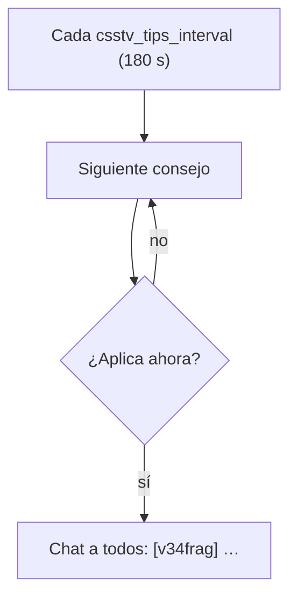

# Consejos de comandos en el chat y Discord al terminar la partida: documentación

## Qué hace

Desde la versión **2.4.0**, `csstv_reporter` hace dos cosas nuevas en el chat:

1. **Al terminar una partida** (también cuando un equipo se rinde con `!gg`; no en una cancelada), después del resultado, el MVP, el top 3 y el "Tu partida" de cada uno, sale una última línea para todos: `[v34frag] ¡Gracias por jugar! Únete a nuestro Discord: dsc.gg/v34frag`.
2. **Cada 3 minutos** (`csstv_tips_interval`), un consejo con la guía de un comando. Son 9 en rotación, y se salta los que no sirven en ese momento.

Si ninguno de los 9 aplica, en esa vuelta no sale nada. No pasa con la configuración actual, porque 5 de ellos aplican siempre.

## Los consejos

El comando va en amarillo. Los números salen de las cvars en el momento en que se muestra el mensaje.

| # | Cuándo sale | Mensaje (con el cfg de hoy) | Se salta si |
|---|---|---|---|
| 1 | Siempre | ¿Compraste mal? Escribe !sell para vender lo que compraste en la ronda, hasta 5 s después del freezetime. !sell all vende todo. | `csstv_sell.smx` no está corriendo o `csstv_sell 0` |
| 2 | En vivo | !pause pide una pausa táctica para tu equipo (2 por partida, de 60 s). Empieza en la próxima ronda y termina antes si los dos equipos escriben !unpause. | `csstv_pause_mode 0` |
| 3 | Siempre | ¿Alguien hace trampa o molesta? Escribe !calladmin <motivo> para avisar a los moderadores en Discord. Sin motivo se abre un menú. | `csstv_calladmin.smx` no está corriendo o `csstv_calladmin_enabled 0` |
| 4 | En vivo | ¿Van perdiendo por 8 rondas o más? Escribe !gg para votar la rendición: hacen falta los votos de todo el equipo menos uno. | `csstv_gg_min_diff 0` |
| 5 | Siempre | Escribe !hp para ver quién te mató en la ronda y cuánta vida le queda. | `csstv_hp_on_death 0` |
| 6 | Calentamiento | En el calentamiento: !rtv pide cambiar de mapa y !nominate <mapa> vota uno (!mapas muestra la lista). | `csstv_rtv 0` |
| 7 | Calentamiento | Escribe !ready cuando estés listo para empezar la partida (!unready lo quita). | `csstv_ready_system 0` |
| 8 | Siempre | !score muestra el marcador y !status cómo está configurada la partida. | — |
| 9 | Siempre | Únete a nuestro Discord: dsc.gg/v34frag | — |

- **En vivo** son los estados `State_Live` y `State_Halftime`, y **calentamiento** es `State_Warmup`. En el LO3, la ronda de cuchillo y los segundos después del final salen solo los de "Siempre".
- **Textos que cambian con las cvars:**
  - `!sell`: con `csstv_sell_window 0` dice "hasta el fin del freezetime".
  - `!pause`, según `csstv_pause_mode`:
    - Modo 1: "(N por partida, de S s). Empieza en la próxima ronda."
    - Modo 2: "(N por partida). Empieza en la próxima ronda y termina cuando los dos equipos escriben !unpause."
    - Modo 3: el de la tabla.
  - `!gg`, según `csstv_gg_missing`: con 0 dice "de todo el equipo", con 1 "menos uno" y con más "menos N".
- **Otros plugins:** para saber si `csstv_sell` y `csstv_calladmin` están corriendo se usa `FindPluginByFile`, no su cvar, porque la cvar sigue existiendo después de descargar el plugin.
- Los créditos ("Plugin made by…", cada 12 minutos) siguen aparte, con su propio timer.

## Cvar nueva

| Cvar | Valor | Qué hace |
|---|---|---|
| `csstv_tips_interval` | `180` | Segundos entre consejos (0 = nunca). Si se cambia, el timer vuelve a empezar al momento |

## Dónde está cada cosa

| Qué | Archivo / ubicación |
|---|---|
| Consejos (cvar, timer, rotación, reglas) | `server/addons/sourcemod/scripting/csstv/tips.inc` |
| Línea del Discord del resumen | `Summary_Discord()` en `server/addons/sourcemod/scripting/csstv/summary.inc` |
| Link (`DISCORD_INVITE`) y versión | `server/addons/sourcemod/scripting/csstv_reporter.sp` |
| Valor en el servidor | `server/cfg/sourcemod/csstv_reporter.cfg` (`csstv_tips_interval`) |
