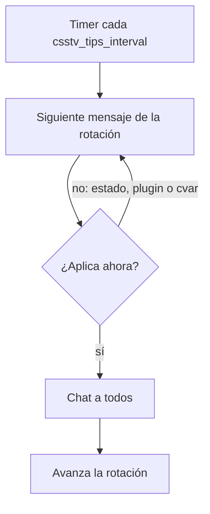
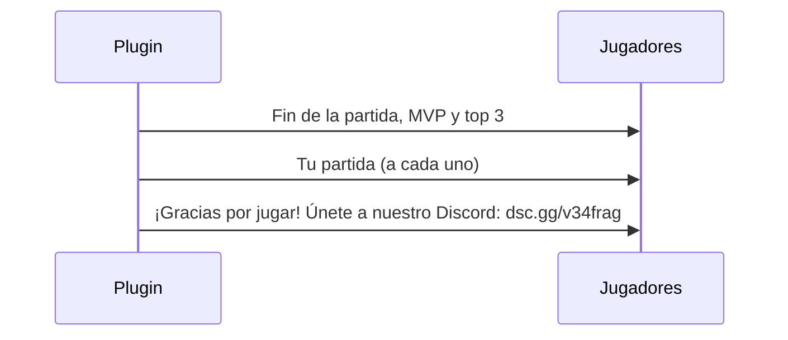

# Plan: consejos de comandos en el chat y Discord al terminar la partida

> Planeación original. Estado: **aprobado** por Daniel el 2026-10-20 ("si, apruebo todo como lo recomiendas"). Las decisiones marcadas como "Propuesta de Claude" no las eligió él, salvo que diga "aceptada".

## El pedido

Daniel, el 2026-10-20:

1. Al terminar una partida, además del resumen que ya sale, mostrar el link de invitación de Discord `http://dsc.gg/v34frag`.
2. Cada 3 minutos, un mensaje en el chat con la guía de un comando del servidor, en rotación: `!sell`, `!pause`/`!unpause`, `!calladmin`, `!gg` y los demás que haya. Los textos exactos los aprobó él antes de implementar.

## Decisiones tomadas

| Tema | Decisión | Origen |
|---|---|---|
| Dónde va | En `csstv_reporter` (archivo nuevo `csstv/tips.inc`), versión **2.4.0** | Propuesta de Claude, aceptada |
| Link | `dsc.gg/v34frag`, sin `http://`: el chat de CS:S no abre links, así se copia más fácil | Propuesta de Claude, aceptada |
| Línea del Discord | Última línea del resumen de fin de partida (también al rendirse con `!gg`; no en una cancelada): `¡Gracias por jugar! Únete a nuestro Discord: dsc.gg/v34frag` | Propuesta de Claude, aceptada |
| Intervalo | cvar nueva `csstv_tips_interval "180"` (0 = apagado). Los créditos (`csstv_credits_interval`) siguen como están | Daniel (3 minutos); cvar, propuesta de Claude |
| Comandos incluidos | Los 9 mensajes de abajo. Fuera: `!match` y `!claim` (no funcionan hasta el corte), `!stay`/`!switch` (ya se anuncian en el cuchillo) y `!whois` (solo admins) | Propuesta de Claude, aceptada |
| Según el momento | Calentamiento: no salen `!pause` ni `!gg`. Partida en vivo (o medio tiempo): no salen `!rtv` ni `!ready`. Si el siguiente no aplica, sale el próximo que sí | Recomendación de Claude, aceptada |
| Otros plugins | Si `csstv_sell` o `csstv_calladmin` no están cargados o están apagados, su mensaje se salta. Igual con `!pause` (`csstv_pause_mode 0`) y `!gg` (`csstv_gg_min_diff 0`) | Propuesta de Claude, aceptada |
| Números | Salen de las cvars al mostrar el mensaje (`csstv_sell_window`, `csstv_pause_max`, `csstv_pause_time`, `csstv_gg_min_diff`, `csstv_gg_missing`) | Propuesta de Claude, aceptada |
| Pruebas | Servidor local con bots y tiempos cortos (`csstv_tips_interval` de pocos segundos; ninguna espera de más de 10 s) | Daniel |

## 1. El flujo

## 2. Los mensajes (aprobados)

Todos con el prefijo `[v34frag]` en verde y el comando en amarillo. Con los valores del cfg de hoy:

| # | Momento | Mensaje |
|---|---|---|
| 1 | Siempre | `¿Compraste mal? Escribe !sell para vender lo que compraste en la ronda, hasta 5 s después del freezetime. !sell all vende todo.` |
| 2 | En vivo | `!pause pide una pausa táctica para tu equipo (2 por partida, de 60 s). Empieza en la próxima ronda y termina antes si los dos equipos escriben !unpause.` |
| 3 | Siempre | `¿Alguien hace trampa o molesta? Escribe !calladmin <motivo> para avisar a los moderadores en Discord. Sin motivo se abre un menú.` |
| 4 | En vivo | `¿Van perdiendo por 8 rondas o más? Escribe !gg para votar la rendición: hacen falta los votos de todo el equipo menos uno.` |
| 5 | Siempre | `Escribe !hp para ver quién te mató en la ronda y cuánta vida le queda.` |
| 6 | Calentamiento | `En el calentamiento: !rtv pide cambiar de mapa y !nominate <mapa> vota uno (!mapas muestra la lista).` |
| 7 | Calentamiento | `Escribe !ready cuando estés listo para empezar la partida (!unready lo quita).` |
| 8 | Siempre | `!score muestra el marcador y !status cómo está configurada la partida.` |
| 9 | Siempre | `Únete a nuestro Discord: dsc.gg/v34frag` |

"Siempre" incluye los estados intermedios (LO3, cuchillo, fin de partida). "En vivo" es `State_Live` y `State_Halftime`, los únicos en que `!pause` y `!gg` funcionan o se pueden pedir enseguida.

## 3. Cambios en el plugin

- `csstv/tips.inc` (nuevo): cvar `csstv_tips_interval`, timer repetido, rotación con un índice y la regla de cada mensaje.
- `csstv/summary.inc`: la línea del Discord al final de `Summary_Print()`.
- `csstv_reporter.sp`: `PLUGIN_VERSION "2.4.0"`, include y llamada a `Tips_Init()`.
- `cfg/sourcemod/csstv_reporter.cfg`: `csstv_tips_interval "180"`.

## 4. Requisitos antes de empezar

- Servidor local (`E:\CSS DEDICATED SERVER\server`) con `csstv_send 0` y la cola vacía.
- Compilador de SourceMod 1.8 y System2 (los de siempre).

## 5. Orden de implementación

1. Código y cfg.
2. Compilar (genérico y con `CSSTV_DEBUG=`).
3. Probar en local con bots: rotación en el calentamiento y en vivo con `csstv_tips_interval 5`, saltos con `csstv_sell`/`csstv_calladmin` apagados, línea del Discord al terminar (`sm_live force mr2`, `$2000$`, 3 vs 1).
4. Documentación, guía, changelog y `PENDIENTES.md`.
5. Despliegue al servidor real y a RBK solo cuando Daniel lo pida.
