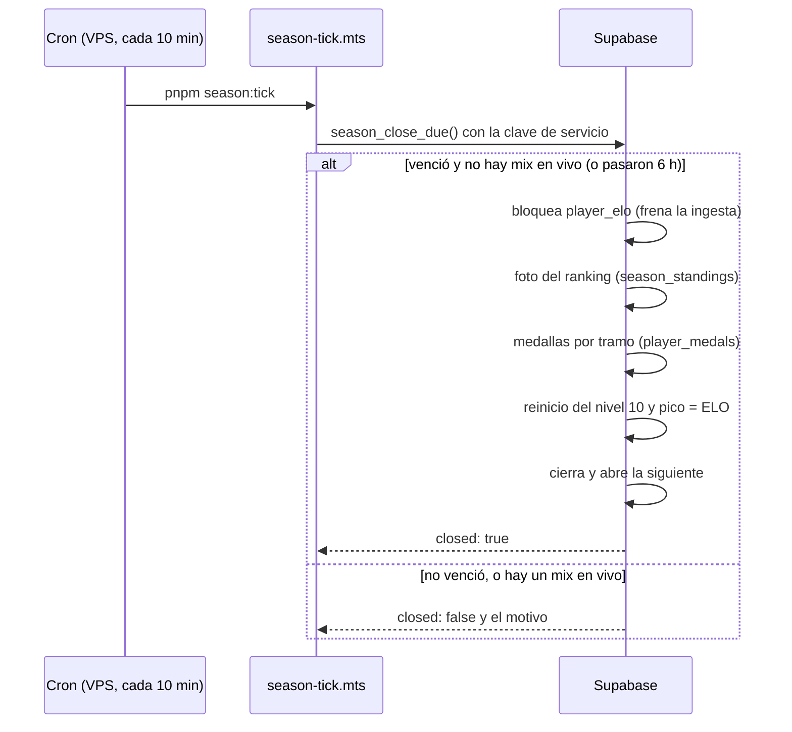
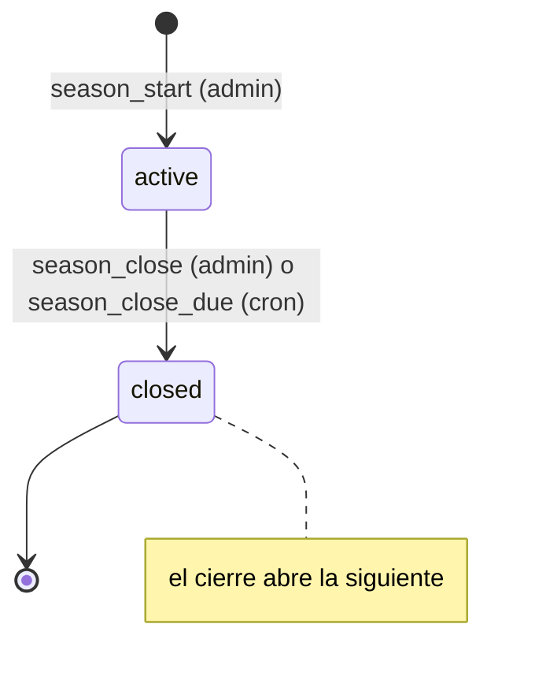
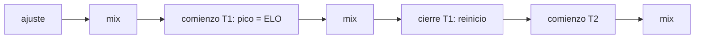

# Temporadas: documentación

## Qué hace

El ranking de jugadores se divide en **temporadas**. Hay una sola activa a la vez. Cuando llega su fecha de fin (por defecto 30 días, a las 06:00 de Argentina) un cron del VPS la cierra; un admin también la puede cerrar antes con "Terminar temporada".

Al cerrarse:
1. Se guarda una **foto del ranking final** (`season_standings`). Después no cambia, aunque se recalcule el ELO.
2. Los del **top N** que jugaron el **mínimo de mixes** reciben una **medalla por tramo** en su ficha ("Temporada 1 · #3").
3. Los **nivel 10** se **reinician**: conservan el porcentaje configurado de lo que tenían sobre 2001.
4. Se abre la temporada siguiente con la configuración vigente.

El cierre es un **evento en la línea de tiempo del ELO**, como los ajustes manuales: `elo_recompute_all` lo vuelve a aplicar en su fecha con los parámetros de esa temporada. Por eso un recálculo posterior deja el mismo ELO.

Solo existe en la web nueva (replanteo `24`). Sale con el corte.

## Estados

## Reglas

| Regla | Valor por defecto | Detalle |
|---|---|---|
| Duración | 30 días | `season_config.duration_days` (1 a 365). Fin: las 06:00 de Argentina del día de inicio + la duración (`season_default_end`) |
| Top | 20 | `top_n` (1 a 500) |
| Mínimo | 20 mixes | `min_matches` (1 a 1000). Cuentan los mixes terminados de la temporada que le movieron el ELO (`elo_after` no nulo), con todos los SteamID de la ficha |
| Puesto | Por ELO | Desempate: más mixes; después, quien llegó antes a ese ELO (su último mix o ajuste de la temporada); después, el id |
| Reinicio | 10 % sobre 2001 | `season_reset_elo`: `piso + round((elo − piso) × % / 100)` si está sobre el piso; si no, igual |
| ELO pico | De la temporada | Al cerrar y al empezar cada temporada, `peak_elo` = `elo` |
| Ventana | `starts_at` < fecha del mix ≤ `closed_at` | La temporada siguiente empieza en el `closed_at` de la anterior |
| Pretemporada | Sin medallas | Lo anterior a la temporada 1 cuenta para el ELO |

**Tramos de medallas** (`tiers`, jsonb): `[{from, to, name, icon}]` en orden desde el puesto 1, sin huecos, y solo el último con `to: null` (llega hasta el top N). En `name`, `{top}` se reemplaza por el top N. Los valida `season_tiers_ok` en la base y `SeasonTiers` en la API.

| Puestos | Medalla |
|---|---|
| 1 | 🏆 Campeón |
| 2 | 🥈 Subcampeón |
| 3 | 🥉 Tercer puesto |
| 4 a 10 | 🎖️ Top 10 |
| 11 al top N | 🏅 Top {top} |

**Parámetros congelados:** cada temporada copia de `season_config` su top, mínimo, porcentaje, piso y tramos al abrirse. Se pueden cambiar mientras está activa (`season_update`) y quedan fijos al cerrarse. Cambiar `season_config` solo afecta a la próxima.

## El ELO: línea de tiempo

`elo_recompute_all` recorre, en orden de fecha:

| Evento | Orden a la misma hora | Qué hace |
|---|---|---|
| Ajuste manual | 1.º | `elo_apply_adjustment` |
| Mix terminado | 2.º | `elo_apply_match` |
| Cierre de temporada | 3.º | `elo_season_event(id, true)`: reinicio y pico = ELO |
| Comienzo de temporada | 4.º | `elo_season_event(id, false)`: pico = ELO |

**Mix que llega tarde:** si `elo_apply_match` recibe un mix con fecha anterior (o igual) al cierre o comienzo de alguna temporada, recalcula todo en vez de sumarlo encima. Así el reinicio queda después del mix, igual que en un recálculo. Pasa con la cola del plugin (un mix que se sube después) y al aprobar un mix interrumpido viejo. Dentro del recálculo no se repite: lo avisa la variable de sesión `v34.elo_recompute`. El mix no cambia la foto de la temporada cerrada.

## Base de datos (replanteo `24`)

| Objeto | Qué es |
|---|---|
| `season_config` | Una fila: valores por defecto de la próxima temporada |
| `seasons` | Temporadas: número, nombre, estado, fechas, `closed_by` (null = el cron) y parámetros. Índice único parcial: una sola `active` |
| `season_standings` | Foto del cierre por ficha: puesto, `eligible`, ELO, pico, mixes, victorias, derrotas, ELO después del reinicio y medalla |
| `player_medals` | Suma `season_id`, `rank` y `tier` (los tres null en las medallas manuales) |
| `season_rank(desde, hasta, mínimo)` | Ranking de las fichas con ELO en una ventana |
| `season_live_standings` | Ranking en vivo de la activa, con la medalla y el ELO si cerrara ahora |
| `season_standings_list` | La foto de las cerradas más la activa en vivo (lo que lee `GET /seasons/{id}/standings`) |
| `season_list` | Temporadas con campeón y cantidad de medallas |
| `player_season_list` | Historial de cada jugador en las temporadas cerradas |
| `season_start`, `season_update`, `set_season_config` | Admin |
| `season_close(id, 'estoy seguro')` | Admin: "Terminar temporada" |
| `season_close_due()` | Solo `service_role`: cierra si venció; con un mix en vivo (foto en los últimos 10 minutos) espera hasta 6 horas. Devuelve `{closed, reason}` (`no_season`, `not_due`, `live_match`) o el resultado del cierre |
| `season_close_run(id, por)` | Interna: el cierre completo |
| `season_preview`, `season_preview_summary` | Admin: el cierre simulado con otros valores, sin cambiar nada |

Los errores de reglas (temporada cerrada, fecha pasada, tramos inválidos) usan el código por defecto (`P0001`), así la API devuelve el mensaje tal cual (`400 BUSINESS_RULE`).

## API

| Endpoint | Quién | Qué hace |
|---|---|---|
| `GET /api/v1/seasons` | Público | Temporadas (filtro `status`) |
| `GET /api/v1/seasons/current` | Público | La activa, o 404 |
| `GET /api/v1/seasons/{id}/standings` | Público | Ranking (en vivo o la foto), con `q` y `eligible` |
| `GET /api/v1/players/{id}/seasons` | Público | Historial del jugador |
| `GET /api/v1/players/{id}/medals` | Público | Suma `season` y `rank` |
| `GET`/`PUT /api/v1/admin/seasons/config` | Admin | Valores por defecto |
| `POST /api/v1/admin/seasons` | Admin | Abre la temporada (409 si ya hay una) |
| `PATCH /api/v1/admin/seasons/{id}` | Admin | Cambia la activa |
| `POST /api/v1/admin/seasons/{id}/close` | Admin | "Terminar temporada" con `confirm` |
| `GET /api/v1/admin/seasons/preview` | Admin | Vista previa con `summary` |

El detalle para el frontend está en [`docs/frontend/contrato/temporadas.md`](../../frontend/contrato/temporadas.md).

## Cron

`web/backend/scripts/season-tick.mts` (`pnpm season:tick`) llama a `season_close_due()` con `SUPABASE_URL` y `SUPABASE_SERVICE_KEY` del entorno. Escribe una línea solo si cerró o si está esperando un mix en vivo, y sale con 1 si falla. En el VPS lo corre un timer de systemd cada 10 minutos (plan [`2026-10-16-despliegue-vps`](../2026-10-16-despliegue-vps/PLAN.md), sección 2). Hasta que exista el VPS, la temporada se cierra con el botón del admin.

## Dónde está cada cosa

| Qué | Archivo / ubicación |
|---|---|
| Migración | `supabase/replanteo/24_temporadas.sql` |
| Inversa y pruebas SQL | `docs/bitacora/2026-10-14-replanteo-modelo-datos/reversas/24_temporadas.sql` y `pruebas/24_temporadas.sql` |
| Rutas | `web/backend/src/routes/seasons.ts`; medallas en `routes/players.ts` y `routes/admin-players.ts` |
| Esquemas | `web/backend/src/schemas/seasons.ts`; `Medal` en `schemas/players.ts` |
| Cron | `web/backend/scripts/season-tick.mts` |
| Pruebas | `web/backend/test/unit/seasons-routes.test.ts`, `web/backend/test/integration/seasons.test.ts` |
| Contrato del frontend | `docs/frontend/contrato/temporadas.md` |
| Changelog para Discord | `CHANGELOG_DISCORD.txt` (esta carpeta) |
