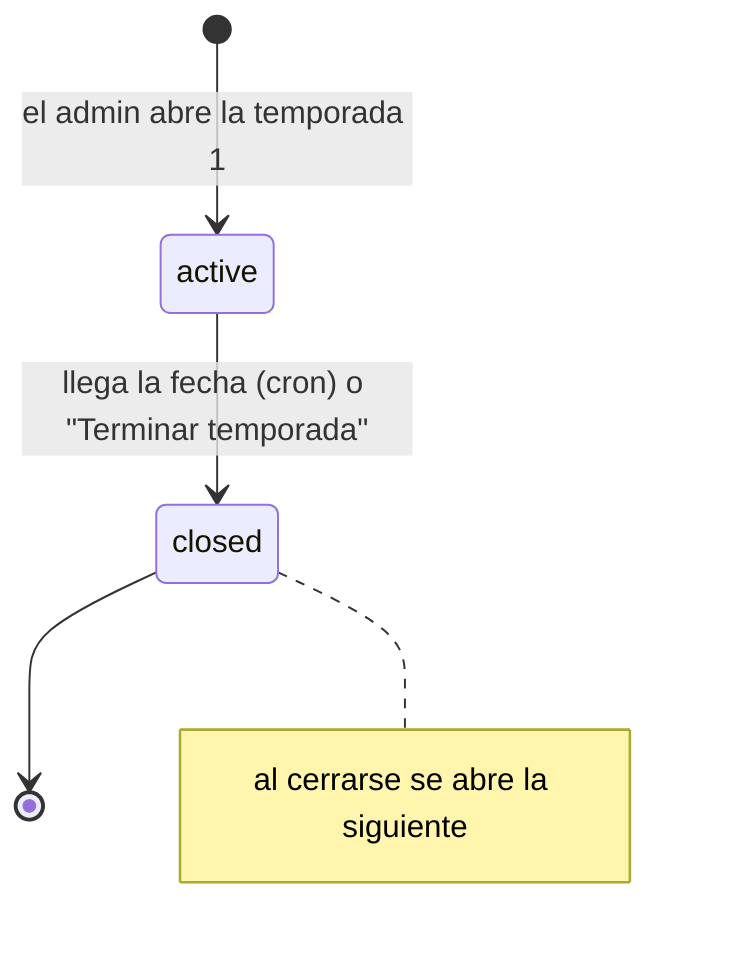
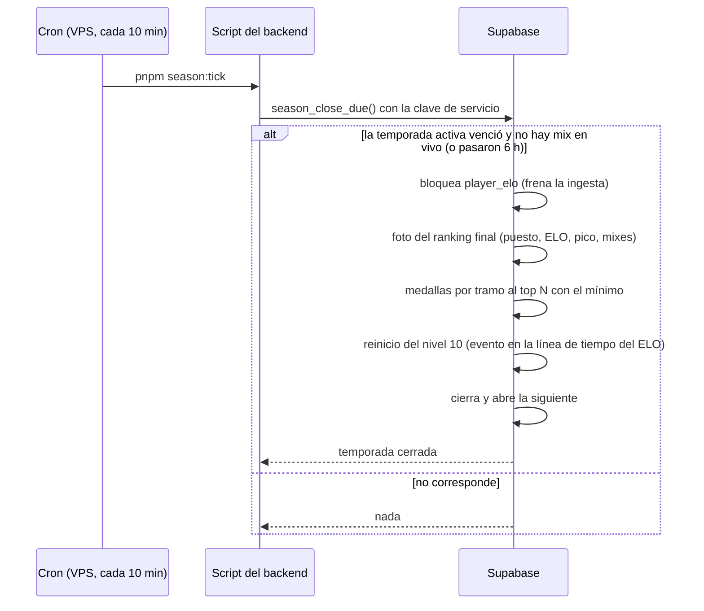
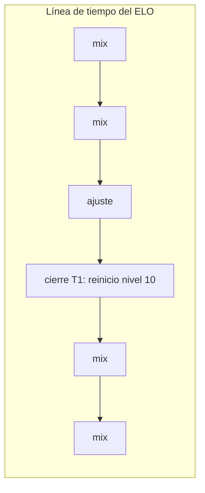

# Plan: temporadas (medallas al top y reinicio del nivel 10)

> Planeación original. Estado: **aprobada por Daniel el 2026-10-21** (con las respuestas de la sección 8). Las decisiones marcadas como "Propuesta de Claude" no las eligió él.

## El pedido

Daniel, el 2026-10-20: cada cierto tiempo se cierra una **temporada**. Al cerrarla:
- El **top de jugadores por ELO** (tamaño configurable) recibe una **medalla**.
- Los jugadores de **nivel 10** vuelven cerca del inicio del nivel 10.

Solo para la **web nueva** (backend del replanteo): sale con el corte o después, no en la web vieja.

## Lo que ya existe y condiciona el diseño

| Qué | Dónde | Consecuencia |
|---|---|---|
| El nivel 10 empieza en **2001** (no 2000) | `LEVEL_FLOORS` en `web/backend/src/lib/db.ts` | El piso del reinicio es 2001, configurable |
| **El ELO se recalcula desde cero** (`elo_recompute_all`: mixes y ajustes en orden de fecha). Se usa al cambiar la configuración del ELO, al aprobar un mix interrumpido y al juntar o separar SteamID de una ficha | `supabase/migrations/20261015210000_elo_ajustes.sql`, replanteo `15` y `21` | Un reinicio hecho con un `update` se perdería en el próximo recálculo. **El cierre tiene que ser un evento con fecha en esa línea de tiempo**, como los ajustes |
| El ELO visible (`elo`, `peak_elo`) es aparte de μ/σ (TrueSkill, para la probabilidad de ganar) | `player_elo` | El reinicio mueve solo `elo` y `peak_elo`, como los ajustes. μ/σ siguen igual |
| Un ELO por ficha (clave: el SteamID principal, `elo_key`) | Replanteo `15` | El ranking de temporada es por ficha. Los perfiles sin reclamar no entran |
| Medallas: `player_medals` (ficha, título, ícono), solo manuales | Esquema y `POST /api/v1/admin/players/{id}/medals` | Se les suma la temporada y el puesto |
| El backend tiene `SUPABASE_SERVICE_KEY` (opcional) | `web/backend/src/env.ts` | El cron del VPS puede llamar a la base con la clave de servicio |
| El plan del VPS todavía no está implementado | `2026-10-16-despliegue-vps` | Hasta que exista, la temporada se cierra con el botón del admin |

## Decisiones tomadas

| Tema | Decisión | Origen |
|---|---|---|
| Duración | Parámetro (días, **30 por defecto**). Cada temporada guarda su fecha de fin planeada; el admin la puede cambiar mientras está activa | Daniel |
| Hora de cierre | **06:00 de Argentina** (`America/Argentina/Buenos_Aires`, UTC−3; son las 09:00 UTC y las 04:00 de Colombia) del día de fin, porque la mayoría de los jugadores son de allá | Daniel |
| Cierre | **Automático al llegar la fecha**, con un **cron en el VPS**. Además, botón "Terminar temporada" con doble confirmación ("estoy seguro") | Daniel |
| Mix en curso al llegar la fecha | El cron **no cierra mientras haya un mix en vivo**: reintenta en la próxima pasada (cada 10 minutos), hasta 6 horas; después cierra igual | Propuesta de Claude |
| Top | **Top N configurable, 20 por defecto** | Daniel (configurable); propuesta de Claude (20) |
| Mínimo para el top | **20 mixes jugados en la temporada**, configurable. Cuentan los mixes terminados (los que mueven el ELO), incluidos los interrumpidos que aprobó un admin | Daniel (20, configurable); propuesta de Claude (qué cuenta) |
| Desempate | Más mixes en la temporada; después, quien llegó antes a ese ELO | Propuesta de Claude |
| Medallas | **Por tramos**. Por defecto: #1 Campeón 🏆, #2 🥈, #3 🥉, #4 a #10 Top 10 🎖️, #11 al top N Top N 🏅. Título "Temporada 1 · #3". Tramos editables por el admin | Daniel |
| Medallas definitivas | Al cerrar se guarda **una foto del ranking final**. Un recálculo posterior del ELO no cambia la foto ni las medallas | Propuesta de Claude |
| Reinicio | **Solo nivel 10**: `nuevo = 2001 + redondeo((ELO − 2001) × porcentaje)`. El porcentaje es un parámetro, **10 % al principio**, y es lo que el jugador **conserva** de lo que tenía sobre 2001. 0 % = todos los nivel 10 vuelven a 2001 | Daniel |
| Piso del reinicio | 2001 (inicio del nivel 10), configurable por si cambian los niveles | Propuesta de Claude |
| Parámetros congelados | Cada temporada guarda, al cerrarse, el top N, el mínimo, el porcentaje, el piso y los tramos con los que se cerró. Cambiar la configuración después no cambia temporadas cerradas, ni siquiera en un recálculo | Propuesta de Claude |
| ELO pico | `peak_elo` pasa a ser **de la temporada**: al reiniciar arranca en el ELO nuevo. El pico de cada temporada queda en su foto | Propuesta de Claude |
| Antes de la temporada 1 | Lo jugado antes cuenta para el ELO, sin medallas ("pretemporada") | Propuesta de Claude |
| Equipos | **Por ahora, solo jugadores** | Daniel |
| Prueba para el admin | La documentación del frontend pide algo **interactivo** para probar el porcentaje con el ELO de un jugador, y una vista previa del cierre | Daniel |

**Ejemplos con 10 %:** 2540 → 2055; 2200 → 2021; 2010 → 2002; 1990 → sin cambios (nivel 9).

## 1. El flujo

`elo_recompute_all` intercala los cierres por su fecha, igual que los ajustes: un recálculo vuelve a aplicar cada reinicio con el porcentaje y el piso **de esa temporada**.

## 2. Base de datos: replanteo `24_temporadas.sql`

### Tablas

| Tabla | Qué guarda |
|---|---|
| `season_config` (una fila) | Valores por defecto para la próxima temporada: `duration_days` (30), `top_n` (20), `min_matches` (20), `reset_pct` (10), `reset_floor` (2001), `tiers` (jsonb con los tramos: desde, hasta, título, ícono) |
| `seasons` | `id`, `number`, `name` ("Temporada 1"), `starts_at`, `ends_at` (planeada), `status` (`active` o `closed`), `closed_at`, `closed_by` (null = cron), y los parámetros con los que se cierra (copiados de `season_config` al abrirla, editables mientras está activa). Una sola activa |
| `season_standings` | La foto al cerrar, por ficha: puesto (null si no llega al mínimo), `elo`, `peak_elo`, `matches`, `wins`, `losses`, `eligible`, ELO después del reinicio |
| `player_medals` | Suma `season_id`, `rank` y `tier` (null en las medallas manuales) |

### Funciones

| Función | Quién | Qué hace |
|---|---|---|
| `season_start(p_name, p_ends_at)` | Admin | Abre la primera temporada (o la siguiente si no hay ninguna activa) |
| `season_update(p_id, …)` | Admin | Cambia nombre, fecha de fin y parámetros de la temporada activa |
| `season_close(p_id, p_confirm)` | Admin | "Terminar temporada": pide `'estoy seguro'`. Hace el cierre completo |
| `season_close_due()` | Solo `service_role` (el cron) | Cierra la activa si venció, con la regla del mix en vivo |
| `season_preview(p_top_n, p_min_matches, p_reset_pct, p_reset_floor)` | Admin | Cómo quedaría el cierre con esos valores, sin cambiar nada: puesto, medalla y ELO después del reinicio de cada ficha |
| `elo_season_reset(p_season)` | Interna | Aplica el reinicio a `player_elo` |
| `elo_recompute_all()` | Admin | Intercala los cierres por `closed_at` |

### Vistas

| Vista | Qué muestra |
|---|---|
| `season_live_standings` | Ranking de la temporada activa en vivo: ELO actual, mixes en la temporada, si ya llega al mínimo y el puesto entre los que llegan |
| `season_list` | Temporadas con su estado, fechas, campeón y cantidad de medallas |

### Riesgo: un mix que llega tarde

Un mix que terminó antes del cierre pero se sube después (la cola del plugin reintenta) se aplica en vivo después del reinicio, pero un recálculo lo pondría antes. Para que no pase:
- El cron no cierra con un mix en vivo (arriba).
- Si llega un mix con fecha anterior al último cierre, la ingesta pide un recálculo completo. Es raro y el recálculo tarda segundos.
- La foto y las medallas de la temporada cerrada no cambian: ese mix cuenta para el ELO, pero no para el ranking de una temporada ya cerrada.

## 3. API

### Públicas

| Endpoint | Qué devuelve |
|---|---|
| `GET /api/v1/seasons` | Temporadas (paginado): número, nombre, fechas, estado, campeón |
| `GET /api/v1/seasons/current` | La activa: fechas (para la cuenta regresiva), top N, mínimo de mixes y tramos de medallas |
| `GET /api/v1/seasons/{id}/standings` | Ranking: en vivo si está activa, la foto si está cerrada. Paginado, con búsqueda y filtro `eligible` |
| `GET /api/v1/players/{id}/seasons` | Historial del jugador: puesto, ELO, pico, mixes y medalla por temporada |
| `GET /api/v1/players/{id}/medals` | Suma `season` y `rank` |

### Admin

| Endpoint | Qué hace |
|---|---|
| `GET`/`PUT /api/v1/admin/seasons/config` | Valores por defecto |
| `POST /api/v1/admin/seasons` | Abre la temporada (la primera, en el corte) |
| `PATCH /api/v1/admin/seasons/{id}` | Nombre, fecha de fin y parámetros de la activa |
| `POST /api/v1/admin/seasons/{id}/close` | "Terminar temporada", con `confirm: "estoy seguro"` |
| `GET /api/v1/admin/seasons/preview` | Con `top_n`, `min_matches`, `reset_pct` y `reset_floor` en la query: el cierre simulado (paginado) y un resumen (cuántos nivel 10, cuánto bajan en promedio, cuántos llegan al mínimo) |

### Cron del VPS

- Script `web/backend/scripts/season-tick.mts` (`pnpm season:tick`): llama a `season_close_due()` con `SUPABASE_SERVICE_KEY` y escribe en el log si cerró.
- En el VPS, un **timer de systemd** (o una línea de `cron`) cada 10 minutos. Va en el plan del VPS (`2026-10-16-despliegue-vps`), que se actualiza.
- **No hay un endpoint público** para cerrar por fecha: solo el script con la clave de servicio.

## 4. Frontend (contrato)

- **Ranking:** selector de temporada (la activa por defecto), cuenta regresiva, y marca de quién todavía no llega al mínimo ("12/20 mixes").
- **Ficha del jugador:** historial de temporadas y medallas con su temporada.
- **Admin, configuración de temporadas:**
  - **Prueba interactiva del porcentaje** (pedido de Daniel): elegir un jugador (o escribir un ELO) y mover el porcentaje con un control deslizante; se ve en el momento "2540 → 2055". La fórmula va en el contrato para calcularla en el navegador, sin una consulta por cada movimiento.
  - **Vista previa del cierre** (`GET /api/v1/admin/seasons/preview`) con los valores del formulario: quién recibe cada medalla y cómo queda cada nivel 10.
  - "Terminar temporada" con doble confirmación y un resumen de lo que va a pasar.

## 5. Documentación

- Contrato del frontend: módulo nuevo `temporadas.md`, más `jugadores.md`, `admin.md`, `api.md`, las novedades y `decisiones.md`.
- `supabase/replanteo/README.md`, `PENDIENTES.md`, el índice de la bitácora y el plan del VPS (el cron).

## 6. Requisitos antes de empezar

- Aprobación de este plan.
- Docker para la Supabase local.
- Para el cierre automático en producción: el VPS (plan `2026-10-16-despliegue-vps`) y `SUPABASE_SERVICE_KEY` en su entorno.

## 7. Orden de implementación

1. Replanteo `24` (tablas, cierre, reinicio en la línea de tiempo, vista previa), su inversa y pruebas SQL. Las pruebas incluyen que un recálculo después de un cierre dé el mismo ELO.
2. `pnpm db:reset` y `pnpm db:types`.
3. Rutas, esquemas y el script del cron.
4. Pruebas unitarias y de integración.
5. Contrato del frontend, plan del VPS, bitácora y pendientes.

## 8. Preguntas respondidas

Daniel, el 2026-10-21:

1. **Porcentaje:** el jugador conserva el porcentaje configurado (10 % al principio) de lo que tenía sobre 2001. 2540 → 2055.
2. **Tramos de medallas por defecto:** sí, los de arriba.
3. **Duración y cierre:** 30 días al principio, configurable. Cierre a las 06:00 de Argentina del día de fin.
