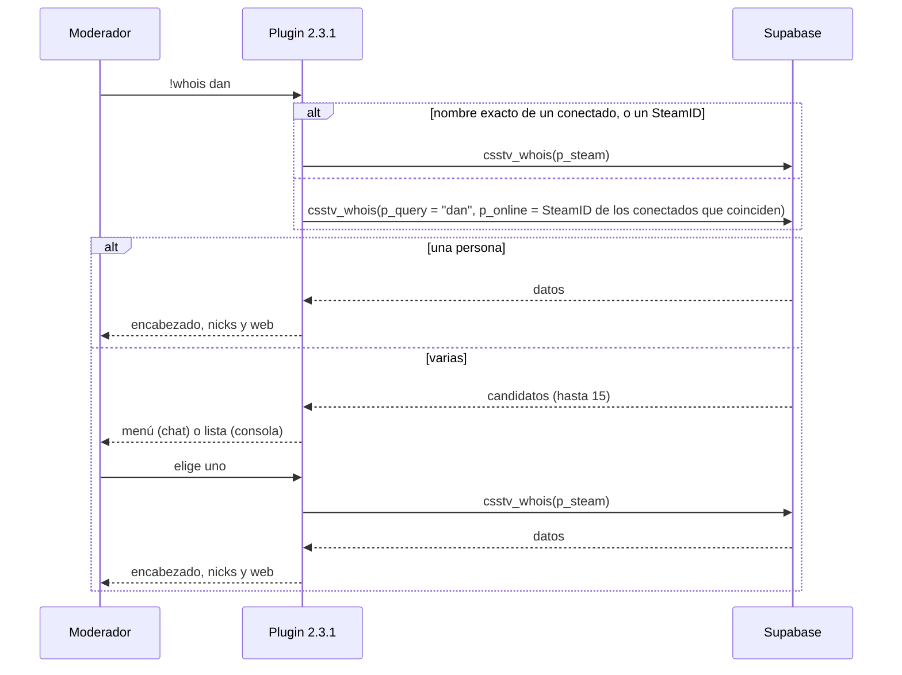
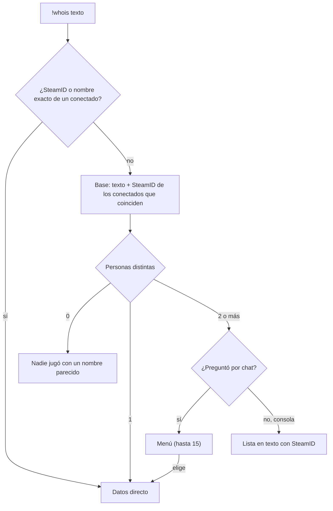

# Menú de `!whois` cuando hay varias coincidencias: documentación

## Qué hace

`!whois <texto>` arma **una sola lista de personas** con los conectados cuyo nombre contiene el texto y con los que aparecen en la base (un nick de las partidas, el nick de la ficha o el alias). Si hay **una persona**, muestra sus datos como antes. Si hay **varias**, abre un **menú** para elegir a quién revisar.

Antes (2.3.0), la base solo se consultaba si ningún conectado coincidía: `!whois dan` con `daniloev` conectado nunca mostraba a `Dante`, que estaba desconectado.

```
!whois dan
┌ ¿A quién querés revisar? (3) ───────────┐
│ 1. daniloev · conectado · ficha         │
│ 2. Dante · 42 partidas · ficha          │
│ 3. dan_pro · 3 partidas                 │
│ 0. Salir                                │
└─────────────────────────────────────────┘
```

Va en el reporter **2.3.1** y en la migración de producción `20261020120000_whois_menu.sql`.

## 1. El flujo





## 2. Reglas

| Regla | Detalle |
|---|---|
| Directo | Un SteamID, o el nombre **exacto** de un conectado (sin distinguir mayúsculas) |
| Candidatos | Personas: un conectado que también aparece por un nick viejo sale una vez. Después del corte, los SteamID de una misma ficha son uno solo (el conectado puede ser un adicional) |
| Conectados | Cuentan aunque nunca hayan jugado. Los bots sin SteamID no entran |
| Orden | Conectados primero; después, por la fecha de la última partida en la que usaron un nick parecido |
| Menú | Hasta 15 opciones (SourceMod pagina de a 7). Si hay más, una opción deshabilitada al final: "Hay N: escribí más del nombre". Se cierra solo a los 30 segundos |
| Cada opción | El nombre actual si está conectado (si no, el último nick de las partidas), "conectado" o la cantidad de partidas, y "ficha" si tiene perfil en la web. Sin SteamID |
| Al elegir | Una segunda consulta por SteamID (el principal de la ficha después del corte). Sin la espera de 3 segundos. Si el elegido está conectado, el encabezado lleva su nombre actual |
| Consola | Sin menú: "Hay N jugadores parecidos:" y una línea por candidato con su SteamID, y "Usá !whois <SteamID> para ver uno" |

## 3. La base

`csstv_whois(p_token, p_steam, p_query, p_online default null)`. Se borró la versión de 3 parámetros; las llamadas sin `p_online` (plugin 2.3.0) siguen funcionando.

| Parámetro | Qué es |
|---|---|
| `p_online` | SteamID de los conectados que coinciden, separados por coma (`STEAM_0:X:Y` o SteamID64). Lo que no es un SteamID se ignora |

Con varios candidatos:

```json
{ "ok": true, "multiple": true, "total": 3,
  "candidates": "STEAM_0:1:48213377|STEAM_0:1:48213377|daniloev|42|1;STEAM_0:0:1234|||12|1;..." }
```

Cada candidato es `steam|online|nick|partidas|ficha`:

| Campo | Qué es |
|---|---|
| `steam` | SteamID para la segunda consulta. Después del corte, el principal de la ficha |
| `online` | El SteamID del conectado (el que mandó el plugin), o vacío |
| `nick` | El último nick de las partidas (de todos los SteamID de la ficha después del corte), o el nick de la ficha. `|` pasa a `/` y `;` a `,` |
| `partidas` | Partidas distintas (de toda la ficha después del corte) |
| `ficha` | `1` si tiene ficha en la web |

Lo demás (un candidato, por SteamID, errores) no cambió.

### Antes y después del corte

| | Producción (`20261020120000_whois_menu.sql`) | Replanteo `23` |
|---|---|---|
| Clave del candidato | El SteamID | El principal de la ficha (o el SteamID si no tiene ficha) |
| `online` | Ese mismo SteamID si está conectado | Cualquier SteamID conectado de la ficha |
| Nicks y partidas | Del SteamID | De todos los SteamID de la ficha |

El replanteo `23` suma la función interna `steam_group(p_s64)`: todos los SteamID de la ficha de un SteamID, o solo ese.

## Dónde está cada cosa

| Qué | Archivo |
|---|---|
| Función en producción | `supabase/migrations/20261020120000_whois_menu.sql` |
| Función después del corte | `supabase/replanteo/23_whois.sql` |
| Inversa y pruebas de la `23` | `docs/bitacora/2026-10-14-replanteo-modelo-datos/reversas/23_whois.sql` y `pruebas/23_whois.sql` |
| Comando y menú | `server/addons/sourcemod/scripting/csstv/whois.inc` |
| Versión | `server/addons/sourcemod/scripting/csstv_reporter.sp` (2.3.1) |
| Plugin compilado | `server/addons/sourcemod/plugins/csstv_reporter.smx` |
| `!whois` original | [`2026-10-19-plugin-whois`](../2026-10-19-plugin-whois/DOCUMENTACION.md) |
