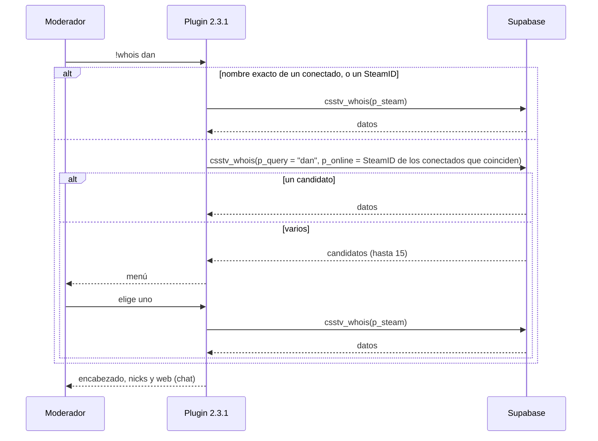
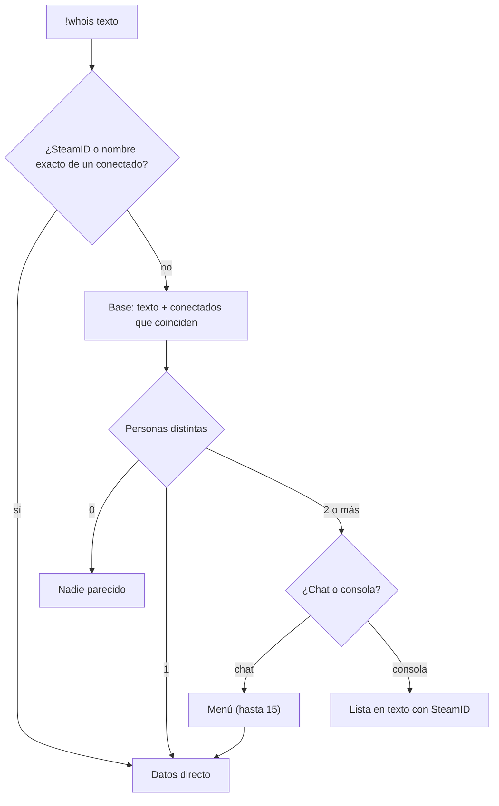

# Plan: menú de `!whois` cuando hay varias coincidencias

> Planeación original. Estado: **aprobado** por Daniel el 2026-10-20 ("de acuerdo con las 3 recomendaciones, escribe el plan e implementa"). Las decisiones marcadas como "Propuesta de Claude" no las eligió él, salvo que diga "aceptada".

## El pedido

Daniel, el 2026-10-20: si escribe `!whois dan`, `daniloev` está conectado y `Dante` no, hoy `!whois` muestra solo a `daniloev`, porque busca en la base únicamente cuando no coincide ningún conectado. Pidió que, **cuando haya 2 o más coincidencias, se abra un menú** para elegir a quién revisar, teniendo en cuenta que en el backend nuevo **una cuenta tiene varios SteamID**.

## Decisiones tomadas

| Tema | Decisión | Origen |
|---|---|---|
| Qué se cuenta como coincidencia | **Personas**, no SteamID ni nombres: un conectado que también aparece por un nick viejo sale una vez, y después del corte los SteamID de una misma ficha son un solo candidato (aunque uno esté conectado y otro no) | Daniel (pedido); propuesta de Claude, aceptada |
| Dónde se buscan | Siempre en los dos lados: los conectados que coinciden y la base. El plugin manda el texto **y** los SteamID de los conectados que coinciden; la base arma la lista única | Propuesta de Claude, aceptada |
| Un solo candidato | Muestra los datos directo, como hoy | |
| Dos o más | **Menú** de SourceMod: conectados primero, después los desconectados por la fecha de su última partida | Daniel |
| Nombre exacto de un conectado | Va directo, sin menú | Recomendación de Claude, aceptada |
| Tamaño del menú | **Hasta 15 candidatos** (dos páginas y una más). Si hay más, una última opción deshabilitada: "Hay N: escribí más del nombre" | Recomendación de Claude, aceptada |
| Qué muestra cada opción | El nombre (el actual si está conectado; si no, el último nick de las partidas), "conectado" o la cantidad de partidas, y "ficha" si tiene perfil en la web. Sin SteamID | Recomendación de Claude, aceptada |
| Desde la consola | Sin menú: la lista en texto, con los SteamID para usar `!whois <SteamID>` | Propuesta de Claude, aceptada |
| Al elegir | Una segunda consulta por SteamID (el principal de la ficha, si tiene). Sin la espera de 3 segundos | Propuesta de Claude |
| Compatibilidad | La 2.3.0 que ya está en los servidores sigue funcionando con la base nueva (el parámetro nuevo es opcional) | Propuesta de Claude |

## 1. El flujo

## 2. Base de datos

### Producción: `supabase/migrations/20261020120000_whois_menu.sql`

- `csstv_whois` pasa a `(p_token, p_steam, p_query, p_online default null)`: se borra la de 3 parámetros y se crea la de 4 (las llamadas de la 2.3.0, sin `p_online`, siguen funcionando).
- `p_online`: los SteamID de los conectados que coinciden, separados por coma. Cuentan como candidatos aunque nunca hayan jugado.
- Con varios candidatos responde `{ ok, multiple, total, candidates }`, donde `candidates` son hasta 15 separados por `;`, cada uno `steam|online|nick|partidas|ficha`:
  - `steam`: el SteamID (`STEAM_0`) para la segunda consulta.
  - `online`: el SteamID del conectado, o vacío.
  - `nick`: el último nick de las partidas (o el de la ficha), sin `|` ni `;`.
  - `partidas` y `ficha` (`1` o `0`).
- Orden: conectados primero, después por la última partida.

### Replanteo `23` (se actualiza; todavía no se aplicó en ningún lado)

La misma función de 4 parámetros, con los candidatos agrupados por ficha: la clave es el principal de la ficha, `online` es cualquier SteamID conectado de esa ficha, y los nicks y las partidas son de todos sus SteamID. La inversa vuelve a la versión de producción nueva. Se actualizan sus pruebas SQL.

## 3. Plugin 2.3.1 (`csstv/whois.inc`)

- Nombre exacto de un conectado o SteamID: consulta por SteamID, como hoy.
- Si no: manda el texto y los SteamID de los conectados que coinciden (sin los bots sin SteamID).
- Varios candidatos:
  - **Chat:** menú con hasta 15 opciones y la opción deshabilitada si hay más. Al elegir, consulta por SteamID; si el elegido está conectado, el encabezado lleva su nombre actual.
  - **Consola:** lista en texto (nombre, SteamID y conectado o partidas).

## 4. Documentación

- Bitácora de este requerimiento, `PENDIENTES.md` y el índice de la bitácora.
- `supabase/replanteo/README.md` (la `23` cambia de firma).
- `CHANGELOG_DISCORD.txt`.

## 5. Requisitos antes de empezar

- Ninguno para implementar. Para desplegar: correr la migración en producción y subir la 2.3.1 al servidor real (genérico) y a RBK (licenciado) en la misma tanda.

## 6. Orden de implementación

1. Migración de producción.
2. Replanteo `23`, su inversa y sus pruebas.
3. Plugin 2.3.1 y compilación.
4. Bitácora y pendientes.
