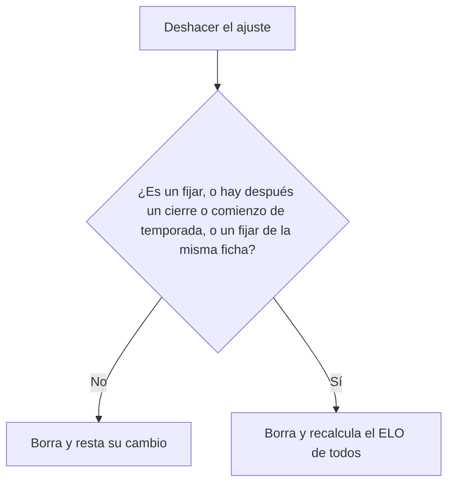

# Ajustes manuales de ELO desde el admin y sin "Recalcular ELO": documentación

## Qué hace

En la web nueva, el admin ya no puede recalcular el ELO de todos. Para corregir casos puntuales (un mix caído, un abandono, un error), **ajusta a mano el ELO de hasta 10 jugadores a la vez**:
- **Sumar o restar** una cantidad (de −500 a +500).
- **Fijar** el ELO en un valor.

Cada ajuste lleva un **motivo obligatorio**, que el jugador ve en su ficha junto con el cambio y la fecha. El admin ve el listado de todos los ajustes y puede **deshacer** uno, con doble confirmación.

Los ajustes ya existían en la base desde el 2026-10-15 (`elo_adjustments`), pero solo se podían hacer desde el SQL Editor. Ahora tienen API, el tipo "fijar" y un deshacer que siempre deja el mismo ELO que un recálculo.

```mermaid
sequenceDiagram
  participant A as Admin (web nueva)
  participant API as API
  participant DB as Supabase
  A->>API: POST /admin/elo/adjustments (fichas, +20 o fijar en 1500, motivo)
  API->>DB: elo_adjust_players
  DB->>DB: valida (admin, 1 a 10 fichas con SteamID, motivo, rangos)
  DB->>DB: una fila de elo_adjustments por ficha (en su SteamID principal)
  DB->>DB: elo += cambio, o elo = valor (con el piso); pico
  DB-->>API: ELO antes y después de cada ficha
  API-->>A: 201
```

## Reglas

| Regla | Detalle |
|---|---|
| A quién | De 1 a 10 fichas, sin repetir, todas con SteamID. El ajuste va al SteamID principal; el ELO es uno por ficha |
| Sumar o restar | `delta` de −500 a +500, sin 0 |
| Fijar | `set_elo` de 0 a 10000. Si la ficha ya tiene ese ELO, no se crea el ajuste (`adjustment_id: null`) |
| Piso | Nadie queda debajo de `elo_config.elo_floor` |
| Fecha | Cuenta desde el momento en que se hace (no hay ajustes con fecha en el pasado desde la API) |
| Qué mueve | Solo `elo` y `peak_elo`. No cambia partidas, victorias, μ/σ ni stats |
| Motivo | Obligatorio, hasta 200 caracteres. Lo ve el jugador |
| Quién | Solo un admin (o el SQL Editor) |

### El recálculo tiene en cuenta los ajustes

Desde la web ya no se recalcula, pero la base recalcula sola en dos casos: al aprobar o quitar un SteamID adicional de una ficha, y cuando llega tarde un mix anterior a un cierre de temporada. `elo_recompute_all` recorre mixes, ajustes y temporadas en orden de fecha, y aplica cada ajuste con su tipo (`elo_apply_adjustment_row`):

| Tipo | En el recálculo |
|---|---|
| Sumar o restar | Vuelve a sumar `delta` en su fecha |
| Fijar | Vuelve a **fijar** `set_elo` en su fecha (no suma el cambio que hubo al hacerlo) |

### Deshacer



Restar el cambio da lo mismo que un recálculo en el caso común. En los otros casos no: un "fijar" no se deshace restando, un reinicio de temporada cambió el ELO en el medio, y un "fijar" posterior ya pisó el valor. Ahí se recalcula para que quede como si el ajuste no hubiera existido.

Límite conocido: si al sumar o restar el ELO tocó el piso, restar el cambio no deja exactamente el mismo valor que un recálculo (igual que antes de este cambio).

## Base de datos (replanteo `25`)

| Objeto | Qué es |
|---|---|
| `elo_adjustments.set_elo` | El valor de un "fijar" (null = sumar o restar). `delta` guarda el cambio que hubo al hacerlo |
| `elo_adjust_players(p_players, p_delta, p_set_elo, p_reason)` | Admin: el ajuste. Devuelve por ficha el id del ajuste, el alias y el ELO antes y después |
| `elo_apply_set`, `elo_apply_adjustment_row` | Internas: fijar el ELO y aplicar un ajuste guardado con su tipo |
| `elo_remove_adjustment(p_id)` | Deshacer (resta o recalcula) |
| `player_elo_adjustment_list` | Pública: los ajustes de cada ficha (por todos sus SteamID) |
| `admin_elo_adjustment_list` | Solo admin: con el alias, el SteamID, quién lo hizo y búsqueda |
| Permisos | `elo_recompute_all` y `elo_simulate` sin `execute` para `authenticated`. `elo_set_config` con `p_recompute = true` y un usuario: error "Recalcular el ELO ya no está disponible desde la web" |

## API

| Endpoint | Quién | Qué hace |
|---|---|---|
| `POST /api/v1/admin/elo/adjustments` | Admin | Ajustar (`player_ids`, `delta` o `set_elo`, `reason`) |
| `GET /api/v1/admin/elo/adjustments` | Admin | Listado (`player`, `q`, `from`, `to`) |
| `DELETE /api/v1/admin/elo/adjustments/{id}` | Admin | Deshacer, con `confirm: "estoy seguro"` |
| `GET /api/v1/players/{id}/elo-adjustments` | Público | Los ajustes del jugador |
| `PUT /api/v1/admin/elo/config` | Admin | Ahora solo `{ config }`: vale para los mixes nuevos |
| ~~`POST /api/v1/admin/elo/recompute`~~, ~~`POST /api/v1/admin/elo/simulate`~~ | — | Borrados |

El detalle para el frontend está en [`docs/frontend/contrato/admin.md`](../../frontend/contrato/admin.md) ("Ajustes manuales de ELO") y [`jugadores.md`](../../frontend/contrato/jugadores.md).

## Dónde está cada cosa

| Qué | Archivo / ubicación |
|---|---|
| Migración | `supabase/replanteo/25_ajustes_elo_admin.sql` |
| Inversa y pruebas SQL | `docs/bitacora/2026-10-14-replanteo-modelo-datos/reversas/25_ajustes_elo_admin.sql` y `pruebas/25_ajustes_elo_admin.sql` |
| Rutas y esquemas | `web/backend/src/routes/elo.ts`, `web/backend/src/schemas/elo.ts` |
| Pruebas | `web/backend/test/unit/elo.test.ts`, `web/backend/test/integration/elo.test.ts` |
| Contrato del frontend | `docs/frontend/contrato/admin.md`, `jugadores.md`, `partidas.md` (8c), `api.md`, `README.md` y `decisiones.md` |
| Ajustes originales (SQL Editor) | `supabase/migrations/20261015210000_elo_ajustes.sql`, bitácora [`2026-10-15-ajustes-elo`](../2026-10-15-ajustes-elo/) |
| Changelog para Discord | `CHANGELOG_DISCORD.txt` (esta carpeta) |
