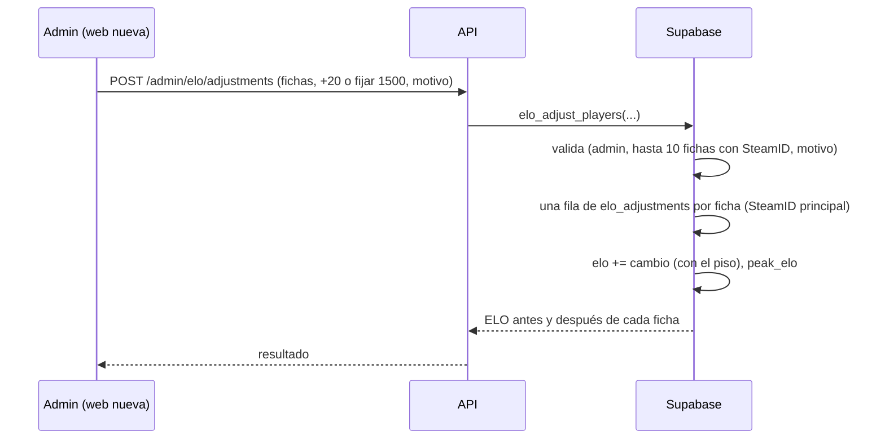

# Plan: ajustes manuales de ELO desde el admin y sin "Recalcular ELO"

> Planeación original. Estado: **aprobada por Daniel el 2026-10-21** (con las respuestas de la sección 8). Las decisiones marcadas como "Propuesta de Claude" no las eligió él.

## El pedido

Daniel, el 2026-10-21:
- **Quitar el botón "Recalcular ELO".**
- **Que el admin pueda ajustar a mano el ELO de un usuario.** Es más realista corregir el ELO de 10 jugadores o menos que tener un botón que recalcula el de todos.

Solo para la **web nueva** (backend del replanteo). Sale con el corte.

## Lo que ya existe y condiciona el diseño

| Qué | Dónde | Consecuencia |
|---|---|---|
| Ajustes manuales en la base: `elo_adjustments` (SteamID, delta, motivo, fecha), `elo_add_adjustment` y `elo_remove_adjustment` | `supabase/migrations/20261015210000_elo_ajustes.sql` (en producción desde el 2026-10-15) | **Ya funcionan, pero solo desde el SQL Editor.** Falta la API. Sobreviven a un recálculo |
| Un ELO por ficha: un ajuste a cualquier SteamID de la ficha mueve el ELO del principal | Replanteo `15` | La API ajusta por **ficha**, no por SteamID |
| Recalcular desde la API: `POST /api/v1/admin/elo/recompute`, `PUT /api/v1/admin/elo/config` con `recompute: true` y `POST /api/v1/admin/elo/simulate` (simula un recálculo) | `web/backend/src/routes/elo.ts`, replanteo `13` | Son los que se quitan |
| `elo_recompute_all` también lo usa la base sola: aprobar o quitar un SteamID adicional, y un mix que llega con fecha anterior a un cierre de temporada | Replanteo `15`, `21` y `24` | **Esos recálculos automáticos se quedan** (pregunta 3): sin ellos el ELO quedaría mal |
| Temporadas: un ajuste con fecha anterior al último cierre dejaría el ELO distinto del de un recálculo | Replanteo `24` | Los ajustes desde la API cuentan **siempre desde ahora** (sin fecha en el pasado) |

## Decisiones tomadas

| Tema | Decisión | Origen |
|---|---|---|
| Recalcular | Se quita de la API: `POST /admin/elo/recompute`, el `recompute` de `PUT /admin/elo/config` (la configuración vale para los mixes nuevos) y `POST /admin/elo/simulate`. Los usuarios ya no pueden llamar a `elo_recompute_all` (solo la base, en los casos automáticos, y el SQL Editor) | Daniel (quitar el botón); propuesta de Claude (también la simulación, que solo sirve para decidir un recálculo) |
| Ajuste | A una o varias fichas a la vez, **hasta 10**, con el mismo cambio y un **motivo obligatorio** | Daniel (10 o menos); propuesta de Claude (motivo) |
| Forma del ajuste | **Sumar o restar** (`delta`, de −500 a +500, sin 0) **o fijar el ELO** a un valor (`set_elo`). Un ajuste "fijar" guarda el valor: un recálculo lo vuelve a fijar en ese valor en su fecha (no suma la diferencia de ese momento) | Daniel (los dos); propuesta de Claude (rangos y cómo se recalcula) |
| Fecha | Cuenta desde el momento en que se hace | Propuesta de Claude |
| Piso | Respeta el ELO mínimo de la configuración (`elo_floor`), como hoy | Ya existía |
| Deshacer | El admin borra un ajuste: se resta su cambio. Pide confirmar | Ya existía (`elo_remove_adjustment`); propuesta de Claude (confirmar) |
| Qué mueve | Solo `elo` y `peak_elo`; no cambia partidas, victorias ni stats | Ya existía |
| Requisito | La ficha tiene que tener SteamID (si no tiene ELO, empieza en el ELO inicial) | Propuesta de Claude |
| Quién lo ve | El jugador ve sus ajustes en su perfil: cambio, motivo y fecha | Daniel |
| Web vieja | No se toca por ahora | Daniel |
| Recálculos automáticos | Se quedan (aprobar o quitar un SteamID adicional, mix que llega tarde a una temporada cerrada) y **tienen en cuenta los ajustes**, también los de "fijar". Deshacer un ajuste que no se puede restar sin más (uno de "fijar", uno anterior a un cierre de temporada o con un "fijar" posterior de la misma ficha) también recalcula | Daniel (se quedan, con los ajustes); propuesta de Claude (deshacer) |

## 1. El flujo

## 2. Base de datos: replanteo `25_ajustes_elo_admin.sql`

| Cambio | Detalle |
|---|---|
| `elo_adjustments` | Suma `set_elo` (null = sumar o restar). La ficha sale de sus SteamID (`player_steam_all`), así sigue al SteamID aunque cambie el principal |
| `elo_adjust_players(p_players uuid[], p_delta int, p_set_elo int, p_reason text)` | Admin. Uno de los dos: `p_delta` o `p_set_elo`. Hasta 10 fichas, todas con SteamID, sin repetir. Bloquea las filas en orden (como `elo_add_adjustment`). Devuelve por ficha: ELO antes, después y el id del ajuste |
| `elo_remove_adjustment` | Igual, más el permiso desde la API (ya lo tiene) |
| Vista `admin_elo_adjustment_list` | Ajuste con la ficha (alias), cambio, tipo, motivo, fecha y quién lo hizo, para el listado del admin |
| Permisos | Se quita `execute` de `elo_recompute_all` y de `elo_simulate` a `authenticated`; `elo_set_config` ignora `p_recompute` desde la web (solo el SQL Editor puede recalcular) |

Inversa y pruebas SQL como las demás del replanteo.

## 3. API

| Endpoint | Qué hace |
|---|---|
| `GET /api/v1/admin/elo/adjustments` | Listado paginado: filtros `player`, `q` (alias o motivo), `from`, `to`; orden **`created_at` desc** |
| `POST /api/v1/admin/elo/adjustments` | Body: `{ player_ids (1 a 10), delta \| set_elo, reason }`. Responde el ELO antes y después de cada ficha |
| `DELETE /api/v1/admin/elo/adjustments/{id}` | Deshace un ajuste. Pide `confirm: "estoy seguro"` |
| ~~`POST /api/v1/admin/elo/recompute`~~ | Se borra |
| ~~`POST /api/v1/admin/elo/simulate`~~ | Se borra |
| `PUT /api/v1/admin/elo/config` | Sin `recompute` ni `confirm`: guarda y vale para los mixes nuevos |
| `POST /api/v1/admin/elo/preview` | Se queda (ejemplos de la configuración, no recalcula nada) |

Pública (pregunta 2): `GET /api/v1/players/{id}/elo-adjustments`, con el cambio, el motivo y la fecha.

## 4. Frontend (contrato)

- **Admin → ELO:** se quita "Recalcular ELO" y la simulación. La configuración avisa que vale para los mixes nuevos.
- **Admin → Ajustes de ELO:**
  - Buscar y elegir hasta 10 jugadores (con su ELO actual).
  - Elegir "Sumar o restar" o "Fijar en".
  - Motivo obligatorio. Antes de confirmar, se muestra cómo queda cada uno ("1480 → 1500").
  - Listado de ajustes con "Deshacer".

## 5. Documentación

Contrato del frontend (`admin.md`, `partidas.md` 8c, `api.md`, novedades y `decisiones.md`), `supabase/replanteo/README.md`, la bitácora y `PENDIENTES.md`.

## 6. Requisitos antes de empezar

- Aprobación de este plan y las respuestas de la sección 8.
- Docker para la Supabase local (ya está).

## 7. Orden de implementación

1. Replanteo `25`, su inversa y pruebas SQL.
2. `pnpm db:types`.
3. Rutas y esquemas: los de ajustes nuevos; quitar recalcular y simular (y sus pruebas).
4. Pruebas unitarias y de integración.
5. Contrato del frontend, bitácora y pendientes.

## 8. Preguntas respondidas

Daniel, el 2026-10-21:

1. **Sumar o restar y también fijar.**
2. **Sí**, el jugador ve sus ajustes.
3. **Sí**, los recálculos automáticos se quedan, y tienen que tener en cuenta los ajustes.
4. **No** se toca la web vieja por ahora.

Las preguntas eran:

1. **¿Sumar o restar, fijar el ELO a un valor, o los dos?** Propuesta: los dos ("+20" para compensar un mix caído; "fijar en 1500" para corregir un caso puntual).
2. **¿El jugador ve sus ajustes en su perfil (cambio, motivo y fecha)?** Propuesta: sí, por transparencia. Hoy la tabla ya es de lectura pública en la base.
3. **Los recálculos automáticos se quedan:** aprobar o quitar un SteamID adicional de una ficha, y un mix que llega tarde a una temporada ya cerrada. No hay botón: los hace la base sola, porque sin ellos el ELO quedaría mal. ¿Te parece?
4. **¿La web vieja también pierde el botón?** Hoy `index.html` tiene "Recalcular ELO" en Admin → Servidores → ELO. Propuesta: no tocarla, porque se reemplaza en el corte y solo la usan los admins.
