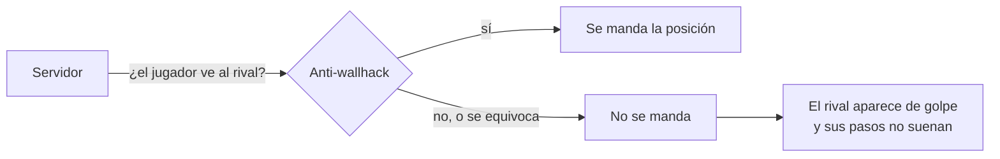

# Anti-wallhack apagados y humo más denso: documentación

## Qué hace

Los jugadores se quejaban de que los rivales "aparecen y desaparecen", como si tuvieran lag, aunque tuvieran 5 de ping. También costaba escuchar los pasos. Los logs de `csstv_perf` del 18 al 22/10 muestran que **el servidor y la red están bien**. El problema venía de dos anti-wallhack que ocultaban a los jugadores.

En los dos servidores (el real y RBK):
- Se apagó el anti-wallhack de KACR (`kacr_eyes_antiwall "0"`). El resto de KACR sigue activo.
- Se sacó `Anti_Wallhack_Lite.smx`, que estaba solo en el servidor real.
- Se pasó el humo de ClientMod al tipo más denso (`clientmod_smoke_type 2`).

## Por qué un anti-wallhack produce "lag"

Los anti-wallhack del servidor (`SetTransmit`) dejan de mandarle a cada jugador los rivales que, según sus cálculos, no puede ver. Así un wallhack no tiene qué mostrar. Pero el cálculo se hace con la posición del servidor, sin contar el ping ni la interpolación del cliente. Cuando el rival sale de una esquina, durante un momento el servidor todavía no lo manda y después aparece de golpe. Al cliente le falta información y no puede suavizar el movimiento.

En el `net_graph` todo se ve perfecto, porque el servidor manda todo lo que decide mandar. Por eso no aparece en las mediciones de red.

| Plugin | Qué hacía | Desde |
|---|---|---|
| KACR (`kigen-ac_redux_legacy.smx`), módulo `Eyetest` | Oculta jugadores y armas (`Eyetest_Transmit`, `Eyetest_WeaponTransmit`). Prendido por defecto | 2026-10-12 en el servidor real |
| `Anti_Wallhack_Lite.smx` 1.3.0 (BrokenT, vk.com/plugskincss) | Lo mismo (`Hook_SetTransmit`, `Hook_SetTransmitWeapon`), y además intercepta los sonidos de los jugadores (`Hook_NormalSound`) y lee las cvars de tasas e interpolación | 2026-10-20, lo subió un admin. Solo en el servidor real |

Lo mismo se reporta en los foros: en el hilo de Kigen Anti-Cheat en AlliedModders, un usuario contó que los rivales se volvían invisibles a cierta distancia y aparecían de golpe al acercarse. El desarrollador le respondió que lo único de KAC que cambia la visibilidad es el anti-wallhack.

## Datos de `csstv_perf` (ventanas con 8 o más jugadores)

| Día | Ticks procesados | Ticks más de 2 intervalos tarde | Pérdida saliente | Choke saliente |
|---|---|---|---|---|
| 2026-10-18 | 99,97 % | 0,87 % (`fps_max` 150) | 0 % | ~0 % |
| 2026-10-19 | 99,97 % | 0,11 % | 0 % | ~0 % |
| 2026-10-20 | 99,97 % | 0,06 % | 0 % | ~0 % |
| 2026-10-21 | 99,97 % | 0,09 % | 0 % | ~0 % |
| 2026-10-22 | 99,97 % | 0,10 % | 0 % | ~0 % |

Lo que queda son jugadores puntuales:
- **Choke entrante alto todo el mix:** jordipolla (38 %) y shevchenko (47 %), por sus FPS.
- **Cortes de conexión sueltos:** Lukas y kyan.

Script del análisis: [`pruebas/analizar_perf.py`](pruebas/analizar_perf.py).

## Humo de ClientMod

Las cvars no están documentadas en ninguna página. Las descripciones salen del propio `clientmod.smx` (en ruso):

| Cvar | Valor | Opciones |
|---|---|---|
| `clientmod_smoke_type` | **2** (antes 1) | `0`: humo viejo de la v34 (por defecto en el plugin) · `1`: el estándar de la versión de Steam · `2`: más denso |
| `clientmod_smoke_mode` | 1 | `0`: nada · `1`: quita el polvo que vuelve transparente el humo · `2`: el humo dura un par de segundos menos, como en la versión de Steam · `3`: las dos cosas |
| `clientmod_smoke_fix` | 1 | `1`: arregla que el radar muestre a los jugadores que están dentro del humo |

`se_newsmoke` se maneja solo con las dos primeras.

## Para después: `se_clockcorrection_ticks`

Es otra cvar de `clientmod.smx`. Según su descripción, indica "cuántos ticks se atrasa el modelo del jugador antes de mostrarse: -1 = arreglo apagado (los 60 ms estándar), 0-1 = no probado, 2 = óptimo".

Hoy no está en nuestro cfg, así que vale `-1`. Si siguen las quejas, se prueba `2` sola, para medir un cambio a la vez.

## Dónde está cada cosa

| Qué | Archivo / ubicación |
|---|---|
| Anti-wallhack de KACR | `cfg/sourcemod/Kigen-AC_Redux.cfg` de cada servidor, línea 65 |
| Humo | `cfg/server.cfg` de cada servidor, línea 148 |
| `Anti_Wallhack_Lite.smx` apagado | `addons/sourcemod/plugins/disabled/Anti_Wallhack_Lite.smx` (servidor real) |
| Script del cambio | [`pruebas/aplicar.py`](pruebas/aplicar.py) |
| Diagnóstico anterior | [`2026-10-18-diagnostico-red-servidor`](../2026-10-18-diagnostico-red-servidor/) |
