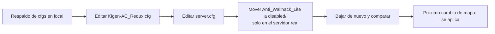

# Plan: apagar los anti-wallhack y humo más denso

> Planeación original. Estado: **aprobado por Daniel el 2026-10-22** ("haz el paso 1 en los dos servidores").

## Decisiones tomadas

| Tema | Decisión | Por qué |
|---|---|---|
| Causa probable de "los jugadores aparecen y desaparecen" | Los anti-wallhack del servidor, no el host | Los logs de `csstv_perf` del 18 al 22/10 muestran el servidor y la red limpios todos los días (99,97 % de ticks, 0 % de pérdida y ~0 % de choke saliente). Un anti-wallhack deja de mandar a los jugadores que el servidor cree que no ves: si se equivoca o se atrasa, el jugador aparece de golpe, y eso no se ve en el `net_graph` |
| KACR | `kacr_eyes_antiwall "0"` en `cfg/sourcemod/Kigen-AC_Redux.cfg`. El resto de KACR sigue igual | Estaba prendido (es el valor por defecto) en los dos servidores desde que se instaló (12/10 en el servidor real) |
| `Anti_Wallhack_Lite.smx` 1.3.0 (BrokenT) | Se pasa a `plugins/disabled/` (solo existe en el servidor real) | Lo subió un admin el 2026-10-20. Hace lo mismo que KACR y además intercepta los sonidos (`Hook_NormalSound`), lo que coincide con la queja de que cuesta escuchar los pasos |
| Humo de ClientMod | `clientmod_smoke_type 2` (más denso) en `cfg/server.cfg`. `clientmod_smoke_mode 1` y `clientmod_smoke_fix 1` quedan igual | Hoy está en `1` (el humo de la versión de Steam). Las opciones salen de las descripciones dentro de `clientmod.smx` |
| `se_clockcorrection_ticks 2` | **No va en esta tanda** | Hay que medir un cambio a la vez. Se prueba solo, después, si siguen las quejas |
| Servidores | El servidor real y RBK en la misma tanda | Regla del proyecto y pedido de Daniel |
| Momento | Se cargan en el próximo cambio de mapa. No se recarga nada | No cortar un mix en curso |

## 1. El flujo

## 2. Cambios en cada servidor

| Archivo | Servidor real | RBK |
|---|---|---|
| `cfg/sourcemod/Kigen-AC_Redux.cfg` | `kacr_eyes_antiwall "1"` → `"0"` | Igual |
| `cfg/server.cfg` | `clientmod_smoke_type 1` → `2` | Igual |
| `addons/sourcemod/plugins/Anti_Wallhack_Lite.smx` | → `plugins/disabled/Anti_Wallhack_Lite.smx` | No existe |

Antes de editar, el script aborta si el archivo no tiene exactamente la línea esperada, y también revisa que ningún cfg de fase (`warmup.cfg`, `live.cfg`, `end.cfg`) vuelva a poner esas cvars.

## 3. Requisitos

Accesos SFTP del `.env`: `SFTP_CSS_*` (servidor real) y `SERVER1_*` (RBK).

## 4. Orden de implementación

1. Bajar los cfgs de los dos servidores y guardar un respaldo en local.
2. Script SFTP: solo inspección. Después, aplicar y verificar.
3. Documentación, guía, `CHANGELOG_DISCORD.txt`, fila en el README de la bitácora y `PENDIENTES.md`.
4. Después de uno o dos mixes: preguntar a los jugadores y revisar `csstv_perf`.
