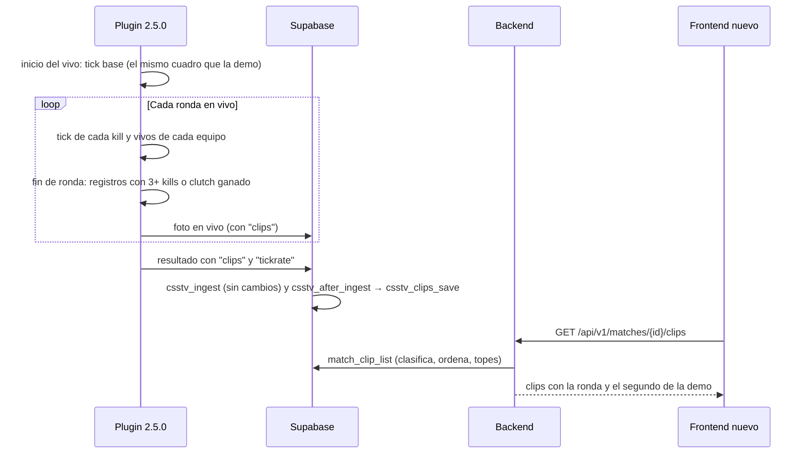
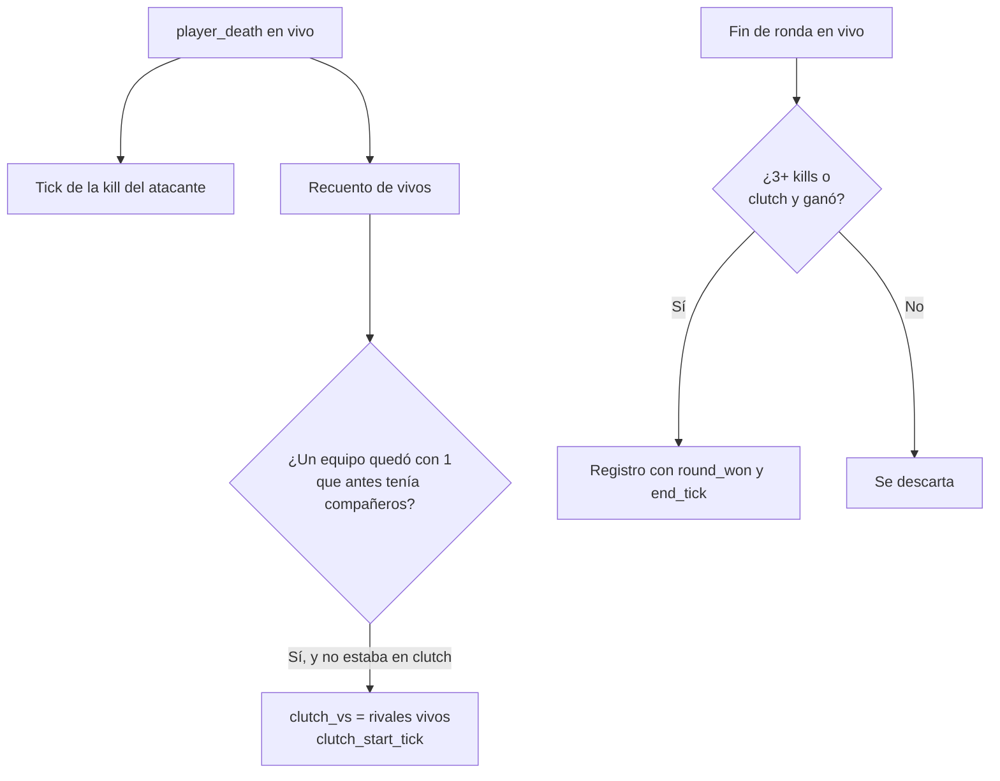

# Clips automáticos por partida: documentación

## Qué hace

El servidor anota las **jugadas destacadas** de cada ronda en vivo, incluida la prórroga: aces, 4k, 3k y clutches ganados (del 1v1 al 1v5). Por cada jugador y cada ronda guarda el tick de la demo de cada kill y, si quedó último vivo de su equipo, contra cuántos rivales. Esos registros viajan con el resultado de la partida y la base los guarda en `match_clips`.

El plugin manda **hechos, no tipos**. La base clasifica cada registro (el tipo más valioso entre sus kills y su clutch), ordena por una escala configurable y aplica los topes: 2 clips por jugador (por ficha) y 10 por partida. El admin cambia la escala y los topes desde la web, sin tocar el plugin ni los datos.

Un clip **no es un video todavía**: es la ronda, el segundo dentro de la ronda y los ticks dentro del `.dem`, que ya se graba y se sube a R2. El render del video es la fase C, un requerimiento aparte.



## Qué se anota

| Regla | Detalle |
|---|---|
| Cuándo | Solo en vivo (`State_Live`), incluida la prórroga. No en calentamiento, cuchillo, medio tiempo ni durante los reinicios |
| Qué registro se guarda | Por jugador y por ronda: si tiene **3 kills o más**, o un **clutch que su equipo ganó**. First kills, plants, defuses y 2k no |
| Kills | Solo a rivales. Más de 5 (solo con bots o equipos de más de 5): se guardan los ticks de las primeras 5 |
| Inicio del clutch | Cuando un jugador queda último vivo de su equipo, que antes tenía compañeros, contra N rivales vivos. Los vivos se recuentan en cada muerte y en cada desconexión |
| 1v1 | Solo si los dos quedaron últimos vivos a la vez. Un 1v3 que llega al 1v1 sigue siendo 1v3 |
| Clutch ganado | Su equipo gana la ronda, por kills, defuse, explosión o tiempo. Cuenta aunque no mate a nadie o muera después de plantar |
| Rivales que se van | El tipo se fija al empezar el clutch |
| `!rr` | Los registros de la ronda anulada se descartan |
| Tope del plugin | 60 registros por partida. Lleno, un registro nuevo reemplaza al de menor valor (kills más rivales del clutch ganado) |
| Interruptor | `csstv_clips "1"` en `csstv_reporter.cfg`. En 0 no se anota ni se manda nada (el `tickrate` sí) |



## Ticks y tiempos

| Dato | Qué es |
|---|---|
| `kill_ticks` | Tick de cada kill, contado desde el inicio de la grabación de la demo (el plugin toma la base en el mismo cuadro que `Demo_Start()`). Sin demo, desde el inicio del vivo |
| `clutch_start_tick`, `end_tick` | Cuándo quedó solo y cuándo terminó la ronda (solo con clutch) |
| `matches.tickrate` | Ticks por segundo del servidor, una vez por partida (66 en el servidor local) |
| `round_seconds` | Segundos desde el fin del freezetime (`m_fRoundStartTime`) hasta la primera kill del registro, o el inicio del clutch. Para mostrar |
| `demo_seconds` (API) | Primer tick del registro dividido por el `tickrate`: el segundo de la demo donde empieza la jugada |

La demo de SourceTV cuenta los ticks al mismo ritmo que el plugin (66 por segundo en la prueba) y empieza, con una diferencia de unos segundos, en el mismo momento. El desfase exacto (incluido el de `tv_delay`) se mide en la fase C, leyendo la demo.

## Escala, desempate y topes

| Prioridad de fábrica | Tipo |
|---|---|
| 1 | Ace (`ace`) |
| 2 | Clutch 1v5 o 1v4 (`clutch_5`, `clutch_4`) |
| 3 | 4k (`4k`) |
| 4 | Clutch 1v3 (`clutch_3`) |
| 5 | 3k (`3k`) |
| 6 | Clutch 1v2 (`clutch_2`) |
| 7 | Clutch 1v1 (`clutch_1`) |

- **Tipo de un registro:** el de número más chico entre sus kills (`5 → ace`, `4 → 4k`, `3 → 3k`) y su clutch, si lo ganó. Un 3k en un 1v3 ganado es `clutch_3`; un 3k en un 1v2 ganado es `3k`.
- **Desempate:** primero la jugada de una ronda ganada, después la ronda más tardía (la prórroga va al final).
- **Topes:** `per_player` (2) por ficha, con sus SteamID principal y adicionales sumando juntos (un SteamID sin ficha cuenta solo), y `per_match` (10).
- **Cortes del video** (para la fase C): `split_gap_seconds` (8), `pre_seconds` (3) y `post_seconds` (2). Hoy no los usa nadie.

## Base de datos

### Tablas

| Tabla | Columnas |
|---|---|
| `match_clips` | `id`, `match_id` → `matches.id` (cascade), `round`, `player_steamid` (SteamID64, o `BOT:n` / `NOSTEAM:n`), `player_name`, `round_seconds`, `round_won`, `kill_ticks integer[]`, `clutch_vs`, `clutch_start_tick`, `end_tick`, `created_at`. Única por (`match_id`, `round`, `player_steamid`). Hasta 5 ticks, no negativos; los tres datos del clutch juntos o ninguno; 3+ kills o clutch ganado |
| `clip_config` | Una fila: `priorities` (jsonb con los 8 tipos), `per_player`, `per_match`, `split_gap_seconds`, `pre_seconds`, `post_seconds`, `updated_at`, `updated_by` |
| `matches.tickrate` | `smallint` de 10 a 1000; nulo en las partidas anteriores |

RLS activado en las dos tablas, con lectura pública (las stats son públicas). No hay políticas de escritura: escriben `csstv_clips_save` (`security definer`) y `clip_set_config`.

### Funciones y vista

| Objeto | Quién | Qué hace |
|---|---|---|
| `csstv_clips_save(match, payload)` | `csstv_after_ingest` | Guarda `tickrate` (si está entre 10 y 1000) y reemplaza los clips de la partida (una reingesta no duplica). Un registro inválido se descarta con un aviso, sin tirar la ingesta. Sin `clips` en el resultado, no toca nada |
| `csstv_after_ingest` | Las tres entradas de la ingesta (`ingest_server_chunk`, `ingest_server_match`, `live_match_close`) | Igual que antes, más la llamada a `csstv_clips_save` al final. `csstv_ingest` no cambió |
| `clip_type(kills, clutch_vs, won, priorities)` | La vista | El tipo de un registro según la escala |
| `clip_set_config(...)` | Admin (por el backend) | Valida y guarda la configuración |
| `match_clip_list` | API | Los clips que se muestran: tipo, prioridad, puesto (`position`), los dos topes, ficha, `tickrate`, `demo_status` y estado de la partida |

Antes del corte, la vista encuentra la ficha por `players.steam_id`. Con el replanteo `26` usa `steam_owner()` (SteamID principal o adicional) y el tope por jugador cuenta por ficha.

## JSON del plugin

Al final del resultado y de la foto en vivo:

```json
{ "tickrate": 66,
  "clips": [ { "round": 3, "steamid": "STEAM_0:0:123", "name": "Gary", "round_seconds": 11, "round_won": true,
               "kill_ticks": [11219, 13255, 14565, 15361, 15427] },
             { "round": 1, "steamid": "STEAM_0:0:456", "name": "Kevin", "round_seconds": 52, "round_won": true,
               "kill_ticks": [], "clutch_vs": 4, "clutch_start_tick": 3883, "end_tick": 4320 } ] }
```

Unos 200 bytes por registro. Si los clips no entran en el buffer del JSON (64 KB, con 128 bytes de margen para cerrarlo y para el texto que agrega `Live_Recover`), el resultado sale **sin clips** y queda un aviso en el log de errores: nunca sale cortado.

## API

| Endpoint | Qué hace |
|---|---|
| `GET /api/v1/matches/{id}/clips` | Público. Paginado (hasta 50), filtros `player` y `type`, orden `position` (por defecto) o `round`. `404` si la partida no existe |
| `GET /api/v1/admin/clips/config` | Admin. La configuración y quién la cambió |
| `PATCH /api/v1/admin/clips/config` | Admin. Solo lo que cambia; vale al instante para todas las partidas |

El contrato del frontend está en [`docs/frontend/contrato/partidas.md`](../../frontend/contrato/partidas.md) (sección 8g) y [`admin.md`](../../frontend/contrato/admin.md) ("Clips (admin)"). La web vieja no muestra clips.

## Dónde está cada cosa

| Qué | Archivo / ubicación |
|---|---|
| Migración de producción | `supabase/migrations/20261023120000_clips.sql` |
| Replanteo (SteamID adicionales y tope por ficha) | `supabase/replanteo/26_clips.sql`, inversa y pruebas en `docs/bitacora/2026-10-14-replanteo-modelo-datos/` |
| Detección en el plugin | `server/addons/sourcemod/scripting/csstv/clips.inc` |
| Ganchos del plugin | `csstv_reporter.sp` (muerte, fin e inicio de ronda, desconexión, inicio del vivo), `csstv/json.inc` y `csstv/rr.inc` |
| Interruptor | `server/cfg/sourcemod/csstv_reporter.cfg` (`csstv_clips`) |
| Backend | `web/backend/src/routes/clips.ts` y `src/schemas/clips.ts` |
| Contrato del frontend | `docs/frontend/contrato/partidas.md` (8g) y `admin.md` |
| Pruebas | [`pruebas/`](pruebas/): SQL de la migración, control contra el log del servidor y script de despliegue |
| Changelog para jugadores | [`CHANGELOG_DISCORD.txt`](CHANGELOG_DISCORD.txt), para cuando la galería esté en la web |
