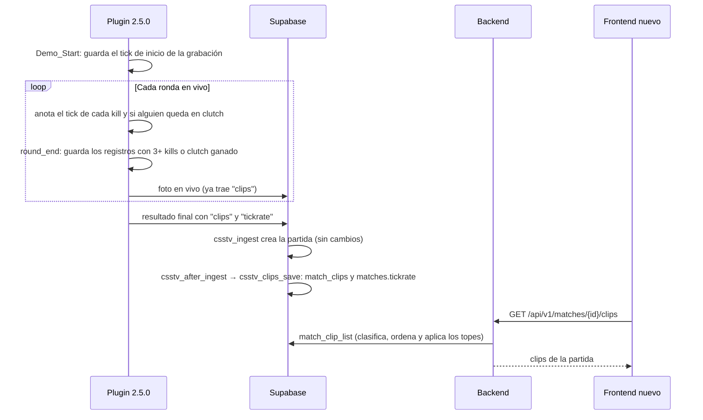
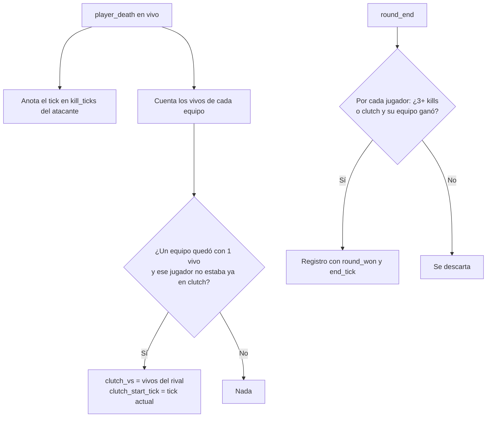

# Plan: clips automáticos por partida (jugadas destacadas)

> Planeación original. Estado: **aprobado** por Daniel el 2026-10-23. Revisado punto por punto con Daniel el 2026-10-23 sobre un borrador del 2026-10-22, que este plan reemplaza.
>
> **Excepción al congelamiento del plugin**, pedida por Daniel el 2026-10-23: la base y el plugin salen ya a producción (servidor real y RBK) para que los clips se vayan juntando antes de la web nueva y para tener ticks reales en la prueba de concepto del render.

## Decisiones tomadas

| Tema | Decisión | Por qué |
|---|---|---|
| Qué es un clip | Una jugada destacada de un jugador en una ronda, con los ticks de la demo donde ocurre. **No es un video**: el video es la fase C | El `.dem` ya se graba y se sube a R2; con los ticks se puede buscar la jugada o, más adelante, cortarla |
| Fases | **A** (base, backend y contrato), **B** (plugin) y **C** (render del video, requerimiento aparte) | Daniel, 2026-10-23. A y B van en este plan; C empieza con una prueba de concepto |
| Excepción | La base (migración de producción) y el plugin **2.5.0** salen ya, a los dos servidores en la misma tanda | Daniel, 2026-10-23 |
| El plugin manda hechos, no tipos | Por jugador y por ronda: ticks de cada kill, si hubo clutch y contra cuántos, y si su equipo ganó la ronda. **La web clasifica**, ordena y aplica los topes | Así la escala de prioridad y los topes se cambian sin recompilar ni desplegar el plugin |
| Qué manda el plugin | Solo los registros que pueden ser clip: **3 kills o más**, o un **clutch ganado** | Un first kill, un plant o un 2k pasan casi todas las rondas: no son destacados y agrandarían el JSON |
| Un registro por jugador y ronda | Un 4k que además es un 1v2 es **un solo** clip, con el tipo de mayor prioridad | Evita el ace duplicado como multikill del borrador |
| Escala de prioridad | 1 ace (5k), 2 clutch 1v5 o 1v4, 3 4k, 4 clutch 1v3, 5 3k, 6 clutch 1v2, 7 clutch 1v1 | Daniel, 2026-10-23 |
| Desempate | Primero la que **ganó la ronda**, después la **ronda más tardía** (la prórroga va al final) | Daniel, 2026-10-23 |
| Topes | **2 por jugador y 10 por partida**, aplicados en la web (vista), configurables en `clip_config` | Daniel, 2026-10-23 |
| Ticks | `kill_ticks integer[]` con el tick de cada kill, contado **desde el inicio de la grabación** de la demo. Para un clutch, además `clutch_start_tick` y `end_tick` | Daniel, 2026-10-23. Los segundos dentro de la ronda no sirven para ubicar la jugada en el `.dem` |
| Cortes del video | Se calculan en la web o en el render con `clip_config` (por ejemplo, más de 8 s entre kills parte el clip). No se guardan | Ajustar el corte no toca ni el plugin ni la base |
| Tickrate | Una vez por partida, en `matches.tickrate` | Para pasar de ticks a segundos. Puede cambiar entre servidores |
| Clutch | Empieza cuando el jugador queda último vivo de su equipo contra N rivales vivos. Es clip solo si **su equipo gana la ronda**, aunque no los mate a todos o muera después de plantar | Daniel, 2026-10-23 (reglas de la sección 3) |
| Cuándo se detecta | En vivo, **incluida la prórroga**. No en calentamiento, cuchillo ni medio tiempo | El borrador dejaba afuera la prórroga, donde suelen estar las mejores jugadas |
| Partidas canceladas | Sus clips se **guardan y se muestran** | Daniel, 2026-10-23 |
| Dónde se guardan | En `csstv_after_ingest`, que ya corre después de la ingesta en las tres entradas. **`csstv_ingest` no se toca** | El replanteo (04, 06, 07 y 15) parchea fragmentos exactos de `csstv_ingest`; cambiarla los rompería en el corte |
| Web vieja | Queda **sin galería** hasta el corte | Daniel, 2026-10-23 |
| Interruptor | cvar `csstv_clips "1"` | Si algo falla en un servidor, se apaga sin recompilar (como `csstv_live`) |

## 1. El flujo completo



La foto en vivo lleva los clips porque, si el servidor se cae, la base convierte la última foto en el resultado (`live_match_close` y la cola con `crash`). Así un mix interrumpido conserva sus clips.

## 2. El formato de los clips en el JSON

Dentro del resultado (y de la foto en vivo), junto a los campos que ya existen:

```json
{
  "tickrate": 100,
  "clips": [
    { "round": 14, "steamid": "STEAM_0:1:123", "name": "jugador", "round_seconds": 42,
      "round_won": true, "kill_ticks": [125940, 126433, 126502],
      "clutch_vs": 3, "clutch_start_tick": 125900, "end_tick": 127210 },
    { "round": 15, "steamid": "STEAM_0:0:456", "name": "otro", "round_seconds": 18,
      "round_won": false, "kill_ticks": [131020, 131210, 131877, 132050] }
  ]
}
```

| Campo | Qué es |
|---|---|
| `round` | Número de ronda dentro de la partida (el mismo que usa el registro de rondas) |
| `round_seconds` | Segundos desde el fin del freezetime hasta la primera kill del registro, o hasta el inicio del clutch si no hubo kills. Solo para mostrar ("ronda 14, 0:42") |
| `round_won` | Si el equipo del jugador ganó la ronda |
| `kill_ticks` | Tick de cada kill del jugador en esa ronda, en orden, desde el inicio de la grabación. Entre 0 y 5 elementos |
| `clutch_vs` | Contra cuántos rivales vivos quedó solo (1 a 5). Ausente si no hubo clutch |
| `clutch_start_tick`, `end_tick` | Cuándo empezó el clutch y cuándo terminó la ronda. Solo si hubo clutch |

Los campos son opcionales para la base: un resultado sin `clips` o sin `tickrate` (plugin viejo, RBK desactualizado) se guarda igual que hoy.

## 3. Reglas de detección (plugin)



| Regla | Detalle |
|---|---|
| Inicio del clutch | Cuando un jugador queda último vivo de su equipo; N es la cantidad de rivales vivos en ese momento. Los vivos se recuentan en cada muerte y en cada desconexión o cambio de equipo |
| 1v1 | Solo cuando los dos quedaron últimos vivos a la vez. Si venía de un 1v3 y llegó al 1v1, sigue siendo 1v3 |
| Clutch ganado | Su equipo gana la ronda, por kills, defuse, explosión o tiempo. Cuenta aunque muera después de plantar y la bomba explote. Un clutch perdido no se manda (salvo que el registro tenga 3+ kills) |
| Rivales que se van | El tipo se fija al empezar el clutch: si después un rival se desconecta, no cambia |
| Prórroga | Se detecta igual que el reglamentario (las rondas de prórroga corren en `State_Live` con `g_iSegment > 0`) |
| `!rr` | La foto de `!rr` guarda cuántos registros había; al restaurar se recortan, como el registro de rondas (`g_iRrRoundLog`). Los ticks siguen corriendo, así que la ronda repetida no se confunde con la anulada |
| Tope del plugin | 60 registros por partida. Si se llena, se reemplaza el de menor valor (menos kills y sin clutch) |
| Buffer del JSON | `JSON_MAX` es 64 KB y `J_Raw` corta sin avisar. Antes de escribir `clips` se revisa el espacio: si no alcanza, el resultado sale **sin clips** en vez de con un JSON roto |
| Tickrate | `RoundToNearest(1.0 / GetTickInterval())` |
| Tick de la demo | `GetGameTickCount()` menos el tick guardado en `Demo_Start()`. Si `csstv_demo` está en 0 o no se grabó, los ticks se mandan igual (relativos al inicio del vivo) y la partida queda sin demo como hoy |

## 4. Base de datos

### 4.1 Migración de producción (`supabase/migrations/20261023120000_clips.sql`)

| Cambio | Detalle |
|---|---|
| `matches.tickrate` | `smallint`, nulo en las partidas viejas |
| `match_clips` (nueva) | `id` uuid, `match_id` → `matches.id` (cascade), `round`, `player_steamid`, `player_name`, `round_seconds`, `round_won`, `kill_ticks integer[]`, `clutch_vs`, `clutch_start_tick`, `end_tick`, `created_at` |
| Restricciones | `unique (match_id, round, player_steamid)`. Hasta 5 kills (`coalesce(array_length(kill_ticks, 1), 0) <= 5`). `clutch_vs` entre 1 y 5. Los tres campos del clutch van juntos o ninguno. Cada registro tiene 3+ kills o clutch |
| `clip_config` (nueva, una fila) | La prioridad de cada tipo (`ace`, `clutch_5`, `clutch_4`, `4k`, `clutch_3`, `3k`, `clutch_2`, `clutch_1`), `per_player` (2), `per_match` (10), `split_gap_seconds` (8) y los márgenes del video (`pre_seconds`, `post_seconds`) |
| `csstv_clips_save(p_match uuid, p jsonb)` (nueva) | Lee `p->'clips'` y `p->'tickrate'`. Borra los clips de esa partida y los vuelve a insertar (una reingesta no duplica). Descarta registros inválidos sin tirar la ingesta |
| `csstv_after_ingest` (modificada) | Agrega `perform csstv_clips_save(p_match, p);` al final. El fragmento que parchea la `16` del replanteo no cambia |
| Vista `match_clip_list` | Clasifica cada registro (el tipo de mayor prioridad entre sus kills y su clutch), lo ordena (prioridad, ronda ganada, ronda más tardía) y aplica los dos topes con funciones de ventana. Devuelve también `tickrate` y el `demo_status` de la partida |
| Permisos | RLS activado. Lectura pública en `match_clips`, `clip_config` y la vista (las stats son públicas desde la `02`). Sin políticas de escritura: escriben `csstv_clips_save` (`security definer`) y el admin por el backend |

### 4.2 Replanteo (`supabase/replanteo/26_clips.sql`)

- `match_clip_list` resuelve la ficha del jugador con `steam_owner()` de la `15`, así funcionan los SteamID adicionales, y suma `player_id`.
- Su inversa en `docs/bitacora/2026-10-14-replanteo-modelo-datos/reversas/` y sus pruebas en `pruebas/`, como el resto.
- Se comprueba que la `16` sigue encontrando su fragmento en `csstv_after_ingest` después de la migración.

## 5. Plugin `csstv_reporter` 2.5.0

| Archivo | Cambio |
|---|---|
| `csstv/clips.inc` (nuevo) | Ticks de kill por registro de jugador, conteo de vivos, inicio del clutch, cierre de la ronda, tope de 60 y escritura del arreglo `clips` |
| `csstv_reporter.sp` | `#include`, `Clips_Init()`, `Clips_Clear()` en `ResetMatch()`, llamadas desde `Event_PlayerDeath`, `Event_RoundEnd` y la desconexión. `PLUGIN_VERSION "2.5.0"` |
| `csstv/qol.inc` | `Demo_Start()` guarda el tick de inicio de la grabación |
| `csstv/json.inc` | `Json_BuildPayload` agrega `tickrate` y `clips`, con el control de espacio del buffer |
| `csstv/rr.inc` | La foto de `!rr` guarda y restaura la cantidad de registros |
| `server/cfg/sourcemod/csstv_reporter.cfg` | `csstv_clips "1"`, igual en los dos servidores |

## 6. Backend (local, sale con el corte)

| Endpoint | Detalle |
|---|---|
| `GET /api/v1/matches/{id}/clips` | Lee `match_clip_list`. Paginación, filtros (`player`, `type`) y orden (por defecto, prioridad) en el servidor, como todo listado |
| `GET /api/v1/admin/clips/config` y `PATCH` | Leer y cambiar `clip_config` (solo admin) |

Con sus esquemas, tipos y pruebas, y el contrato del frontend al día (módulo de partidas, novedades del índice y `decisiones.md`). La galería la hace el frontend con ese contrato.

## 7. Fuera de este plan

- **Fase C, el render del video**: requerimiento aparte. Empieza con una prueba de concepto en el portátil de Daniel (Asus E1504FA, Ryzen 5 7520U, 16 GB) con demos que ya están en R2: reproducir la demo en el cliente v34, `demo_gototick`, seguir al jugador, `startmovie` y FFmpeg. Ahí se agregan `video_status` y `video_url`.
- **Retención de las demos**: el Worker las vence a los 90 días (`RETENTION_DAYS`). Los clips con más de 90 días cuando arranque la fase C no van a tener video, salvo que la fase C decida guardar más tiempo las demos con clips.
- **Desfase de `tv_delay`**: la relación exacta entre el tick del servidor y el tick dentro del `.dem` se mide en las pruebas de este plan, pero se usa recién en la fase C.
- **La web vieja**: no muestra clips.

## 8. Changelog para jugadores

Se publica **cuando la galería esté en la web**, no al subir el plugin:

```
CMLeague 2.5.0 --  Changelog

Ahora cada partida guarda tus mejores jugadas: aces, 4k, 3k y clutches ganados (del 1v1 al 1v5).
Las vas a ver en el detalle de cada partida en la web, con la ronda y el momento exacto, para que las busques en la demo.
Se muestran las mejores primero: hasta 2 por jugador y 10 por partida.
```

## 9. Requisitos antes de empezar

| Requisito | Cómo se verifica |
|---|---|
| Supabase local con las migraciones de producción y el replanteo | Para las pruebas SQL y de integración, sin tocar la real |
| Servidor local de pruebas (`E:\CSS DEDICATED SERVER\server`) | `tv_enable 1` al cargar el mapa. Envía a la Supabase real: `csstv_send 0` después de cada carga del cfg y `data/csstv/queue/` vacía antes de reiniciar |
| Accesos de despliegue | `SFTP_CSS_*` (servidor real) y `SERVER1_*` (RBK) en el `.env` |
| Licencia de RBK | Para `server/build_licenciado.sh <license_key> <slug>` |

## 10. Orden de implementación

1. Migración `20261023120000_clips.sql` y `csstv_clips_save`, con pruebas SQL en la Supabase local: reingesta, registros inválidos, resultado sin `clips`, mix interrumpido (`live_match_close`) y topes de la vista.
2. Replanteo `26_clips.sql` con su inversa y sus pruebas, y comprobar que la `16` sigue aplicando.
3. Plugin 2.5.0 (`clips.inc` y los cambios de la sección 5) y `csstv_reporter.cfg`.
4. Pruebas con bots en el servidor local: ace, 4k, 3k, clutch 1v1 a 1v3 ganado y perdido, T que muere después de plantar, `!rr` en una ronda con clutch, prórroga, mix interrumpido, `csstv_clips 0`, tamaño del JSON de un mix completo y desfase de ticks contra el `.dem`.
5. Backend: endpoints de la sección 6, con pruebas unitarias y de integración, y el contrato del frontend.
6. Despliegue, en una sola tanda y en este orden:
   1. Migración en la Supabase real (SQL Editor).
   2. `.smx` genérico al **servidor real** por `SFTP_CSS_*`.
   3. Build licenciado (`server/build_licenciado.sh`) a **RBK** por `SERVER1_*`.
   4. `csstv_reporter.cfg` con `csstv_clips "1"` en los dos.
   5. Carga en el próximo cambio de mapa de cada uno, nunca con un mix en curso.
7. Verificar en los dos: `sm plugins list` con la 2.5.0, el primer mix con registros en `match_clips` y `tickrate`, y los logs sin errores (en RBK, `addons/sourcemod/logs/` por SFTP).
8. `DOCUMENTACION.md`, `GUIA_IMPLEMENTACION.md` (con los dos servidores), `CHANGELOG_DISCORD.txt`, la fila del README de la bitácora y `docs/PENDIENTES.md`.
