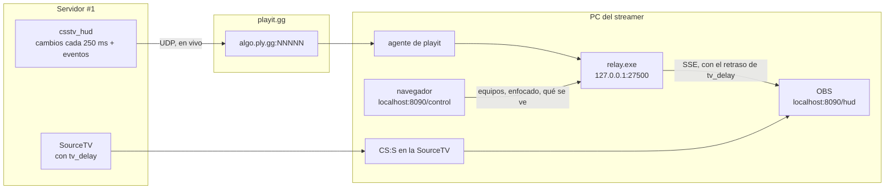
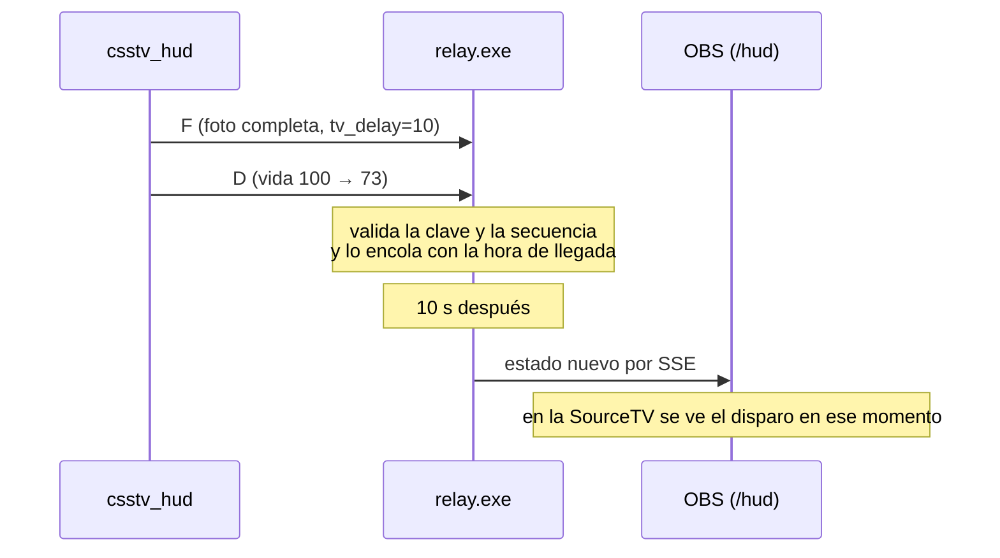

# HUD de observer: documentación

## Qué hace

Un streamer se conecta a la SourceTV del servidor #1 y transmite con OBS. Encima de la imagen muestra un HUD con los 10 jugadores (vida, chaleco, plata, armas, granadas, K/D y daño de la ronda), el marcador, el timer, la bomba y el feed de kills.

El plugin `csstv_hud` **empuja** los datos por UDP a una sola dirección y **solo manda lo que cambió**. No contesta pedidos, así que cuesta lo mismo con 1 o con 50 personas mirando el HUD. Esto reemplaza al intento anterior, que pedía el estado completo cada 0,2 s y trababa el servidor.

Los datos llegan al **relay** (`relay.exe`), que hoy corre en la PC del streamer detrás de un túnel UDP de playit.gg, porque no hay VPS y la conexión de Daniel tiene CGNAT. El relay retrasa todo lo mismo que `tv_delay`, así que el HUD y la imagen de la SourceTV llegan juntos. El dato en vivo nunca llega a OBS.

## El plugin `csstv_hud` 1.0.0

Es independiente de `csstv_reporter` y no lleva licencia. Usa la extensión **Socket 3.0.1** (sfPlayer), que ya estaba en los dos servidores (`socket.ext.so`). El socket es UDP "conectado": la extensión resuelve el dominio en su propio hilo y después cada envío va directo. Si se cae, reintenta a los 10 s.

**Cuándo manda:** solo si `csstv_hud 1`, hay host y puerto, y hay al menos un jugador en T o CT.

### Cvars (`cfg/sourcemod/csstv_hud.cfg`)

| Cvar | Por defecto | Qué hace |
|---|---|---|
| `csstv_hud` | `1` | `0` apaga el envío al instante |
| `csstv_hud_host` | `""` | Dominio o IP del relay. Vacío: no manda nada. Protegida |
| `csstv_hud_port` | `0` | Puerto UDP del relay |
| `csstv_hud_key` | `""` | Clave compartida con el relay. Protegida |
| `csstv_hud_interval` | `0.25` | Cada cuántos segundos revisa qué cambió (0,1 a 2) |
| `csstv_hud_full` | `3` | Cada cuántos segundos manda la foto completa (1 a 30) |

Todas se pueden cambiar desde la consola sin recargar el plugin, así que no cancelan ninguna partida. Al cambiar el host o el puerto, el plugin cierra el socket y abre uno nuevo.

**Comando:** `csstv_hud_status` (flag RCON) muestra si está conectado, a dónde manda, cuántos paquetes y bytes salieron y el último error.

### Paquetes

Texto, con los campos separados por `|` y los jugadores por `;`, nunca más de 1200 bytes:

| Tipo | Cuándo | Cuerpo |
|---|---|---|
| `F` | Cada `csstv_hud_full` s y al empezar cada ronda | `tv_delay`, mapa, ronda, puntos T y CT, fase, segundos que quedan y todos los jugadores |
| `N` | Junto con cada `F` | `uid,steamid,nombre` de cada jugador |
| `D` | En cada revisión que encuentra cambios | La línea entera de cada jugador que cambió |
| `E` | Al instante | `kill` (atacante, víctima, arma, headshot), `phase` (`freeze`, `live`, `planted`, `over`), `bomb` (`plant`, `defuse`, `explode`) y `end` (ganador y motivo) |

Todos empiezan con `CMH1|<clave>|<secuencia>|<tipo>|`. La secuencia le sirve al relay para descartar los paquetes viejos que llegan desordenados.

**Línea de cada jugador:** uid, equipo, vivo, vida, chaleco, casco, kit, plata, arma principal, secundaria, en la mano, HE, flashes, humo, bomba, kills, muertes y daño de la ronda.

## El relay (`hud/relay/` 1.0.0)

Node 24 con TypeScript directo, sin dependencias de producción. Se empaqueta como un solo `relay.exe` (*Single Executable Application* de Node, unos 90 MB) con el HUD adentro, así que el streamer no instala nada.

- **Entrada UDP**, solo en `127.0.0.1` (por defecto el puerto 27500): el agente de playit corre en la misma PC. Descarta los paquetes con la clave incorrecta o con un formato inválido, y los cuenta.
- **Retraso:** cada paquete se aplica al estado que ve OBS recién cuando pasaron `tv_delay` segundos (el último valor de una `F`). `delay` en `relay.json` fuerza otro valor. El estado en vivo no se expone por ninguna ruta.
- **HTTP**, solo en `127.0.0.1` (por defecto el puerto 8090):

| Ruta | Qué es |
|---|---|
| `/hud` | El HUD para OBS, a 1920×1080 y con el fondo transparente |
| `/control` | La página de control del streamer |
| `/events` | *Server-Sent Events*: el estado retrasado completo al conectarse y después cada cambio |
| `/api/status` | Versión, paquetes recibidos, hace cuánto llegó el último, retraso, cola y HUD abiertos |
| `POST /api/control` | Cambios de la página de control. Solo acepta JSON (si no, responde 415) |

- **Consola:** cada 10 s dice si recibe, cuántos paquetes por segundo llegan, el retraso, los jugadores y cuántos HUD hay abiertos, o por qué no llega nada.

### Configuración

`relay.json`, al lado del `.exe`. Si no existe, el relay lo crea y se cierra:

| Campo | Por defecto | Qué es |
|---|---|---|
| `key` | `PEGAR_ACA_LA_CLAVE` | La clave del servidor (`HUD_RELAY_KEY` del `.env`) |
| `udpPort` | `27500` | El puerto local del túnel de playit |
| `httpPort` | `8090` | El puerto del HUD y de la página de control |
| `delay` | `null` | `null` usa el `tv_delay` del servidor. Un número (0 a 300) fuerza ese retraso |

`relay-control.json` guarda lo que se eligió en `/control`, para que sobreviva a un reinicio.

## El HUD y la página de control

| Zona del HUD | Qué muestra |
|---|---|
| Arriba al centro | Nombres de los equipos, marcador, ronda y timer de la ronda o de la bomba plantada |
| Costados | Los 5 jugadores de cada equipo: barra de vida, chaleco o casco, plata, armas, granadas, kit o bomba, K/D y daño de la ronda. Los muertos se ven apagados |
| Abajo al centro | El jugador enfocado, más grande |
| Arriba a la derecha | Feed de kills con el arma y el headshot |
| Al terminar la ronda | Un cartel con el ganador y si explotó o se desactivó la bomba |

Las armas se muestran con su nombre, sin íconos.

**Página de control:** los nombres de los equipos (con *Intercambiar* para el medio tiempo), el jugador enfocado (un clic, las teclas 1 a 5 para CT y 6 a 0 para T, y Esc para sacarlo) y qué partes del HUD se ven (jugadores, enfocado, kills y marcador). Lo que se elige acá no viene del servidor, así que no pasa por el retraso.

## Reglas

- **Un solo destino por servidor.** Cuando cambia el streamer, un admin cambia `csstv_hud_host` y `csstv_hud_port` en la consola y en el cfg.
- **Mientras el relay corra en la PC del streamer, en los torneos solo transmite alguien neutral.** El dato sin retraso pasa por su PC antes que la imagen.
- La clave, el host y el puerto van solo en el cfg del servidor y en el `.env`, nunca en el repo.
- Cuando haya VPS, el relay pasa ahí y el plugin apunta al VPS. No hay que tocar el plugin ni el HUD.

## Dónde está cada cosa

| Qué | Archivo / ubicación |
|---|---|
| Plugin | `server/addons/sourcemod/scripting/csstv_hud.sp` (el formato de los paquetes está en la cabecera) |
| Plugin compilado | `server/addons/sourcemod/plugins/csstv_hud.smx` |
| Include de Socket | `server/addons/sourcemod/scripting/include/socket.inc` |
| Cfg (sin host ni clave) | `server/cfg/sourcemod/csstv_hud.cfg` |
| Lectura de los paquetes | `hud/relay/src/protocol.ts` |
| Retraso | `hud/relay/src/delay.ts` |
| Estado que ve el HUD | `hud/relay/src/state.ts` |
| HTTP y SSE | `hud/relay/src/server.ts` |
| `relay.json` y `relay-control.json` | `hud/relay/src/config.ts` y `src/control.ts` |
| HUD y página de control | `hud/relay/public/` |
| Partida simulada | `hud/relay/scripts/simular.ts` |
| Armado de `relay.exe` | `hud/relay/scripts/build-exe.mjs` |
| Pruebas | `hud/relay/test/relay.test.ts` |
| Guía del streamer y de los admins | [`hud/relay/README.md`](../../../hud/relay/README.md) |
| Clave | `.env` de la raíz (`HUD_RELAY_KEY`) y `cfg/sourcemod/csstv_hud.cfg` del servidor |
