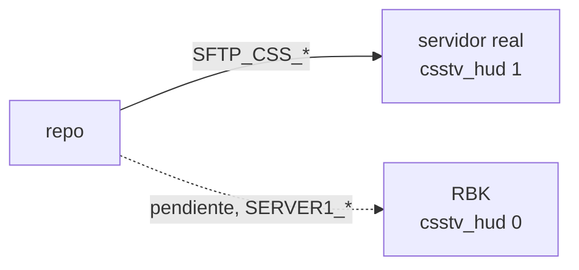

# HUD de observer: guía de implementación

## Estado

**`csstv_hud` 1.0.0 subido solo al servidor real el 2026-10-22, sin probar** (excepción pedida por Daniel), con el host y el puerto vacíos. El relay y el HUD (1.0.0) están probados solo en local, con la partida simulada. **RBK no lo tiene.** Falta la prueba con el servidor real y playit.gg.

## Archivos

| Archivo | Cambio |
|---|---|
| `server/addons/sourcemod/scripting/csstv_hud.sp` | Nuevo: plugin 1.0.0 |
| `server/addons/sourcemod/plugins/csstv_hud.smx` | Nuevo: compilado (14738 bytes, md5 `72645cac9e61aa5ad768586eee72d06d`) |
| `server/addons/sourcemod/scripting/include/socket.inc` | Nuevo: include de la extensión Socket, de JoinedSenses/sm-ext-socket (las mismas natives que la 3.0.1 de sfPlayer) |
| `server/cfg/sourcemod/csstv_hud.cfg` | Nuevo: cfg con el host y la clave vacíos |
| `hud/relay/` | Nuevo: relay, HUD, página de control, simulador, armado del `.exe`, pruebas y `README.md` |
| `hud/relay/pnpm-workspace.yaml` | `minimumReleaseAge: 10080`, `trustPolicy: no-downgrade` y `allowBuilds` con `esbuild` |
| `docs/PENDIENTES.md` | Punto 1.15 |
| `docs/bitacora/README.md` | Fila del requerimiento |

Dependencias de desarrollo del relay: `@types/node` 24.19.0, `esbuild` 0.28.1, `postject` 1.0.0-alpha.6 y `typescript` 6.0.3. No hay dependencias de producción.

## Compilación

**Plugin**, con el spcomp 1.8 del servidor local (las natives que usa existen igual en el 1.10 del servidor real):

```bash
cd server/addons/sourcemod/scripting
"<servidor local>/cstrike/addons/sourcemod/scripting/spcomp.exe" csstv_hud.sp \
  -i"<servidor local>/cstrike/addons/sourcemod/scripting/include" -iinclude \
  -o../plugins/csstv_hud.smx
```

Con `HUD_DEBUG=` se compila la versión de depuración, que escribe cada paquete en `logs/csstv_hud_AAAAMMDD.log`.

**Relay:**

```bash
cd hud/relay
pnpm install --frozen-lockfile
pnpm test
pnpm typecheck
pnpm build:exe     # dist/relay.exe
```

`relay.exe` no se versiona. El del 2026-10-22 pesa 92,7 MB (md5 `9463d2976eb528cc8b0356a78c73cf4c`) y se le pasa al streamer por Drive, con la clave por privado. No está firmado, así que Windows SmartScreen muestra una advertencia.

## Despliegue (hecho el 2026-10-22)



1. **Servidor real** (`SFTP_CSS_*`):
   - `cstrike/addons/sourcemod/plugins/csstv_hud.smx`
   - `cstrike/cfg/sourcemod/csstv_hud.cfg` con `csstv_hud "1"`, la clave y el host y el puerto vacíos
   - Los dos se bajaron de nuevo y se compararon.
2. La clave se generó en ese momento y se guardó en el `.env` como `HUD_RELAY_KEY`.
3. Se carga sola en el próximo cambio de mapa, o con `sm plugins load csstv_hud` desde la consola del panel, que no corta la partida porque es un plugin aparte.
4. **RBK** (`SERVER1_*`): **pendiente.** Cuando se confirme que funciona, se sube el mismo `.smx` con `csstv_hud "0"`. Es un plugin sin licencia, así que no hace falta el build licenciado. RBK ya tiene `socket.ext.so` (el mismo md5 que el real).

**Para usarlo** (un admin, cuando el streamer pasa su dirección de playit):

```
csstv_hud_host "algo.ply.gg"
csstv_hud_port "12345"
csstv_hud_status
```

Y lo mismo en `cfg/sourcemod/csstv_hud.cfg`, para que no se pierda en el próximo mapa.

**Túnel del streamer en playit.gg:** agente en *Your computer*, túnel UDP, *port count* 1, dirección local `127.0.0.1:27500` y *proxy protocol* None.

## Pruebas

### Relay y HUD (PC de Daniel, 2026-10-22)

- 16 pruebas con `node:test` (lectura de los paquetes, clave, secuencias, cola del retraso, estado, `relay.json` y control) y el typecheck sin errores.
- El relay con Node y el `relay.exe` contra `pnpm simular 3`: llegaron los paquetes, el HUD se llenó con 3 s de retraso y la página de control cambió los nombres, el enfocado y las partes visibles.
- Captura del HUD con Edge headless: se ve bien.

### Plugin

- Compila sin errores ni avisos.
- **No se probó** en el servidor local (excepción de Daniel): no se midió con `csstv_perf`, ni se comprobó que resolver el dominio no bloquee el hilo del juego, ni se comparó el HUD con la SourceTV.

### Falta

- La prueba con el servidor real y playit.gg en un mix, sin transmitir: que la salida UDP del hosting llegue al túnel, que el HUD acompañe la SourceTV y que `csstv_perf` no muestre cambios.
- Ver cómo ocultar las barras de espectador de CS:S debajo del HUD.

## En qué se apartó del plan

- **Sin pruebas en el servidor local y solo al servidor real** (pasos 1, 3 y 5 del orden del plan). Lo pidió Daniel el 2026-10-22. RBK queda pendiente.
- ***Server-Sent Events* en lugar de WebSocket**: el HUD solo recibe datos, y así el relay no tiene dependencias (el plan usaba `ws`). La página de control manda sus cambios con `POST /api/control`.
- **Un paquete `N` aparte** con el SteamID y el nombre, en lugar de mandarlos dentro de la `F`.
- **El paquete `D` manda la línea entera** de cada jugador que cambió, no solo los campos que cambiaron (`campo=valor`). Es más simple de armar y de leer, y sigue cabiendo en un paquete.
- **El tipo `E` tiene `phase`** (`freeze`, `live`, `planted`, `over`) en lugar de `round_start` y `round_end`, más `end` con el ganador.
- **Las armas se muestran con su nombre, sin íconos.**
- **El cartel de fin de ronda** muestra al ganador y si explotó o se desactivó la bomba, pero no el motivo del motor.
- **Sin logos de los equipos** en la página de control: solo los nombres.
- **La configuración va solo en `relay.json`**, sin opciones de línea de comandos (`--udp-port`, `--http-port`, `--delay`).
- **Un solo destino por servidor:** decidido con Daniel. Se cambia a mano cuando cambia el streamer.

## Cómo revertir

- **Apagarlo al instante:** `csstv_hud 0` en la consola del panel (y en el cfg).
- **Sacarlo del servidor:** mover `addons/sourcemod/plugins/csstv_hud.smx` a `plugins/disabled/`. Deja de cargar en el próximo cambio de mapa. `sm plugins unload csstv_hud` lo saca en el momento sin cortar la partida.
- **Repo:** revertir los commits del HUD. No toca la base de datos ni los otros plugins.
