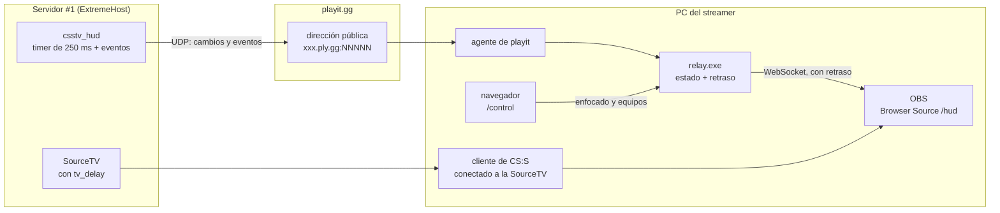
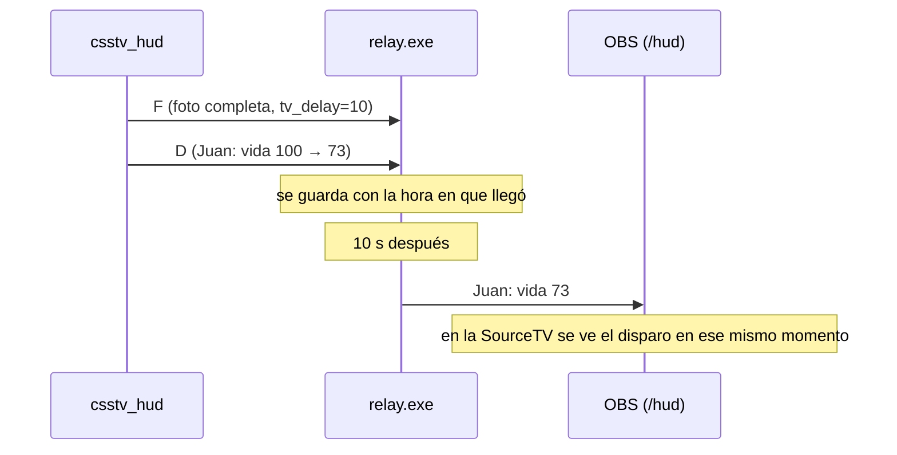

# Plan: HUD de observer para transmitir desde la SourceTV

> Planeación original. Estado: **propuesta**, pendiente de aprobación.

Un streamer se conecta a la SourceTV del servidor #1 (el real) y transmite con OBS. Encima de la imagen muestra un HUD con la vida, el chaleco, la plata, las armas y las kills de los 10 jugadores, el marcador y la bomba.

**Antecedente:** ya hubo un intento que actualizaba el HUD pidiendo el estado completo cada 0,2 s. El servidor se trababa porque cada pedido se armaba en el hilo que simula el juego. Ese intento no quedó en el repo. Este plan lo resuelve con tres cambios: el servidor **empuja** los datos en lugar de contestar pedidos, **solo manda lo que cambió** y usa **UDP**.

**Excepción al orden de trabajo:** desde el 2026-10-15 los plugins están congelados hasta terminar la web ("web primero, plugins al final"). Este plan es un plugin nuevo e independiente (`csstv_hud`), así que no toca `csstv_reporter`. Si Daniel lo aprueba, es una excepción como `!sell` o `!calladmin`.

## Decisiones tomadas

| Tema | Decisión | Por qué |
|---|---|---|
| Quién inicia el envío | El plugin empuja los datos a una sola dirección (el relay). Nadie le pide nada al servidor | Con *polling*, el costo sube con cada fuente de OBS abierta. Empujando, el servidor manda lo mismo aunque haya 1 o 50 espectadores |
| Transporte | UDP con la extensión `socket` (`socket.ext.so`, ya instalada en el servidor real por el hosting) | No hay conexión, ni TLS, ni espera de respuesta, ni hilos. Mandar un datagrama de ~200 bytes cuesta casi nada. HTTP con `system2` queda como plan B |
| Qué se manda | Solo lo que cambió, como mucho cada 250 ms (`csstv_hud_interval`). Además, una foto completa cada 3 s y los eventos (kill, bomba, ronda) al instante | Si nadie recibe daño ni compra, no sale ningún paquete. La foto periódica sirve para recuperarse si se pierde un paquete UDP |
| Cómo detecta los cambios | Un timer cada 250 ms lee unas 12 propiedades por jugador, las compara con lo que mandó antes y arma el paquete con las diferencias | Leer unas 120 propiedades cada 250 ms es despreciable. Es más simple y más seguro que depender solo de eventos (la vida también baja por caídas o por la bomba) |
| Retraso | El relay retrasa todo igual que `tv_delay`. El plugin manda el valor de `tv_delay` en cada foto | El HUD queda sincronizado con la imagen. Además, el dato en vivo nunca llega a OBS: si llegara, serviría para hacer *ghosting* |
| Dónde corre el relay, por ahora | En la PC del streamer, publicado con un túnel UDP de **playit.gg** | Todavía no tenemos el VPS y la conexión que probamos tiene CGNAT (WAN `172.19.32.1`, distinta de la IP pública). playit.gg funciona con CGNAT y se configura en 10 a 15 minutos |
| Dónde corre el relay, después | En el VPS (o en una VM con IP pública) | Pasar de uno a otro es cambiar `csstv_hud_host` y `csstv_hud_port` en la consola. No hay que tocar el plugin ni el HUD |
| Regla mientras el relay esté en la PC del streamer | **En torneos, solo transmite un streamer neutral** (que no sea de ninguno de los dos equipos ni de su entorno) | El dato sin retraso pasa por su PC. Alguien con conocimientos podría leerlo antes que la SourceTV |
| Autenticación | Clave compartida (`csstv_hud_key`) en cada paquete. El relay descarta los que no la traen | Cualquiera que conozca la dirección de playit podría mandar paquetes falsos y ensuciar el HUD |
| Jugador enfocado (la tarjeta grande) | Lo elige el streamer desde una página de control del relay (`/control`), con un clic o las teclas 1 a 0 | El servidor no sabe a quién mira cada espectador de la SourceTV. Seguir al director automático depende de la investigación 2.2 de `PENDIENTES.md`, que está en pausa |
| Nombres de los equipos | Se cargan en `/control` | CS:S v34 no tiene nombres de equipo en el motor |
| Asistencias | No se muestran | CS:S v34 no las cuenta. Calcularlas sería trabajo aparte y no hace falta para la primera versión |
| Licencia | `csstv_hud` va sin licencia, igual que `csstv_sell` y `csstv_calladmin` | No manda nada a nuestra base. Sin `csstv_hud_host` no hace nada |
| Servidores | Se sube al servidor real y a RBK en la misma tanda (regla de `CLAUDE.md`). En RBK queda con `csstv_hud "0"` hasta que alguien quiera transmitir desde ahí | Configuración igual en todos los servidores |
| Relay para el streamer | Un solo `.exe` (*Single Executable Application* de Node) | El streamer no tiene que instalar Node ni pnpm |

## 1. El flujo completo



1. El plugin le manda al relay los cambios de los jugadores y los eventos, por UDP y a la dirección de playit.
2. El agente de playit reenvía esos paquetes al `relay.exe`, en la misma PC.
3. El relay arma el estado y guarda cada cambio con la hora en que llegó. Recién lo aplica al estado que ve OBS cuando pasaron `tv_delay` segundos.
4. OBS muestra la imagen de CS:S (la SourceTV, que ya viene retrasada) y encima el HUD (`http://localhost:PUERTO/hud`), con el mismo retraso.



## 2. Plugin `csstv_hud` 1.0.0

Archivo nuevo: `server/addons/sourcemod/scripting/csstv_hud.sp`. Es independiente de `csstv_reporter`: no comparte código ni natives.

### Cvars (`cfg/sourcemod/csstv_hud.cfg`)

| Cvar | Valor por defecto | Qué hace |
|---|---|---|
| `csstv_hud` | `1` | `0` apaga el envío al instante |
| `csstv_hud_host` | `""` | Dominio o IP del relay. Vacío: no manda nada |
| `csstv_hud_port` | `0` | Puerto UDP del relay |
| `csstv_hud_key` | `""` | Clave compartida con el relay |
| `csstv_hud_interval` | `0.25` | Cada cuántos segundos revisa los cambios (de 0,1 a 2) |
| `csstv_hud_full` | `3` | Cada cuántos segundos manda la foto completa |

`csstv_hud_host`, `csstv_hud_port` y `csstv_hud_key` se pueden cambiar desde la consola del panel sin recargar el plugin, así que no cancelan ninguna partida. Al cambiar el host o el puerto, el plugin cierra el socket y abre uno nuevo.

### El socket

- Un socket UDP "conectado" (`SocketCreate(SOCKET_UDP)` + `SocketConnect`). La extensión resuelve el dominio y conecta en su propio hilo, y después cada envío es un `SocketSend` sin resolver nada.
- **Hay que verificarlo en las pruebas:** que la resolución del dominio no bloquee el hilo del juego. Si lo bloquea, `csstv_hud_host` lleva la IP del dominio de playit en lugar del nombre.
- Si el socket se cae o el relay no está, el plugin no reintenta en cada tick: espera 10 s y vuelve a conectar. Con UDP, que el relay esté apagado no afecta al servidor.

### Cuándo manda

Solo si `csstv_hud 1`, hay host y hay al menos un jugador en T o CT. Sin jugadores no sale nada, ni siquiera la foto periódica.

### Formato de los paquetes

Son de texto, con los campos separados por `|` y los jugadores por `;`, y como mucho 1200 bytes para que no se fragmenten. No se usa JSON porque armarlo en SourcePawn es más caro y ocupa más.

```
CMH1|<clave>|<secuencia>|<tipo>|<cuerpo>
```

| Tipo | Cuándo | Cuerpo |
|---|---|---|
| `F` | Cada `csstv_hud_full` segundos, al conectar y al empezar cada ronda | `tv_delay`, mapa, ronda, marcador T y CT, fin de la ronda (para el timer), bomba (estado y tiempo), y todos los jugadores con todos sus campos |
| `D` | En cada revisión que encuentra cambios | Solo los jugadores que cambiaron, cada uno con su `userid` y los campos que cambiaron (`campo=valor`) |
| `E` | Al instante | Un evento: `kill` (quién, a quién, arma, headshot), `plant`, `defuse`, `explode`, `round_start`, `round_end` (ganador y motivo) |

**Campos de cada jugador:** `userid`, SteamID y nombre (solo en `F` y cuando cambian), equipo, vivo, vida, chaleco, casco, kit, plata, arma principal, arma secundaria, HE, flashes, humo, si lleva la bomba, kills, muertes y daño hecho en la ronda (con `player_hurt`, sin pasarse de la vida que le quedaba a la víctima, igual que el `!hp` de la QoL).

La secuencia sirve para que el relay descarte los paquetes viejos que llegan desordenados.

### Costo esperado

| | Intento anterior | `csstv_hud` |
|---|---|---|
| Pedidos o paquetes por segundo | 5 HTTP por cada fuente de OBS | De 0 a 4 UDP en total, más 1 foto cada 3 s |
| Trabajo en el hilo del juego | Armar el estado completo y la respuesta HTTP | Comparar unas 120 propiedades y, si hay cambios, un `Format` y un `SocketSend` |

Se mide con `csstv_perf` en el servidor local, con bots, antes y después de cargar el plugin (sección 6).

## 3. Relay (`hud/relay/`)

Proyecto nuevo con Node 24 y TypeScript, igual que el backend. Usa **pnpm** con su `pnpm-workspace.yaml` (antigüedad mínima de 7 días, `trustPolicy: no-downgrade`, `allowBuilds`). Su única dependencia de producción es `ws`.

- **Entrada UDP** (`--udp-port`, por defecto 27500): valida el prefijo `CMH1` y la clave, descarta las secuencias viejas y guarda cada paquete con la hora en que llegó.
- **Retraso:** una cola. Cada paquete se aplica al **estado retrasado** cuando pasaron `tv_delay` segundos (el último valor recibido en una `F`). Con `--delay` se fuerza otro valor. El estado en vivo **no se expone** por ninguna ruta.
- **HTTP y WebSocket** (`--http-port`, por defecto 8090, solo en `127.0.0.1`):
  - `/hud`: la página del HUD para OBS.
  - `/control`: jugador enfocado, nombres y logos de los equipos, y mostrar u ocultar partes del HUD.
  - `/ws`: le manda a cada página el estado retrasado completo al conectarse y después los cambios.
- **Estado del relay:** en la consola muestra si llegan paquetes, cuántos por segundo, el retraso y si la clave es correcta. Así el streamer sabe si el túnel funciona.
- **Empaquetado:** `pnpm build:exe` genera `relay.exe` (*Single Executable Application* de Node) con el HUD adentro. La configuración va en `relay.json`, junto al `.exe` (puerto, clave y retraso).

Escuchar solo en `127.0.0.1` hace que nadie de la red del streamer pueda ver el HUD ni la página de control. El único puerto que llega desde afuera es el UDP, y solo por el túnel de playit.

## 4. El HUD (`hud/relay/public/`)

HTML, CSS y JavaScript sin frameworks, a 1920×1080 y con fondo transparente para OBS. La estética es la de CMLeague (colores y tipografía de la web).

| Zona | Qué muestra |
|---|---|
| Arriba al centro | Nombres de los equipos, marcador, ronda, timer de la ronda (o de la bomba plantada) |
| Costados | Los 5 jugadores de cada equipo: nombre, barra de vida, chaleco o casco, plata, arma principal, granadas, kit o bomba, K/D y daño de la ronda. Los muertos se ven apagados |
| Abajo al centro | El jugador enfocado (elegido en `/control`): vida, chaleco, arma, granadas y K/D más grandes |
| Arriba a la derecha | Feed de kills con el arma y el headshot. Desaparecen a los 5 s |
| Al terminar la ronda | Un cartel con el ganador y el motivo |

Los íconos de las armas son SVG propios o de uso libre, nunca los de Valve.

## 5. Configuración provisoria con playit.gg

### Lo que hace el streamer (una sola vez)

1. Crear una cuenta en [playit.gg](https://playit.gg) e instalar el agente para Windows.
2. En el panel de playit, crear un túnel **UDP** hacia la IP local `127.0.0.1`, puerto `27500`. playit le da una dirección como `algo.ply.gg:12345`.
3. Pasarle esa dirección a Daniel **por mensaje privado** (no en un canal público).
4. Poner `relay.exe` y `relay.json` (con la clave que le pase Daniel) en una carpeta.

### Lo que hace el streamer cada vez que transmite

1. Abrir el agente de playit y `relay.exe`. La consola del relay dice "esperando paquetes".
2. Conectarse a la SourceTV del servidor #1 desde CS:S.
3. En OBS: capturar el juego y, encima, un **Browser Source** de 1920×1080 con la URL `http://localhost:8090/hud`.
4. Abrir `http://localhost:8090/control` en el navegador para poner los nombres de los equipos y elegir a quién enfocar.
5. Cuando arranca la partida, la consola del relay muestra "recibiendo" y el HUD se llena, con el retraso de la SourceTV.

### Lo que hace Daniel (o un admin)

En la consola del panel del servidor #1, sin recargar nada:

```
csstv_hud_host "algo.ply.gg"
csstv_hud_port "12345"
csstv_hud_key "<clave>"
```

Y lo mismo en `cfg/sourcemod/csstv_hud.cfg`, para que no se pierda en el próximo cambio de mapa. Si el streamer cambia, solo cambian el host y el puerto.

### Cuando esté el VPS

El relay corre como servicio en el VPS y el HUD se sirve por HTTPS, con un token por streamer en la URL. El plugin pasa a apuntar al VPS. La regla del streamer neutral deja de hacer falta, porque el dato en vivo ya no sale de nuestra infraestructura. Esto va en un plan aparte, junto con el del VPS.

## 6. Pruebas

En el **servidor local** con bots, y el relay en la misma PC (sin playit):

1. `csstv_perf` sin `csstv_hud` y con `csstv_hud`, en un mix de bots de 5 contra 5: los ticks tarde y el tiempo de frame no tienen que cambiar.
2. Paquetes: con `csstv_hud_interval 0.25`, contar cuántos llegan por segundo en una ronda con combate y en una ronda tranquila.
3. HUD: vida, chaleco, compras, granadas, muertes, bomba (plantar, desactivar, explotar), fin de ronda y medio tiempo, comparados con lo que se ve en la SourceTV.
4. Retraso: con `tv_delay 10`, el HUD y la imagen tienen que coincidir. Y abrir el HUD a mitad de ronda no tiene que mostrar el estado en vivo.
5. Robustez: apagar el relay a mitad de una ronda (el servidor sigue igual), mandar paquetes con una clave equivocada (se descartan) y cambiar `csstv_hud_host` en una ronda (no cancela nada).
6. Que resolver el dominio no bloquee el hilo del juego (sección 2).

Después, **con playit.gg y el servidor real**, en un mix normal: que la salida UDP del hosting llegue al túnel y que el HUD acompañe la SourceTV durante todo el mix. Recién después, una transmisión de verdad.

## 7. Referencia: `cs-hud-observer` (CS 1.6)

Daniel pasó [Counter-Strike-HUD/cs-hud-observer](https://github.com/Counter-Strike-HUD/cs-hud-observer) (licencia MIT, archivado desde 2023-02-02). Lo revisé el 2026-10-22.

| Qué hace | Qué tomamos |
|---|---|
| Un plugin de AMX Mod X (no está en el repo) **escucha un puerto TCP en el servidor del juego**. El backend, en la PC del streamer, se conecta a ese puerto y manda `Bearer <token>`. Los datos son eventos (`kill`, `damage`, `money_change`, `c4_planted`, `weapon_switched`…) | La misma idea de **empujar eventos** en lugar de hacer *polling*. Y la lista de eventos de `events.ts`, como referencia para el HUD |
| Como el que se conecta es la PC del streamer, **no le afecta el CGNAT** | Lo dejamos como **alternativa** a playit.gg. Para usarla, ExtremeHost tendría que asignar un puerto extra al servidor, y el plugin quedaría escuchando conexiones desde internet. Eso suma riesgo en un servidor que ya recibió ataques (ver `PENDIENTES.md`, 2.1) |
| El caster está **dentro del servidor como espectador** (`caster_observed_player`), así que el plugin sabe a quién mira | No sirve con la SourceTV. Un caster dentro del servidor ve todo sin `tv_delay` y ocupa un lugar. Lo descartamos para torneos |
| No aplica ningún retraso | Nosotros sí, en el relay (sección 3) |
| Backend con socket.io y HUD en React con componentes (`PlayersLeft`, `PlayerObserved`, `Score`, `Kill`, `Radar`) | El diseño de las zonas del HUD y el `demo.mp4`, como inspiración. No copiamos el código: las dependencias son de 2022 y el repo está archivado |

## 8. Requisitos antes de empezar

| Qué | Quién |
|---|---|
| Aprobar este plan y la excepción al congelamiento de los plugins | Daniel |
| Confirmar con `sm exts list` (consola del panel) que `socket.ext.so` carga en el servidor real, y revisar si RBK la tiene | Daniel, o yo por SFTP |
| Instalar la extensión `socket` (`socket.ext.dll`) en el servidor local de pruebas, `E:\CSS DEDICATED SERVER\server` | Daniel |
| Elegir al streamer, que tenga Windows con OBS, y que cree su cuenta en playit.gg | Daniel |
| Decidir el `tv_delay` de las transmisiones (hoy está en el valor por defecto del motor). Para torneos se suele usar entre 30 y 90 s | Daniel |

## 9. Orden de implementación

1. Plugin `csstv_hud` 1.0.0 y su cfg, probados con bots en el servidor local.
2. Relay y HUD en `hud/relay/`, probados contra el servidor local.
3. Medición con `csstv_perf` (sección 6, prueba 1). Si cambia algo, se ajusta antes de seguir.
4. Empaquetar `relay.exe` y escribir la guía para el streamer (pasos de la sección 5, con capturas).
5. Subir `csstv_hud.smx` y `csstv_hud.cfg` al **servidor real** (`SFTP_CSS_*`) y a **RBK** (`SERVER1_*`) en la misma tanda. En RBK, con `csstv_hud "0"`. Se cargan en el próximo cambio de mapa.
6. Prueba con playit.gg en un mix real, sin transmitir.
7. Primera transmisión.
8. `DOCUMENTACION.md`, `GUIA_IMPLEMENTACION.md`, `PLUGINS_EXTERNOS.md` (si se instala `socket` en RBK) y `PENDIENTES.md`.
