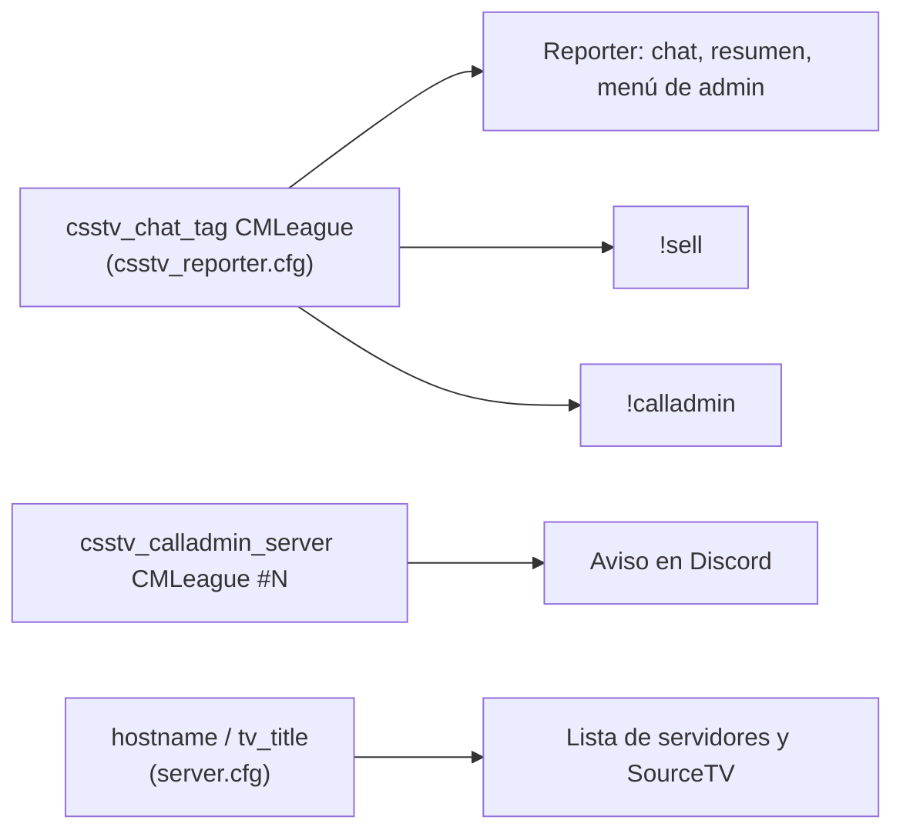

# Nombre visible CMLeague: documentación

## Qué hace

Desde el 2026-10-22, en los dos servidores (el real y RBK), todo lo que ven los jugadores y los admins dice **CMLeague** en lugar de v34frag:
- el nombre del servidor en la lista;
- el título de SourceTV;
- el prefijo del chat;
- los avisos de `!calladmin` en Discord;
- la categoría del menú de admin;
- el autor de nuestros plugins.

Lo que no ve ningún jugador queda igual: el repo, los nombres de los proyectos, el Worker de demos y las URLs. Cambiarlos rompería la web, las demos y los volcados de Accelerator.

## Dónde se define cada nombre

| Qué ve el jugador | Dónde se define | Valor |
|---|---|---|
| Nombre en la lista de servidores | `cfg/server.cfg` → `hostname` | `CMLeague #1 By ExtremeHost` (real) y `CMLeague #2 By ExtremeHost` (RBK) |
| Título de SourceTV | `cfg/server.cfg` → `tv_title` | `CMLeague SourceTV #1` (solo en el real: RBK no lo define) |
| Prefijo `[CMLeague]` en el chat y nombre de la categoría del menú de admin | `cfg/sourcemod/csstv_reporter.cfg` → `csstv_chat_tag` | `CMLeague`. El reporter, `!sell` y `!calladmin` lo leen de esta cvar |
| Servidor en los avisos de `!calladmin` | `cfg/sourcemod/csstv_calladmin.cfg` → `csstv_calladmin_server` | `CMLeague #1` y `CMLeague #2` |
| Valores por defecto (si el cfg no define nada) | Código de los plugins | `CMLeague` |
| Autor en `sm plugins list` | Código de los plugins | `CMLeague` (el reporter sigue como `CSSTV`) |
| Motivo del cambio de mapa por votación | `csstv/maps.inc` | `CMLeague: votación de mapa de los jugadores` |

## Lo que no se cambió

| Qué | Por qué |
|---|---|
| `dsc.gg/v34frag` (link de Discord al final de cada partida) | Decisión de Daniel: el link sigue funcionando |
| Identificadores del menú de admin (`v34frag_live`, `v34frag_cancel`…) | Son internos. El nombre que se ve sale de `csstv_chat_tag` |
| Worker `v34frag-demos` (su URL la usan la web, el backend y el `core.cfg` de Accelerator), `v34frag-api`, `project_id` de Supabase y nombres de paquetes | Son identificadores de infraestructura: cambiarlos rompe enlaces |
| Nombre de los archivos de las demos (`v34frag_AAAA-MM-DD_mapa…dem`) | Lo arma el Worker. Si se quiere cambiar, va con el próximo deploy del Worker (punto 1.1 de `PENDIENTES.md`) |
| Repo, carpetas y documentación interna | No son visibles |
| "v34fragnation" | No aparece en el repo, en los cfgs ni en los plugins de los dos servidores. Si está en otro lado (Discord, panel del hosting), se cambia a mano |

## Versiones

| Plugin | Antes | Ahora |
|---|---|---|
| `csstv_reporter` | 2.4.0 | 2.4.1 |
| `csstv_sell` | 1.0.0 | 1.0.1 |
| `csstv_calladmin` | 1.0.0 | 1.0.1 |
| `csstv_allchat` | 1.0.1 | 1.0.2 |

Las cuatro versiones solo cambian textos.
