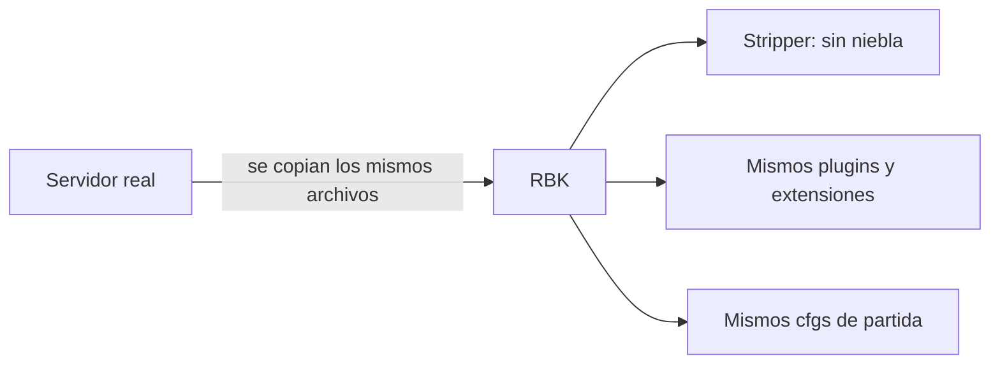

# RBK igual a nuestro servidor: documentación

## Qué hace

Desde el 2026-10-22, RBK (CMLeague #2) tiene la misma configuración que nuestro servidor (CMLeague #1):
- mismos plugins y extensiones;
- Stripper:Source, que les saca la niebla a los mapas;
- los mismos valores de partida, prórroga y medio tiempo;
- el mismo `mapcycle.txt`.

Solo difiere lo que es propio de cada servidor.

En la misma tanda cambiaron dos valores en los dos servidores: la plata de la prórroga pasa a **12000** y la pausa del medio tiempo a **5 segundos**.

## La niebla

Stripper:Source es un plugin de Metamod que cambia las entidades del mapa al cargarlo. `addons/stripper/global_filters.cfg` hace tres cosas en todos los mapas:
- borra `env_fog_controller` (la niebla del mapa);
- borra `fog_volume` (las nieblas por zona);
- en el `worldspawn` pone `fademindist -1` y `fademaxdist 0` (los objetos lejanos no desaparecen).

Lo carga `addons/metamod/metaplugins.ini` (`addons/stripper/bin/stripper_mm`). `addons/stripper/maps/de_dust2_ob.cfg` agrega una caja en de_dust2_ob. RBK no tenía nada de esto.

## Valores de la partida (los dos servidores)

| Qué | Valor | Dónde |
|---|---|---|
| Freezetime en la partida | 15 | `cfg/csstv/live.cfg` |
| Tiempo de la bomba | 40 | `live.cfg` |
| Fuego amigo en la partida | 0 | `live.cfg` (el `server.cfg` tiene 1, pero en la partida manda `live.cfg`) |
| Prórroga | MR3 (`csstv_ot_maxrounds "6"`) | `cfg/sourcemod/csstv_reporter.cfg` |
| Plata en la prórroga | **12000** | `csstv_reporter.cfg` |
| Pausa del medio tiempo | **3 s** (5 s hasta el 2026-10-24, ver [`2026-10-24-medio-tiempo-3s`](../2026-10-24-medio-tiempo-3s/)) | `csstv_reporter.cfg` |
| `sv_pure` | 2 | `server.cfg` y `game.cfg` |
| `phys_timescale` | 1.7 | `server.cfg` |
| Tasas de red | `sv_minupdaterate 100`, `sv_maxupdaterate 101`, `sv_mincmdrate 100`, `sv_maxcmdrate 101` (desde el 2026-10-27, ver [`2026-10-27-tasas-coherentes`](../2026-10-27-tasas-coherentes/)) | `server.cfg` |
| `fps_max` | 600 | `csstv_perf`, que lo sostiene aunque el plugin del hosting lo baje a 150 |

## Lo que sigue siendo distinto (a propósito)

| Qué | Por qué |
|---|---|
| Token, tag (`srv1` / `rbk`) y build licenciado del reporter | Cada servidor tiene su licencia |
| `csstv_demo 0` en RBK | El Worker de demos solo baja demos de nuestro panel |
| `hostname`, `tv_title`, `sv_password`, `tv_password` (solo RBK) | Son de cada servidor |
| `csstv_calladmin_server` y `csstv_calladmin_address` | Cada aviso lleva el nombre y la IP de su servidor |
| Admins (`admins_simple.ini`) | Los de RBK los define su dueño |
| `sv_downloadurl` | El FastDL del real es de nuestra cuenta del hosting. RBK no tiene |
| `adminmenu_cfgs.txt` | El del real tiene una sección rota (error en cada mapa). El de RBK está bien y se dejó |
| Restos sin uso del real (CSS:DM, `grenade_sound_replacer`, SMAC, `deadchat`, `.sp` y `.tar.gz` en `plugins/`) | No los carga nada |
| Líneas de RBK en `csstv_reporter.cfg` que el real no tiene (`!gg`, cuchillo, `!rtv`) | Tienen los mismos valores que el real usa por defecto |

## Accelerator

Está retirado en los dos servidores: sus archivos están en `addons/sourcemod/accelerator_retirado/`, fuera de `extensions/` y `gamedata/`. En el real lo movió alguien a mano, sin dejarlo anotado. En RBK se hizo igual el 2026-10-22. Para volver a usarlo hay que devolver los tres archivos a su lugar, y antes desplegar la ruta `/crash` del Worker (punto 1.1 de `PENDIENTES.md`).

## Dónde está cada cosa

| Qué | Archivo |
|---|---|
| Comparación de los dos servidores | [`pruebas/comparar.py`](pruebas/comparar.py) |
| Script del cambio | [`pruebas/rbk_igual.py`](pruebas/rbk_igual.py) |
| Verificación después del cambio | [`pruebas/verif_cfgs.py`](pruebas/verif_cfgs.py) |
| Cvars en el repo | `server/cfg/sourcemod/csstv_reporter.cfg` |
