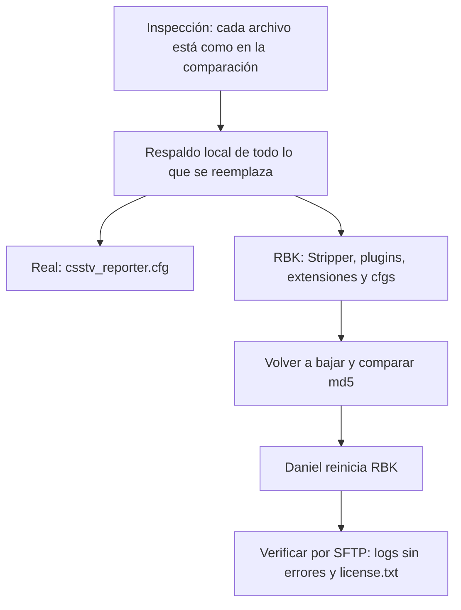

# Plan: dejar RBK igual a nuestro servidor (con Stripper) y nuevos valores de prórroga y medio tiempo

> Planeación original. Estado: **aprobado por Daniel el 2026-10-22**: "el server de rbk debe quedar igual en todo al nuestro, incluye también el stripper… yo lo puedo reiniciar".

## Decisiones tomadas

| Tema | Decisión | Por qué |
|---|---|---|
| Plata en la prórroga | `csstv_ot_startmoney "12000"` en los dos servidores (antes 16000 en el real y 10000 en RBK) | Pedido de Daniel |
| Pausa del medio tiempo | `csstv_halftime_delay "5.0"` en los dos servidores (antes 10 en el real y 3 en RBK) | Pedido de Daniel |
| Niebla en RBK | Se instala Stripper:Source igual que en el real: binarios Linux, `metamod/stripper.vdf`, `metamod/metaplugins.ini`, `stripper/global_filters.cfg` (quita `env_fog_controller` y `fog_volume`) y `stripper/maps/` | Es lo que le saca la niebla a nuestro servidor |
| Resto de RBK | Igual al real: `live.cfg`, `mapcycle.txt`, valores de `server.cfg` y `game.cfg` (`sv_pure 2`, `phys_timescale 1.7`, c4 40, fuego amigo en el `server.cfg`), prórroga MR3, plugins y extensiones | "Igual en todo" |
| Plugins que se agregan a RBK | `csstv_perf` (sostiene `fps_max 600`), `SendFileExploitFixV3.3` con su gamedata, `soft_detector` con su extensión, `clientmod_emulator` con su cfg, `convar_detector` | Están en el real |
| Plugins base de SourceMod y ClientMod en RBK | Se reemplazan por los del real (compilados con SourceMod 1.10) | Hoy RBK tiene los de la 1.8 |
| `IGN.smx` en RBK | A `plugins/disabled/` | No está en el real |
| Accelerator en RBK | A `addons/sourcemod/accelerator_retirado/`, igual que en el real | En el real está retirado así. De todos modos, sin la ruta `/crash` desplegada (punto 1.1 de `PENDIENTES.md`) los volcados se pierden |
| Lo que **no** se iguala | Lo propio de cada servidor: token y tag del reporter, build licenciado, `csstv_demo 0` (el Worker no baja demos de RBK), `hostname`, contraseñas, `tv_password`, admins, `csstv_calladmin_server` y `_address`, `sv_downloadurl` (es de nuestra cuenta del hosting) | Son de cada servidor o rompen algo |
| Lo que **no** se copia del real | Restos sin uso: extensiones de CSS:DM, `grenade_sound_replacer/`, `deadchat.phrases.txt`, `adminlist_settings.ini`, cfgs de SMAC, `RateSetup.cfg`, `allchat.cfg` y `csstv_matchmaking_dispatcher.cfg`, los `.sp` y el `.tar.gz` de `plugins/`, y la sección rota de `adminmenu_cfgs.txt` | No los carga ningún plugin, y el `adminmenu_cfgs.txt` del real tiene un error |
| Reinicio | Lo hace Daniel desde el panel de RBK cuando termine la subida | Metamod (Stripper) y las extensiones cargan al arrancar. No tenemos consola de RBK |
| Servidor real | Solo cambian las dos cvars (en el próximo cambio de mapa) | Pedido de Daniel |

## 1. El flujo

## 2. Cambios en archivos

Los archivos se copian del servidor real a RBK (los binarios, los mismos bytes). En los cfgs se cambian líneas exactas: si alguna no está como se espera, el script aborta antes de tocar nada.

- **`cfg/sourcemod/csstv_reporter.cfg`:**
  - Real: `ot_startmoney` y `halftime_delay`.
  - RBK: además `ot_maxrounds "6"`, y se agregan `abandon_players`, `abandon_seconds` y `end_delay` con los valores del real.
- **RBK, `cfg/server.cfg`:** `mp_c4timer 40`, `mp_friendlyfire 1`, `sv_pure "2"`, `phys_timescale 1.7` y `tv_title "CMLeague SourceTV #2"`.
- **RBK, `cfg/game.cfg`:** `sv_pure 2`.
- **RBK, `cfg/csstv/live.cfg` y `mapcycle.txt`:** copia del real.

## 3. Requisitos

`SFTP_CSS_*` (de donde se lee) y `SERVER1_*` (RBK). Daniel reinicia RBK.

## 4. Orden de implementación

1. Script con `inspect` y `apply`.
2. Repo: `server/cfg/sourcemod/csstv_reporter.cfg` con los valores nuevos.
3. Documentación, guía, changelog, README de la bitácora y `PENDIENTES.md`.
4. Después del reinicio: verificar por SFTP.
