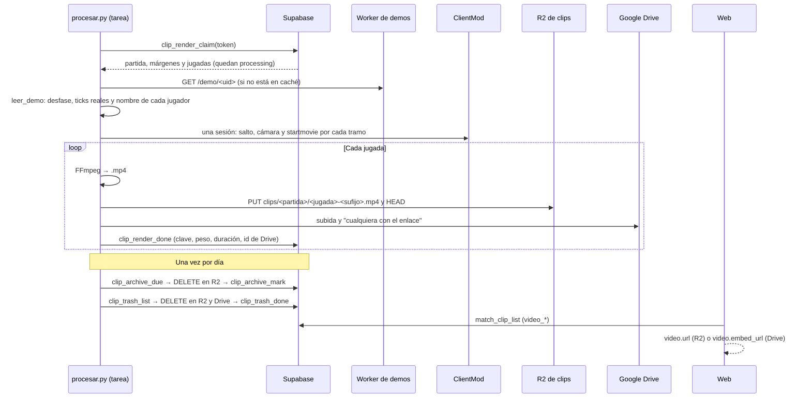
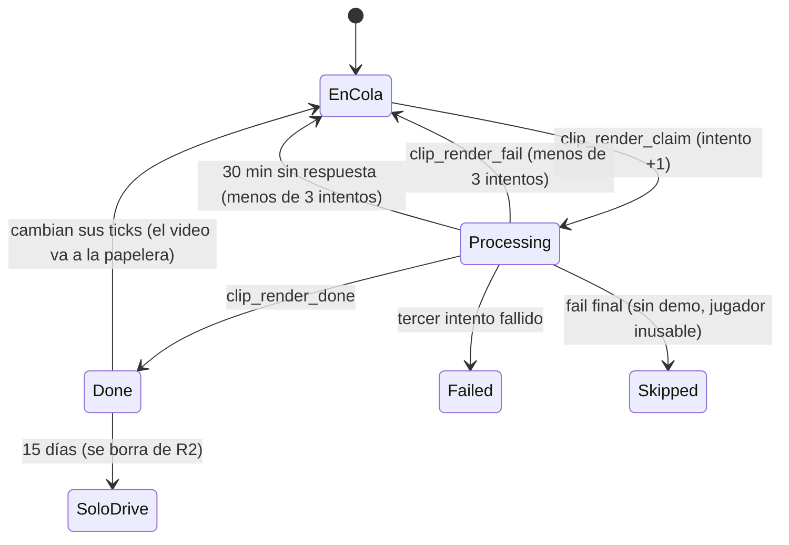

# Grabación automática de los clips (fase C2): documentación

## Qué hace

Una tarea programada en la máquina de render (el portátil, o la PC de Daniel mientras tanto) corre cada 10 minutos. Pide a la base una partida terminada con jugadas visibles sin video, baja su demo y graba todas esas jugadas en una sola sesión del cliente ClientMod. Después pasa cada una a `.mp4` con FFmpeg, la sube a R2 y a Google Drive y la deja atada a su fila de `match_clips`.

Cada video está **15 días en R2**, en el bucket de clips de la cuenta de Cloudflare de Daniel, servido por el Worker de clips con el reproductor de la web. Queda **para siempre en Google Drive**, con el reproductor embebido de Drive. Pasados los 15 días, la tarea borra la copia de R2.

La base guarda el estado de cada jugada (en cola, grabándose, lista, fallida o salteada) y la API lo devuelve en cada clip como `video`.

## Qué se graba

| Regla | Detalle |
|---|---|
| Qué jugadas | Las **visibles** de `match_clip_list`, las que dejan los topes de `clip_config` (hoy 2 por jugador y 10 por partida). Si el admin sube los topes, las que entran después también se graban |
| Qué partidas | Terminadas o canceladas (`finished`, `cancelled`) con la demo en R2 (`demo_status = 'uploaded'`). Nunca un mix en vivo. De la más vieja a la más nueva |
| Cámara | Primera persona del jugador (`spec_mode 3`), con el feed de kills y sin la barra, el menú ni el mapa del espectador |
| Tramos | De `pre_seconds` (3) antes del primer hecho a `post_seconds` (2) después del último, con un corte si entre dos hechos pasan más de `split_gap_seconds` (8). Los hechos son las kills y, en un clutch, también su inicio y el fin de la ronda. Los valores salen de `clip_config` en cada corrida |
| Calidad | 1080p a 60 cuadros, H.264 (CRF 23) y AAC de 128 kbps, con `+faststart` (`config.json`) |
| Primeros cuadros | Cada tramo se graba medio segundo antes (`lead_seconds`) y FFmpeg descarta esos cuadros: después de un salto, la cámara tarda en ponerse en primera persona |

## Estados de una jugada

| `video_status` | En la API (`video.status`) | Qué significa |
|---|---|---|
| `null` | `pending` | En cola. Si la partida no tiene demo (`none`, `missing`, `expired`), la API dice `unavailable`: nunca va a tener video |
| `processing` | `processing` | La tomó el render. Si en 30 minutos no terminó, vuelve a la cola en el siguiente `claim` (o queda `failed` si iba por el tercer intento) |
| `done` | `done` | Grabada y subida |
| `failed` | `failed` | Falló tres veces. El error queda en `video_error`, para revisarla a mano |
| `skipped` | `skipped` | No se puede grabar: la demo ya no está, el jugador no aparece en la demo o su nombre tiene comillas o `;` (no entra en `spec_player`) |

## Base de datos

Migración `supabase/migrations/20261023180000_clips_video.sql`.

### Tablas y columnas

| Tabla | Qué guarda |
|---|---|
| `match_clips` (columnas nuevas) | `video_status`, `video_key` (clave en R2), `video_bytes`, `video_seconds`, `video_drive_id`, `video_attempts`, `video_error`, `video_claimed_at`, `video_rendered_at` y `video_r2_deleted_at`. Con `done`, la clave, el peso, la duración y la fecha son obligatorios |
| `clip_video_trash` | Archivos que ya no tienen jugada: `video_key` (si seguía en R2) y `video_drive_id`. Sin acceso público |
| `render_workers` | Tokens de la máquina de render (`name`, `token_hash`, `active`, `last_seen_at`), como `demo_workers`. Solo el admin |

### Las jugadas ya no se recrean

Antes `csstv_clips_save` borraba y volvía a insertar los clips de la partida, y cada jugada cambiaba de `id`. Ahora actualiza por (partida, ronda, SteamID), la clave única, y solo borra las que dejaron de venir. El `id` y el video se conservan.

En la práctica `csstv_clips_save` corre una sola vez por partida: la ingesta no reprocesa un resultado repetido. El cambio protege cualquier llamada nueva, como un reproceso a mano.

El trigger `match_clips_video_guard` cuida los archivos:

- **Si se borra una jugada** (porque no vino, o porque se borró la partida en cascada), su video va a `clip_video_trash`.
- **Si cambian sus ticks o su resultado** (`kill_ticks`, `round_won`, `clutch_vs`, `clutch_start_tick`, `end_tick`), el video viejo va a la papelera y la jugada vuelve a la cola. Un cambio de nombre no la toca.
- **Un video que ya se borró de R2** va a la papelera solo con su id de Drive.

### Funciones del render

Las llama `procesar.py` por PostgREST, con la clave pública y su token (`p_token`). Un token inválido o desactivado da `PT401` (HTTP 401).

| Función | Qué hace |
|---|---|
| `clip_render_claim(p_token)` | Devuelve a la cola las `processing` vencidas (30 min), toma la partida más vieja con jugadas visibles en cola y la demo en R2, y las marca `processing` (intento +1). Devuelve `{ match, config, clips }` (`clips` ordenadas por su primer tick) o `null`. Un candado (`pg_advisory_xact_lock`) evita que dos llamadas tomen lo mismo |
| `clip_render_done(p_token, p_clip, p_key, p_bytes, p_seconds, p_drive_id)` | Marca `done` con los datos del video. La clave tiene que ser `clips/<partida>/<jugada>-<sufijo>.mp4`, de esa jugada y esa partida. Devuelve `false` si la jugada ya no estaba en `processing`: entonces los archivos van a la papelera |
| `clip_render_fail(p_token, p_clip, p_error, p_final)` | Vuelve a la cola, o `failed` al tercer intento, o `skipped` con `p_final`. Devuelve `pending`, `failed`, `skipped` o `gone` (la jugada ya no existe) |
| `clip_archive_due(p_token, p_days, p_limit)` y `clip_archive_mark(p_token, p_clip)` | Los videos con más de `p_days` días en R2 **que ya están en Drive**, y marcar que se borraron de R2 |
| `clip_trash_list(p_token, p_limit)` y `clip_trash_done(p_token, p_id)` | La papelera |
| `create_render_worker_token(p_name)` | Un token nuevo (solo admin con sesión). Desde el SQL Editor, el `insert` del final de la migración |

### Vista `match_clip_list`

Suma al final `video_status`, `video_key`, `video_seconds`, `video_drive_id` y `video_in_r2` (`done` y todavía no borrado de R2). El replanteo `26` la vuelve a definir con las mismas columnas.

## La jugada dentro de la demo

El plugin cuenta los ticks desde que empezó a grabar la demo, pero el `.dem` empieza un poco antes o después (y está `tv_delay`). Por eso el render no confía en un desfase fijo: lo calcula por partida.

1. Por cada jugada, compara sus `kill_ticks` con las kills del mismo jugador en la demo, el inicio del clutch con las muertes (el clutch empieza en la muerte del último compañero) y el fin del clutch con los `round_end`. Lo hace con todas las parejas a menos de 3 minutos.
2. Gana la diferencia que más se repite (con 2 ticks de tolerancia).
3. Cada kill se cambia por la kill real de la demo que está a 3 ticks o menos de lo esperado. El inicio y el fin del clutch se corren por el desfase.

El jugador se busca en la demo por su número de cuenta de Steam: el SteamID64 de `match_clips` contra el `STEAM_X:Y:Z` de la tabla `userinfo`. Los bots se buscan por el nombre. La cámara lo sigue con el nombre que tenía **en ese tick**: `leer_demo.py` guarda el historial de nombres de cada SteamID.

## La sesión del juego

`render_clip.record_session()` graba los tramos de todas las jugadas de la partida en orden de tick, **siempre saltando hacia adelante**. Un salto hacia atrás reinicia la demo, que después no queda en pausa (ver la guía, incidentes del 2026-10-23).

Después de cada tramo, la demo sigue corriendo entre 5 y 10 s hasta que llega el `demo_pause`. Por eso `plan_passes()` reparte los tramos en **pasadas**: cada tramo va a la primera pasada cuyo último tramo terminó al menos `gap_seconds` (15) antes de que empiece. Si no, a una pasada nueva. Dos jugadas de la misma ronda suelen ir en pasadas distintas.

Cada pasada es una sesión nueva del juego: abrir, cargar la demo y saltar hacia adelante. Casi siempre es una sola pasada; con varios multikills en la misma ronda, dos o tres.

En cada tramo hay tres controles:

- **Si el salto reinició la demo** (`Playing demo from` en el log): se espera la carga, se pausa y se vuelve a saltar desde el principio. Si se reinicia otra vez, la sesión falla.
- **Antes de grabar:** si en el log ya apareció la primera kill del tramo, la demo se pasó de largo y la sesión falla en lugar de grabar otra cosa.
- **Después del `endmovie`:** si siguen apareciendo cuadros, se reintenta dos veces más y, si no corta, falla.

El resto del manejo del juego es el de C1: elevado, escribiendo en la consola y esperando las marcas en el log. Está en la [documentación de C1](../2026-10-23-clips-video/DOCUMENTACION.md).

## Archivos y limpieza

| Qué | Dónde | Cuándo se borra |
|---|---|---|
| Demo | `work_dir/demos/<uid>.dem` (se verifica el tamaño contra `demo_size`) | Cuando la partida ya no tiene jugadas para reintentar |
| Copia de la demo en el cliente | `ClientMod/cstrike/cmleague/demos/` | Al terminar la sesión |
| Cuadros TGA y WAV | `ClientMod/cstrike/cmleague/cuadros/` | Al codificar cada jugada |
| `.mp4` | `out_dir/<id de la jugada>.mp4` | Al subirlo (también si falla) |
| Video en R2 | `clips/<partida>/<jugada>-<AAAAMMDDhhmmss>.mp4` | A los 15 días, si está en Drive, o desde la papelera |
| Video en Drive | `CMLeague clips/<fecha de la partida>/` | Solo desde la papelera |

El sufijo de la clave cambia en cada grabación. Así, una clave que va a la papelera nunca es la de un video nuevo de la misma jugada.

## Worker de clips (`cloudflare/clips-worker`)

`GET` y `HEAD /clip/<partida>/<jugada>-<sufijo>.mp4` sirve `clips/<…>` del bucket:

- `Content-Type: video/mp4`, `Accept-Ranges` y `Range` (`bytes=a-b`, `bytes=a-` y `bytes=-n`, con 206 y `Content-Range`).
- 416 si el rango está fuera del video o no se entiende.
- 304 con `If-None-Match`.
- Caché de un año (`immutable`: la clave no se reutiliza) y CORS abierto.

Cualquier otra ruta da 404, y otro método, 405. Solo lee: la máquina de render sube y borra con las claves S3.

## Google Drive

| Tema | Cómo |
|---|---|
| Permiso | `drive.file`: la app solo ve los archivos que creó, no el resto del Drive de Daniel |
| Login | `drive_login.py`, una vez: navegador, PKCE y el token de renovación en el `.env` (`GOOGLE_REFRESH_TOKEN`), sin imprimirlo |
| Subida | Reanudable, a `CMLeague clips/<AAAA-MM-DD>`, con el permiso "cualquiera con el enlace puede ver". Se verifica el tamaño que guardó Drive |
| Ver | `https://drive.google.com/file/d/<id>/preview` en un `iframe` |
| Sin Drive | Con `"drive": false` en `config.json`, los videos quedan solo en R2 y el archivo de los 15 días no los borra (exige el id de Drive) |

## API

`GET /api/v1/matches/{id}/clips` suma `video` en cada clip:

| Campo | Qué es |
|---|---|
| `status` | `pending`, `processing`, `done`, `failed`, `skipped` o `unavailable` |
| `url` | `<CLIPS_BASE_URL>/clip/…` mientras está en R2. `null` si no, o si el backend no tiene `CLIPS_BASE_URL` |
| `embed_url` | El reproductor de Drive, si está en Drive |
| `seconds` | Duración del video |

El frontend usa `url` si viene y, si no, `embed_url`. El contrato está en la sección 8g de [`partidas.md`](../../frontend/contrato/partidas.md).

## Configuración (`render/config.json`)

| Clave | Para qué |
|---|---|
| `client_dir`, `work_dir`, `out_dir`, `ffmpeg`, `registry_key` | Rutas de la máquina (igual que en C1) |
| `width`, `height`, `fps`, `crf`, `preset` | Calidad (1920x1080 a 60) |
| `lead_seconds` | Segundos de más al principio de cada tramo, que se descartan (0,5) |
| `gap_seconds` | Separación mínima entre dos tramos de la misma pasada (15). Menos: el salto puede reiniciar la demo |
| `demo_worker_url` | De dónde bajar las demos |
| `r2_days` | Días en R2 antes de quedar solo en Drive (15) |
| `max_matches_per_run` | Partidas por corrida (5) |
| `drive` | Subir también a Google Drive |

Variables del `.env` de la máquina: `RENDER_SUPABASE_URL`, `RENDER_SUPABASE_KEY` (la clave pública), `RENDER_WORKER_TOKEN`, las `CF_*_CLIPS` de R2 y las `GOOGLE_*` de Drive.

## Dónde está cada cosa

| Qué | Archivo / ubicación |
|---|---|
| Migración | `supabase/migrations/20261023180000_clips_video.sql` |
| Vista con el replanteo | `supabase/replanteo/26_clips.sql` y su inversa (`docs/bitacora/2026-10-14-replanteo-modelo-datos/reversas/26_clips.sql`) |
| Lo que corre la tarea | `render/procesar.py` |
| Sesión del juego y FFmpeg | `render/render_clip.py` (`record_session`, `encode`) |
| Lector de demos | `render/leer_demo.py` (nombres por tick: `name_at`) |
| R2 y Drive | `render/r2.py`, `render/drive.py`, `render/drive_login.py` |
| Tarea programada | `render/instalar_tarea.ps1` |
| Worker de clips | `cloudflare/clips-worker/` |
| API | `web/backend/src/routes/clips.ts`, `src/schemas/clips.ts` y `CLIPS_BASE_URL` en `src/env.ts` |
| Contrato del frontend | `docs/frontend/contrato/partidas.md` (8g), `README.md` y `decisiones.md` |
| Pruebas | [`pruebas/`](pruebas/) |
| Registro de cada corrida | `work_dir/procesar.log` |
