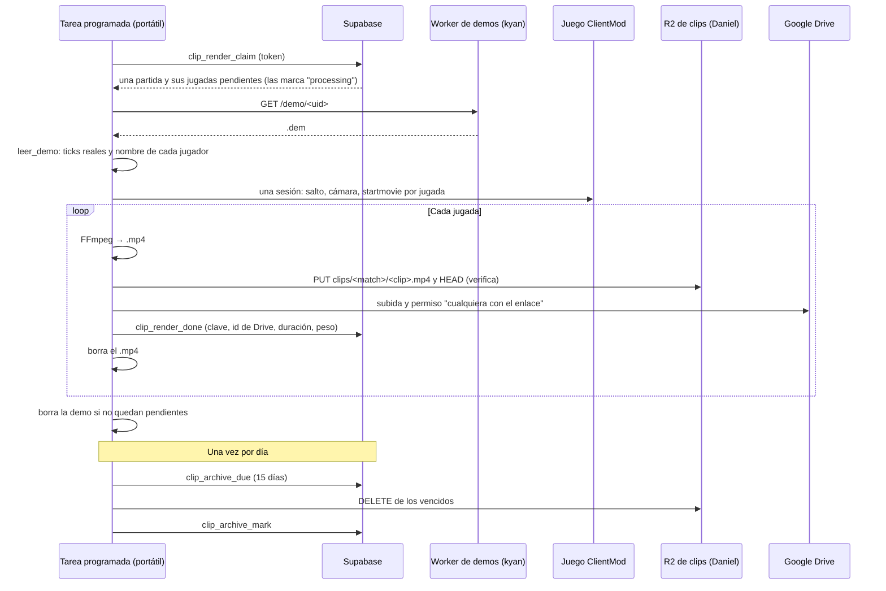
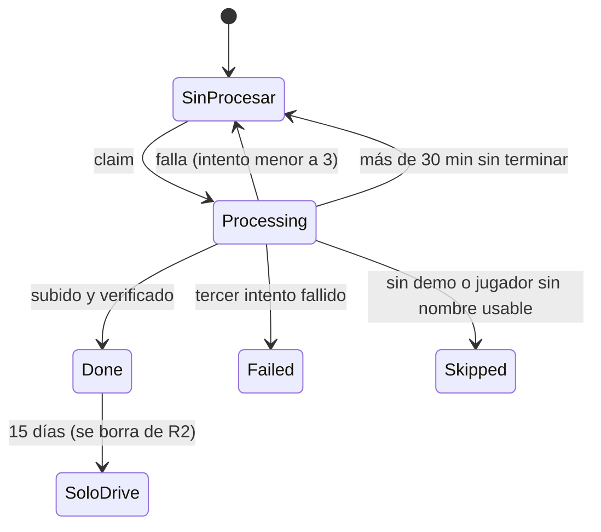

# Plan: grabación automática de los clips (fase C2)

> Planeación original. Estado: **aprobado** por Daniel el 2026-10-23. Confirmó todas las decisiones de la tabla (ver "Conversación del 2026-10-23" al final).

Sigue a la prueba de concepto [`2026-10-23-clips-video`](../2026-10-23-clips-video/) (C1), que demostró que una jugada se puede grabar sin manos con el cliente ClientMod, `startmovie` y FFmpeg, y subir a R2. Este plan arma el circuito completo: una tarea programada en el portátil de render toma las jugadas sin video, las graba una por una, las sube y deja cada video atado a su jugada en la base. Todo se deja listo y probado en la PC de Daniel; en el portátil solo se instala y se prueba.

## Decisiones tomadas

| Tema | Decisión | Por qué |
|---|---|---|
| Qué se graba | Las jugadas **visibles** de `match_clip_list`: hoy **10 por partida y 2 por jugador** (los topes de `clip_config`) | Daniel, 2026-10-23. Si el admin cambia los topes, las que entren después también se graban |
| Qué partidas | Solo las **terminadas o canceladas**, con la demo en R2 (`demo_status = 'uploaded'`). Nunca un mix en vivo | Durante el vivo las jugadas cambian con cada foto; al terminar quedan fijas |
| Dónde viven los videos | **15 días en R2** (cuenta de Daniel, bucket de clips) y **para siempre en Google Drive** (5 TB de Daniel) | Daniel, 2026-10-23: no gastar almacenamiento de Cloudflare. Los 15 días de R2 dan el mejor reproductor mientras la partida es reciente |
| Cuándo se sube a Drive | **Al grabar**, junto con R2. A los 15 días solo se borra la copia de R2 | Evita volver a bajar el video de R2 para pasarlo a Drive |
| Cómo se ve en la web | Mientras está en R2: el `.mp4` con el reproductor de la web, servido por un **Worker en la cuenta de Daniel**. Después: el reproductor de Drive embebido (`drive.google.com/file/d/<id>/preview`) | Daniel, 2026-10-23 (Worker). R2 soporta saltar dentro del video y no tiene el límite de `r2.dev` |
| Cómo se ata el video a la jugada | Columnas nuevas en **`match_clips`**: estado, clave en R2, id del archivo en Drive, duración y peso. La clave en R2 es `clips/<match_id>/<clip_id>.mp4`. La jugada ya tiene su partida (`match_id`) y su jugador (`player_steamid` → ficha con `steam_owner()`) | Se guarda la clave y no la URL: si cambia la dirección del Worker, no hay que tocar la base |
| Las jugadas no se recrean | `csstv_clips_save` pasa de "borrar e insertar" a **actualizar por (partida, ronda, SteamID)**, que ya es la clave única. Solo borra las que dejaron de venir; si una tenía video, su clave queda en una papelera para que el render borre el archivo | Hoy cada foto en vivo y cada reingesta recrean las filas con otro `id`: el video quedaría huérfano |
| Los ticks | El render **no confía en un desfase fijo**: lee la demo, busca los `player_death` del jugador en esa ronda y toma los ticks reales del `.dem`. El desfase con los ticks del plugin se calcula por partida (y se usa para el inicio del clutch) | La prueba de C1 mostró que el lector da los ticks exactos. Así no depende de `tv_delay` ni de medirlo a mano |
| A quién sigue la cámara | Al nombre que tenía su SteamID **en la demo**, sacado de la tabla `userinfo` | El nombre de `match_clips` puede no coincidir con el de ese momento |
| Una sesión de juego por partida | Se abre el juego una vez por partida y se graban todas sus jugadas, **ordenadas por tick** (solo saltos hacia adelante) | En C1, abrir y cargar se llevaba la mitad del tiempo; un salto hacia atrás reinicia la demo |
| Acceso del portátil a la base | Con un **token propio** (tabla `render_workers`, como `demo_workers`) y funciones `security definer`. No usa la clave de servicio | Si el portátil se pierde, se desactiva su token y nada más |
| Cuándo graba | **Siempre**: la tarea corre cada 10 minutos y graba apenas hay jugadas pendientes | Daniel, 2026-10-23. El juego abre una ventana y toma el teclado unos segundos por jugada |
| Reintentos | Hasta **3 intentos** por jugada; después queda `failed` con el error, para revisarla a mano | Un fallo (la demo no baja, el juego se cuelga) no bloquea la cola |
| Borrado local | Cada `.mp4` se borra al confirmar que está en R2 (mismo tamaño con `HEAD`) **y** en Drive. La demo se borra cuando ya no quedan jugadas pendientes de esa partida | Pedido de Daniel |
| Resolución | **1080p a 60 cuadros** (H.264, CRF 23), unos 0,7 MB por segundo | Daniel prefirió probar 1080p; se confirma con la medición del portátil |

## 1. El flujo completo

## 2. Base de datos

Migración de producción `supabase/migrations/AAAAMMDDHHMMSS_clips_video.sql` y replanteo `27_clips_video.sql` (la vista `match_clip_list` del replanteo `26` se vuelve a definir con las columnas nuevas).

| Cambio | Detalle |
|---|---|
| `match_clips` (columnas nuevas) | `video_status` (`null` = sin procesar, `processing`, `done`, `failed`, `skipped`), `video_key`, `video_bytes`, `video_seconds`, `video_drive_id`, `video_attempts`, `video_error`, `video_claimed_at`, `video_rendered_at`, `video_r2_deleted_at` |
| `csstv_clips_save` | Actualiza por (partida, ronda, SteamID) sin tocar las columnas del video; borra solo las que no vinieron y manda sus claves a `clip_video_trash` |
| `clip_video_trash` (nueva) | `video_key`, `video_drive_id`, `created_at`. La vacía el render |
| `render_workers` (nueva) | `name`, `token_hash`, `active`, `last_seen_at`. Sin acceso público |
| `clip_render_claim(p_token)` | La partida terminada más vieja con jugadas visibles sin video (o `processing` con más de 30 min, o `failed` con menos de 3 intentos) y la demo en R2. Las marca `processing` y devuelve la partida (`external_id`, `tickrate`, `demo_size`) y sus jugadas |
| `clip_render_done(p_token, p_clip, p_key, p_bytes, p_seconds, p_drive_id)` | `done` y los datos del video |
| `clip_render_fail(p_token, p_clip, p_error, p_final)` | Suma un intento; con `p_final` (sin demo, demo vencida, jugador sin nombre usable) queda `skipped` |
| `clip_archive_due(p_token, p_days)` y `clip_archive_mark(p_token, p_clip)` | Los videos con más de 15 días en R2 y ya en Drive; marcar que se borraron de R2 |
| `clip_trash_list` y `clip_trash_done` | La papelera |
| `match_clip_list` | Suma `video_status`, `video_key`, `video_seconds`, `video_drive_id` y `video_in_r2` (true si todavía no se borró de R2) |
| Pruebas | `pruebas/pruebas_db.sql`: reingesta que conserva el video, cola, reintentos, papelera, archivo |

## 3. API (backend)

`GET /api/v1/matches/{id}/clips` suma por clip un objeto `video`: `status`, `url` (el `.mp4` del Worker de clips mientras está en R2), `embed_url` (el de Drive cuando ya no está en R2) y `seconds`. La dirección base del Worker va en una variable del backend (`CLIPS_PUBLIC_BASE`). Contrato: sección 8g de `partidas.md`. El backend sale con el corte, como el resto.

## 4. Worker de clips (`cloudflare/clips-worker/`, cuenta de Daniel)

- `GET /clip/<match_id>/<clip_id>.mp4`: sirve el objeto de R2 con `Range` (saltar dentro del video), `Content-Type: video/mp4` y caché larga. `HEAD` igual.
- Sin escritura: el portátil sube directo con las claves S3 (`render/r2.py`).
- Se despliega con `CF_API_TOKEN_CLIPS` y `CF_ACCOUNT_ID_CLIPS`, con pnpm y la misma configuración que `cloudflare/demo-worker` (antigüedad mínima de 7 días, `trustPolicy`).

## 5. Google Drive

**Es viable**, con estas condiciones:

| Tema | Cómo |
|---|---|
| Acceso | Un proyecto de Google Cloud en la cuenta de Daniel con un cliente OAuth "de escritorio" y el permiso **`drive.file`** (solo ve los archivos que creó la app, no el resto del Drive) |
| Que el permiso no venza | La app se pasa a **"En producción"**. En "Prueba", Google vence el token cada 7 días. `drive.file` no es un permiso sensible: no hace falta la verificación de Google |
| Login una sola vez | `render/drive_login.py` abre el navegador, Daniel acepta y el token de renovación queda en el `.env` del portátil (`GOOGLE_CLIENT_ID`, `GOOGLE_CLIENT_SECRET`, `GOOGLE_REFRESH_TOKEN`) |
| Subida | Subida reanudable de la API de Drive, solo con la biblioteca estándar, a una carpeta `CMLeague clips/<fecha>`. Después, permiso "cualquiera con el enlace puede ver" |
| Ver en la web | `iframe` de `drive.google.com/file/d/<id>/preview`: el reproductor de Drive |
| Límites conocidos | Drive tarda unos minutos en procesar un video nuevo (por eso se sube al grabar, no a los 15 días). Un archivo muy visto puede topar con el límite de descargas de Drive: con el tráfico de la liga no debería pasar. Drive no es una CDN: el reproductor es más lento que el `.mp4` de R2 |
| Riesgo | El token queda en el portátil. Con `drive.file` solo puede tocar los clips; se revoca desde la cuenta de Google |

## 6. Render automático (`render/`)

| Archivo | Qué hace |
|---|---|
| `procesar.py` (nuevo) | Lo que corre la tarea: candado para no correr dos veces, `clip_render_claim`, baja la demo (verifica el tamaño con `demo_size`), arma la sesión, graba, sube, marca y limpia. Al final, el archivo de los 15 días y la papelera (una vez por día) |
| `render_clip.py` | Se separa en funciones reutilizables: una sesión de juego con varias jugadas y FFmpeg por jugada. El modo de una jugada sola queda para pruebas |
| `leer_demo.py` | Devuelve también la tabla SteamID → nombre por tick |
| `r2.py` | Suma `HEAD` (verificar) y `DELETE` |
| `drive.py` y `drive_login.py` (nuevos) | Subida a Drive y el login inicial |
| `instalar_tarea.ps1` (nuevo) | Crea la tarea programada (ver abajo) |
| `config.example.json` | Suma la dirección del Worker de demos, la carpeta de demos y los días de R2 |
| `.env` del portátil | `RENDER_WORKER_TOKEN`, las de R2 de clips y las de Google. Nunca se versiona |

**Clutch:** los tramos van de `clutch_start_tick` (corrido por el desfase) a `end_tick`, con los mismos márgenes y cortes de 8 s entre lo que pasa (inicio, kills, fin).

**Tarea programada:** el Programador de tareas de Windows, cada 10 minutos, con "ejecutar con los privilegios más altos" (sin aviso de UAC) y **"solo cuando el usuario haya iniciado sesión"**, porque el juego necesita el escritorio. No arranca una instancia nueva si la anterior sigue. El portátil tiene que quedar con la sesión iniciada y sin suspenderse (plan de energía): `instalar_tarea.ps1` lo avisa.

## 7. Requisitos antes de empezar

- Que Daniel apruebe este plan.
- Para Drive: que Daniel cree el proyecto de Google Cloud y el cliente OAuth (le dejo los pasos en la guía).
- Que Daniel aplique la migración en producción cuando esté probada en local.
- El primer mix real con la 2.5.0, para probar con jugadas de verdad (el desfase ya no bloquea: se calcula solo).

## 8. Orden de implementación

1. Migración y replanteo `27`, con sus pruebas, en la Supabase local.
2. `render/`: sesión por partida, ticks reales desde la demo, `procesar.py` contra la base local con una partida armada a partir de la demo de tuscan.
3. Worker de clips en la cuenta de Daniel.
4. Drive: `drive.py`, `drive_login.py` y la prueba de subida y de embebido.
5. Backend y contrato.
6. `instalar_tarea.ps1` y una corrida de la tarea en esta PC.
7. Migración en producción (Daniel) y prueba con un mix real.
8. Documentación y guía; después, el traslado al portátil.

## Conversación del 2026-10-23 (contexto para retomar)

Daniel cambia de cuenta de Claude: esto resume lo decidido para que otra sesión siga sin la conversación.

| Tema | Lo que se decidió | Cómo se llegó |
|---|---|---|
| Alcance | Dejar todo listo y probado en la PC de Daniel; en el portátil solo instalar y probar | Pedido de Daniel |
| Ciclo de la tarea | Tarea programada de Windows cada N minutos: detecta jugadas sin procesar, baja la demo, graba una por una, sube a R2, verifica, borra el `.mp4` local; cuando terminó todas las jugadas del mix, borra la demo | Pedido de Daniel |
| Asociación en la base | Cada video queda atado a su fila de `match_clips` (que tiene partida y jugador) por columnas nuevas; se guarda la clave en R2, no la URL | Daniel pidió que el clip quede asociado a la jugada, la partida y el jugador; el formato lo propuse yo |
| Qué se graba | 10 por mix y 2 por jugador (los topes visibles) | Daniel eligió eso entre 10, 5 y 3 por mix |
| YouTube | Descartado: la API deja privados los videos de proyectos sin auditar y tiene cupo diario | Daniel lo propuso; lo cambió por R2 al ver los límites |
| R2 | Cuenta de Cloudflare **de Daniel**, bucket de clips, credenciales `CF_*_CLIPS` en el `.env` (conexión probada) | Las demos se quedan en la cuenta de kyan |
| R2 y Drive | **R2 los primeros 15 días** (rápido, reproductor de la web) y **Google Drive después** (5 TB de Daniel, embebido, más lento). El video se sube a Drive al grabarlo; a los 15 días solo se borra de R2 | Daniel confirmó: "primero R2, que es más rápido, y después de 15 días Google Drive" |
| Cómo se sirve desde R2 | Worker en la cuenta de Daniel (`CF_API_TOKEN_CLIPS`) | Elegido por Daniel |
| Horario | Siempre que haya pendientes (aunque alguien use el portátil) | Elegido por Daniel |
| Resolución | 1080p | Daniel; se confirma con la medición del portátil |
| Problema encontrado | `csstv_clips_save` borra y recrea las jugadas en cada ingesta (cambia el `id`): hay que pasarla a actualizar por (partida, ronda, SteamID) | Encontrado al revisar la base para este plan |

**Para empezar:** pedirle a Daniel el "aprobado" de este plan y arrancar por el paso 1 del orden de implementación (migración y replanteo `27` en la Supabase local). Lo hecho en C1 y cómo funciona el render está en [`../2026-10-23-clips-video/DOCUMENTACION.md`](../2026-10-23-clips-video/DOCUMENTACION.md).
