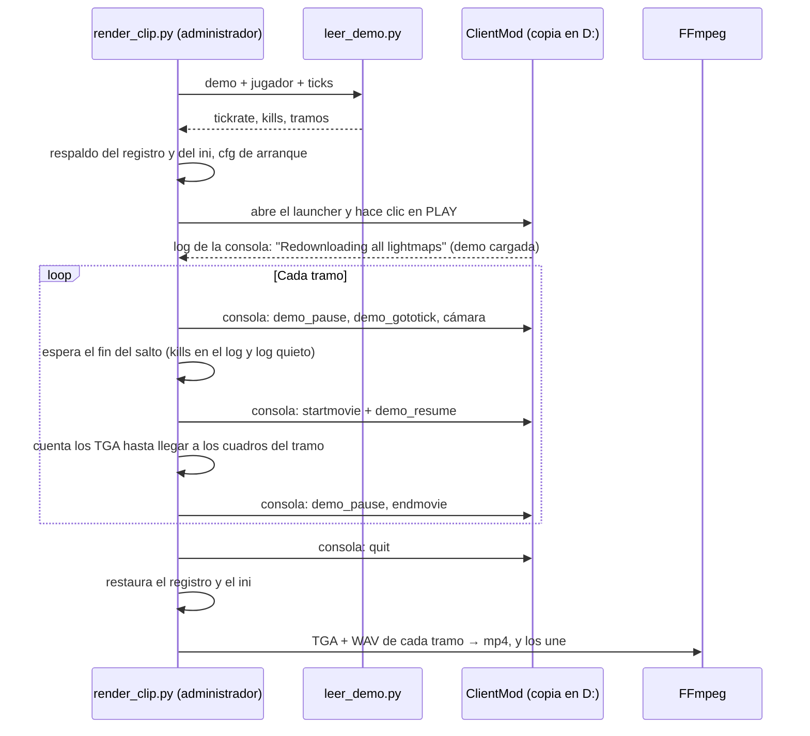

# Video de los clips (fase C), prueba de concepto: documentación

## Qué hace

Convierte una jugada de una demo de CS:S v34 (las que el Worker sube a R2) en un `.mp4` sin intervención: abre una copia del cliente ClientMod, reproduce la demo, salta a la jugada, la sigue en primera persona, la graba con `startmovie` y la codifica con FFmpeg. También sube el video a R2, al bucket de clips de la cuenta de Cloudflare de Daniel.

Son tres scripts en `render/` (solo biblioteca estándar de Python, más FFmpeg): el **lector de demos** (`leer_demo.py`), que saca de la demo las kills y las rondas con su tick; el **render** (`render_clip.py`), que maneja el juego y FFmpeg; y el **cliente de R2** (`r2.py`).

Es la prueba de concepto (C1). La grabación automática de todas las jugadas, atada a la base, es la fase C2: [`2026-10-23-clips-render-automatico`](../2026-10-23-clips-render-automatico/PLAN.md).



## Lector de demos (`leer_demo.py`)

Lee el `.dem` (protocolo de demo 3, protocolo de red 7, el motor viejo de HL2) y decodifica solo lo necesario: la lista de eventos, los eventos (`player_death`, `round_start`, `round_end`, `round_freeze_end`, `player_team`) y la tabla `userinfo` (userid → nombre y SteamID). El resto de los mensajes se salta por su largo. Formato tomado del SDK `episode1` de AlliedModders y de UntitledParser (HL2 old engine).

| Uso | Qué sale |
|---|---|
| `python leer_demo.py demo.dem` | Kills por ronda con tick, atacante, víctima, arma y headshot |
| `--clips` | Registros con 3+ kills de un jugador en una ronda |
| `--json` | Todo en JSON (para otros scripts) |

Cada evento tiene dos ticks: el del `.dem` (desde que empezó la grabación, el que usa `demo_gototick`) y el del servidor (`net_Tick`).

**Diferencias del motor de v34 con el formato publicado** (encontradas en la prueba):

| Qué | En v34 |
|---|---|
| Largo de los datos de una entrada de tabla de strings | 12 bits (no 14) |
| `svc_VoiceData` | Sin byte de proximidad |
| `svc_Menu` | Largo de 16 bits, en bits |
| `net_Tick` | Solo el tick (sin los tiempos de cuadro) |
| `player_info_t` | 132 bytes |
| Primera ronda | La demo arranca con la ronda en curso, sin su `round_start`: se cuenta desde el tick 0 |
| Kills entre `round_end` y el `round_start` siguiente | No se cuentan (igual que las stats del plugin) |
| Números de ronda | Incluyen las rondas que reinicia el plugin al empezar el vivo: no coinciden con `match_clips.round` |

**Validación:** en la demo de tuscan del 2026-10-22 (partida `6e0d4581…`, 19-16), las kills de los 10 jugadores coinciden exacto con `match_player_stats`, y también los 3k y 4k. De 335 000 paquetes, 2 no se leen (actualizaciones de `instancebaseline`, que no hace falta) sin perder ninguna kill. Lee la demo entera (70 MB) en unos 2,5 s. El servidor real corre a unos 101 ticks por segundo (`tick_interval` 0,0099 s).

## Render (`render_clip.py`)

```
python render_clip.py <demo.dem> --player "<nombre>" --ticks 234981,235042,235201,237919 [--height 1080]
python render_clip.py <demo.dem> --player "<nombre>" --round <n>
```

### Cómo maneja el juego

| Problema | Solución |
|---|---|
| El launcher (`CMLauncher.exe`) pide permisos de administrador, y Windows no deja que un programa sin esos permisos le mande clics ni teclas | El script **se eleva solo** (un aviso de UAC) y espera al proceso elevado mostrando su salida (`ultimo_render.log`) |
| El launcher no arranca solo: hay que hacer clic en PLAY (interfaz Dear ImGui) | Clic automático en (785, 450) de la ventana de 890x500, escalado al tamaño real, hasta 3 veces |
| No existe `hl2.exe`: los parámetros del motor van en `Params` de `clientmod.ini` | El script cambia `Params` (`-novid -windowed -noborder -w -h +exec cmleague_render`) y restaura el ini al final |
| La resolución y el modo de ventana se guardan en `HKCU\Software\CSSv34_ClientMod\Settings`, **compartido con la instalación normal** de Daniel | `reg export` antes y `reg import` al final |
| Un bucle con `wait` en la cola de comandos **traba la carga de la demo** (la carga usa la misma cola y queda detrás) | No se usan bucles dentro del juego |
| Durante la demo el juego **no ejecuta cfg sueltos** (`'…' not present; not executing`, por el `sv_pure 2` grabado en la demo) | Los pasos no van en archivos |
| ClientMod **bloquea los alias recursivos** | — |
| La **barra del espectador se queda con el teclado**: los atajos (F9, F10) no llegan, ni siquiera apretados a mano | — |
| La consola sí se abre siempre | **El script escribe en la consola**: tecla de consola (código de escaneo 0x29), el texto con `WM_CHAR` y Enter, todo con mensajes a la ventana (no hace falta el foco). Cada paso termina con `echo CML_PASO_n`, que el script espera en el log (`con_logfile`) |
| Abrir la consola también abre el menú de ClientMod, que queda encima del video | `hideconsole` y `gameui_hide` en cada paso |
| `demo_gototick` avanza la demo a toda velocidad y tarda (unos 10 s desde el principio) | El script espera a ver en el log la última kill anterior al tramo ("X killed Y with arma.") y que el log quede quieto 1,5 s. La línea se busca desde que empezó a grabarse el tramo anterior |
| El juego no se puede matar (proceso protegido) | Se cierra con `quit` por la consola |

### Lo que se ve

| Ajuste | Comando |
|---|---|
| Primera persona | `spec_mode 3` (en este motor el 4 es la cámara de persecución) |
| A quién sigue | `spec_player "<nombre>"` |
| Sin barra ni menú del espectador | `hidepanel specmenu`, `hidepanel specgui` |
| Sin el mapa de arriba a la izquierda | `overview_mode 0` (es el overview del espectador; `hideradar` no lo quita) |
| Sin chat | `hud_saytext_time 0` |
| Sin net_graph ni fps | `net_graph 0`, `cl_showfps 0` |
| Ritmo fijo | `host_framerate 60` y `fps_max 0` (sin `sv_cheats`, el tope es 1000). La demo corre unas 10 veces más rápido que en vivo |

Queda el feed de kills y los textos del centro ("Terrorists Win!").

### Tramos y codificación

- **Tramos:** desde `pre_seconds` (3) antes de la primera kill hasta `post_seconds` (2) después de la última, con un corte si entre dos kills pasan más de `split_gap_seconds` (8). Los mismos valores que `clip_config`.
- **Fin de cada tramo:** se cuentan los TGA; con 60 cuadros por segundo, un tramo de N segundos son 60·N cuadros. Lo que se graba de más se recorta en FFmpeg (`-frames:v`).
- **FFmpeg:** TGA + WAV → H.264 (`libx264`, CRF 23, `preset veryfast`, `yuv420p`), AAC de 128 kbps; los tramos se unen con `concat` sin recodificar y `+faststart`.
- Los cuadros se borran al terminar. Al lado del `.mp4` queda un `.json` con los tramos, la resolución, el peso y los tiempos.

## Mediciones (PC de Daniel: Ryzen 7 5700X, RTX 5070)

El 4k de Lukas en tuscan (ticks 234981, 235042, 235201 y 237919): dos tramos, 12,2 s de video.

| | 720p | 1080p |
|---|---|---|
| Peso del `.mp4` | 5,1 MB | 8,7 MB |
| Grabación en el juego | 43 s | 77 s |
| FFmpeg | 5 s | 7 s |
| Total (con abrir y cerrar el juego) | 82 s | 119 s |
| Cuadros temporales (se borran) | 2,1 GB | 4,6 GB |
| Subida a R2 | — | 2,4 s (29 Mbit/s) |

El cuello de botella es escribir los TGA a disco: el juego graba a unos 25 cuadros por segundo a 720p y unos 12 a 1080p. El portátil no se midió todavía.

**Tiempos del video:** en el feed, la primera kill aparece a los 3,17 s (margen de 3 s), y la cuarta, en el segundo tramo. Los ticks del lector calzan con la demo.

## Cliente de R2 (`r2.py`)

Firma S3 v4 con la biblioteca estándar: `put`, `get` y `delete` sobre el bucket de clips. Lee del `.env` de la raíz `CF_ACCOUNT_ID_CLIPS`, `CF_R2_BUCKET_CLIPS`, `CF_R2_ACCESS_KEY_ID_CLIPS` y `CF_R2_SECRET_ACCESS_CLIPS`, sin imprimirlas. `python r2.py prueba` sube, lee y borra un objeto de prueba.

## Decisiones tomadas en la conversación del 2026-10-23

| Tema | Decisión |
|---|---|
| Máquina de la prueba | Esta PC primero; después el portátil (Asus E1504FA, Ryzen 5 7520U, 16 GB). La idea es dejar todo listo acá y en el portátil solo instalar y probar |
| Cliente | Una copia aparte en `D:\CMLeague_Render\ClientMod` (sin `.idea/` ni `docs/`), para no tocar la instalación de Daniel |
| Dónde va el código | `render/`, con las rutas en `render/config.json` (no se versiona; ejemplo en `config.example.json`) |
| Correr como administrador | Aprobado por Daniel: un aviso de UAC por corrida. En la tarea programada, "privilegios más altos" |
| Resolución | Se probó 720p y 1080p. Daniel prefiere 1080p si el portátil lo aguanta |
| Dónde se guardan los videos | **R2, no YouTube**: la API de YouTube deja privados los videos subidos desde proyectos sin auditar y tiene un cupo diario de subidas |
| Cuenta de Cloudflare | **Los clips van al R2 de la cuenta de Daniel; las demos se quedan en la de kyan** (`csstv-demos`), sin migrar |
| Variables del `.env` | `CF_ACCOUNT_ID_CLIPS`, `CF_API_TOKEN_CLIPS`, `CF_R2_BUCKET_CLIPS`, `CF_R2_ACCESS_KEY_ID_CLIPS`, `CF_R2_SECRET_ACCESS_CLIPS` (las cargó Daniel) |
| Almacenamiento medido | Demos: 40 en 10 días, 1,7 GB (42 MB cada una); con 90 días de retención el bucket de kyan se estabiliza en unos 15 GB |
| Lo que sigue | Fase C2 (grabación automática): ver su plan |

## Dónde está cada cosa

| Qué | Archivo / ubicación |
|---|---|
| Lector de demos | `render/leer_demo.py` |
| Render | `render/render_clip.py` |
| Cliente de R2 | `render/r2.py` |
| Configuración | `render/config.example.json` (copiar a `render/config.json`) |
| Copia del cliente | `D:\CMLeague_Render\ClientMod` (cfg `cstrike/cfg/cmleague_render.cfg`, log `cstrike/cmleague/render.log`, demos `cstrike/cmleague/demos/`) |
| Videos de la prueba | `D:\CMLeague_Render\videos\` |
| Respaldo del registro de ClientMod | El script lo guarda en `work_dir/registro.reg` en cada corrida |
| Plan de C2 | [`../2026-10-23-clips-render-automatico/PLAN.md`](../2026-10-23-clips-render-automatico/PLAN.md) |
