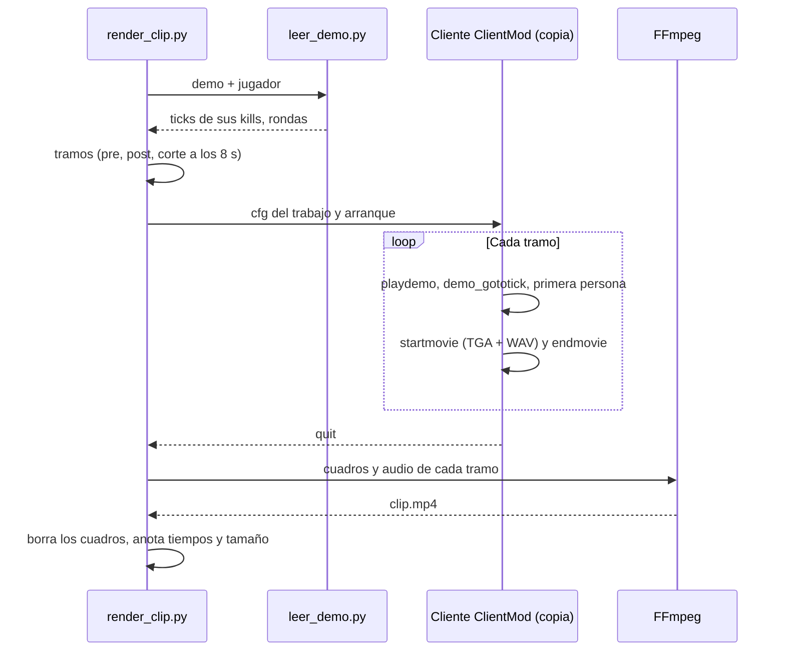

# Plan: video de los clips (fase C), prueba de concepto

> Planeación original. Estado: **aprobado** por Daniel el 2026-10-23 (prueba en esta PC y después en el portátil, copia del cliente y el código en una carpeta aparte).

Fase C del requerimiento [`2026-10-22-clips-automaticos`](../2026-10-22-clips-automaticos/), que la dejó como requerimiento aparte. Este plan cubre solo la **prueba de concepto (C1)**: demostrar que una jugada se puede pasar de la demo de R2 a un `.mp4` sin intervención manual, y medir cuánto tarda y cuánto pesa. **No toca la base, el plugin, el backend, el Worker ni los servidores.** La automatización completa (C2) se planea después, con lo que se mida acá.

## Decisiones tomadas

| Tema | Decisión | Por qué |
|---|---|---|
| Alcance | Solo **C1**: scripts locales que, dada una demo y una jugada, generan el `.mp4`. Sin `video_status`, sin `video_url`, sin cola y sin subir nada | Lo más incierto es si el cliente v34 deja grabar sin manos. Antes de diseñar la cola hay que saberlo |
| Máquina de la prueba | **Esta PC** (Ryzen 7 5700X, RTX 5070, 233 GB libres en `D:`). Al final, la misma prueba en el portátil (Asus E1504FA) para comparar tiempos | **Cambia lo anotado en la fase A**, que decía el portátil. En esta PC ya están el cliente ClientMod y una demo real de R2, y desde acá puedo correr las pruebas yo. El portátil sigue siendo el candidato a quedar renderizando siempre |
| Cliente | Una **copia aparte** de ClientMod en `D:\CMLeague_Render\ClientMod` (5,6 GB), con su propio `clientmod.ini` y sus cfg | El juego guarda `config.cfg` al salir: grabar con la instalación de Daniel le cambiaría la resolución, `host_framerate` y los binds. Una copia, además, es lo que necesitaría una máquina de render |
| Datos de prueba | La demo de R2 de tuscan que ya está en el cliente (`v34frag_2026-10-22_tuscan_19-16.dem`, partida `6e0d4581…`) y, en cuanto haya, **el primer mix real con la 2.5.0**, que trae `kill_ticks` de verdad | En producción todavía no hay ningún registro en `match_clips`: no hubo mix desde el despliegue |
| Lector de demos | Un script en Python, solo con la biblioteca estándar, que lee el `.dem` v34 y saca los `player_death` y los inicios y finales de ronda con su tick | Sirve para dos cosas: elegir jugadas en demos viejas, que no tienen clips, y **medir el desfase exacto** entre el tick que manda el plugin y el tick del `.dem` (con `tv_delay`), que quedó pendiente de la fase A |
| Captura | Primero, **`startmovie`** con `host_framerate 60`: cuadros TGA y WAV a ritmo fijo, sin importar la velocidad de la PC. Si ClientMod lo bloqueó o no graba con su render, se captura la ventana en tiempo real con FFmpeg (`ddagrab`) | `startmovie` da un video sin tirones aunque la máquina sea lenta. La captura de ventana es el respaldo |
| Codificación | **FFmpeg**: H.264 (`libx264`, CRF 23, `preset veryfast`), AAC de 128 kbps, `+faststart`. **720p a 60 cuadros** por defecto; se compara con 1080p | 720p60 pesa unos 2 MB por cada 15 s, que en R2 (10 GB gratis) son miles de clips. La comparación decide C2 |
| Cuadros temporales | Se graban en `D:\CMLeague_Render\trabajo\` y se borran apenas sale el `.mp4` | Un cuadro TGA de 720p pesa unos 2,7 MB: 20 s a 60 cuadros son unos 3 GB |
| Cámara | **Primera persona del jugador** (`spec_mode 4`, el que la ve es él), con el feed de kills y sin los menús del espectador | Es lo que se espera de un clip. Se prueba qué partes del HUD de espectador se pueden apagar |
| Cortes | Los de `clip_config`: desde `pre_seconds` (3) antes de la primera kill hasta `post_seconds` (2) después de la última. Si entre dos kills pasan más de `split_gap_seconds` (8), se graban tramos separados y se unen con un corte seco. En un clutch, desde `clutch_start_tick` hasta `end_tick` | Así quedó acordado en la fase A, y los valores se leen de la configuración, no del script |
| Dónde va el código | En **`render/`**, en la raíz del repo, con las rutas de la máquina en `render/config.json` (no se versiona; el ejemplo es `config.example.json`) | Daniel, 2026-10-23: para que sea fácil llevarlo al portátil |
| Instalaciones | FFmpeg lo instalas tú (`winget install Gyan.FFmpeg`). Los scripts usan el Python que ya está, sin paquetes | Regla del proyecto: lo nuevo en la máquina lo instala Daniel |

## 1. El flujo completo

Con un mix real, la jugada sale de `match_clips` (lectura pública) en lugar del lector de demos, y el lector solo sirve para comparar los ticks.

## 2. Lector de demos (`render/leer_demo.py`)

- Lee la cabecera (`HL2DEMO`, protocolo de demo 3, protocolo de red 7, tickrate según `playback_ticks / playback_time`).
- Recorre los paquetes y decodifica solo lo necesario: la lista de eventos (`svc_GameEventList`) y los eventos (`svc_GameEvent`). El resto de los mensajes se salta por su largo.
- Saca la tabla de jugadores (`userinfo`) para pasar del `userid` del evento al nombre y al SteamID.
- Imprime por ronda: tick, atacante, víctima, arma y si fue headshot. Con `--clips`, los registros que serían clip (3+ kills) en el mismo formato que manda el plugin.
- **Prueba:** sobre la demo de tuscan, el total de kills por jugador tiene que coincidir con las stats de esa partida en la base.

## 3. Grabación (`render/render_clip.py`)

1. Arma los tramos a partir de los ticks y del `tickrate`.
2. Escribe `cfg/cmleague_render.cfg` en la copia del cliente: resolución, `host_framerate 60`, HUD, y por cada tramo `demo_gototick`, la cámara sobre el jugador, `startmovie`, una espera de la duración del tramo y `endmovie`. Al final, `quit`.
3. Arranca la copia del cliente con `-novid -windowed -w 1280 -h 720 +playdemo … +exec cmleague_render`. Hay que probar si `CMLauncher.exe` pasa esos parámetros o si van en `Params` de su `clientmod.ini`.
4. Espera a que el proceso termine, con un tope de tiempo.
5. Llama a FFmpeg por cada tramo, une los tramos y borra los cuadros.
6. Anota en un `.json` al lado del video: tiempo total, tiempo dentro del juego, tiempo de FFmpeg, tamaño y duración.

Lo que hay que averiguar probando, porque los comandos del motor no aparecen en claro en los binarios de ClientMod:

| Pregunta | Si falla |
|---|---|
| ¿Existen `startmovie`, `demo_gototick` y `host_framerate`, y graban con el render de ClientMod? | Captura de la ventana con FFmpeg en tiempo real (`demo_timescale 1`) |
| ¿`spec_player` acepta el nombre o hay que usar el índice del jugador? | El índice sale del lector de demos |
| ¿Las esperas (`wait`) son exactas con `host_framerate` fijo? | Se cortan los tramos por tick en FFmpeg, grabando un poco de más |
| ¿El launcher actualiza, abre el menú de CEF o pide algo antes de jugar la demo? | Se documenta el paso y se busca cómo saltarlo con parámetros |
| ¿Se pueden ocultar los menús del espectador sin perder el feed de kills? | Se deja el HUD de espectador en la prueba y se decide en C2 |

## 4. Qué se mide

| Medida | Para qué |
|---|---|
| Tiempo por clip (total, juego y FFmpeg), en esta PC y en el portátil | Saber cuántos clips por hora salen y si el portátil alcanza |
| Peso del `.mp4` a 720p60 y a 1080p60 | Costo en R2 y elección de la calidad |
| Desfase entre el tick del plugin y el tick del `.dem` | Para que el clip arranque donde debe. Se mide con el primer mix real: `kill_ticks` de `match_clips` contra los `player_death` del lector |
| Si la jugada se ve completa con los márgenes de 3 y 2 segundos | Ajustar `pre_seconds` y `post_seconds` |

## 5. Lo que no entra (C2, plan aparte)

- `video_status` y `video_url` en `match_clips`, la cola de clips pendientes y quién los toma.
- Subir los `.mp4` a R2 (otra carpeta del bucket o un bucket aparte) y servirlos.
- La máquina que renderiza siempre, cómo se entera de los clips nuevos y qué pasa si está apagada.
- Retención: las demos se vencen a los 90 días (`RETENTION_DAYS`). C2 decide si se guardan más tiempo las que tienen clips sin video.
- La galería en el frontend nuevo.

## 6. Requisitos antes de empezar

- Que apruebes este plan, sobre todo el cambio de máquina y la copia del cliente.
- Que instales FFmpeg (`winget install Gyan.FFmpeg`) y me avises.
- Para las pruebas con el cliente: que no estés usando la PC mientras graba, porque el juego abre una ventana y toma el foco.

## 7. Orden de implementación

1. Lector de demos y su prueba contra las stats de la partida de tuscan.
2. Copia del cliente en `D:\CMLeague_Render\ClientMod`.
3. Prueba a mano en la copia: `playdemo`, `demo_gototick`, cámara en primera persona y `startmovie`. Se responden las preguntas de la sección 3.
4. `render_clip.py` con una jugada de la demo de tuscan, a 720p y a 1080p.
5. Con el primer mix real de la 2.5.0: el desfase de ticks y un clip hecho a partir de `match_clips`.
6. La misma prueba en el portátil.
7. Documentación, guía y la fila en la bitácora. Con eso se escribe el plan de C2.
