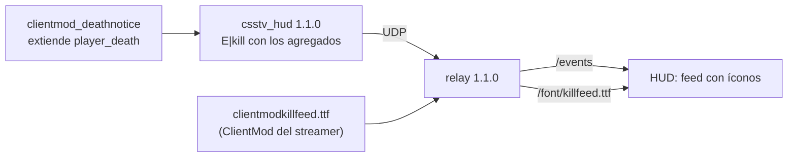

# Íconos en el feed de kills del HUD: documentación

## Qué hace

El feed de kills del HUD de observer ([`2026-10-22-hud-observer`](../2026-10-22-hud-observer/DOCUMENTACION.md)) se dibuja con los mismos íconos que el kill feed de ClientMod: el arma, el headshot y los agregados de `clientmod_deathnotice` (asistencia, asistencia con flash, wallbang, ciego, a través del humo y no scope). Ya no muestra el nombre del arma ni "HS".



## De dónde salen los datos

`clientmod_deathnotice.smx` le agrega campos al evento `player_death` (en `resource/modevents.res`). El 2026-10-23 se verificó que el **servidor real y RBK** tienen esos campos. `csstv_hud` 1.1.0 los lee y los manda al final del evento `kill`:

```
E|kill|<atacante>|<víctima>|<arma>|<headshot>|<asistente>|<flash>|<paredes>|<ciego>|<humo>|<noscope>
```

| Campo de `player_death` | En el paquete | Qué es |
|---|---|---|
| `assister` | asistente | `userid` del que asistió (0 = nadie) |
| `assistedflash` | flash | 1 si la asistencia fue con una flash |
| `penetrated` | paredes | Cuántas paredes atravesó la bala |
| `attackerblind` | ciego | 1 si el atacante estaba ciego |
| `smoke` | humo | 1 si el disparo pasó por un humo |
| `noscope` | noscope | 1 si fue con un rifle de mira sin usarla |

Sin `clientmod_deathnotice`, o con el plugin 1.0.0, esos campos llegan en 0 y el feed queda como uno normal.

## Los íconos

Salen de `clientmodkillfeed.ttf`, la fuente del kill feed de ClientMod. El relay la lee de la instalación del streamer, que la tiene porque el servidor es solo para ClientMod, y la sirve en `/font/killfeed.ttf`. **No va en el repo ni dentro de `relay.exe`**, para no repartir archivos de Valve ni de ClientMod.

- **Dónde la busca:** `<gameDir>\cstrike\resource\clientmodkillfeed.ttf`. Con `"gameDir": null` en `relay.json`, que es el valor por defecto, prueba `C:\CSSv34_ClientMod` a `F:\CSSv34_ClientMod`.
- **Sin la fuente:** el feed muestra los nombres de las armas y "HS", como en la 1.0.0. La consola del relay lo avisa al abrir, y `/api/status` lo dice en `killfeedIcons`.

| Ícono | Letra en la fuente |
|---|---|
| Armas | `a` USP, `b` AK-47, `c` Glock, `d` TMP, `e` AUG, `f` Desert Eagle, `h` HE, `i` G3SG1, `j` cuchillo, `k` M3, `l` MAC-10, `m` P90, `n` Scout, `o` SG 550, `q` UMP45, `r` AWP, `s` Dual Elites, `t` FAMAS, `u` Five-SeveN, `v` Galil, `w` M4A1, `x` MP5, `y` P228, `z` M249, `A` SG 552, `B` XM1014, `I` bomba |
| Calavera (caída, el mundo o un arma sin ícono) | `C` |
| Headshot | `D` |
| Wallbang, asistencia con flash, ciego, humo y no scope | `!`, `"`, `#`, `$` y `%` |

## Orden del feed

El mismo orden que el kill feed de ClientMod:

```
[ciego] Atacante + [flash] Asistente [arma] [no scope] [humo] [wallbang] [headshot] Víctima
```

Los nombres van con el color de su equipo y los íconos en blanco.

## Dónde está cada cosa

| Qué | Archivo |
|---|---|
| Lectura de los campos de ClientMod | `server/addons/sourcemod/scripting/csstv_hud.sp` (`Event_PlayerDeath`) |
| Evento `kill` en el relay | `hud/relay/src/protocol.ts` (`KillExtras`) |
| Búsqueda de la fuente | `hud/relay/src/font.ts` |
| `gameDir` | `hud/relay/src/config.ts` |
| Ruta `/font/killfeed.ttf` | `hud/relay/src/server.ts` |
| Letra de cada ícono | `hud/relay/public/common.js` (`KILL_GLYPHS` e `ICON`) |
| Feed | `hud/relay/public/hud.js` (`renderKills`) y `hud.css` |
