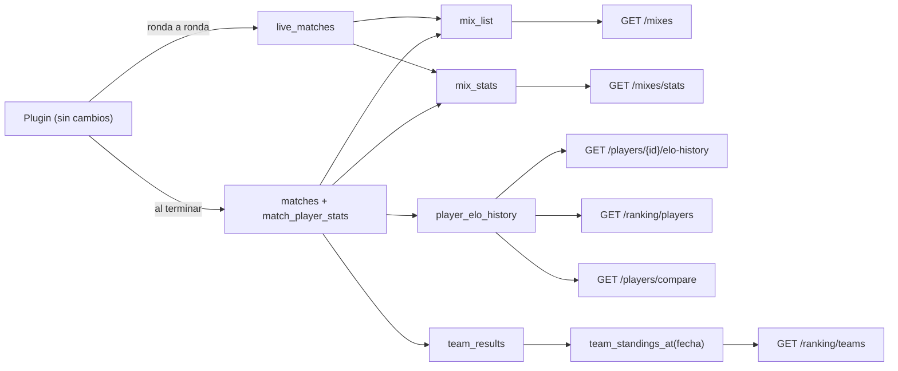
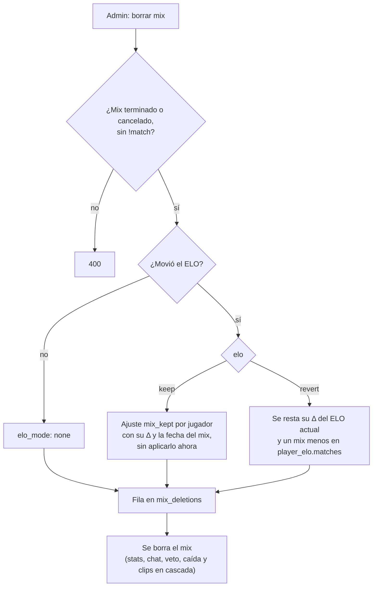

# API para los mockups de Mixes, Perfil público y Ranking: documentación

## Qué hace

Le da al frontend nuevo lo que piden los mockups de CM League para tres pantallas: **Mixes** (el listado y la sala del mix), el **perfil público** de un jugador y el **ranking** (jugadores, equipos y comparador).

Del lado de la base es la migración del replanteo `27_mixes_perfil_ranking.sql`: vistas nuevas, el puerto de SourceTV de cada servidor, el nick único y el borrado de mixes. Del lado de la API son endpoints nuevos y campos nuevos en los que ya existían. El plugin del servidor no cambia: ya manda el mix en vivo ronda por ronda y el resultado al terminar.

Todo es para la web nueva: sale con el corte, como el resto del replanteo.

## Mixes

### Listado único: `GET /api/v1/mixes`

La vista `mix_list` junta dos fuentes con las mismas columnas:

| | Mix en vivo | Mix terminado o cancelado |
|---|---|---|
| Sale de | `live_match_list` (la última foto) | `matches` con `kind = 'mix'` |
| Identificador | `live_uid` (detalle en `/mixes/live/{uid}`) | `match_id` (detalle en `/matches/{id}`) |
| Ronda actual | rondas jugadas + 1 | null |
| MVP | el de mejor rating parcial (`live_match_players`) | el de mejor rating (`match_player_stats`) |
| `tv` | host de `connect_address` + `tv_port` del servidor | null |
| `live_rank` | 1 | 0 |

- **Orden por defecto:** `sort=started_at`, `order=desc` ordena por `live_rank` y después por fecha, así que los en vivo van primero. Con `order=asc` los en vivo quedan al final.
- **Filtros:** `q` (bandos, mapa, servidor y nombres de los jugadores, alias y nombre del juego), `map`, `server`, `status`, `mine`, `hide_cancelled`, `from` y `to`.
- **`mine=true`:** pide sesión (`401` sin ella). Busca la ficha de la cuenta y filtra por `player_ids`; sin ficha, la lista viene vacía.
- La vista corre con los permisos de su dueño (como `live_match_list`), porque el nombre del servidor y su `tv_port` están en `game_servers`, que el público no lee. Del servidor solo expone esas dos cosas.

### Números: `GET /api/v1/mixes/stats`

Vista `mix_stats`, una fila: `live_now` (mixes en vivo no `stale`) y, de los mixes terminados de los **últimos 30 días**, `players_recent` (fichas distintas, o SteamID sin ficha), `top_map` y `avg_rounds`. `window_days` dice el período.

### SourceTV

- `game_servers.tv_port` (1 a 65535, opcional), en `game_servers_public`, `admin_server_list` y `admin_create_server`.
- El admin lo carga en el alta o la edición del servidor (`tv_port`).
- Lo usan `tv: { host, port }` en `/mixes`, `/mixes/live` y su detalle, y `tv_address` (`host:puerto`) en `/servers/status`. Si falta el puerto o la dirección, `tv` es null.

### Sala del mix

`GET /api/v1/matches/{id}` suma `demo_size` (bytes). El resto ya existía: stats por jugador con `elo_delta`, `mvp` y `demo_url`. Las demos son públicas: el link no se firma.

## Borrar un mix

`DELETE /api/v1/admin/mixes/{id}` con `{ elo: 'keep' | 'revert', confirm: 'estoy seguro' }` llama a `admin_delete_mix(p_match, p_elo)`.

**Reglas:**
- Solo admins. Solo mixes `finished` o `cancelled`. Un mix vinculado con `!match` a una partida de torneo o PCW no se borra (la serie quedaría con un mapa que no existe).
- **Nunca se recalcula la historia.** Los mixes posteriores quedan con el ELO que tenían.
- **Mantener** guarda un ajuste interno por jugador (`elo_adjustments.source = 'mix_kept'`) con el cambio que le dio el mix y la fecha del mix. No se aplica al crearlo, porque el ELO actual ya lo incluye. Sirve para que un recálculo automático de la base (al aprobar o quitar un SteamID, con un mix que llega tarde a una temporada cerrada o al deshacer ciertos ajustes) siga contando ese ELO aunque el mix ya no exista. **No se ve en el perfil del jugador** (`player_elo_adjustment_list` lo excluye); sí en el listado del admin. Si un admin lo deshace, se le resta al jugador como en un "revertir".
- **Revertir** resta ahora el cambio de cada jugador (con el piso de `elo_config`) y le descuenta un mix en `player_elo.matches`. No guarda ajuste: el mix ya no está, así que un recálculo futuro tampoco lo cuenta, y un ajuste lo restaría dos veces. El pico (`peak_elo`) no baja.
- El resultado de "revertir" es aproximado: los mixes que vinieron después se calcularon con el ELO que incluía este. Revertir el último mix de cada jugador da exactamente lo mismo que un recálculo (probado).
- `mix_deletions` (solo la leen los admins): partida, mapa, fecha, servidor, marcador, `elo_mode` (`keep`, `revert` o `none`), los cambios por SteamID (`deltas`), quién y cuándo.
- La demo en R2 queda hasta que venza.

## Perfil público

### Perfil por id o por nick

Las rutas públicas de un jugador aceptan el id o el nick: `/players/{id}`, `/matches`, `/map-stats`, `/medals`, `/medals/summary`, `/teams`, `/seasons`, `/elo-adjustments`, `/elo-history` y `/titles`. `resolvePlayer` (`services/players.ts`) busca por id si el parámetro es un UUID, y si no por nick sin distinguir mayúsculas (`ilike` exacto, con los comodines escapados). Si no existe, `404`.

**Nick único:** el índice `players_nick_unico` (`lower(trim(nick))`) y el trigger del mismo nombre, que da el mensaje "Ese alias ya está en uso: otro jugador se llama …" (`409`). `alias_check` (el "¿está libre?" del alias) también cuenta como tomado el nick de otra ficha. Así una cuenta no puede elegir como alias el nick de una ficha sin cuenta, ni el admin crear una ficha con un nick que ya existe.

`/players/compare` se monta antes que `/players/{id}`: un jugador que se llame `compare` (o `unclaimed`) solo se abre por id.

### SteamID

`GET /players/{id}` devuelve `steam_id` y `steam_ids` solo al dueño de la ficha y a los admins; para los demás, `null` y `[]`. "Verificado" es `has_steam`.

### Endpoints nuevos

| Endpoint | Fuente | Qué devuelve |
|---|---|---|
| `GET /players/{id}/elo-history` | `player_elo_history` | Un punto por mix que movió su ELO (`match_id`, `map`, `at`, `elo_before`, `elo_after`, `elo_delta`). Por defecto 30, del más nuevo al más viejo |
| `GET /players/{id}/titles` | `player_titles` | Campeón y subcampeón de cada torneo terminado, con el equipo con el que estaba inscrito (`tournament_registration_players`) y la fecha de la final |
| `GET /players/{id}/medals/summary` | `player_medals` | Medallas agrupadas por título e icono, con `count` y `last_at`. Se agrupan, ordenan y paginan en la API (son pocas por jugador) |

**Palmarés:** la final es la `grand` en doble eliminación y la última `ko` en las demás plantillas; el subcampeón es el otro equipo de la final. Una liga sin final (un grupo que clasifica a uno) solo da campeón, con la fecha del último partido.

**Partidas del jugador:** `player_matches` suma el torneo y la fase de la partida o, en un mapa jugado con `!match`, de su partida de torneo. La API devuelve `event` y `label` ("Final", "Grupo A · fecha 2"…, con `stageLabel`); el título y el subtítulo los arma el front.

## Ranking

### Jugadores: `GET /api/v1/ranking/players`

- Vista `player_ranking`: las fichas con ELO, con `position = rank() over (order by elo desc)`. La posición se calcula antes de los filtros, así que **no cambia al filtrar**.
- `country` y `game_role` salen de `profile_details` con su RLS: null si el perfil es privado (salvo para el dueño y los admins) o si no tiene cuenta.
- `level`: `10` (ELO 2001 o más), `7-9` (1351 a 2000) o `1-6` (menos de 1351), con `LEVEL_FLOORS`.
- `elo_trend`: los últimos 30 `elo_after` de cada ficha de la página, del más viejo al más nuevo. Se piden a `player_elo_history` de a 30 fichas, para no pasar las 1000 filas de PostgREST.

### Equipos: `GET /api/v1/ranking/teams`

- `team_results`: cada partida que cuenta para el ranking, por equipo oficial (las mismas reglas de antes: sin byes, huérfanas ni W.O., y las PCW jugadas como el equipo).
- `team_standings_at(fecha)`: la tabla con las partidas jugadas hasta esa fecha. `team_standings` pasa a ser `team_standings_at('infinity')`: una sola regla.
- `team_ranking` suma `official_position_prev` y `total_position_prev` (la posición con `team_standings_at(now() - 30 días)`, null si en ese modo no tenía partidas) y `form_official` y `form_total` (últimos 5 resultados).
- La API suma `win_rate`, `trend` (posición de hace 30 días menos la actual: positivo, subió) y `form`.
- La posición, ahora y hace 30 días, se cuenta entre todos los equipos oficiales, como antes. Un equipo que jugó y perdió todo queda debajo de uno que todavía no jugó (0 puntos, 0 victorias y menos derrotas). No cambió en este requerimiento.

### Comparador: `GET /api/v1/players/compare?a=&b=`

Dos jugadores cualesquiera, por id o nick. Por cada uno: ELO, nivel, rating, K/D, HS %, ADR, % de victorias, partidas, mixes, equipos, puesto y `elo_history` (últimos 30 mixes). `together` sale de `players_together(a, b)`: mixes terminados en el mismo bando (y cuántos ganaron) y como rivales (y cuántos ganó A). El mismo jugador dos veces da `400`.

## Dónde está cada cosa

| Qué | Archivo / ubicación |
|---|---|
| Migración | `supabase/replanteo/27_mixes_perfil_ranking.sql` |
| Inversa y pruebas SQL | `docs/bitacora/2026-10-14-replanteo-modelo-datos/reversas/27_mixes_perfil_ranking.sql` y `pruebas/27_mixes_perfil_ranking.sql` |
| Listado y números de mixes | `web/backend/src/routes/mixes.ts`; esquemas en `src/schemas/live.ts` |
| SourceTV y borrar un mix | `src/routes/live.ts`, `src/services/live.ts` (`toTv`, `serverTvs`), `src/routes/admin-servers.ts`, `src/services/servers.ts` (`tvAddress`) |
| Perfil | `src/routes/players.ts`, `src/services/players.ts` (`resolvePlayer`), `src/schemas/players.ts` |
| Ranking de jugadores y comparador | `src/routes/ranking.ts` |
| Ranking de equipos | `src/routes/teams.ts`, `src/schemas/teams.ts` |
| Pruebas | `web/backend/test/integration/mixes-perfil-ranking.test.ts`, `test/unit/mixes-perfil.test.ts` |
| Contrato del frontend | `docs/frontend/contrato/` (`README.md`, `jugadores.md` 5 y 5c, `partidas.md` 8d y 8e, `equipos.md` 7, `admin.md` 9, `decisiones.md`) |
| Mockups | `E:\Css V34 Web\mockups\MCLeague\MCLeague\` (fuera del repo) |
