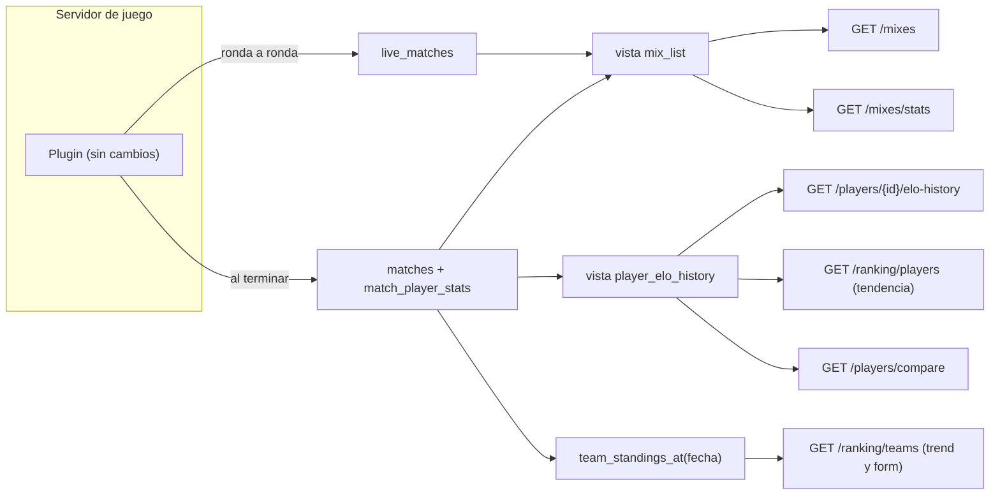
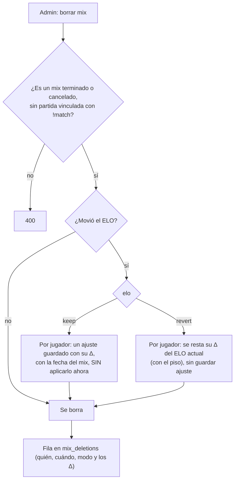

# Plan: API para los mockups de Mixes, Perfil público y Ranking

> Planeación original. Estado: **aprobada por Daniel el 2026-10-24** (con las respuestas de la sección 9). Las decisiones marcadas como "Propuesta de Claude" no las eligió Daniel.

## El pedido

Los mockups de CM League (`E:\Css V34 Web\mockups\MCLeague\MCLeague\`) traen tres handoffs para el frontend (`handoff_mixes`, `handoff_perfil_publico` y `handoff_ranking`), cada uno con su `Pedidos al backend.md`. El 2026-10-24 se compararon contra la API actual y Daniel decidió qué se hace.

Solo para la **web nueva** (backend del replanteo). Sale con el corte. No toca el plugin ni la web vieja.

## Lo que ya existe y condiciona el diseño

| Qué | Dónde | Consecuencia |
|---|---|---|
| Mixes terminados y cancelados en `match_list` (`GET /matches?kind=mix`); mixes en vivo en `live_match_list` (`GET /mixes/live`), identificados por `uid` y no por id de partida | Replanteo `16` y `19` | El listado único junta las dos fuentes. Una fila en vivo no tiene id de partida todavía |
| El detalle de un mix ya trae `players` (K, D, A, HS, daño, rating, Δ ELO, ficha), `mvp` y `demo_url` | `GET /matches/{id}` | Solo falta el tamaño de la demo |
| `demo_url` es un link fijo al Worker de demos, sin firmar | `services/matches.ts` | Las demos son públicas (Daniel): se deja así |
| Un mix con stats no se puede borrar: `DELETE /admin/matches/{id}` lo rechaza | `routes/matches.ts` | Hace falta un borrado de mixes aparte |
| El ELO actual vive en `player_elo` y se suma partida a partida. `elo_recompute_all` lo rehace desde cero intercalando los mixes y los ajustes (`elo_adjustments`) por fecha, y lo siguen usando los recálculos automáticos (SteamID adicional, mix que llega tarde a una temporada) | Migración `20261015210000`, replanteo `15`, `24` y `25` | Borrar un mix no puede romper un recálculo automático posterior (sección 4) |
| El alias de la cuenta es único sin distinguir mayúsculas, y el `nick` de la ficha de un usuario es su alias. Las fichas sin cuenta las nombra el admin, **sin control de repetidos** | Replanteo `09` | Para buscar el perfil por nick hace falta que el nick sea único en todas las fichas (sección 5) |
| `PlayerDetail` devuelve `steam_id` y `steam_ids` a cualquiera | `routes/players.ts` | Se ocultan en el perfil público (Daniel) |
| "Verificado" del mockup = tiene al menos un SteamID | `has_steam` en `PlayerSummary` | No hace falta campo nuevo |
| Nivel 1 a 10 según el ELO, calculado en TypeScript | `levelOf` y `LEVEL_FLOORS` en `lib/db.ts` | El filtro por nivel del ranking se traduce a un rango de ELO |
| Ranking de equipos con puntos 30/5, PCW opcional y posición con desempate por victorias y derrotas | `team_standings`, `team_ranking`, `GET /ranking/teams` | Se amplía el mismo endpoint (ya está en el contrato) en vez de crear `/rankings/teams` |
| Campeón de cada torneo en `events.champion`; la final es la última `ko` o la `grand` (doble eliminación); jugadores inscritos por equipo en `tournament_registration_players` | Replanteo `10` | El palmarés sale de ahí, con el equipo con el que el jugador estaba inscrito |
| Los equipos no tienen logo | `teams` | El ranking de equipos no devuelve `logo_url` (el mockup muestra la sigla en un cuadro) |

## Decisiones tomadas

| Tema | Decisión | Origen |
|---|---|---|
| Puerto de SourceTV | Columna `game_servers.tv_port` (1 a 65535, opcional), editable en el alta y la edición de servidores. Con ella, los mixes en vivo devuelven `tv: { host, port }` (el host sale de `connect_address`) | Daniel |
| KPIs de mixes | `GET /mixes/stats`: en vivo ahora, jugadores distintos de los últimos 30 días, mapa más jugado de los últimos 30 días y promedio de rondas de los últimos 30 días | Daniel |
| Listado de mixes | Un solo endpoint `GET /mixes` con en vivo, terminados y cancelados. Primero los en vivo y después por fecha descendente. Cada fila con `mvp`, ronda actual y `tv` (solo en vivo) | Daniel |
| Atajos del listado | `mine=true` (mixes donde jugó el usuario, pide sesión) y `hide_cancelled=true` | Daniel |
| Sala del mix | Se suma `demo_size` (bytes) al detalle. `linked` ya es `player_id != null`. Las demos siguen públicas, sin firmar | Daniel |
| Mixes en vivo por SSE o WebSocket | **No por ahora** | Daniel |
| Borrar un mix | El admin elige: **mantener** el ELO que dio el mix o **revertirlo**. Nunca recalcula toda la historia | Daniel |
| Perfil por nick | Todas las rutas `/players/{id}/…` aceptan el id o el nick (sin distinguir mayúsculas) | Daniel |
| Historial de ELO | Endpoint dedicado y liviano `GET /players/{id}/elo-history` | Daniel |
| Palmarés | `GET /players/{id}/titles`: torneos ganados (campeón) y finales perdidas (subcampeón), con la fecha y el equipo con el que jugó | Daniel (torneos con fecha y equipo); propuesta de Claude (subcampeón, como en el mockup) |
| SteamID en el perfil | **Nunca** en el perfil público. Solo los ven el dueño y los admins | Daniel |
| Medallas | Dos endpoints: el detalle que ya existe y uno nuevo agrupado con `count` | Daniel |
| Título y subtítulo de las partidas | Los arma el front. La API suma a cada partida del jugador el torneo (`event`) y la fase (`label`) | Daniel |
| Ranking de jugadores | `GET /ranking/players` con posición global, filtro por nivel y tendencia de los últimos 30 mixes | Daniel |
| Ranking de equipos | `GET /ranking/teams` suma `win_rate`, `trend` (puestos que subió o bajó desde hace 30 días) y `form` (últimos 5 resultados) | Daniel |
| Comparador | `GET /players/compare?a=&b=` | Daniel |
| Listados | Todos los GET de listados paginan, filtran y ordenan en el servidor (`limit`, `offset`, `sort`, `order`) | Regla del proyecto |

## 1. El flujo completo



El plugin ya reporta el mix en vivo ronda por ronda y el resultado final; no cambia nada de su lado. Todo lo nuevo son vistas y funciones en la base (replanteo `27`) y endpoints en la API.

## 2. Mixes

### 2.1 Base: vista `mix_list`

Une las dos fuentes con las mismas columnas:

| Columna | Mix en vivo (`live_match_list`) | Mix terminado o cancelado (`match_list`, `kind = 'mix'`) |
|---|---|---|
| `match_id` | null | id de la partida |
| `live_uid` | `uid` | null |
| `status` | `live` | `finished` o `cancelled` |
| `server_id`, `server_name` | del mix en vivo | de la partida |
| `map`, `score1`, `score2`, `side1_name`, `side2_name` | de la última foto | de la partida |
| `current_round` | rondas jugadas + 1 | null |
| `started_at`, `ended_at` | inicio / null | inicio / `played_at` |
| `cancel_reason`, `demo_status` | null / `none` | de la partida |
| `mvp_*` | mejor rating parcial (`live_match_players`) | mejor rating (`match_player_stats`) |
| `tv_host`, `tv_port` | `connect_address` sin el puerto + `game_servers.tv_port` | null |
| `player_ids`, `search` | de la vista en vivo | de `match_list` |
| `live_rank` | 1 | 0 (para ordenar los en vivo primero) |

El `mvp` trae ficha (si tiene), alias o nombre del juego, ELO (para el nivel) y rating.

### 2.2 Base: vista `mix_stats`

Una fila: `live_now` (mixes en vivo no `stale`), `players_recent` (SteamID distintos en mixes terminados de los últimos 30 días), `top_map` (mapa con más mixes terminados en 30 días) y `avg_rounds` (promedio de rondas de esos mixes).

### 2.3 Base: puerto de SourceTV

- `game_servers.tv_port integer check (tv_port between 1 and 65535)`.
- `game_servers_public` y `admin_server_list` lo suman al final. `admin_create_server` acepta `p_tv_port`.
- `live_match_list` y `live_match_players` no cambian; el `tv` sale de `mix_list` y del detalle en vivo.

### 2.4 API

| Endpoint | Cambio |
|---|---|
| `GET /api/v1/mixes` | **Nuevo.** Filtros: `q` (bandos, jugadores, mapa, servidor), `map`, `server`, `status` (`live`, `finished`, `cancelled`), `mine` (pide sesión; sin ficha devuelve vacío), `hide_cancelled`, `from`, `to`. Orden por defecto: en vivo primero y después `started_at` desc; también `sort=started_at\|rounds`. Paginado. Ítem: `{ match_id, live_uid, status, map, server: { id, name }, started_at, ended_at, side1: { name, score }, side2: { name, score }, mvp, demo_status, cancel_reason, current_round, tv }` |
| `GET /api/v1/mixes/stats` | **Nuevo.** `{ live_now, players_recent, top_map, avg_rounds, window_days: 30 }`. Sin sesión. El texto del mockup "Jugadores esta semana" pasa a "Jugadores en los últimos 30 días" |
| `GET /api/v1/mixes/live` y `/live/{uid}` | Suman `tv: { host, port } \| null` |
| `GET /api/v1/matches/{id}` | Suma `demo_size` (bytes, null si no hay demo) |
| `GET/POST/PATCH /api/v1/admin/servers…` y `GET /api/v1/servers` | Suman `tv_port` |
| `DELETE /api/v1/admin/mixes/{id}` | **Nuevo** (sección 4) |

`GET /matches?kind=mix` y `GET /mixes/live` se quedan como están (los usa el resto del contrato).

## 3. Perfil público

### 3.1 Perfil por nick

- Las rutas `GET /api/v1/players/{id}`, `/matches`, `/map-stats`, `/medals`, `/teams`, `/seasons`, `/elo-adjustments` y las nuevas aceptan el **id o el nick**. Si el parámetro es un UUID se busca por id; si no, por nick sin distinguir mayúsculas ni espacios de los costados.
- Para que el nick identifique una sola ficha: índice único `players (lower(btrim(nick)))`. La `27` aborta si encuentra repetidos (en la copia local no hay). `set_my_tag`, `set_user_tag` y el alta o edición de fichas desde el admin rechazan un nick que ya usa otra ficha con "Ese alias ya está en uso".

### 3.2 Cambios en endpoints existentes

| Endpoint | Cambio |
|---|---|
| `GET /players/{id}` | `steam_id` y `steam_ids` solo para el dueño y los admins; para los demás, `null` y `[]`. `has_steam` es el "Verificado" |
| `GET /players/{id}/matches` y `GET /me/matches` | Suman `event: { id, name } \| null` y `label` (la fase, como en `MatchSummary`). En un mix vinculado con `!match` salen de la partida de torneo |

### 3.3 Endpoints nuevos

| Endpoint | Respuesta |
|---|---|
| `GET /players/{id}/elo-history` | Listado paginado de `{ match_id, map, at, elo_before, elo_after, elo_delta }` de los mixes que movieron su ELO. Por defecto `limit=30`, `sort=at`, `order=desc` (el front lo da vuelta para el gráfico) |
| `GET /players/{id}/titles` | Listado paginado de `{ event: { id, name }, result: 'champion' \| 'runner_up', team: { id, name, tag }, at }`. `at` es la fecha de la final. Filtro `result` |
| `GET /players/{id}/medals/summary` | Listado paginado de `{ title, icon, count, last_at }` agrupado por título e icono. Orden por `count` desc |

### 3.4 Base

- Vista `player_elo_history`: una fila por mix con ELO aplicado (`elo_after` no null) y ficha, con `row_number()` por ficha del más nuevo al más viejo (sirve también para la tendencia del ranking y el comparador).
- Vista `player_titles`: torneos con campeón, la final (`grand` o la última `ko`) y los jugadores inscritos (`tournament_registration_players`) del campeón y del perdedor de la final. Un torneo de liga sin final solo da campeón.
- `player_matches` suma `event_id`, `event_name` y los datos de fase (`stage`, `phase`, `grp`, `round` y la última ronda de la fase) de la partida o de su partida de torneo.

## 4. Borrar un mix

`DELETE /api/v1/admin/mixes/{id}` con body `{ elo: 'keep' | 'revert', confirm: 'estoy seguro' }`. Llama a `admin_delete_mix(p_match, p_elo)`:



Por qué así: el ELO actual ya incluye el mix, y un recálculo automático posterior lo rehace desde los mixes y los ajustes.
- **Mantener:** hoy no cambia nada. Como el mix ya no está, el ajuste con su fecha hace que un recálculo futuro siga contando ese ELO. **Hace falta** aunque ya no exista el botón "Recalcular ELO" (2026-10-21): la base sigue recalculando sola al aprobar o quitar un SteamID, con un mix que llega tarde a una temporada cerrada y al deshacer ciertos ajustes (replanteo `15`, `21`, `24` y `25`). El ajuste lleva `elo_adjustments.source = 'mix_kept'` (columna nueva; los demás son `manual`) y **no se ve en el perfil del jugador**, porque para él no cambió nada: `player_elo_adjustment_list` lo excluye. Sí aparece en el listado del admin con el motivo "Mix borrado (de_dust2, 2026-10-20): se mantiene su ELO". Si un admin lo deshace, queda como un "revertir".
- **Revertir:** se resta ahora. Un recálculo futuro da lo mismo porque el mix ya no está. No se guarda ajuste: si se guardara, el recálculo lo restaría dos veces.
- El resultado de "revertir" es aproximado: los mixes posteriores se calcularon con el ELO que incluía este. Es lo que pidió Daniel (no recalcular la historia).

`mix_deletions` (solo admins la leen): id, `match_id`, mapa, fecha del mix, servidor, `elo_mode`, `deltas` (jsonb por SteamID), `deleted_by`, `deleted_at`. Los clips, el chat y las stats del mix se borran con él (las claves con `on delete cascade`; se revisan en la `27`). La demo en R2 queda hasta que venza.

El toast del mockup ("Mix borrado. ELO recalculado.") se cambia en el contrato a "Mix borrado. Se mantuvo el ELO." o "Mix borrado. ELO revertido."

## 5. Ranking

### 5.1 Jugadores: `GET /api/v1/ranking/players`

- Vista `player_ranking`: las fichas con ELO, con `position` = `rank() over (order by elo desc)`. La posición se calcula antes de los filtros, así que no cambia al filtrar.
- Filtros: `q` (alias o equipo), `level` (`10`, `7-9`, `1-6`, que la API traduce a un rango de ELO con `LEVEL_FLOORS`), `team`. Orden por defecto `position`; también `rating`, `kd`, `matches`. Paginado.
- Ítem: `{ position, player: { id, alias, photo_url }, level, elo, teams, rating, kd, matches, country, game_role, elo_trend }`. `country` y `game_role` salen de los datos públicos del perfil y son null si es privado o no tiene cuenta. `elo_trend` son los últimos 30 `elo_after`, del más viejo al más nuevo (una consulta para toda la página sobre `player_elo_history`).

### 5.2 Equipos: `GET /api/v1/ranking/teams`

- Función `team_standings_at(p_at timestamptz)`: la cuenta de `team_standings` con las partidas jugadas hasta esa fecha. `team_standings` pasa a ser `select * from team_standings_at('infinity')`, así hay una sola regla.
- Vista `team_ranking` suma `official_position_prev` y `total_position_prev` (posición con `team_standings_at(now() - 30 días)`) y `form_official` / `form_total` (últimos 5 resultados, del más viejo al más nuevo).
- La API suma `win_rate` (0 a 100, null sin partidas), `trend` (posición de hace 30 días − posición actual: positivo subió, null si no tenía partidas hace 30 días) y `form` (`['W','L',…]`). El desempate sigue siendo puntos, victorias y derrotas (más victorias primero, como pide el mockup).

### 5.3 Comparador: `GET /api/v1/players/compare?a=&b=`

`a` y `b` aceptan id o nick. Respuesta:

```json
{
  "a": { "player": { "id": "…", "alias": "…", "photo_url": null }, "level": 8, "elo": 1720, "rating": 1.12, "kd": 1.3, "hs": 48.2, "adr": 84.1, "win_rate": 55.0, "matches": 120, "elo_history": [1690, 1702, …] },
  "b": { … },
  "together": { "same_team": { "matches": 7, "wins": 4 }, "against": { "matches": 3, "a_wins": 2 } }
}
```

`elo_history`: los últimos 30 mixes de cada uno, del más viejo al más nuevo. `together` cuenta los mixes terminados que jugaron los dos, en el mismo bando y en bandos contrarios.

## 6. Documentación

- Contrato del frontend: `partidas.md` (mixes y borrado), `jugadores.md` (perfil por nick, historial, palmarés, medallas, partidas, SteamID ocultos, ranking y comparador), `equipos.md` (ranking de equipos), `admin.md` (servidores y borrar mix), `api.md`, las novedades del índice y `decisiones.md`.
- `supabase/replanteo/README.md`, la bitácora (`DOCUMENTACION.md`, `GUIA_IMPLEMENTACION.md` y su fila en `bitacora/README.md`) y `PENDIENTES.md` (el `tv_port` del servidor real y de RBK se carga en el corte).

## 7. Requisitos antes de empezar

- Aprobación de este plan y las respuestas de la sección 9.
- Docker Desktop para la Supabase local (está levantado).
- Saber el puerto de SourceTV del servidor real y de RBK para el corte (no bloquea la implementación).

## 8. Orden de implementación

1. Replanteo `27_mixes_perfil_ranking.sql`, su inversa y pruebas SQL.
2. `pnpm db:reset` y `pnpm db:types`.
3. Servidores: `tv_port`.
4. Mixes: `GET /mixes`, `GET /mixes/stats`, `tv` en vivo, `demo_size` y `DELETE /admin/mixes/{id}`.
5. Perfil: resolver id o nick, SteamID ocultos, `event` y `label` en las partidas, historial de ELO, palmarés y medallas agrupadas.
6. Ranking: jugadores, equipos (`trend`, `form`, `win_rate`) y comparador.
7. Pruebas unitarias y de integración de cada endpoint (feliz, 400, 401 y 403 donde aplique). `pnpm typecheck`, `pnpm test` y `pnpm test:int` en verde.
8. Contrato del frontend, bitácora y pendientes.

## 9. Preguntas

Respondidas por Daniel el 2026-10-24:

1. **Nick único: sí**, índice único en todas las fichas.
2. **Ajuste de "mantener":** preguntó si hace falta, a la luz de que se quitó el botón de recalcular (2026-10-21). Hace falta por los recálculos automáticos que quedaron (sección 4). Propuesta de Claude: que **no se vea** en el perfil del jugador, solo en el listado del admin.
3. **Comparador:** Daniel lo entendía como comparar las stats (K/D, rating, etc.) de otro jugador con las del usuario logueado. El mockup compara **dos jugadores cualesquiera** (dos selects, o marcando dos filas del ranking); la sección 5.3 queda así, y el front puede poner al usuario logueado como A por defecto. La línea "Mixes jugados juntos" **se queda, con los dos casos** (mismo bando y rivales).
4. **Ventana: 30 días** para los KPIs de mixes y para el `trend` de equipos.
