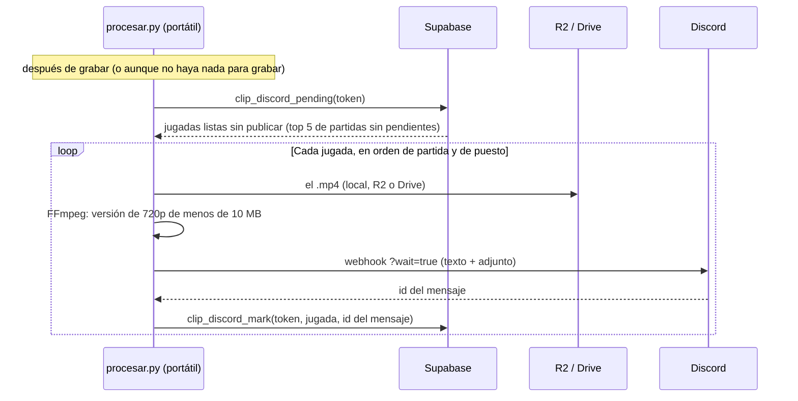

# Plan: publicar los clips en Discord

> Planeación original. Estado: **aprobado** por Daniel el 2026-10-24 (con el tope de jugadas por partida bajado a 5 en `clip_config`, el top 5 de Discord son todas las visibles).

Sigue a la grabación automática ([`2026-10-23-clips-render-automatico`](../2026-10-23-clips-render-automatico/)). Mientras sale la web nueva, las mejores jugadas de cada mix se publican en un canal de Discord con su video.

## Decisiones tomadas

| Tema | Decisión | Por qué |
|---|---|---|
| Dónde se muestran | Un canal de Discord, por webhook. La web vieja sigue sin galería | Daniel, 2026-10-24: Discord es lo más viable mientras sale la web nueva. Llega donde están los jugadores y no es código que se tira en el corte |
| Cuántas por mix | Las **5 mejores** (`position` 1 a 5 de `match_clip_list`) | Daniel, 2026-10-24 |
| El video en el mensaje | **Adjunto**: una versión liviana de 720p de menos de 10 MB, que Discord reproduce en el chat y guarda mientras exista el mensaje | El link del Worker vence a los 15 días (se borra de R2). Drive no se reproduce dentro de Discord. El límite del webhook sin boost es 10 MB, y el `.mp4` de 1080p pesa más |
| Link permanente | "Ver en 1080p": el link de Drive | No vence |
| Estado | Columnas nuevas en `match_clips`: `discord_posted_at` y `discord_message_id` | Daniel, 2026-10-24: las que ya están grabadas y todavía no se publicaron también se publican |
| Quién publica | `procesar.py`, en cada corrida, después de grabar | Ya tiene el video, los datos de la jugada y el token. No hace falta otra pieza |
| Webhook | `DISCORD_CLIPS_WEBHOOK` en el `.env` de la máquina de render (nunca en el repo) | Es una credencial: quien la tiene puede publicar en el canal |

## 1. El flujo

## 2. Qué se publica y cuándo

| Regla | Detalle |
|---|---|
| Qué jugadas | Las de puesto 1 a 5 de cada partida, con `video_status = 'done'` y sin `discord_posted_at` |
| Cuándo | Cuando la partida ya no tiene, entre sus 5 mejores, jugadas en cola o grabándose. Así salen juntas y en orden. Las que fallaron o se saltaron no frenan a las demás |
| Orden | Partida más vieja primero y, dentro de cada partida, del puesto 1 al 5 |
| Las ya grabadas | Entran solas: el estado sale de la base. La primera corrida publica las del inferno del 2026-10-24 y las de las partidas que ya estén listas |
| Partidas viejas | Solo las que tienen video (las de la 2.5.0 en adelante) |

## 3. El mensaje

Un mensaje por jugada, con un embed y el video adjunto:

- **Título:** `ACE · Old x roman`. Los tipos: ACE, 4K, 3K y Clutch 1vN.
- **Texto:** `de_cbble · ronda 26 · 16-13` (mapa, ronda y resultado final de la partida) y `#1 de la partida`.
- **Link:** "Ver en 1080p" a Drive, si lo tiene.
- **Video:** el adjunto, que Discord muestra con su reproductor.
- **Sin menciones:** el webhook manda `allowed_mentions` vacío, así un nombre con `@` no le avisa a nadie.

## 4. Base de datos

Migración `supabase/migrations/AAAAMMDDHHMMSS_clips_discord.sql`.

| Cambio | Detalle |
|---|---|
| `match_clips` | `discord_posted_at timestamptz` y `discord_message_id text` |
| `clip_discord_pending(p_token, p_top default 5, p_limit default 20)` | Las jugadas a publicar según la sección 2, con lo que hace falta para el mensaje y para conseguir el video: partida (`external_id`, mapa, resultado, fecha), puesto, tipo, ronda, jugador, `video_key`, `video_in_r2`, `video_drive_id` y `video_seconds` |
| `clip_discord_mark(p_token, p_clip, p_message_id)` | Marca la jugada como publicada. Devuelve false si ya lo estaba |
| Si la jugada se vuelve a grabar (cambian sus ticks) | El trigger no toca `discord_*`: lo publicado queda publicado (caso muy raro) |
| Pruebas | Las de `pruebas/pruebas_db.sql`: top 5, partida con pendientes, orden, marca repetida y token |

`match_clip_list` no cambia (la web no necesita saber si se publicó), así que el replanteo no se toca.

## 5. `render/`

| Archivo | Cambio |
|---|---|
| `discord.py` (nuevo) | El webhook: `multipart/form-data` con `payload_json` y el archivo, `?wait=true` para recibir el id del mensaje, `User-Agent` propio y espera ante un 429 (`retry_after`) |
| `procesar.py` | Paso nuevo al final de cada corrida: `clip_discord_pending` y, por cada jugada, conseguir el `.mp4` (lo local, si está; si no, R2 si todavía está, y si no, Drive), armar la versión liviana, publicar y marcar. 2 s entre mensajes |
| `render_clip.py` | `light_version()`: FFmpeg a 720p (CRF 28, AAC 96 kbps). Si pasa de 9,5 MB, se vuelve a codificar a la tasa de bits que entra |
| `drive.py` | `download(file_id)`, para las jugadas que ya no están en R2 |
| `config.example.json` | `"discord": true` y `"discord_top": 5` |
| Si se publicó pero no se pudo marcar | Se anota el id de la jugada en `work_dir/discord_publicados.json` antes de marcar, y se consulta antes de publicar: así no sale dos veces |

## 6. Requisitos

- Que Daniel apruebe este plan.
- El webhook del canal: ya está en el `.env` de la PC como `DISCORD_CLIPS_WEBHOOK`. Falta copiarlo al `.env` del portátil.
- Que Daniel aplique la migración en el SQL Editor cuando esté probada en local.

## 7. Orden de implementación

1. Migración y pruebas en la Supabase local.
2. `discord.py`, la versión liviana y el paso en `procesar.py`. Prueba de punta a punta con la base local y un webhook de prueba (un hilo o un canal privado que cree Daniel, para no llenar el canal real).
3. Migración en producción (Daniel).
4. Actualizar el portátil (`git pull`, el webhook en su `.env` y `"discord": true`). La primera corrida publica las ya grabadas.
5. Documentación, guía, la fila en la bitácora y `PENDIENTES.md`.
