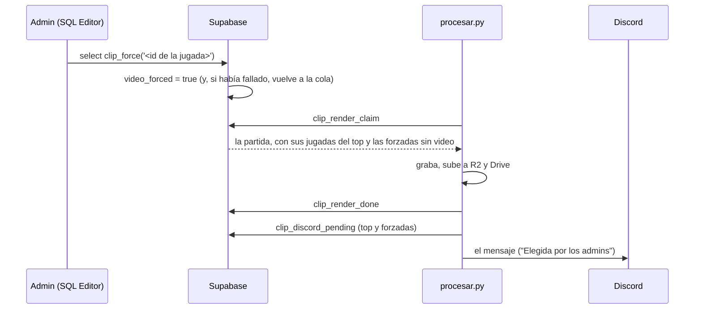

# Plan: forzar el video de una jugada que quedó fuera del top

> Planeación original. Estado: **aprobado** por Daniel el 2026-10-24.

Sigue a [`2026-10-23-clips-render-automatico`](../2026-10-23-clips-render-automatico/) y [`2026-10-24-clips-discord`](../2026-10-24-clips-discord/). Hoy el bot graba y publica solo las 5 mejores jugadas de cada partida (`clip_config.per_match`). Un jugador reportó un 1v2 ganado (sunless, season del 2026-10-24, ronda 5) que quedó afuera por el tope. Con esto, un admin puede pedir el video de cualquier jugada registrada.

## Decisiones tomadas

| Tema | Decisión | Por qué |
|---|---|---|
| Cómo se pide | Una marca por jugada, `match_clips.video_forced`, que pone un admin | Daniel, 2026-10-24: una opción permanente, no un arreglo de una vez |
| Quién la pone | Un admin: hoy con una línea en el SQL Editor (`clip_force`); más adelante, un botón en el admin de la web nueva | La web nueva todavía no salió. La función ya valida que sea admin |
| Qué hace el bot | Graba y publica en Discord las jugadas forzadas igual que las del top, aunque estén fuera de los topes | El mismo camino de siempre: cola, R2, Drive y Discord |
| Dónde se ven | En `match_clip_list` (la lista de la web nueva) aparecen después de las del top, con su puesto a continuación (6, 7…) | Si un admin la eligió, se tiene que ver. Las del top no cambian |
| Mensaje en Discord | Igual que el resto, pero en lugar de "#N de la partida" dice "Elegida por los admins" | No es parte del top: que no parezca un error del orden |
| Partidas viejas | Se puede forzar cualquier jugada mientras su demo siga en R2 (90 días) | Después la demo ya no está y la jugada queda `skipped` |

## 1. El flujo



## 2. Base de datos

Migración `supabase/migrations/AAAAMMDDHHMMSS_clips_forzados.sql`.

| Cambio | Detalle |
|---|---|
| `match_clips.video_forced` | `boolean not null default false`. Además, `video_forced_at` y `video_forced_by` (quién la pidió, `null` desde el SQL Editor) |
| `clip_force(p_clip uuid)` | Solo admin (o el SQL Editor). Marca la jugada. Si estaba `failed` o `skipped`, la devuelve a la cola con los intentos en 0. Devuelve el estado en que quedó |
| `clip_unforce(p_clip uuid)` | Le saca la marca. No borra un video que ya se grabó |
| `match_clip_list` | Las del top como hoy y, después, las forzadas que no entraron, con puesto a continuación. Columna nueva al final: `forced` |
| `clip_render_claim` | Ya usa `match_clip_list`, así que toma las forzadas sin cambios. Se ajusta el orden de la cola: una partida con forzadas pendientes entra aunque sea vieja |
| `clip_discord_pending` | Suma las forzadas con video y sin publicar, después de las del top, y devuelve `forced` para el mensaje |
| Replanteo `26` e inversa | La vista con las columnas nuevas, como pasó con el video |
| Pruebas | Forzar una jugada fuera del top: aparece en la lista, la toma la cola, sale en Discord. Forzar una `failed`. Permisos: un usuario común no puede |

## 3. `render/`

| Archivo | Cambio |
|---|---|
| `discord.py` | Si la jugada es forzada, "Elegida por los admins" en lugar de "#N de la partida" |
| `procesar.py` | Nada más: la cola y Discord ya vienen de la base |

## 4. Cómo se pide (hasta que exista el botón)

En el SQL Editor, buscar la jugada y forzarla:

```sql
-- Las jugadas de un jugador en la última partida de un mapa
select c.id, c.round, c.player_name, cardinality(c.kill_ticks) as kills, c.clutch_vs, c.round_won, c.video_status
  from match_clips c join matches m on m.id = c.match_id
 where m.map = 'season' and c.player_name ilike '%sunless%'
 order by m.played_at desc, c.round;

select clip_force('<id>');
```

La guía de implementación va a tener estos pasos.

## 5. Fuera de este plan

- El botón en el admin de la web nueva (`POST /api/v1/admin/clips/{id}/force`): con el corte, siguiendo el contrato.
- Que los jugadores pidan sus propias jugadas.

## 6. Requisitos

- Que Daniel apruebe este plan.
- Docker Desktop abierto en la PC, para las pruebas con la Supabase local.
- Que Daniel aplique la migración en producción cuando esté probada.

## 7. Orden de implementación

1. Migración, la vista del replanteo `26` y su inversa, y las pruebas en la Supabase local.
2. `discord.py` y la prueba de punta a punta de Discord.
3. Migración en producción (Daniel), forzar la ronda 5 de sunless (y la ronda 1, si se quiere) y `git pull` en el portátil.
4. Documentación, guía y la fila en la bitácora.
