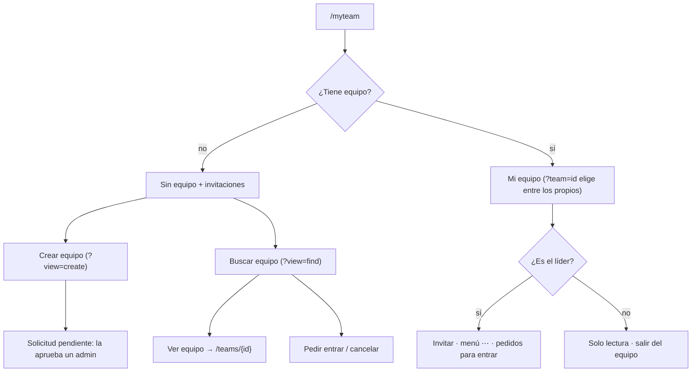
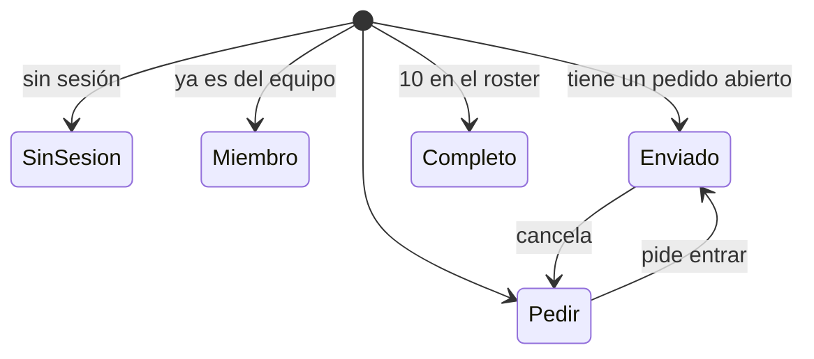

# Equipo (Mi equipo, vista pública y Buscar equipo): documentación

## Qué hace

Hay una sola vista de equipo con dos modos:
- **Mi equipo** (`/myteam`): la gestión de los equipos propios.
- **Equipo público** (`/teams/{id}`): el mismo diseño, en solo lectura, para cualquier equipo.

Quien no tiene equipo ve "Sin equipo", con las invitaciones recibidas, y desde ahí llega a **Crear equipo** (`/myteam?view=create`) o **Buscar equipo** (`/myteam?view=find`).

Lo que el backend todavía no tiene **se ve, deshabilitado y con "Próximamente"** (decisión de Esteban). Se activa cuando llegue el endpoint.

## Secciones

| Sección | Qué muestra | Origen |
|---|---|---|
| Mis equipos | Segmentado hasta 3 equipos, desplegable desde 4 ("Tus equipos · n"). Sigla, nombre y rol (líder / activo / suplente / coach) | `GET /me/profile` (`teams`) y el plantel de cada uno |
| Cabecera | Escudo con la sigla (o las iniciales si no tiene), "MI EQUIPO · DESDE {mes año}", nombre, líder, roster y títulos | `GET /teams/{id}`; "desde" = el ingreso más antiguo del plantel |
| KPIs | Ranking, puntos, % de victorias, títulos; **torneos jugados: Próximamente** | `GET /ranking/teams`, `record.official`, `GET /events?status=finished` |
| Roles de equipo | Mapa con IGL, Entry, AWPer, Lurker y Support, todos "Sin asignar": **Próximamente** | — |
| Jugador estrella | El de mejor rating del roster: nivel, ELO, rating, K/D, ADR y HS | `GET /players?team=&sort=rating`, `GET /players/{id}` |
| Forma reciente | Últimas 5 partidas: V/D, rival, torneo, fase y marcador | `GET /matches?team=` |
| Roster | Agrupado en Activos ("hasta 5"), Suplentes y Coach ("hasta 1"); chip de estado; "Líder" | `GET /teams/{id}/members` (`role` `player`/`sub`/`coach`) |
| Pedidos para entrar (líder) | Avatar y nick, que abren el perfil; hace cuánto y cuándo vence; Aceptar / Rechazar | `GET /teams/{id}/pending`, `POST /join-requests/{id}/accept|reject` |
| Vitrina | Torneos ganados: nombre, "Campeón", hace cuánto, premio | `GET /events?status=finished` (`champion`) |
| Torneos en los que participó | **Próximamente** | — |

## Acciones

| Acción | Quién | Cómo |
|---|---|---|
| Invitar jugador | Líder | Panel lateral: busca por alias (`GET /players?q=`) y marca quién no puede entrar ("Sin cuenta o SteamID…", "Ya está en el roster") o en qué otro equipo está. `POST /teams/{id}/invites`. El campo "Estado en el roster" queda **Próximamente** |
| Menú ⋯ → estado | Líder | Activo / Suplente / Coach, deshabilitados (**Próximamente**) |
| Menú ⋯ → ceder liderazgo | Líder | Deshabilitado si el jugador no tiene SteamID. Confirmación y toast "{nick} ahora es el líder de {equipo}". `POST /teams/{id}/captain` |
| Menú ⋯ → expulsar | Líder | Confirmación. `DELETE /teams/{id}/members/{playerId}` |
| Salir del equipo | Miembro | Deshabilitado para el líder ("Primero cede el liderazgo"); confirmación. `POST /teams/{id}/leave` |
| Pedir entrar / cancelar | Cualquiera con sesión | Vista pública y Buscar. `POST /teams/{id}/join-requests`, `DELETE /join-requests/{id}`; el estado sale de `GET /me/team-invites?kind=request` |
| Aceptar / rechazar invitación | Invitado | "Sin equipo". `POST /team-invites/{id}/accept|reject` |
| Crear equipo | Usuario | Nombre (2 a 40) y sigla (1 a 6, en mayúsculas). `PUT /me/team-request`; después, la pantalla de solicitud pendiente, con "Editar solicitud". "Subir imagen" queda **Próximamente** |

Los errores del backend se muestran con su mensaje. Por ejemplo, sin SteamID: "Para entrar a un equipo tenés que tener tu SteamID vinculado".

## Estados del botón "Pedir entrar"

## Dónde está cada cosa

Todo dentro de `web/frontend/src/`.

| Qué | Archivo |
|---|---|
| Consultas y mutaciones | `features/teams/queries.ts` (la clave `["team", id]` la comparte el breadcrumb del shell) |
| Lógica pura (grupos, sigla, KPIs, títulos, resultado de una partida, estado de "Pedir entrar") | `features/teams/model.ts` |
| Vista del equipo y acciones | `features/teams/TeamView.tsx` |
| Secciones | `features/teams/sections.tsx`, `Roster.tsx`, `InviteDrawer.tsx`, `TeamSwitcher.tsx` |
| Sin equipo, Crear y Buscar | `features/teams/NoTeam.tsx`, `CreateTeam.tsx`, `FindTeam.tsx` |
| Escudo, panel, "Próximamente", avatar | `features/teams/ui.tsx` |
| Rutas | `routes/_app/myteam.tsx`, `routes/_app/teams.$id.tsx` |
