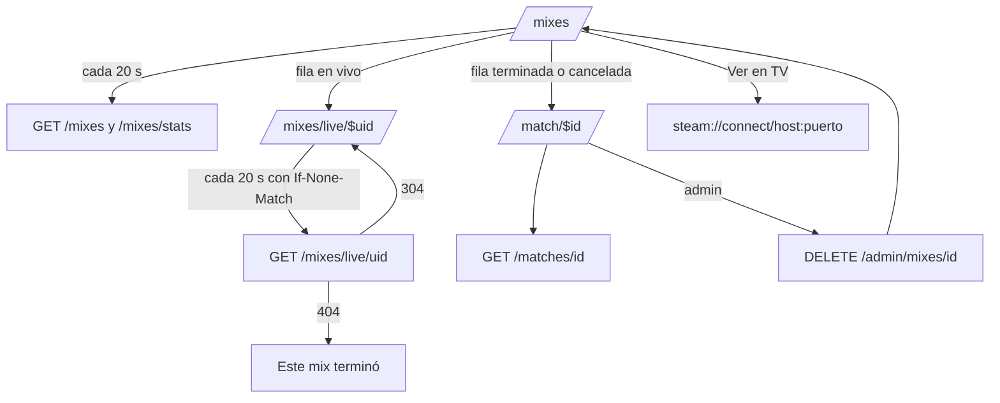
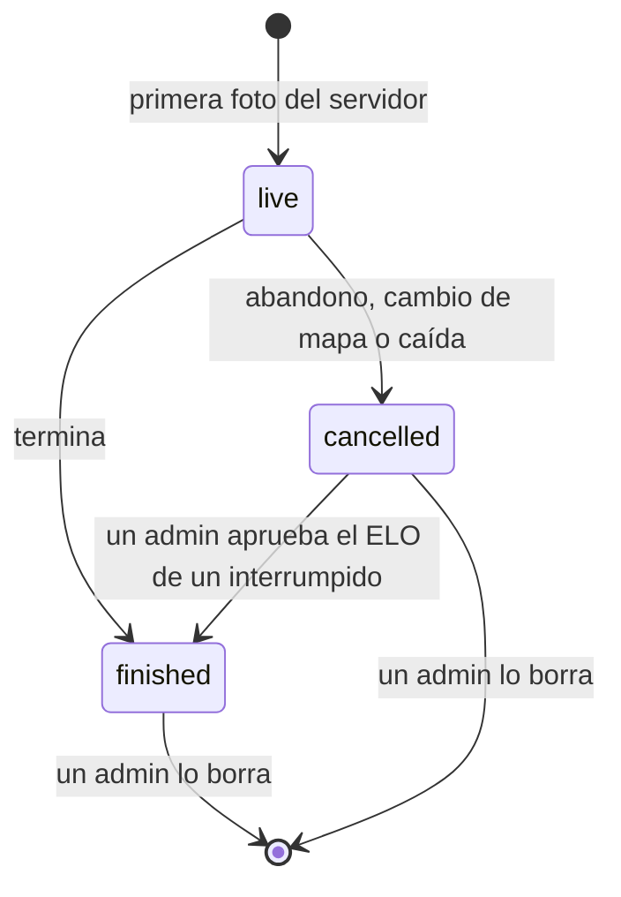

# Mixes en el frontend: documentación

## Qué hace

El módulo Mixes del frontend nuevo (`web/frontend`) muestra todos los mixes que reportan los servidores en un solo listado (`/mixes`): primero los que se están jugando y después el resto, del más nuevo al más viejo. Arriba hay cuatro números (mixes en vivo, jugadores de los últimos 30 días, mapa más jugado y promedio de rondas), un buscador, el filtro de mapa y dos atajos: "Solo donde jugué" y "Ocultar canceladas".

Cada fila abre la sala del mix. La de un mix terminado o cancelado está en `/match/$id` y muestra el marcador, la demo y una tabla por bando con las stats de cada jugador y lo que ganó o perdió de ELO. La de un mix en vivo está en `/mixes/live/$uid`, se actualiza cada 20 segundos y ofrece "Ver en CM League TV", que abre Steam conectado al SourceTV del servidor. Un admin puede borrar un mix terminado o cancelado y elegir si el ELO que dio se mantiene o se revierte.

El marcador de la sala lleva de fondo la foto del mapa, que el admin carga en la maestra de mapas. Esa maestra todavía no existe en la API: hasta que llegue, el marcador sale liso y no hay select de mapas.

## El listado

- **Estado en la URL:** `q`, `map`, `mine`, `hideCancel`, `page` y `per` (10, 15 o 25; 15 por defecto). Un valor inválido vuelve al de por defecto. Todo cambio de filtro vuelve a la página 1. El buscador pasa a la URL 300 ms después de dejar de escribir.
- **API:** `GET /api/v1/mixes` con `q`, `map`, `mine=true`, `hide_cancelled=true`, `page` y `per`. El orden (los en vivo primero) lo pone la API. Se vuelve a pedir cada 20 segundos, y mientras llega una página nueva queda la anterior.
- **Fila en vivo:** fondo `destructive` al 5 %, chip "EN VIVO" y "Ronda {n} · {servidor}", marcador sin negrita, MVP parcial y "Ver en TV" si el servidor tiene cargado su puerto de SourceTV. Sin novedades del servidor por más de 10 minutos (`stale`), la fila sale atenuada con "Sin novedades del servidor".
- **Fila terminada:** fecha y hora (la de inicio o, si falta, la de fin), el ganador en negrita, el MVP con su nivel, nick y rating, y el estado de la demo.
- **Fila cancelada:** chip "Cancelada · {motivo}".
- **"Ver en TV"** es un link `steam://connect/{host}:{puerto}` con el tooltip `connect {host}:{puerto}`. No abre la sala.

| `demo_status` | En el listado | En la sala |
|---|---|---|
| `uploaded` | Disponible (verde) | "Descargar demo ({MB} MB)" |
| `pending` | Subiendo (naranja) | "La demo se está subiendo" |
| `expired` | Vencida (gris) | "Demo vencida (90 días)" |
| `missing` | No encontrada (gris) | "Demo no encontrada" |
| `none` u otro | — | "Sin demo" |

| `cancel_reason` | Texto |
|---|---|
| `crash` | Interrumpida |
| `map_change` | Cambio de mapa |
| `abandoned` | Abandono |
| `admin` | Admin |
| Cualquier otro | El texto tal cual (texto libre) |

## La sala del mix

- **Modelo común** (`room.ts`): la sala terminada o cancelada sale de `GET /api/v1/matches/{id}` y la en vivo de `GET /api/v1/mixes/live/{uid}`. Las dos se convierten al mismo modelo y usan los mismos componentes.
- **Marcador:** chip EN VIVO, FINAL o CANCELADO, los dos bandos con su cuadro A y B, y el marcador grande. El anillo naranja del ganador sale solo en un mix terminado. Debajo:
  - en vivo: "{mapa} · ronda {n} · empezó hace…";
  - terminado o cancelado: "{mapa} · rondas".
- **Foto del mapa** (`MapBackdrop`): si la maestra tiene foto para ese mapa, va de fondo con un velo negro. La franja queda oscura en los dos temas, con los cuadros A y B translúcidos. Sin foto, o si no carga, queda lisa.
- **Tablas por bando:** Jugador, K, D, A, +/−, HS %, ADR, Rating y Δ ELO, de mejor a peor rating.
  - HS % es `headshots / kills` y ADR es `damage / rounds`, redondeados.
  - Chip MVP; chip "INVITADO" si el jugador no tiene ficha.
  - El nick lleva al perfil si tiene ficha. La fila del usuario lleva el naranja al 6 %.
  - En vivo y en cancelados, Δ ELO es "—".
- **Avisos:** en un cancelado, "Mix cancelado por {motivo}. No afecta al ELO." Si es un interrumpido con la revisión pendiente: "Un admin tiene que decidir si cuenta para el ELO.". En un mix en vivo sin novedades: "Sin novedades del servidor desde hace más de 10 minutos.".
- **Mix en vivo que terminó:** la API responde `404` y la sala muestra "Este mix terminó." con un botón a Mixes.
- **Refresco en vivo:** cada 20 segundos con `If-None-Match`. Un `304` reusa la última foto, sin redibujar.

## Borrar un mix (admin)

- "Borrar este mix" solo aparece para el rol `admin` (`canDeleteMix` en `auth/permissions.ts`) y en mixes que no están vinculados con `!match` a un torneo o PCW.
- El diálogo pregunta qué pasa con el ELO: **Mantener** (`keep`, por defecto) o **Revertir** (`revert`). En un cancelado no pregunta. El botón "Borrar mix" se habilita recién al escribir `estoy seguro`.
- `DELETE /api/v1/admin/mixes/{id}` con `{ elo, confirm }`. Al terminar, un toast según `elo_mode` ("Mix borrado. Se mantuvo el ELO." o "Mix borrado. ELO revertido."), se refrescan los mixes y vuelve a `/mixes`. Un error de la API se muestra en el diálogo sin cerrarlo.

## Maestra de mapas (pendiente del backend)

`features/maps/queries.ts` define `mapsOptions` con el tipo esperado (`name`, `active`, `image_url`). Hoy devuelve una lista vacía, así que no hay select de mapas y el marcador sale liso. Cuando el backend publique el endpoint, solo cambia el `queryFn` y el tipo pasa a ser el generado. Detalle en `docs/PENDIENTES.md`, sección 6.

## Dónde está cada cosa

| Qué | Archivo / ubicación |
|---|---|
| Rutas | `web/frontend/src/routes/_app/mixes.index.tsx`, `mixes.live.$uid.tsx`, `match.$id.tsx` |
| Listado | `src/features/mixes/MixesList.tsx` |
| Sala, marcador, tablas y demo | `src/features/mixes/MixRoom.tsx`, `MixRoomPages.tsx`, `room.ts` |
| Foto del mapa | `src/features/mixes/MapBackdrop.tsx` |
| Borrar | `src/features/mixes/DeleteMixDialog.tsx` |
| Consultas (lista, KPIs, vivo con ETag, borrar) | `src/features/mixes/queries.ts` |
| Textos y cálculos | `src/features/mixes/labels.ts` |
| Estado de la URL | `src/features/mixes/search.ts` |
| Chips, "Ver en TV", estado de la demo y MVP | `src/features/mixes/parts.tsx` |
| Maestra de mapas | `src/features/maps/queries.ts` |
| Permiso de borrar | `src/auth/permissions.ts` (`canDeleteMix`) |
| Migas de `/mixes/live/$uid` | `src/features/shell/nav.ts` |
| Pruebas | `src/features/mixes/*.test.ts(x)`, `src/features/maps/queries.test.ts`, `e2e/mixes.spec.ts` |
