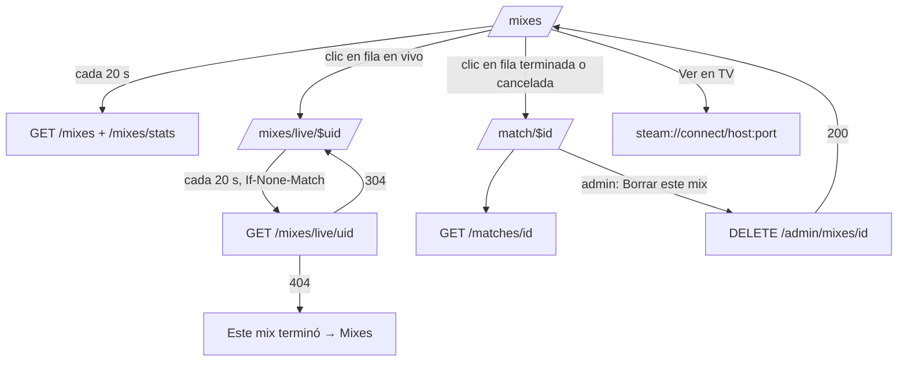
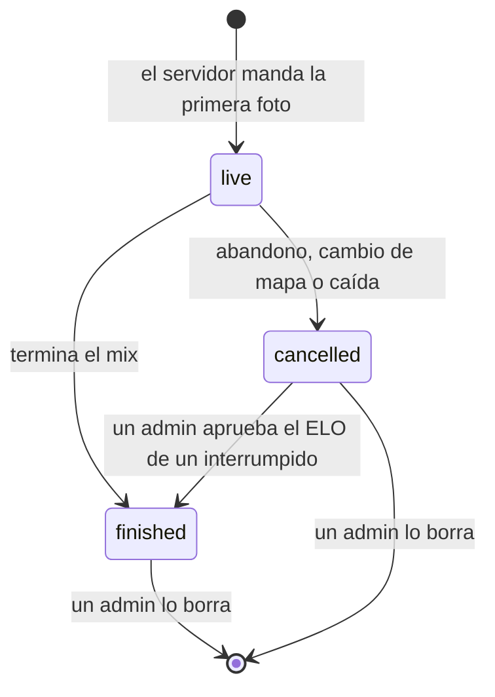

# Plan: Mixes en el frontend (listado y sala del mix)

> Planeación original. Estado: **aprobado** el 2026-10-24.

Handoff: `mockups/MCLeague/MCLeague/handoff_mixes/` (`README.md`, `Pedidos al backend.md`, `referencia-visual/Mixes.dc.html`, `MatchRoom.dc.html`, `CSSTV.dc.html` y `data.js`). Vista previa (datos de ejemplo): https://claude.ai/artifact/RCYu9YLMvVqS5CT4y5xwVq

Contrato: `docs/frontend/contrato/partidas.md` (sección 8d) y `admin.md` ("Borrar un mix"), en la versión de la rama `feat/backend-api-fase-1` (commit `6d36e6e`).

## Decisiones tomadas

| Tema | Decisión | Por qué |
|---|---|---|
| Fuente de verdad | El handoff manda en copy, medidas y colores. Si choca con el contrato de la API, manda el contrato | Regla del frontend (`web/frontend/CLAUDE.md`) |
| KPI de jugadores | "Jugadores en los últimos 30 días" en lugar de "Jugadores esta semana" | `GET /api/v1/mixes/stats` cuenta 30 días (contrato 8d) |
| Borrar un mix | Diálogo con "Mantener el ELO" o "Revertir el ELO", escribir `estoy seguro` y mandarlo en `confirm`. Toast "Mix borrado. Se mantuvo el ELO." o "Mix borrado. ELO revertido." | Contrato (`admin.md`): nunca se recalcula la historia. El mockup decía "Borrar y recalcular" |
| "Ver en TV" | Solo si el mix trae `tv`. Con `tv: null` no hay botón (la celda muestra "—") | Contrato 8d |
| Mix sin novedades (`stale`) | Fila atenuada y "Sin novedades del servidor" junto a la ronda. En la sala, un aviso | Contrato 8d |
| Motivo de cancelación | `cancel_reason` se muestra tal cual llega, como texto libre. Solo `crash` se traduce a "Interrumpida" (más "ELO pendiente" con `review: pending`) | Daniel, 2026-10-24 (texto libre); `crash` está definido en el contrato 8d |
| "Solo donde jugué" sin ficha | Lista vacía, con el estado vacío normal | Daniel, 2026-10-24 |
| Select de mapas | Sale de la maestra de mapas (los activos), sin lista fija en el frontend | Daniel, 2026-10-24: Mixes sale junto con la maestra (`docs/PENDIENTES.md`, sección 6) |
| Fila en vivo | Abre `/mixes/live/$uid` (ruta nueva), no `/match/$id` | La fila en vivo trae `live_uid` y `match_id: null` |
| Fin del mix en vivo | Si `GET /api/v1/mixes/live/{uid}` responde `404`, la sala muestra "Este mix terminó" con un botón a Mixes | La API no dice qué `match_id` quedó (pedido al backend, sección 7) |
| Refresco | `refetchInterval` de 20 s en el listado, los KPIs y la sala en vivo. La sala en vivo manda `If-None-Match` | Contrato 8d (sin SSE por ahora) |
| Título de la sala | "Mix · reportado por el servidor" (sin número). La migaja muestra el mapa y la fecha | `match_id` es un UUID; la API no tiene un número correlativo como el "Mix #{n}" del mockup |
| Nivel de cada jugador en la sala | Se muestra el `LevelBadge` solo si la API lo trae; mientras no, la columna arranca con el nick | `PlayerLine` y `LivePlayerLine` no traen `level` (pedido al backend, sección 7) |
| HS y ADR | HS % = `headshots / kills`; ADR = `damage / rounds`, redondeados | La API manda los totales; es solo formato |
| Bando B | `chart-2` del preset (gris), como dice el handoff | Tokens del handoff |
| Foto del mapa en el marcador | La franja del marcador de la sala (bandos, chip y marcador) lleva de fondo la foto del mapa que se jugó o se está jugando, con un velo negro para que se lea. La franja es oscura en los dos temas (texto blanco). Sin foto para ese mapa, queda lisa como en el handoff | Daniel, 2026-10-24 (`handoff_mixes/fondo mapa.png`) |
| Fotos de los mapas | Solo desde la maestra de mapas: el admin sube la foto de cada mapa y la API la devuelve con el mapa. Ninguna foto va en el frontend. Si el mapa no está en la maestra o no tiene foto, la franja sale lisa, como en el handoff | Daniel, 2026-10-24: se sale con todo junto, sin etapa intermedia |
| Estado del listado | En la URL con `validateSearch`: `q`, `map`, `mine`, `hideCancel`, `page` y `per` (10, 15 o 25; 15 por defecto) | Handoff ("Estado") |

## 1. El flujo completo

## 2. Traer el backend y los tipos

- Fusionar `feat/backend-api-fase-1` en `feat/frontend-fase-1` (como se hizo en `54e8a00`). La rama del frontend llega hasta `241e6c7` y no tiene `/mixes`, `/mixes/stats`, `tv`, `demo_size` ni `DELETE /admin/mixes/{id}`.
- Levantar la API local (`web/backend`: `pnpm db:start` y `pnpm dev:node`) con el replanteo `27` aplicado, y correr `pnpm gen:api`.
- Revisar que el resto del frontend siga compilando con el cambio que rompe de `GET /api/v1/players/{id}` (`steam_id: null` salvo al dueño y a los admins).

## 3. Listado `/mixes`

Archivos en `src/features/mixes/` y la ruta `src/routes/_app/mixes.tsx`.

- **Cabecera:** "Mixes" y el texto del handoff, tal cual.
- **KPIs** (`MixKpis`): En vivo ahora (`live_now`), Jugadores en los últimos 30 días (`players_recent`), Mapa más jugado (`top_map`, "—" si es null) y Promedio de rondas (`avg_rounds`, un decimal). Skeleton mientras cargan.
- **Filtros** (`MixFilters`):
  - buscador con `InputGroup` y el ícono `Search`, con debounce (`useDebouncedValue`) antes de pasar `q` a la URL;
  - select de mapa ("Todos los mapas");
  - toggles punteados "Solo donde jugué" (`UserCheck`) y "Ocultar canceladas", con fondo `accent` cuando están activos;
  - cualquier cambio vuelve a la página 1.
- **Tabla** (`MixesTable`): Fecha · Mapa · Bando 1 · Rondas · Bando 2 · MVP · Demo / TV · chevron, con el orden de la API (los en vivo primero).
  - **En vivo:** fondo `destructive` al 5 %, chip "EN VIVO" con `LiveDot` blanco y debajo "Ronda {current_round} · {servidor}". Marcador parcial sin negrita, MVP parcial y "Ver en TV" (`WatchTvButton`, outline de 28 px, tooltip `connect {host}:{port}`, `stopPropagation`).
  - **Terminada:** fecha y "{hora} · {servidor}", ganador en 600 (`winner_side`), MVP con `LevelBadge`, nick (`alias` o `game_nick`) y rating, y el estado de la demo (`DemoStatus`): Disponible (`win`), Subiendo (`sidebar-primary`), Vencida, — o No encontrada (`muted-foreground`).
  - **Cancelada:** chip "Cancelada · {motivo}" con `Ban` en Rondas.
  - Toda la fila es un link (accesible con teclado) a su sala.
- **Paginación:** "Mostrando {a}–{b} de {total}", select de 10, 15 o 25 por página y botones de página.
- **Estados:** skeleton de filas al cargar, vacío ("No hay mixes con esos filtros.") y error con reintento (por `error.code`, como en el resto).

## 4. Sala del mix terminado o cancelado `/match/$id`

Hoy `match.$id.tsx` es un `Placeholder` y sirve para cualquier partida. En este plan solo se arma la vista de los mixes (`kind: "mix"`); torneos y PCW siguen con el placeholder.

- **Cabecera:** "Volver" y "Mix · reportado por el servidor".
- **Marcador:** Bando A y B con su cuadro (A o B), chip FINAL (`secondary`) o CANCELADO (`muted`), marcador grande en Geist Mono y debajo "{mapa} · rondas". Anillo `primary` en el ganador solo si terminó.
- **Foto del mapa** (`MapBackdrop`): `background-image` con `cover`, un velo negro (más oscuro a los costados y abajo, más claro al centro) y padding vertical algo mayor. Los cuadros A y B pasan a blanco translúcido con desenfoque, y el marcador y los nombres llevan una sombra suave. La URL sale de la maestra (`mapsOptions`, buscando por nombre el mapa del mix). La imagen no bloquea el render: mientras carga, la franja es gris oscuro, y si falla la carga queda lisa. Mapa fuera de la maestra o sin foto → franja lisa (`card`).
- **Barra inferior:** servidor y fecha, y el botón de la demo:
  - "Descargar demo ({MB} MB)" con `demo_url` y `demo_size`;
  - "La demo se está subiendo", "Demo vencida (90 días)", "Sin demo" y "Demo no encontrada", deshabilitados.
- **Aviso de cancelado:** "Mix cancelado por {motivo}. No afecta al ELO." (con `crash` y `review: pending`: "Un admin tiene que decidir si cuenta para el ELO.").
- **Una tabla por bando** (`MixSideTable`): borde izquierdo `primary` (A) o `chart-2` (B), chip Victoria (`win`), Derrota (`destructive`) o Cancelado, y el marcador. Columnas: Jugador · K · D · A · +/− · HS % · ADR · Rating · Δ ELO.
  - Jugador: nick, chip MVP y chip "INVITADO" (borde punteado) si `player_id` es null, con el tooltip del handoff. El nick lleva al perfil (`/player/{alias}`, o al perfil sin reclamar si solo hay `steam_id`).
  - Δ ELO: verde o rojo con signo; "—" en cancelados.
  - La fila del usuario lleva `primary` al 6 %.
- **Admin:** "Borrar este mix" (texto `destructive`), solo si el rol puede (vía `src/auth/permissions.ts`, nunca comparando `role` suelto).

## 5. Sala del mix en vivo `/mixes/live/$uid`

Ruta nueva, con los mismos componentes de la sección 4.

- Chip EN VIVO (`destructive`), marcador parcial y "{mapa} · ronda {n} · empezó {hace…}" (`date-fns`, `formatDistanceToNow` en español).
- "Ver en CM League TV" (`Tv`) con la misma acción del listado, si hay `tv`.
- Chips "En juego" (`muted`) en los dos bandos, sin anillo. Δ ELO siempre "—".
- Con `stale: true`, aviso "Sin novedades del servidor desde hace más de 10 minutos."
- Sin botón de borrar (la API solo borra terminados o cancelados).
- `404`: "Este mix terminó." con un botón "Ver mixes".

## 6. Borrar un mix (admin)

`DeleteMixDialog` con el `Dialog` de shadcn:

- Texto: "Se borran el mix, sus stats, el chat y los clips. La demo queda guardada hasta que venza. No se puede deshacer."
- `RadioGroup`: "Mantener el ELO" (`keep`, por defecto) y "Revertir el ELO" (`revert`), con la explicación de cada uno. En un cancelado no se muestra la elección (la API responde `elo_mode: "none"`).
- Campo "Escribe **estoy seguro** para confirmar"; el botón "Borrar mix" se habilita recién con el texto exacto.
- `DELETE /api/v1/admin/mixes/{id}` con `{ elo, confirm }`. Al terminar: toast según `elo_mode`, invalidar `['mixes']` y volver a `/mixes`.
- `400 BUSINESS_RULE` (por ejemplo, vinculado con `!match` a un torneo): mostrar el mensaje de `errors.ts` sin cerrar el diálogo.

## 7. Pedidos al backend (se anotan, no se hacen acá)

| Pedido | Para qué |
|---|---|
| `match_id` en el `404` de `GET /api/v1/mixes/live/{uid}` (o un endpoint que lo resuelva) | Pasar de la sala en vivo a la sala final sin volver al listado |
| `level` (y `elo`) en `PlayerLine` y `LivePlayerLine` | La insignia de nivel de cada jugador en la sala, como el handoff |
| Maestra de mapas con la foto de cada mapa (ya anotada en `docs/PENDIENTES.md`, sección 6) | El select de mapas del listado y el fondo del marcador. Mixes sale junto con ella |

Se suman a `docs/PENDIENTES.md` (sección 6) al terminar.

## 8. Componentes y archivos

| Archivo | Qué |
|---|---|
| `src/features/mixes/queries.ts` | `mixesListOptions(search)`, `mixStatsOptions`, `mixMatchOptions(id)`, `liveMixOptions(uid)` (con ETag) y `useDeleteMix()` |
| `src/features/mixes/labels.ts` | Textos y colores de `demo_status`, motivo de cancelación, nick (`alias ?? game_nick`), HS % y ADR |
| `src/features/mixes/MixKpis.tsx`, `MixFilters.tsx`, `MixesTable.tsx`, `MixPagination.tsx` | Listado |
| `src/features/mixes/MixScoreboard.tsx`, `MixSideTable.tsx`, `DemoButton.tsx`, `DeleteMixDialog.tsx` | Sala |
| `src/features/mixes/WatchTvButton.tsx`, `DemoStatus.tsx` | Compartidos |
| `src/routes/_app/mixes.tsx` | Listado (reemplaza el "Hello") con `validateSearch` |
| `src/routes/_app/match.$id.tsx` | La sala del mix si `kind` es `mix`; el resto sigue con `Placeholder` |
| `src/routes/_app/mixes.live.$uid.tsx` | Sala en vivo (nueva) |
| `src/components/brand/LevelBadge.tsx` | Prop `size` (20, 22 y 26 px) |
| `src/features/maps/queries.ts` | `mapsOptions`: la maestra de mapas (nombre, activo y foto), compartida con el admin de mapas |
| `src/features/mixes/MapBackdrop.tsx` | Fondo con la foto del mapa y su velo, o liso si no hay |
| `src/features/shell/nav.ts` | Que `/mixes/live/$uid` y `/match/$id` de un mix marquen "Mixes" y armen sus migas |
| `src/components/ui/table.tsx`, `badge.tsx`, `toggle.tsx`, `radio-group.tsx` | `pnpm dlx shadcn add` (sin editar a mano) |

## 9. Pruebas

- **Unitarias (Vitest):** `labels.ts` (demo, motivo, nick, HS %, ADR con 0 kills o 0 rondas), el `validateSearch` del listado y el armado de los parámetros de la API.
- **Componentes (Testing Library + MSW):** fila en vivo con y sin `tv`, `stale`, cancelada con `crash` y `review: pending`, ganador en 600, "Ver en TV" que no navega, paginación, diálogo de borrado (botón deshabilitado hasta `estoy seguro`, toast según `elo_mode`) y el `404` de la sala en vivo.
- **Punta a punta (Playwright):** `/mixes` contra la API local con la copia de producción: carga, filtra por mapa, pagina y abre la sala de un mix terminado. Sin borrar nada.
- **Comparar con el prototipo:** capturas del prototipo y de `vite preview` en 1440 y 390 px, claro y oscuro (regla del frontend).
- `pnpm lint`, `pnpm typecheck` y `pnpm test` en verde.

## 10. Requisitos antes de empezar

- Docker Desktop con la Supabase local y la API levantada (`web/backend`, guía `241e6c7`).
- La copia de producción en la base local, para tener mixes reales (`~/.v34frag/prod-copy/`). No sale del equipo: nada de capturas con emails.
- Detener `pnpm dev` antes de fusionar el backend.
- **Maestra de mapas en la API** (`docs/PENDIENTES.md`, sección 6), con la foto de cada mapa. Mixes sale junto con ella. Si el backend todavía no está al empezar, se implementa contra su contrato y se prueba con MSW, y el `pnpm gen:api` final se hace cuando esté.
- **Fotos de los mapas:** las carga el admin en la maestra (capturas horizontales, sin HUD, idealmente 1920×1080). No bloquean la implementación: sin foto, la franja sale lisa.

## 11. Orden de implementación

1. Fusionar `feat/backend-api-fase-1`, aplicar el replanteo `27` en local y correr `pnpm gen:api`. Arreglar lo que rompa.
2. `shadcn add` de `table`, `badge`, `toggle` y `radio-group`; prop `size` en `LevelBadge`.
3. `queries.ts` y `labels.ts`, con sus pruebas.
4. Listado: KPIs, filtros con la URL, tabla y paginación, con sus pruebas.
5. Sala del mix terminado o cancelado en `/match/$id`, con `MapBackdrop` (foto de la maestra o liso).
6. Sala en vivo en `/mixes/live/$uid` con el refresco y el `404`.
7. Diálogo de borrado (admin).
8. Migas y sidebar (`nav.ts`).
9. Playwright y comparación con el prototipo en 1440 y 390 px.
10. `DOCUMENTACION.md`, `GUIA_IMPLEMENTACION.md`, los pedidos al backend en `docs/PENDIENTES.md` y la fila de `docs/bitacora/README.md` al día.
