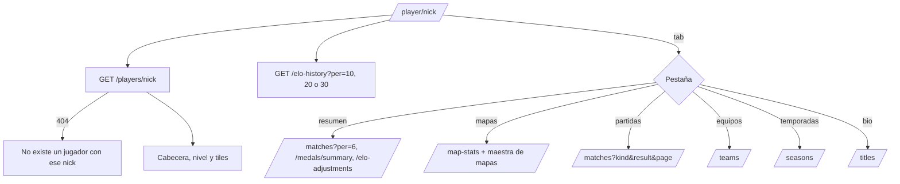

# Perfil público en el frontend: documentación

## Qué hace

Reemplaza el placeholder de `/player/{nick}` por el perfil público del handoff `handoff_perfil_publico`, con dos agregados aprobados por Daniel: la pestaña **Temporadas** y la tarjeta **Ajustes de ELO**. También suma dos ajustes al backend: el líder en el historial de equipos y el orden de los jugadores sin puesto en el ranking de una temporada.

Todas las rutas aceptan el nick o el id. Cada sección pide lo suyo, así que una pestaña que no se abre no consulta nada.

## Cabecera

- Foto (o la inicial), nick, país con su bandera y "Verificado" si `has_steam`. Nunca se muestra un SteamID.
- Nombre real, equipos (el primero y "+ {otro}", cada uno con su link), puesto preferido y "Miembro desde {fecha} · visto {hace…}".
- **Redes:**
  - **Steam:** solo si el campo es un link de `steamcommunity.com`. Muchos perfiles de la web vieja tienen un SteamID escrito a mano: esos no muestran el botón.
  - **Discord:** el usuario, como texto.
  - **FACEIT:** un link, armado desde el nick (web nueva) o desde el link completo (web vieja).
- **Privacidad:**
  - Con `private: true`, la API manda `details: null`. En lugar del nombre se muestra "Perfil privado: nombre, país y redes ocultos", sin país, redes ni fecha de alta.
  - El dueño ve "Perfil privado · solo tú y los admins ven tus datos".
  - El admin recibe todo desde la API.
- **Acciones:** "Comparar" abre `/players/compare?b={nick}` (A eres tú). El dueño ve "Editar perfil" en su lugar.
- **Ficha sin cuenta** (`has_account: false`): aviso de `!claim` con "Generar código", que lleva a `/profile/link`.

## Nivel, gráfico y tiles

- **Nivel:** insignia, ELO, "Máximo de la temporada {peak_elo}" (el pico es el de la temporada activa) y la escalera de 10 tramos. Debajo, "Faltan {n} ELO para nivel {n+1} ({elo})." o "Nivel máximo alcanzado.", y las victorias y derrotas. Sin ELO: "Todavía no jugó mixes en el servidor."
- **Evolución de ELO:**
  - Usa `elo-history` con 10, 20 o 30 puntos (`range` en la URL), dado vuelta porque la API manda el más nuevo primero.
  - Muestra área y línea en `primary`, una línea punteada en el piso del nivel actual ("Nivel {n} · {elo}") y, bajo el puntero, "{elo} · {mapa} · {fecha}".
  - Con menos de 2 puntos: "Todavía no hay mixes para el gráfico."
- **Tiles:** Rating, K/D, HS %, ADR, % Victorias ("{g} de {n}") y Partidas. Cada barra se mide contra una escala fija: 2, 2,5, 100, 150, 100 y 200.

## Pestañas (`tab` en la URL)

| Pestaña | Contenido |
|---|---|
| Resumen | Las 6 partidas más recientes (V/D, título, subtítulo, K-D, rating y Δ ELO; clic → `/match/{id}`) con "Ver todas"; Logros (`×{n}`); **Ajustes de ELO**, solo si hay ("+20 · {motivo}" o "Fijado en {elo} · {motivo}") |
| Mapas | Tarjetas por mapa, de más a menos jugado, con % de victorias, K/D y ADR. Llevan la foto de la maestra de mapas si existe; si no, el rayado del prototipo. Barra `win` con 50 % o más |
| Partidas | Tabla paginada (25, 50 o 100) con filtros de tipo (Todas / Mix / PCW / Torneo) y resultado. Columnas: fecha, tipo, mapa, nombre en el juego, resultado y marcador (desde su lado), K-D, rating y Δ ELO |
| Equipos | Rol con el vocabulario nuevo ("Activo · líder", "Suplente", "Coach"), período y "Actual". Debajo, "Antes de CM League": los equipos que escribió en la web vieja |
| Temporadas | Puesto, ELO, pico, mixes, V–D y medalla de cada temporada cerrada. Sin ninguna: "Todavía no terminó ninguna temporada." |
| Bio y palmarés | Biografía, títulos de torneos ("Campeón · {torneo}", "con {equipo} · {fecha}") y, debajo, el palmarés escrito por el jugador |

Cambiar de pestaña limpia los filtros de Partidas. Al cambiar de jugador, la página se arma de nuevo (`key` por nick).

## Backend (`5f786eb`, rama `feat/backend-api-fase-1`)

| Cambio | Detalle |
|---|---|
| `is_captain` en `GET /players/{id}/teams` | Ya estaba en la vista `team_members_view`: se suma a la consulta y a `TeamStint`. Sin migración |
| Orden de los sin puesto | `runList` (`src/lib/list.ts`) acepta columnas con dirección fija (`elo:desc`), que no siguen a `order`. `seasons.ts` lo usa en `standings` y en la vista previa del cierre: los que no llegan al mínimo quedan al final, por ELO de mayor a menor |

## Dónde está cada cosa

| Qué | Archivo |
|---|---|
| Ruta | `web/frontend/src/routes/_app/player.$nick.tsx` |
| Estado de la URL | `src/features/player/search.ts` |
| Consultas | `src/features/player/queries.ts` |
| Textos y cálculos | `src/features/player/labels.ts` |
| Cabecera, nivel, gráfico y tiles | `src/features/player/PlayerProfile.tsx`, `EloChart.tsx` |
| Pestañas | `src/features/player/tabs.tsx` |
| Patrones de Steam y FACEIT (compartidos con Mi perfil) | `src/features/profile/schemas.ts` (`STEAM_LINK`, `FACEIT_LINK`) |
| Pruebas | `src/features/player/labels.test.ts`, `PlayerProfile.test.tsx`, `e2e/player.spec.ts` |
| Backend | `web/backend/src/lib/list.ts`, `routes/players.ts`, `routes/seasons.ts`, `schemas/players.ts` |
