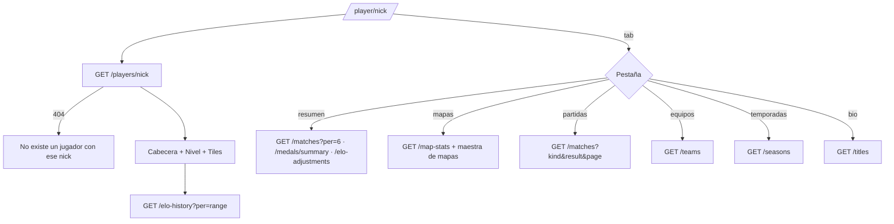

# Plan: Perfil público de jugador en el frontend (y dos ajustes del backend)

> Planeación original. Estado: **aprobado** el 2026-10-24.

Handoff: `mockups/MCLeague/MCLeague/handoff_perfil_publico/` (`README.md`, `Pedidos al backend.md`, `referencia-visual/Player.dc.html`, `CSSTV.dc.html` y `data.js`). Vista previa (datos de ejemplo): https://claude.ai/artifact/V1ttBJ1n7i44xtbuxZF9aN

Contrato: `docs/frontend/contrato/jugadores.md` (5 y 5b) y `temporadas.md` (8f). Casi todo existe en la API desde el replanteo `27`. Faltan dos cosas chicas del backend (sección 2).

## Decisiones tomadas

| Tema | Decisión | Por qué |
|---|---|---|
| Fuente de verdad | El handoff manda en copy, medidas y colores. Si choca con el contrato, manda el contrato | Regla del frontend |
| Ruta y datos | `/player/$nick` (hoy `Placeholder`). Ficha con `GET /players/{nick}`; cada sección pide lo suyo. Nick inexistente: "No existe un jugador con ese nick." y un link al Ranking | Contrato 5 |
| Privacidad | Con `private: true` y `details: null`: "Perfil privado: nombre, país y redes ocultos", sin país, redes ni "Miembro desde". El dueño ve "Perfil privado · solo tú y los admins ven tus datos". El admin recibe todo de la API | Handoff 1 y contrato 5 |
| Verificado | `has_steam`. Ningún SteamID se muestra | Handoff, "Alinear con cambios recientes" |
| Botón de Steam | Solo si `details.steam` es un link de `steamcommunity.com`; con un SteamID escrito a mano, no se muestra | 7 de 20 perfiles locales tienen un SteamID en ese campo |
| FACEIT | Tercer botón de redes con `details.faceit` | La API lo trae |
| Máximo | "Máximo de la temporada {peak_elo}" | `peak_elo` es el pico de la temporada activa |
| Escalera y umbral | Tramos del contrato; "Faltan {n} ELO para nivel {n+1} ({elo})." o "Nivel máximo alcanzado."; línea punteada en el piso del nivel actual | Handoff 2 |
| Evolución de ELO | `elo-history?per=10|20|30`, dado vuelta; hover con "{elo} · {mapa} · {fecha}"; con menos de 2 puntos, "Todavía no hay mixes para el gráfico." | Contrato 5 |
| Tiles | Rating (escala 2), K/D (2,5), HS % y % victorias (100), ADR (150), Partidas (200). Null → "—" | El handoff no da la escala |
| Partidas | Resumen: 6 últimas con "Ver todas". Pestaña: paginada (25) con filtros de tipo y resultado. Título y subtítulo según el contrato | Contrato 5 |
| Mapas | Tarjetas del prototipo (no tabla), por mapas jugados, con la foto de la maestra si existe; si no, el rayado. Barra `win` con 50 % o más | El prototipo manda sobre el README |
| Equipos | Activo / Suplente / Coach, "· líder" con `is_captain`; período o "—"; chip "Actual"; nota con "rosters". `team_history_text` debajo, como "Antes de CM League" | Handoff y datos de la web vieja |
| Logros | `medals/summary`: ícono, título y "×{n}"; vacío: "Todavía sin medallas." | Contrato 5 |
| Ajustes de ELO | Tarjeta debajo de Logros, solo si hay alguno: "+20 · {motivo}" o "Fijado en {elo} · {motivo}", con la fecha | Daniel, 2026-10-24 (contrato 5) |
| Pestaña Temporadas | Sí: puesto, ELO, pico, mixes, V–D y medalla de cada temporada cerrada (`/players/{id}/seasons`). Sin ninguna: "Todavía no terminó ninguna temporada." | Daniel, 2026-10-24 (contrato 8f) |
| Bio y palmarés | Biografía, títulos de `/titles` ("Campeón · {torneo}", "con {equipo} · {fecha}") y debajo `achievements` como "Escrito por el jugador" | Contrato 5 |
| Ficha sin cuenta | `has_account: false`: aviso de `!claim` con "Generar código" → `/profile/link` | Contrato 5b; la ruta existente es `/profile/link` |
| Acciones | "Comparar" → `/players/compare?b={nick}`; el dueño ve "Editar perfil" → `/profile` en su lugar | Handoff 1 |
| Estado en la URL | `tab`, `range`, y en Partidas `kind`, `result` y `page`. Al cambiar de jugador vuelve a Resumen | Handoff ("Estado") |

## 1. El flujo completo

## 2. Backend (rama `feat/backend-api-fase-1`)

Se hace primero, con commit y push en su rama, y después se fusiona en `feat/frontend-fase-1` y se corre `pnpm gen:api`.

| Cambio | Detalle |
|---|---|
| `is_captain` en `GET /players/{id}/teams` | La vista `team_members_view` ya lo tiene: se agrega a la consulta y a `TeamStint` (`schemas/players.ts`). Sin migración |
| Orden de los sin puesto en `GET /seasons/{id}/standings` y en la vista previa del cierre | Con el orden por defecto (`rank` asc), los sin puesto salían por ELO de menor a mayor. `runList` acepta una columna con dirección fija (`elo:desc`) y `seasons.ts` la usa |

Con sus pruebas (unitarias de `runList`, integración de los dos endpoints) y el contrato (`jugadores.md` 5 y `temporadas.md`) al día.

## 3. Frontend

Archivos en `src/features/player/` y la ruta `src/routes/_app/player.$nick.tsx`.

- `queries.ts`: ficha, historial de ELO, partidas, mapas, medallas, ajustes, equipos, temporadas y títulos.
- `search.ts`: `tab`, `range`, `kind`, `result`, `page`.
- `labels.ts`: link de Steam válido, títulos de partidas, período de un equipo, rol, escalera de nivel, escalas de los tiles, texto de un ajuste.
- `PlayerHeader.tsx`, `LevelCard.tsx`, `EloChart.tsx`, `StatTiles.tsx`, `tabs/*.tsx` y `PlayerProfile.tsx` (la página).
- Reutiliza `LevelBadge`, `ListPagination`, `PlayerAvatar`, `TagBox` y `mapsOptions` (foto del mapa).
- `nav.ts`: las migas "Ranking › {nick}" ya existen.

## 4. Pruebas

- **Backend:** `pnpm test` (unitarias e integración) en verde.
- **Unitarias (Vitest):** `labels.ts` y `search.ts`.
- **Componentes (MSW):** público, privado visto por otro, privado visto por el dueño, ficha sin cuenta, 404, Steam con SteamID (no se muestra), escalera y "Faltan…", equipos con líder y "Antes de CM League", temporadas vacías y con datos, ajustes.
- **Punta a punta (Playwright):** el perfil de un jugador real del ranking, las pestañas y el link a una partida.
- **Capturas:** 1440 y 390 px, claro y oscuro.

## 5. Orden de implementación

1. Backend en su rama: `is_captain`, orden de los sin puesto, pruebas, contrato, commit y push.
2. Volver a `feat/frontend-fase-1`, fusionar el backend y `pnpm gen:api`.
3. `queries.ts`, `search.ts` y `labels.ts` con sus pruebas.
4. Cabecera, nivel, gráfico y tiles.
5. Pestañas.
6. Pruebas de componentes, Playwright y capturas.
7. `DOCUMENTACION.md`, `GUIA_IMPLEMENTACION.md`, `CHANGELOG_DISCORD.txt`, `docs/PENDIENTES.md` y la fila de la bitácora.
