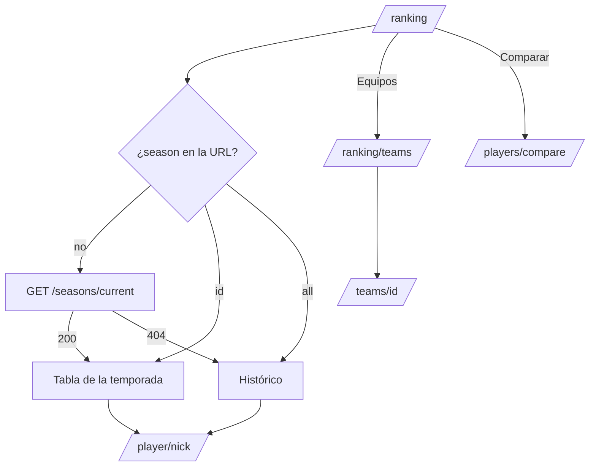

# Ranking en el frontend: documentación

## Qué hace

Reemplaza los tres placeholders de Ranking del frontend nuevo (`web/frontend`) por las pantallas del handoff `handoff_ranking`, más el selector de temporadas que pidió Daniel:

| Ruta | Pantalla | Fuente |
|---|---|---|
| `/ranking` | **Jugadores**: una temporada (la activa por defecto) o el Histórico por ELO | `GET /seasons`, `/seasons/current`, `/seasons/{id}/standings` y `/ranking/players` |
| `/ranking/teams` | **Equipos**: puntos por partida ganada, con o sin PCW | `GET /ranking/teams` |
| `/players/compare` | **Comparador** de dos jugadores | `GET /players/compare` y `/players?q=` (búsqueda) |

Todo el estado (temporada, buscador, nivel, orden, página y tamaño; PCW; los dos jugadores) vive en la URL, así que un link abre la misma vista.

## Jugadores (`/ranking`)

- **Cabecera:** "Ranking", el subtítulo del handoff, el segmentado Jugadores / Equipos (son links a las dos rutas) y "Comparar".
- **Franja de la temporada:** un select con las temporadas (`number` desc) y "Histórico".
  - La activa se muestra con "EN CURSO", la cuenta regresiva hasta `ends_at` (se actualiza cada 30 s) y "Top {top_n} con medalla · mínimo {min_matches} mixes para tener puesto".
  - Una cerrada se muestra con "CERRADA", la fecha del cierre y el campeón.
  - Elegir la activa saca `season` de la URL (es la opción por defecto); cambiar de temporada limpia nivel, "Solo con puesto", orden y página.
- **Podio:** en una temporada, los 3 primeros con puesto (`eligible=true`, `per=3`); en Histórico, los 3 primeros sin filtros (`per=3`). Es una consulta aparte, así que no cambia con el buscador ni con el nivel.
- **Tabla de una temporada:** #, Jugador, Nivel, ELO, Pico, Mixes, V–D, Medalla y "Al cerrar".
  - Quien no llega al mínimo va sin puesto ("—"), atenuado y con una barra "{mixes}/{mínimo}" (tooltip: "Le faltan {n} mixes para tener puesto").
  - En la activa, "Medalla si cierra hoy" y "Al cerrar" (`elo_after`, o "Sin cambio"); en una cerrada, "Medalla" y "Después del cierre".
  - "Solo con puesto" manda `eligible=true`. ELO y Mixes ordenan.
- **Tabla del Histórico:** #, Jugador ("{rol} · {país}", omitidos si son null), Nivel, ELO, Equipo (el primero y "+n" con tooltip), Rating, K/D, Partidas y "Últimos 30" (sparkline de 80×20, `win` si sube y `destructive` si baja). Chips de nivel (`level`). Rating, K/D y Partidas ordenan; ELO vuelve al orden por posición.
- **Orden desde la cabecera:** clic → descendente, otro clic → ascendente, otro → vuelve al orden por defecto. La columna # siempre es la posición que da la API.
- **Fila:** link con teclado (Enter) a `/player/{alias}`. La del usuario va con `primary` al 6 % y `aria-current`.

## Equipos (`/ranking/teams`)

- El subtítulo y la leyenda cambian con "Contar también PCW" (`pcw=1`). La leyenda usa `points_per_win` de la respuesta.
- Columnas: #, Equipo (sigla en un cuadro y "TU EQUIPO" en **todos** los equipos del usuario), Tendencia (▲n / ▼n / "–", con tooltip "Hace 30 días: {n}.º"), Forma (V/D), PJ, G, P, % Vict. y Pts.
- Los equipos sin sigla muestran las iniciales del nombre.

## Comparador (`/players/compare`)

- A por defecto es la ficha del usuario (`GET /me/profile`); B queda vacío hasta elegirlo ("Elige un jugador para comparar con {A}.").
- Los dos selectores son combobox con búsqueda (`GET /players?q=&sort=elo&per=8`); el jugador del otro lado aparece deshabilitado.
- Cabeceras de A (`primary`) y B (`chart-2`), siete filas con barras (el que gana en `foreground`), el gráfico de ELO con una escala común y "Mixes jugados juntos" / "Como rivales".
- Un jugador que no existe muestra "Ese jugador no existe.".

## Quién es el usuario

`useMine()` (`features/ranking/parts.tsx`) lee `GET /me/profile`: `player.id` para resaltar su fila y `teams` para "TU EQUIPO". Sin ficha, no se resalta nada.

## La temporada BETA

Decisión de Daniel (2026-10-24): la primera temporada abarca **todos** los mixes desde el primero.

- **En local** se creó el 2026-10-24 con `pruebas/temporada_beta_local.sql`: inicio el 2026-10-13 00:00 UTC (el primer mix es de las 01:42), fin el 2026-11-23 09:00 UTC, top 20 y mínimo 20. Quedaron 77 jugadores, 6 con puesto.
- No se usa `season_start`, porque la abre en `now()` y pone el pico en el ELO actual. Sin temporadas previas, el pico guardado ya es el de toda la historia, que es el de BETA.
- **En producción** se hace lo mismo en el corte (el nombre puede cambiar).

## Dónde está cada cosa

| Qué | Archivo |
|---|---|
| Rutas | `web/frontend/src/routes/_app/ranking.index.tsx`, `ranking.teams.tsx`, `players.compare.tsx` |
| Estado de la URL y parámetros de la API | `src/features/ranking/search.ts` |
| Consultas | `src/features/ranking/queries.ts` |
| Textos y cálculos | `src/features/ranking/labels.ts` |
| Jugadores (temporada e Histórico) | `src/features/ranking/PlayersRanking.tsx`, `SeasonBar.tsx` |
| Equipos | `src/features/ranking/TeamsRanking.tsx` |
| Comparador y gráfico | `src/features/ranking/Compare.tsx` |
| Piezas compartidas (cabecera, podio, sparkline, "+n", "TU EQUIPO") | `src/features/ranking/parts.tsx`, `SearchBox.tsx` |
| Paginación común (Mixes y Ranking) | `src/components/brand/ListPagination.tsx` |
| Pruebas | `src/features/ranking/labels.test.ts`, `Ranking.test.tsx`, `e2e/ranking.spec.ts` |
| BETA en local | `docs/bitacora/2026-10-24-frontend-ranking/pruebas/temporada_beta_local.sql` |
