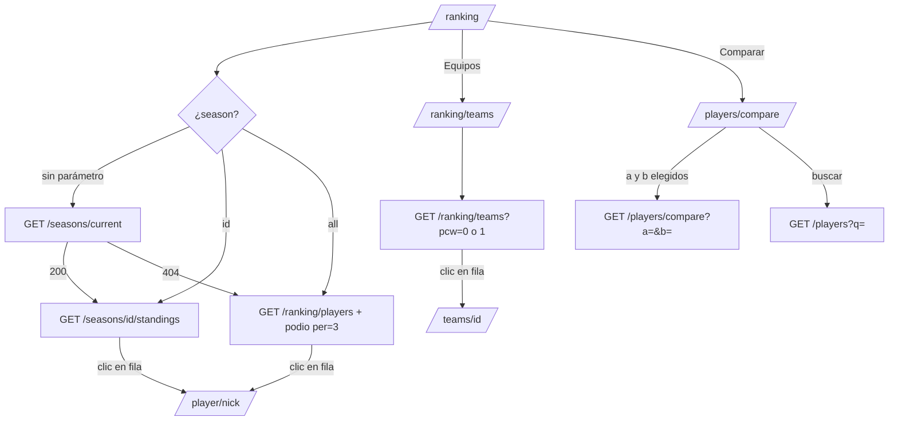

# Plan: Ranking en el frontend (jugadores por temporada, equipos y comparador)

> Planeación original. Estado: **aprobado** el 2026-10-24.

Handoff: `mockups/MCLeague/MCLeague/handoff_ranking/` (`README.md`, `Pedidos al backend.md`, `referencia-visual/Ranking.dc.html`, `Players.dc.html` (comparador), `CSSTV.dc.html` y `data.js`). Vista previa (datos de ejemplo): https://claude.ai/artifact/MvTvUSrGD9bqB3zHTjrSLi

Contrato: `docs/frontend/contrato/jugadores.md` (5c), `equipos.md` (7) y `temporadas.md` (8f), en la versión de la rama `feat/frontend-fase-1` (commit `49aad5c`). Los tipos ya están en `src/api/schema.d.ts`: `RankingPlayer`, `RankingItem`, `Compare`, `Season` y `SeasonStanding`.

## Decisiones tomadas

| Tema | Decisión | Por qué |
|---|---|---|
| Fuente de verdad | El handoff manda en copy, medidas y colores. Si choca con el contrato de la API, manda el contrato | Regla del frontend (`web/frontend/CLAUDE.md`) |
| Rutas | `/ranking` (Jugadores), `/ranking/teams` (Equipos) y `/players/compare` (comparador). El segmentado Jugadores / Equipos navega entre las dos primeras | Daniel, 2026-10-24. Las tres rutas ya existen como `Placeholder`; el handoff decía `/ranking/equipos` (es la misma pantalla, solo cambia la URL) |
| Selector de temporada | Desde ya, solo en Jugadores. Opciones: cada temporada (la activa primero y por defecto) y "Histórico" (el ranking general por ELO del handoff). Sin temporada activa, abre en Histórico | Daniel, 2026-10-24. Contrato 8f; las temporadas son solo de jugadores |
| Primera temporada | BETA, con inicio antes del primer mix: todo lo jugado cuenta. En local se creó el 2026-10-24 (`pruebas/temporada_beta_local.sql`). En producción se abre **en el corte** (el nombre puede cambiar) | Daniel, 2026-10-24 |
| Tabla de una temporada | #, Jugador, Nivel, ELO, Pico, Mixes, V–D, Medalla y "Al cerrar". Sin puesto ("—"), al final y atenuado, con su avance ("12/20"). Atajo "Solo con puesto" | `GET /seasons/{id}/standings` no trae equipo, rating, K/D ni tendencia; esas columnas quedan en Histórico |
| Columnas que el prototipo no dibuja | Van la tendencia de 30 mixes (sparkline de 80×20) en Histórico, y la tendencia (▲▼) y la forma (V/D) en Equipos | El README del handoff las pide; `Ranking.dc.html` calcula los datos pero no los pinta |
| Paginación | "Mostrando {a}–{b} de {n}", 25, 50 o 100 por página (25 por defecto) | Todo listado pagina en el servidor; el handoff no la dibuja |
| Orden | Histórico: Rating, K/D y Partidas ordenan desde la cabecera; ELO vuelve al orden por posición. Temporada: ELO y Mixes. La columna # siempre es la posición global | Lo que acepta cada endpoint (`sort`) |
| Podio | Histórico: los 3 primeros sin filtros (consulta aparte con `per=3`). Temporada: los 3 primeros con puesto. Equipos: los 3 primeros del modo (con o sin PCW). No cambia con el buscador ni con el nivel | Contrato 5c: "el podio son los 3 primeros de la página 1 sin filtros" |
| Tendencia de equipos | Contra hace 30 días, con tooltip "Hace 30 días: {n}.º". `0` o `null`: "–" | La API compara con 30 días, no con la semana anterior del handoff |
| Varios equipos | El primero y "+1" con tooltip (y foco de teclado) que nombra los demás. "TU EQUIPO" marca todos los equipos del usuario | "Alinear con cambios recientes" del handoff |
| Quién es el usuario | `myProfileOptions` (`GET /me/profile`): `player.id` para resaltar su fila (`primary` 6 %) y `teams` para "TU EQUIPO". Sin sesión o sin ficha, nada resaltado | `/auth/me` no trae la ficha |
| Leyenda de puntos | Sale de `points_per_win` (`official` y `pcw`) | El admin los configura |
| Datos que faltan | Rol y país se omiten si son null (si faltan los dos, no hay segunda línea). País con su nombre en español (`Intl.DisplayNames`). Nivel, rating, K/D o % null → "—" | `country` y `game_role` son null con perfil privado |
| Equipos sin logo | La sigla en un cuadro | Contrato 7 |
| Comparador | A por defecto es el usuario logueado (si tiene ficha); B vacío hasta elegir. Los dos selectores son combobox con búsqueda (`GET /players?q=`). El mismo jugador no se puede elegir en los dos | Con cientos de fichas no sirve un select con todos; la API da `400` con el mismo jugador |
| Juntos y rivales | "Mixes jugados juntos: {n} · ganaron {w}" y "Como rivales: {n} · {A} ganó {w}" | La API trae `same_team` y `against` |
| Comparar desde la tabla | Solo el botón "Comparar" de la cabecera | Daniel, 2026-10-24 |
| Estado en la URL | Jugadores: `season` (id o `all`; sin el parámetro, la activa), `q`, `level` (Histórico), `eligible` (temporada), `sort`, `order`, `page`, `per`. Equipos: `q`, `pcw`, `page`, `per`. Comparador: `a`, `b` | Handoff ("Estado") y `validateSearch`, como en Mixes |

## 1. El flujo completo

```mermaid
stateDiagram-v2
    [*] --> active: BETA (en local ya; en producción, en el corte)
    active --> closed: llega ends_at (cron) o "Terminar temporada"
    closed --> [*]
    note right of active: medalla y ELO "si cerrara hoy"
    note right of closed: la foto del cierre, con el campeón
```

## 2. Jugadores `/ranking`

Archivos en `src/features/ranking/` y la ruta `src/routes/_app/ranking.index.tsx`.

- **Cabecera:** "Ranking" y "Jugadores ordenados por ELO. Solo cuentan partidas jugadas en el servidor.", el segmentado Jugadores / Equipos (`User` / `Shield`) y "Comparar" (`GitCompare`).
- **Franja de la temporada** (`SeasonBar`): select "Temporada" con las temporadas (`GET /seasons`, `number` desc) más "Histórico".
  - Activa: chip "EN CURSO" (`win`), "Termina en {d} d {h} h {m} min" (se actualiza cada 30 s) y "Top {top_n} con medalla · mínimo {min_matches} mixes para tener puesto".
  - Cerrada: chip "CERRADA" (`muted`), "Cerró el {fecha}" y el campeón (`champion`).
  - Histórico: "Todas las partidas jugadas en el servidor, sin temporadas."
- **Podio** (`RankingPodium`): tarjetas del handoff. El 1.º con borde `primary` al 50 %, el número en `primary` y la corona; el 2.º y el 3.º en `muted-foreground`.
  - Histórico: avatar, nick, "Nivel {n} · {equipo o Libre}" y el ELO.
  - Temporada: avatar, nick, "Nivel {n} · {mixes} mixes" y el ELO.
- **Filtros:** buscador con debounce ("Alias o sigla del equipo" en Histórico, "Alias del jugador" en temporada). Histórico: chips Todos / Nivel 10 / Nivel 7–9 / Nivel 1–6 (activo en `foreground` sólido). Temporada: toggle punteado "Solo con puesto". Contador a la derecha ("{n} jugadores"; en temporada, "· {m} con puesto"). Cualquier cambio vuelve a la página 1.
- **Tabla de Histórico** (`PlayerRankingTable`): #, Jugador (avatar, nick, "{rol} · {país}"), Nivel (`LevelBadge` de 24 px), ELO, Equipo ("+1" con `Tooltip`), Rating, K/D, Partidas y "Últimos 30" (`Sparkline`, `win` si sube y `destructive` si baja, con el punto final).
- **Tabla de temporada** (`SeasonStandingsTable`): #, Jugador, Nivel, ELO, Pico, Mixes (o la barra de avance "{n}/{min}" con el tooltip "Le faltan {k} mixes para tener puesto"), V–D, "Medalla si cierra hoy" (ícono y nombre) y "Al cerrar" (`elo_after`, o "Sin cambio"). En una cerrada, "Medalla" y "Después del cierre". Leyenda: "Sin puesto: jugaron menos de {min} mixes en la temporada. Al cerrar, los nivel 10 se reinician al {reset_pct} % sobre {reset_floor}."
- **Fila:** link accesible con teclado a `/player/{alias}`; la del usuario con `primary` al 6 %.
- **Paginación** (reutiliza el patrón de `MixesList`) y estados: skeleton, vacío ("No hay jugadores con esos filtros.") y error con reintento por `error.code`.

## 3. Equipos `/ranking/teams`

Ruta `src/routes/_app/ranking.teams.tsx`.

- **Cabecera:** "Puntos por partida de torneo ganada." o, con PCW, "Puntos por partida ganada en torneos y en PCW jugadas como equipo oficial."
- **Podio:** sigla en un cuadro, nombre, "{G}G · {P}P · {%} victorias" y los puntos.
- **Filtros:** buscador "Buscar equipo o sigla", `Switch` "Contar también PCW" (`pcw=1`) y "{n} equipos oficiales".
- **Tabla** (`TeamRankingTable`): #, Equipo (sigla, nombre y "TU EQUIPO"), Tendencia, Forma (chips V/D con `win` 18 % y `destructive` 15 %), PJ, G, P, % Vict. (barra de 56 px) y Pts. Clic → `/teams/{id}`.
- **Leyenda:** "{official} pts por partida de torneo ganada" y, con PCW, "· {pcw} pts por PCW ganada como equipo oficial".

## 4. Comparador `/players/compare`

Ruta `src/routes/_app/players.compare.tsx`.

- "← Ranking", "Comparar jugadores" y los dos `PlayerCombobox` (Popover + Command de shadcn, búsqueda con debounce en `GET /players?q=`), con "vs" en el medio.
- **Sin B:** el estado vacío "Elige un jugador para comparar con {A}.". Con A y B: `GET /players/compare`.
- **Cabeceras:** avatar, nick, "{equipo} · {puesto}", nivel (30 px) y ELO, con la línea superior `primary` (A) o `chart-2` (B). Clic → perfil.
- **Filas:** ELO, Rating, K/D, HS %, ADR, % Victorias y Mixes, cada una con su barra proporcional. El ganador en `foreground` y su barra en `primary` o `chart-2`; el otro en `muted-foreground` con `chart-3` o `chart-4`. Null → "—" y sin barra.
- **Gráfico** (`EloCompareChart`, SVG propio): "ELO en los últimos 30 mixes", las dos líneas con una escala común, tres valores en el eje Y, "hace 30 mixes" y "último" en el eje X y el punto final de cada una.
- "Mixes jugados juntos: {n} · ganaron {w}" y "Como rivales: {n} · {A} ganó {w}".
- **Errores:** `404` "Ese jugador no existe."; `400` no debería pasar (el combobox no deja repetir).

## 5. Pedidos al backend (se anotan, no se hacen acá)

| Pedido | Para qué |
|---|---|
| `teams`, `rating`, `kd` y el filtro `level` en `GET /seasons/{id}/standings` (opcional) | Que la tabla de una temporada tenga las columnas del Histórico. No bloquea |
| Abrir la primera temporada en producción con inicio antes del primer mix (no se puede con `season_start`, que la abre en `now()`) | Paso del corte. En local se hizo con `pruebas/temporada_beta_local.sql` |

Se suman a `docs/PENDIENTES.md` al terminar.

## 6. Componentes y archivos

| Archivo | Qué |
|---|---|
| `src/features/ranking/queries.ts` | `playerRankingOptions(search)`, `rankingPodiumOptions`, `seasonsOptions`, `currentSeasonOptions`, `seasonStandingsOptions(id, search)`, `teamRankingOptions(search)`, `compareOptions(a, b)` y `playerSearchOptions(q)` |
| `src/features/ranking/search.ts` | `validateSearch` de las tres rutas y el armado de los parámetros de la API |
| `src/features/ranking/labels.ts` | Rol y país, "+1", tendencia de equipos, forma, avance hacia el mínimo, cuenta regresiva y formato de rating, K/D y % |
| `src/features/ranking/RankingHeader.tsx`, `SeasonBar.tsx`, `RankingPodium.tsx` | Cabecera, franja de la temporada y podio |
| `src/features/ranking/PlayerRankingTable.tsx`, `SeasonStandingsTable.tsx`, `TeamRankingTable.tsx` | Tablas |
| `src/features/ranking/Sparkline.tsx`, `EloCompareChart.tsx`, `PlayerCombobox.tsx`, `Compare.tsx` | Gráficos y comparador |
| `src/features/ranking/RankingPagination.tsx` o un `Pagination` común sacado de `MixesList` | Paginación compartida |
| `src/routes/_app/ranking.index.tsx`, `ranking.teams.tsx`, `players.compare.tsx` | Reemplazan los `Placeholder` |
| `src/features/shell/nav.ts` | Migas con la temporada ("Ranking / BETA") |
| `src/components/ui/switch.tsx` | `pnpm dlx shadcn add switch` (sin editar a mano) |

## 7. Pruebas

- **Unitarias (Vitest):** `labels.ts` (rol y país con nulls, "+1", tendencia `null`/`0`/±n, avance, cuenta regresiva vencida) y los `validateSearch`.
- **Componentes (Testing Library + MSW):** temporada activa por defecto; sin temporada activa abre Histórico; el podio no cambia al filtrar; fila sin puesto atenuada con "12/20"; "Solo con puesto"; "+1" con tooltip; "TU EQUIPO" en dos equipos; PCW cambia la leyenda y el subtítulo; comparador sin B, con A y B, y con un `404`.
- **Punta a punta (Playwright):** contra la API local con la copia de producción y BETA: `/ranking` abre BETA, cambia a Histórico, filtra por nivel, pagina, abre un perfil; `/ranking/teams` con y sin PCW; el comparador con dos jugadores reales.
- **Comparar con el prototipo:** capturas en 1440 y 390 px, claro y oscuro (regla del frontend).
- `pnpm lint`, `pnpm typecheck` y `pnpm test` en verde.

## 8. Requisitos antes de empezar

- Docker Desktop con la Supabase local y la API levantada (`web/backend`: `pnpm db:start` y `pnpm dev:node`, en `http://localhost:8787`).
- La copia de producción en la base local (`~/.v34frag/prod-copy/`), con la temporada BETA ya creada (hecho el 2026-10-24: 77 jugadores, 6 con puesto, fin el 2026-11-23 09:00 UTC). Nada de capturas con emails.
- No hace falta fusionar el backend ni correr `pnpm gen:api`: los endpoints y sus tipos ya están en la rama.

## 9. Orden de implementación

1. `shadcn add switch`.
2. `queries.ts`, `search.ts` y `labels.ts`, con sus pruebas.
3. Cabecera, podio y paginación compartida.
4. Jugadores: franja de la temporada y tabla de temporada; después Histórico con su tabla y el sparkline.
5. Equipos.
6. Comparador: combobox, filas, gráfico y juntos/rivales.
7. Migas (`nav.ts`).
8. Playwright y comparación con el prototipo en 1440 y 390 px.
9. `DOCUMENTACION.md`, `GUIA_IMPLEMENTACION.md` (con la primera temporada como paso del corte), los pedidos en `docs/PENDIENTES.md`, el `CHANGELOG_DISCORD.txt` y la fila de `docs/bitacora/README.md`.
