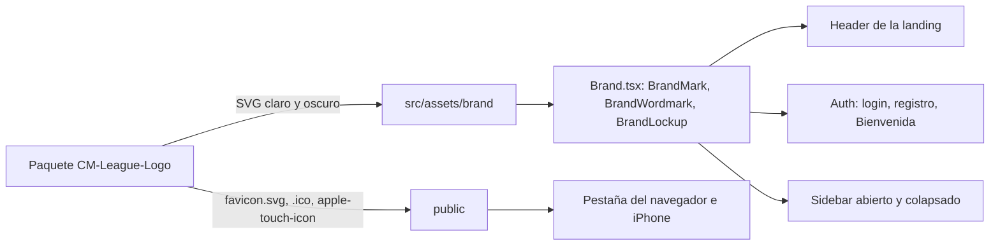

# Marca CM League en el frontend: documentación

## Qué hace

La plataforma se llama **CM League**. El frontend muestra el logo oficial (paquete `CSSTV/CM-League-Logo/`) en lugar de la marca provisoria en CSS (el cuadro "TV" y el texto "CSS**TV**"). Usa siempre los SVG del paquete sin modificar: la versión "fondo claro" en el tema claro y la "fondo oscuro" en el oscuro.

## Piezas y dónde va cada una

| Lugar | Pieza | Tamaño |
|---|---|---|
| Header de la landing | Lockup (isotipo + "CM League"). Por debajo de 400px, solo el isotipo | 28px de alto |
| Bajada "Counter-Strike Source" en la landing | Texto, desde 1200px | 14px |
| Auth (arriba a la izquierda) | Lockup | 28px de alto |
| Sidebar abierto | Isotipo + wordmark, y debajo "Comunidad Counter-Strike: Source" | Isotipo 32px, wordmark de 15px de alto |
| Sidebar colapsado | Isotipo | 32px |
| Pestaña del navegador | `favicon.svg` (actuales), que sigue el tema del sistema o del navegador (fondo claro o fondo oscuro), y `favicon.ico` (viejos, versión clara) | — |
| iPhone/iPad, pantalla de inicio | `apple-touch-icon.png` | 180×180 |

## Cómo se muestra según el tema

- **Componentes:** `BrandMark`, `BrandWordmark` y `BrandLockup` (`src/components/brand/Brand.tsx`) dibujan dos ``: la versión clara con `dark:hidden` y la oscura con `hidden dark:block`.
- **Sin destello:** `theme-init.js` pone `.dark` antes del primer render.
- **Proporción:** solo se fija el alto; el ancho sale de la proporción del SVG.
- **Colores:** los del logo son exactamente tokens del sistema:
  - `#F54900` y `#FF6900` son `sidebar-primary` en claro y en oscuro;
  - desde el 2026-10-24, `#FF6900` es también el `primary` del tema oscuro, con texto negro encima (antes era `#9F2D00`, que como texto daba 2,7:1);
  - `#CA3500` es `primary` en claro;
  - la tinta (`#0A0A0A` / `#FAFAFA`) es `foreground`.

## Reglas

- **No se recolorean, no se estiran, no se rotan** ni se les agregan sombras. Mínimos: isotipo 16px y lockup 24px de alto. Espacio libre: ¼ del alto del isotipo.
- **Son imágenes decorativas** (`alt=""`). El link o botón que las contiene lleva el nombre accesible:
  - "CM League, ir al inicio" en auth y en el sidebar;
  - "CM League, volver arriba" en la landing.
- **Nombre visible:** "CM League" en el título de la pestaña, el pie de la landing, el tooltip del sidebar, los paneles y la Bienvenida.
- **Claves internas** (`csstv.session`, `csstv-theme`, `csstv.themeFx`…): no cambian, para no cerrar sesiones ni borrar preferencias.

## Archivos guardados (y los que no)

- **Se guardan:**
  - 6 SVG (isotipo, wordmark y lockup, en versión de fondo claro y de fondo oscuro);
  - 3 archivos de favicon.
- **No se guardan:**
  - PDF y los demás PNG;
  - las versiones de una tinta, que no tienen uso todavía;
  - `android-chrome` y el manifest, porque la web no es instalable;
  - los avatares y banners, que son para redes.

## Dónde está cada cosa

| Qué | Dónde |
|---|---|
| SVG de la marca | `web/frontend/src/assets/brand/` |
| Componentes | `web/frontend/src/components/brand/Brand.tsx` |
| Favicon | `web/frontend/public/` y `<link>` en `web/frontend/index.html` |
| Guía para Claude Design | `C:\Users\xxest\Downloads\CMLeague-marca.md` (fuera del repo) |
| Paquete original | `CSSTV/CM-League-Logo/` (fuera del repo) |
