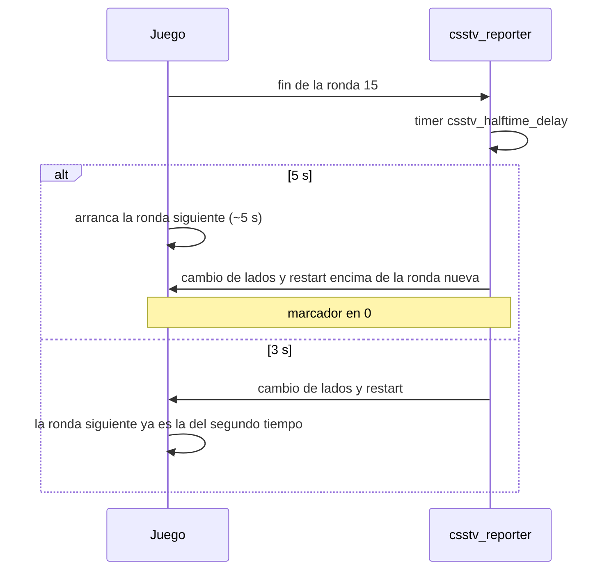

# Pausa del medio tiempo de 3 segundos

Desde el 2026-10-24 los dos servidores (el real y RBK) esperan **3 segundos** después de la última ronda del primer tiempo, o de la ronda que deja el empate, antes de cambiar de lados o de arrancar la prórroga. Antes eran 5.

## El problema

Con 5 segundos el marcador se bugeaba en el medio tiempo y volvía a 0.

La causa probable: el juego reinicia la ronda unos 5 segundos después de que termina, el mismo momento en que disparaba el timer del plugin. Con 3 segundos el cambio de lados pasa antes. El código del plugin no cambió.

## Dónde está

| Qué | Valor | Archivo |
|---|---|---|
| Pausa del medio tiempo y antes de la prórroga | `csstv_halftime_delay "3.0"` | `cfg/sourcemod/csstv_reporter.cfg` de cada servidor y `server/cfg/sourcemod/csstv_reporter.cfg` del repo |

El convar admite de 1 a 10 segundos. Es parte de la configuración obligatoria e igual en todos los servidores: un servidor nuevo también lleva 3.
