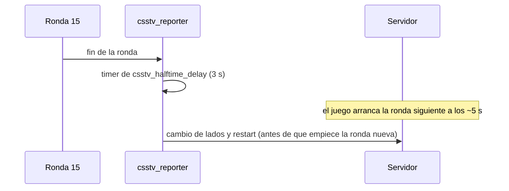

# Plan: pausa del medio tiempo de 5 a 3 segundos

> Planeación original. Estado: **aprobado** por Daniel el 2026-10-24 (lo pidió él).

## Decisiones tomadas

| Tema | Decisión | Por qué |
|---|---|---|
| Pausa del medio tiempo | `csstv_halftime_delay "3.0"` (antes `"5.0"`) | Con 5 s el marcador se bugea y vuelve a 0 en el medio tiempo. Pedido de Daniel |
| Servidores | El real y RBK en la misma tanda | Configuración obligatoria e igual en todos los servidores |
| Plugin | No se toca ni se recarga | Es solo un valor del cfg; se aplica en el próximo cambio de mapa sin cancelar partidas |

## 1. El flujo completo

Con 5 s el timer del plugin coincide con el reinicio de ronda del propio juego (unos 5 s después del fin de ronda), y el cambio de lados choca con la ronda nueva. Con 3 s el cambio pasa antes.

## 2. Cambios

- `server/cfg/sourcemod/csstv_reporter.cfg` del repo: `csstv_halftime_delay "3.0"`.
- `cfg/sourcemod/csstv_reporter.cfg` del servidor real (`SFTP_CSS_*`) y de RBK (`SERVER1_*`): la misma línea, con respaldo local del original (tiene el token, no se versiona).
- `CLAUDE.md`, `docs/PENDIENTES.md` y la memoria: "medio tiempo de 3 s".

## 3. Requisitos antes de empezar

Accesos SFTP del `.env` y `paramiko` en un entorno virtual aparte.

## 4. Orden de implementación

1. Cambiar el cfg del repo.
2. `pruebas/medio_tiempo_3s.py inspect`: los dos servidores tienen `csstv_halftime_delay "5.0"` una sola vez.
3. `apply` y verificar releyendo el archivo.
4. Documentación, guía y changelog.
