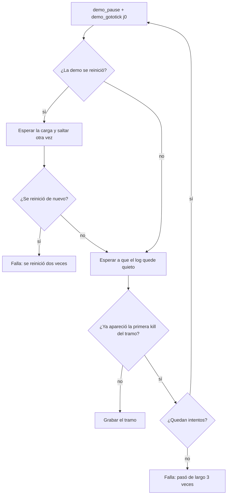

# Plan: ajustes del render después de configurar el portátil

> Planeación original. Estado: **propuesta**, pendiente de aprobación.
>
> Los dos cambios de código se hicieron y probaron en el portátil la noche del 2026-10-23 al 2026-10-24, y después se descartaron ahí para aplicarlos desde la PC de Daniel. El parche está en [`pruebas/ajustes_render.patch`](pruebas/ajustes_render.patch).

## Decisiones tomadas

| Tema | Decisión | Por qué |
|---|---|---|
| Descarga de la demo | `download_demo()` manda `User-Agent: CMLeague-render/1.0` | Con el User-Agent por defecto de Python (`Python-urllib/3.12`), Cloudflare responde **403, error 1010**. Pasó en el portátil y no en la PC; `curl` sí bajaba la demo |
| Salto que se pasa de largo | Se vuelve a saltar al mismo tick, hasta `SEEK_TRIES = 3` veces, antes de fallar | Si una sesión falla, `procesar.py` da por fallidas **todas** las jugadas de la partida. En el portátil, el primer salto se pasó de largo una vez de cada dos |
| Cómo llega a la PC | Parche (`git apply`) y commit desde la PC | Daniel prefiere commitear el código desde la PC |

## 1. El flujo del salto con el reintento



Un reintento es un salto hacia atrás: el juego reinicia la demo y adelanta desde el principio. Eso ya lo manejaba el código (rama de `restarted()`).

## 2. Cambios en `render/procesar.py`

En `download_demo()`, en lugar de `urlopen(url)`:

```python
# Con el User-Agent por defecto de Python, Cloudflare responde 403 (error 1010) en algunas máquinas.
req = urllib.request.Request(url, headers={"User-Agent": "CMLeague-render/1.0"})
try:
    with urllib.request.urlopen(req, timeout=600) as r, open(path + ".part", "wb") as f:
```

Comprobado en el portátil: con el User-Agent por defecto, 403 (`error code: 1010`); con el propio, 200 y la demo completa.

## 3. Cambios en `render/render_clip.py`

- Constante nueva, junto a `LOG_OUT`: `SEEK_TRIES = 3`.
- En `record_session()`, el bloque que va de `game.step(goto)` hasta el control de "pasó de largo" queda dentro de `for attempt in range(1, SEEK_TRIES + 1)`:
  - si la primera kill del tramo **no** apareció, `break` y se graba como antes;
  - si apareció y quedan intentos, se anota `Aviso: la demo pasó de largo el tick {j0}; vuelvo a saltar ({n} de 3).`, se pone `since = None` y se repite el salto;
  - en el último intento se falla con `la demo pasó de largo el tick {j0} (3 veces)`.
- `after` (la primera kill del tramo) se calcula una vez, antes del bucle.

El detalle exacto está en el parche.

## 4. Lo que se vio en el portátil

Portátil: Ryzen 5 7520U con gráficos Radeon integrados y 15 GB de RAM, contra el Ryzen 7 5700X con RTX 5070 de la PC.

| Hora | Qué pasó |
|---|---|
| 23:44 | Prueba manual a 1080p (4k de roman, cbble), **sin** el reintento: "clip tramo 0: la demo pasó de largo el tick 230489". El log del juego muestra que, después del salto, la demo siguió unos 3,5 s y escribió la primera kill del tramo |
| 23:52 y 00:01 | La misma prueba otra vez (la segunda ya con el reintento, sin que hiciera falta): bien. 170 s en total (152 s de juego y 17 s de FFmpeg), 17,7 s de video y 17 MB |
| 00:12 | Primera corrida de la tarea, **sin** el User-Agent: 403 en todas las descargas. Las jugadas de **cbble** (`srv1-20261023T234218-c364`) gastaron sus 3 intentos en la misma corrida y quedaron **`failed`** |
| 00:22 a 00:42 | Con los dos arreglos: **inferno_classic (`srv1-20261024T003046-9062`) completa, 10 de 10 en R2 y en Drive**. El reintento se usó una vez ("pasó de largo el tick 70748; vuelvo a saltar (2 de 3)") y funcionó. Sesión de 958 s |
| 00:42 a 01:24 | **mirage_rc1 (`srv1-20261024T013348-963d`)**: tres sesiones fallidas y las jugadas quedaron **`failed`** (ver la sección 5) |

## 5. Problemas abiertos (no se arreglaron)

1. **Tramo al principio de la demo** (mirage, tick 3826, unos 38 s después del comienzo): al cargar, la demo corre sin pausa a unas 10 veces la velocidad real. Cuando llega el primer `demo_pause` ya pasó el tick, así que el reintento salta hacia atrás, reinicia la demo, y pasa lo mismo: "la demo se reinició dos veces". Sin el reintento habría fallado igual, como "pasó de largo". Posible arreglo: mandar `demo_pause` apenas aparece "Redownloading all lightmaps", o poner la pausa en `cmleague_render.cfg`.
2. **`startmovie` sin cuadros:** "928f73c5 tramo 0: 0 de 1532 cuadros en 300 s". Pasó en una corrida y en la siguiente el mismo tramo grabó bien (1502 cuadros en 141 s).
3. **`endmovie` no cortó** "5cf5b44c_3_" después de 3 intentos.
4. **El juego no se cerró** después de dos de esos fallos ("El juego no se cerró: ciérralo a mano"). Entonces `procesar.py` se cae en el `finally` de `process_match()` con `PermissionError` al borrar la copia de la demo (`os.remove(copia)`, el juego la tiene abierta) y **corta la corrida entera**: las otras partidas no se procesan. Arreglo propuesto: envolver ese `os.remove` en `try/except OSError`.
5. **Velocidad:** en la última sesión, los tramos de 300 cuadros tardaron entre 27 y 30 s, contra 15 s en las anteriores. No se sabe si el portátil se calentó o si alguien lo estaba usando.
6. **Tres intentos se gastan en una sola corrida:** si la descarga falla, la misma partida se reintenta enseguida tres veces y queda `failed` en segundos. Conviene esperar entre intentos, o no contar como intento un error de red.

## 6. Datos para reponer en la base (los corre Daniel en el SQL Editor)

Para que la tarea vuelva a tomar las jugadas de cbble y de mirage. Antes de correrlo, confirmar en `supabase/migrations/20261023180000_clips_video.sql` que pendiente es `video_status = null`:

```sql
update match_clips
   set video_status = null, video_attempts = 0, video_error = null
 where video_status = 'failed'
   and match_id in ('54456386-8d11-48cd-abf3-1572d4961861',   -- cbble, srv1-20261023T234218-c364
                    '92d7a525-c4ba-4377-8f1f-14917989293f');  -- mirage_rc1, srv1-20261024T013348-963d
```

Conviene correrlo **después** de que el portátil tenga los arreglos (o con la tarea desactivada). Si no, se vuelven a gastar los intentos.

## 7. Correcciones para `render/CONFIGURAR_PORTATIL.md`

- Paso 1: el arreglo del intervalo de tick está escrito `h["playback_time"] / h["playback_ticks"]` (`leer_demo.py:369`), y la búsqueda literal de la guía no lo encuentra.
- Paso 5: `config.example.json` trae `"drive": false`, pero la guía pide `true`. Uno de los dos está mal.
- Paso 8: si `python` es otra versión (en el portátil quedó la 3.9 primero en el PATH), hay que pasar `-Python <ruta de la 3.12>`. Copiar dos líneas juntas en PowerShell falla: es mejor dar un solo comando, `powershell -ExecutionPolicy Bypass -File C:\v34frag\render\instalar_tarea.ps1 -Python "…"`.
- Paso 7: borrar el video de prueba solo después de que Daniel lo vea.

## 8. Requisitos antes de empezar

- La PC con la rama `feat/backend-api-fase-1` al día (incluye este documento y el parche).
- Desactivar la tarea del portátil mientras tanto (en una PowerShell como administrador: `Disable-ScheduledTask "CMLeague clips"`). Sin el User-Agent, cada partida nueva gasta sus 3 intentos con 403.

## 9. Orden de implementación

1. En la PC: `git apply docs/bitacora/2026-10-24-render-portatil-ajustes/pruebas/ajustes_render.patch`.
2. Revisar el diff y decidir si se suman los arreglos de la sección 5 (por lo menos el 4 y el 1).
3. Commit (`fix(render): …`) y push.
4. En el portátil: `git pull` y volver a activar la tarea (`Enable-ScheduledTask "CMLeague clips"`, como administrador).
5. Correr el SQL de la sección 6.
6. Seguir `C:\CMLeague_Render\trabajo\procesar.log` hasta que cbble y mirage queden `done`.
7. Escribir `DOCUMENTACION.md` y `GUIA_IMPLEMENTACION.md` y corregir `CONFIGURAR_PORTATIL.md` (sección 7).
