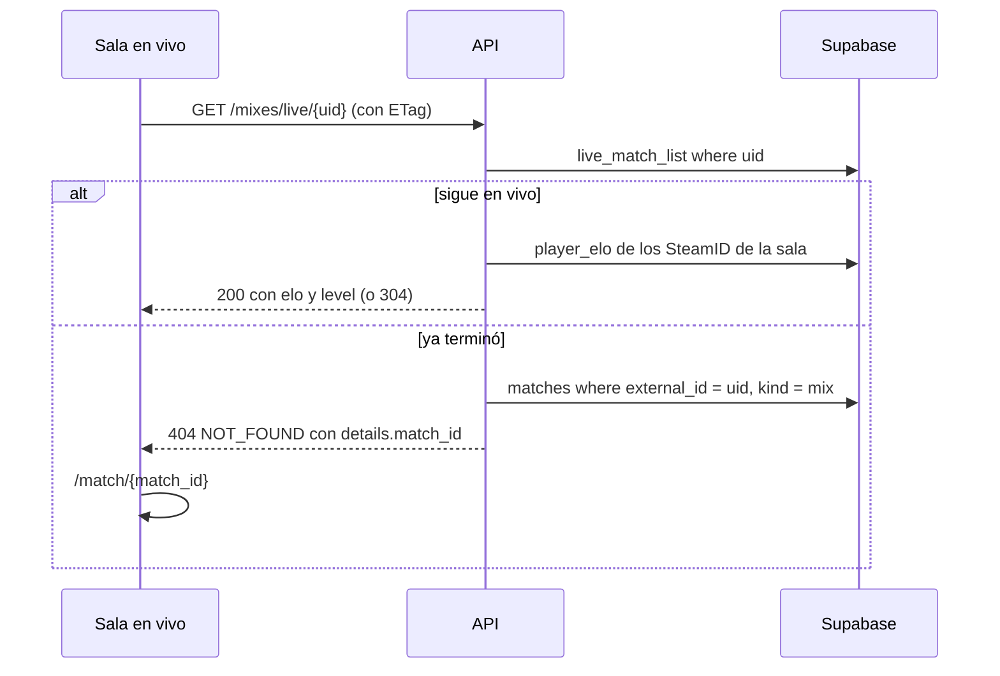

# Pedidos del frontend de Mixes a la API: documentación

## Qué hace

Suma a la API los tres datos que el frontend de Mixes necesitaba y no tenía. Ninguno cambia la base: son cambios en `web/backend` y en el contrato.

1. **De la sala en vivo a la sala final:** cuando un mix termina, la sala en vivo recibe un `404` que ahora dice a qué partida pasar.
2. **Insignia de nivel en la sala:** cada jugador de la sala (terminada o en vivo) trae su `elo` y su `level`.
3. **"ELO pendiente" en el listado:** cada fila de `/mixes` trae `review`, el estado de la revisión del ELO de un mix interrumpido.

## El `404` con `match_id`

- **Cómo se encuentra la partida:** al terminar un mix, `csstv_ingest` guarda el uid del plugin (`match_uid`) en `matches.external_id` y borra la fila de `live_matches` en la misma transacción. El cierre por caída que hace un admin (`live_match_close`) pasa por el mismo `csstv_ingest`, así que también queda unido.
- **Respuesta:** `404` con `error.code: "NOT_FOUND"` y `error.details: { match_id }`, mensaje "Ese mix ya terminó.".
- **Si el uid nunca existió:** el `404` de siempre, sin `details`.
- El frontend decide por `error.code` y usa `details.match_id` si viene. No rompe a nadie.

## `elo` y `level` de cada jugador

| Línea | De dónde sale el ELO |
|---|---|
| Con ficha | `player_elo` del SteamID principal de la ficha (`players.steam_id`), el que suma todas sus partidas |
| Sin ficha (invitado) | `player_elo` del SteamID con el que jugó |
| Bot o NOSTEAM | Sin fila: `elo` y `level` en `null` |

- Es el **ELO actual**, no el que tenía en esa partida: igual que el MVP del listado de mixes, para que la insignia coincida con la del resto de la web (decisión de Daniel, 2026-10-25).
- `level` sale de `levelOf`, el mismo de toda la API (tramos 0, 501, 751, 901, 1051, 1201, 1351, 1531, 1751 y 2001).
- Se lee en **una consulta por respuesta** (`eloBySteam`), nunca por jugador.
- Va en `PlayerLine` (detalle de cualquier partida: mix, PCW o torneo) y en `LivePlayerLine` (sala en vivo).
- **ETag de la sala en vivo:** el ELO no cambia durante un mix (se aplica al terminar), así que el `304` sigue igual.

## `review` en el listado de mixes

| Valor | Significa |
|---|---|
| `pending` | Mix interrumpido por una caída; falta que un admin decida el ELO |
| `applied` | El admin aplicó el ELO |
| `discarded` | El admin lo descartó |
| `null` | No es un interrumpido, o sigue en vivo |

- Sale de `match_list` (la misma columna que ya usan `/matches` y la sala), en una consulta para los `match_id` de la página.
- No hay filtro por `review` en `/mixes`: el admin ya filtra en `GET /api/v1/matches?review=pending`.

## Dónde está cada cosa

| Qué | Archivo |
|---|---|
| `404` con `match_id` y ELO de la sala en vivo | `web/backend/src/routes/live.ts` |
| ELO de la sala de una partida | `web/backend/src/routes/matches.ts` |
| `review` en el listado | `web/backend/src/routes/mixes.ts` (`toMixItem`) |
| `eloBySteam` y `eloLevel` | `web/backend/src/services/live.ts` |
| Esquemas (`PlayerLine`, `LivePlayerLine`, `MixItem`) | `web/backend/src/schemas/matches.ts`, `schemas/live.ts` |
| `ReviewStatus` (pasó acá para no armar un ciclo entre `matches.ts` y `live.ts`) | `web/backend/src/schemas/common.ts` |
| Pruebas | `web/backend/test/unit/mixes-perfil.test.ts`, `test/integration/live.test.ts` |
| Contrato | `docs/frontend/contrato/partidas.md` (sección 8), `README.md`, `decisiones.md` |
