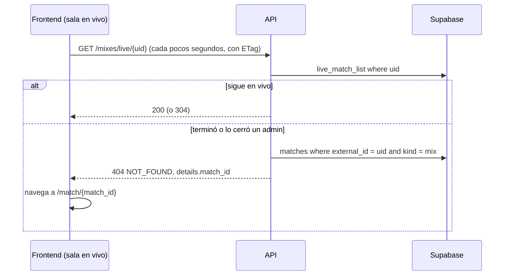

# Plan: pedidos del frontend de Mixes a la API

> Planeación original. Estado: **propuesta**, pendiente de aprobación.

Los tres pedidos que dejó el frontend de Mixes (bitácora `2026-10-24-frontend-mixes`, anotados en `docs/PENDIENTES.md`):

1. `match_id` en el `404` de `GET /api/v1/mixes/live/{uid}`, para pasar de la sala en vivo a la sala final.
2. `level` y `elo` en `PlayerLine` y `LivePlayerLine`, para la insignia de nivel de cada jugador en la sala.
3. `review` en `MixItem`, para el chip "ELO pendiente" de un mix interrumpido en el listado.

Los tres salen **sin migración**: solo cambian la API (`web/backend`) y el contrato.

## Decisiones tomadas

| Tema | Decisión | Por qué |
|---|---|---|
| Cómo se une el mix en vivo con su partida | Por `matches.external_id = uid` | Al terminar, `csstv_ingest` guarda el `match_uid` del plugin en `external_id`, y borra la fila de `live_matches` en la misma transacción. El cierre por el admin (`live_match_close`) pasa por el mismo `csstv_ingest`. La columna es pública (la 10 da `select` de todas menos `link_code`) |
| Forma del `404` | Sigue siendo `404 NOT_FOUND`, con `details: { match_id }` cuando la partida existe. Si el uid no existe, `404` sin `details` | No rompe a nadie: el frontend decide por `error.code` y usa `details.match_id` si viene. Evita un endpoint nuevo |
| Qué ELO lleva cada jugador | El **actual** (`player_elo`), igual que el MVP del listado de mixes: con ficha, el de su SteamID principal (`players.steam_id`); sin ficha, el del SteamID de la línea | Es lo que muestra la insignia en el resto de la web. Bots y NOSTEAM: `null` |
| `level` | `levelOf(elo)`, el mismo de toda la API (1 a 10, `null` sin ELO) | Un solo criterio de tramos |
| Partidas que no son mix | `level` y `elo` también en las líneas de PCW y torneos (`PlayerLine` es el mismo esquema) | Mismo costo, y la sala de torneo lo va a necesitar |
| `review` en el listado | `pending`, `applied` o `discarded`, o `null` si no es un interrumpido (el mismo `ReviewStatus` de `match_list`). En vivo, `null` | Es lo que ya muestra la sala. Se lee de `match_list` para los `match_id` de la página, en una consulta |
| Filtro por `review` en `/mixes` | No se agrega | No lo pidieron; el admin ya filtra en `GET /matches?review=pending` |

## 1. El flujo completo

## 2. `match_id` en el `404` de la sala en vivo

`routes/live.ts`, handler `detail`:

- Si `live_match_list` no tiene el uid, busca `matches` con `external_id = uid` y `kind = 'mix'` (`select id`, `maybeSingle`).
- Con partida: `throw new AppError(404, 'NOT_FOUND', 'Ese mix ya terminó.', { match_id })`.
- Sin partida: el `notFound` de hoy.
- La descripción de la ruta en la OpenAPI lo explica ("404 con `details.match_id` cuando terminó").

## 3. `level` y `elo` en las líneas de jugador

**Esquemas:**

- `schemas/matches.ts` (`PlayerLine`) y `schemas/live.ts` (`LivePlayerLine`): `elo: z.number().int().nullable()` y `level: z.number().int().min(1).max(10).nullable()`, como en `MixMvp`.

**Rutas:**

- `routes/matches.ts` (detalle) y `routes/live.ts` (detalle): una consulta más.
  - Primero junta el SteamID de cada línea: con ficha, el `steam_id` de `players` (ya se consulta el alias; se suma la columna a ese `select`); sin ficha, el de la línea.
  - Después lee `player_elo` con `.in('steam_id', …)` y arma un `Map`.
- La consulta se hace una vez por respuesta, nunca por jugador.

**ETag de la sala en vivo:** el cuerpo ahora incluye el ELO. No cambia durante un mix (el ELO se aplica al terminar), así que el `304` sigue funcionando igual.

## 4. `review` en el listado de mixes

`routes/mixes.ts` (listado) y `schemas/live.ts` (`MixItem`):

- `review: ReviewStatus.nullable()`, con la descripción "Solo en un mix interrumpido: `pending` (falta que un admin decida el ELO), `applied` o `discarded`".
- Después de `runList`, con los `match_id` de la página: `match_list` con `select('id, review')` e `.in('id', ids)`, en un `Map`.

## 5. Contrato y documentación

- `docs/frontend/contrato/partidas.md`:
  - El `404` de la sala en vivo con `details.match_id`.
  - `level` y `elo` en las líneas de jugador.
  - `review` en el listado de mixes.
- `docs/frontend/contrato/README.md`: una fila en Novedades.
- `docs/frontend/contrato/decisiones.md`: las decisiones de este plan.
- `docs/PENDIENTES.md`: los tres pedidos, marcados como hechos.
- La bitácora: `DOCUMENTACION.md` y `GUIA_IMPLEMENTACION.md` al terminar, más la fila en `docs/bitacora/README.md`. Sin `CHANGELOG_DISCORD.txt`: los jugadores lo ven cuando lo use el frontend, y va en el changelog de Mixes.

## 6. Pruebas

- **Unitarias** (`test/unit/`, con el patrón de las de rutas que ya existen): la línea con ficha, la línea sin ficha y un bot (`elo` y `level` `null`); el `404` con `details.match_id` y sin él; y `review` en una fila cancelada por caída y `null` en una en vivo.
- **De integración, contra la Supabase local:** `GET /matches/{id}` de un mix real trae `elo` y `level`; `GET /mixes` trae `review` en un interrumpido; `GET /mixes/live/{uid}` de un uid que ya terminó da el `match_id` correcto.
  - **No se corre `seasons.test.ts`:** borra todas las temporadas, BETA incluida.
- `pnpm typecheck`, `pnpm lint` y `pnpm test` en verde.

## 7. Requisitos antes de empezar

- La Supabase local en Docker (ya está arriba) y la API levantada desde este worktree (`E:\Css V34 Web\v34frag-backend`) en vez de la copia del frontend.

## 8. Orden de implementación

1. `review` en el listado (el más chico).
2. `level` y `elo` en `PlayerLine` y `LivePlayerLine`.
3. `match_id` en el `404` de la sala en vivo.
4. Pruebas unitarias y de integración.
5. Contrato, `docs/PENDIENTES.md` y bitácora.
6. Commit en `feat/backend-api-fase-1` cuando Daniel lo pida. Después, fusión en `feat/frontend-fase-1` y `pnpm gen:api`: el frontend usa los campos en su propio requerimiento.
