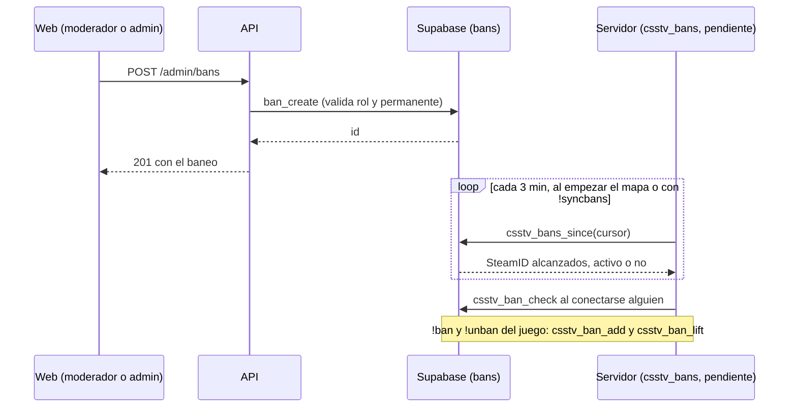
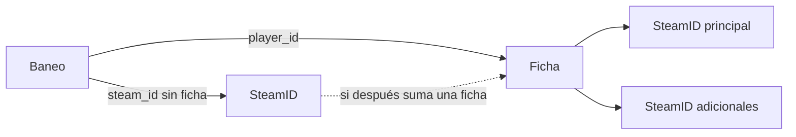

# Baneos de los servidores gestionados desde la web: documentación

> Primera tanda (2026-10-26): base de datos (replanteo `31`) y API. Todavía no hay frontend ni plugin `csstv_bans`.

## Qué hace

La tabla `bans` de Supabase es la lista única de baneos de todos los servidores, incluido RBK. Se banea desde la web (moderadores y admins) o desde el juego con `!ban`, y la lista es pública.

Un baneo alcanza a una **ficha** (todos sus SteamID, también los que sume después) o a un **SteamID sin ficha**. No se borra: se levanta, y queda quién, cuándo y por qué.

Los servidores lo van a aplicar con el plugin `csstv_bans` (todavía no existe):
- al conectarse alguien, con `csstv_ban_check`;
- cada 3 minutos y al empezar cada mapa, con `csstv_bans_since`;
- al momento, cuando un moderador o admin escribe `!syncbans` en el servidor (también con `csstv_bans_since`).

Las dos funciones ya están en la base.

## Roles

`profiles.role` suma `moderator`. Los roles no le quitan nada a nadie: todos juegan.

| Rol | Organiza (`is_organizer()`) | Modera (`is_moderator()`) | Administra (`is_admin()`) |
|---|---|---|---|
| `user` | No | No | No |
| `organizer` | Sí | No | No |
| `moderator` | No | Sí | No |
| `admin` | Sí | Sí | Sí |

- **Quién lo asigna:** el admin, con `PUT /api/v1/admin/users/{id}/role` (`set_user_role` acepta `user`, `organizer` o `moderator`). El rol admin se da en la base.
- **SourceMod:** el rol web no está atado al grupo `Moderador` de SourceMod.
- **API:** `requireModerator` e `isModerator` en `lib/auth.ts`. `user.role` en la sesión y en `/me/profile` puede ser `moderator`.

## Tabla `bans`

| Columna | Qué guarda |
|---|---|
| `id` | uuid |
| `player_id` | Ficha baneada; null si se baneó un SteamID sin ficha |
| `steam_id` | SteamID64 baneado (con ficha, su principal) |
| `nick` | Nick al banear: el que mandó el plugin, el de la ficha o el último de sus partidas |
| `reason` | Motivo, de 1 a 200 caracteres |
| `expires_at` | Vencimiento; null = permanente |
| `source` | `web`, `server` (`!ban`) o `import` |
| `created_by` | Cuenta web que baneó |
| `created_by_steam`, `created_by_name` | Admin del juego que baneó (puede ser la consola: solo el nombre) |
| `server_id` | Servidor donde se puso con `!ban` |
| `created_at`, `updated_at`, `updated_by` | Fechas; `updated_at` lo pone el trigger `bans_touch` en cada cambio (es el cursor del plugin) |
| `lifted_at`, `lifted_by`, `lifted_by_steam`, `lifted_by_name`, `lift_reason` | Si se levantó: cuándo, quién (web o juego) y por qué |
| `replaced_by` | Baneo nuevo que lo reemplazó |

- **Activo:** `lifted_at` null y `expires_at` null o futuro. No hace falta tocar nada al vencer.
- **RLS:** sin acceso directo para `anon` ni `authenticated`. Se lee por `ban_list` y se escribe por las funciones.

### A quién alcanza

`ban_owner(player_id, steam_id)` es la ficha del baneo: la guardada o, si se baneó un SteamID sin ficha, la que tenga ese SteamID hoy. `ban_active_for(steam)` devuelve los baneos activos que alcanzan a un SteamID:
- los de ese SteamID;
- los de su ficha (por cualquiera de sus SteamID).

Primero van los permanentes y después los que vencen más tarde.

### Un activo por ficha

`ban_insert` (interna) crea el baneo y levanta los activos que alcanzan al mismo SteamID:
- `lift_reason = 'Reemplazado por un baneo nuevo'`;
- `replaced_by` apunta al nuevo.

Un candado por ficha (`pg_advisory_xact_lock`) evita dos altas a la vez.

Si ya hay un baneo **permanente** activo:
- **desde la web:** un admin lo reemplaza; un moderador recibe `403`;
- **desde el juego:** se deja el permanente y la función devuelve su id. Un `!ban` temporal no lo acorta.

## Reglas de la web (en la base)

| Función | Quién | Reglas |
|---|---|---|
| `ban_create(p_player, p_steam, p_reason, p_expires)` | Moderador o admin | Ficha o SteamID, uno de los dos. La ficha necesita SteamID. Un SteamID con ficha banea la ficha. `p_expires` null (permanente) solo un admin; si no, futuro |
| `ban_update(p_id, p_reason, p_expires, p_permanent)` | Moderador o admin | Solo un baneo activo. Uno permanente, solo un admin. Volverlo permanente, solo un admin |
| `ban_lift(p_id, p_reason)` | Moderador o admin | Solo un baneo activo, con motivo. Uno permanente, solo un admin |

Los errores de permiso usan el código `42501` y la API los devuelve como `403` con el mensaje. Los demás errores llegan como `400`.

## Funciones para el plugin

Usan el token del servidor (`csstv_auth`, como `csstv_whois`) y la anon key. Responden siempre `{"ok": ...}`. Un token inválido da error `PT401`. Aceptan el SteamID como SteamID64 o como `STEAM_0`.

| Función | Para qué | Respuesta |
|---|---|---|
| `csstv_ban_check(token, steam)` | Al conectarse alguien | `banned`, `ban_id`, `reason`, `expires` (segundos Unix, 0 = permanente) y `expires_at` |
| `csstv_bans_since(token, cursor)` | Sincronización (cada 3 minutos, al empezar cada mapa y con `!syncbans`) y copia local | `items` (uno por SteamID alcanzado) y el próximo `cursor` |
| `csstv_ban_add(token, steam, nick, admin_steam, admin_name, minutes, reason)` | `!ban` del juego | `ban_id`. `minutes` 0 = permanente. Sin motivo: "Sin motivo (baneado en el servidor)" |
| `csstv_ban_lift(token, steam, admin_steam, admin_name)` | `!unban` del juego | `lifted`: cuántos levantó. Levanta todos los que alcanzan a ese SteamID, también los de la web y los permanentes |

### Sincronización (`csstv_bans_since`)

- **Sin cursor:** todos los activos, con cada SteamID alcanzado (el baneado y todos los de su ficha).
- **Con cursor:**
  - los baneos con `updated_at` posterior: creados, cambiados o levantados;
  - los activos cuya ficha sumó un SteamID después del cursor.
- **Cada item:** `ban_id`, `steam` (`STEAM_0`), `steam64`, `active`, `reason` y `expires`.
- **Al recibir los items:**
  - uno levantado viene con `active: false`, y el plugin borra de su copia todo lo de ese `ban_id`;
  - un baneo que vence no cambia: el plugin usa `expires`.
- **Próximo cursor:** `now()` menos un minuto, para no perder filas de transacciones que terminaron tarde. Un item puede repetirse, y aplicarlo dos veces da lo mismo.

## Vista pública `ban_list`

Una fila por baneo, con:
- `player_id` (la ficha alcanzada) y `nick` (el de la ficha, o el guardado);
- `steam_id`, `reason`, `created_at`, `expires_at` y `permanent`;
- `status` (`active`, `expired` o `lifted`) y `source`;
- el servidor (`server_name`);
- quién lo puso y quién lo levantó (`created_by_alias` y `created_by_name`, `lifted_by_alias` y `lifted_by_name`), y `replaced_by`.

**SteamID:** se rige por la regla de SteamID ocultos del 2026-10-24.
- `search` busca en el nick y el motivo. El SteamID entra solo en los baneos sin ficha.
- `search_all` busca también en el SteamID. La usa la API para moderadores y admins.

## API

| Endpoint | Quién | Qué |
|---|---|---|
| `GET /api/v1/bans` | Público | Lista con `status`, `source`, `server` y `q`; orden `created_at` (por defecto, desc) o `expires_at` |
| `GET /api/v1/players/{id}/bans` | Público | Los de la ficha (id o nick), con `status` y `source` |
| `POST /api/v1/admin/bans` | Moderador o admin | `player_id` o `steam_id`, `reason`, y `expires_at` o `permanent: true`. Devuelve `201` con el baneo |
| `PATCH /api/v1/admin/bans/{id}` | Moderador o admin | `reason`, `expires_at` o `permanent: true`. `404` si no existe |
| `POST /api/v1/admin/bans/{id}/lift` | Moderador o admin | `reason`. `404` si no existe; `400` si ya no está activo |

- **Cada baneo (`Ban`):**
  - `player` (`id` y `alias`, o null) y `nick`;
  - `steam_id`: null si tiene ficha y quien consulta no es moderador ni admin;
  - `reason`, `created_at`, `expires_at`, `permanent`, `status`, `source` y `server`;
  - `created_by` (`id` null si fue un admin del juego);
  - `lifted` (`at`, `reason`, `by` y `replaced_by`, o null).
- **Ficha (`GET /players/{id}`) y perfil sin reclamar (`GET /players/steam/{steamid}`):** suman `ban`, el baneo activo (`id`, `reason`, `created_at` y `expires_at`) o null. En un SteamID reclamado, el baneo va en la ficha.

## Dónde está cada cosa

| Qué | Archivo / ubicación |
|---|---|
| Migración | `supabase/replanteo/31_baneos.sql` |
| Inversa y pruebas SQL | `docs/bitacora/2026-10-14-replanteo-modelo-datos/reversas/31_baneos.sql` y `pruebas/31_baneos.sql` |
| Rutas | `web/backend/src/routes/bans.ts` |
| Esquemas | `web/backend/src/schemas/bans.ts`; `ActiveBan` en `schemas/players.ts` |
| Fila a respuesta y baneo activo | `web/backend/src/services/bans.ts` |
| Rol de moderador | `web/backend/src/lib/auth.ts` (`isModerator`, `requireModerator`), `services/account.ts` (`roleOf`), `schemas/auth.ts` y `schemas/admin.ts`, `routes/pcw-play.ts` (`PUT /admin/users/{id}/role`) |
| `ban` en la ficha y en el perfil sin reclamar | `web/backend/src/routes/players.ts`, `routes/claim.ts`, `schemas/players.ts`, `schemas/claim.ts` |
| Contrato del frontend | `docs/frontend/contrato/admin.md` ("Baneos"), `jugadores.md`, `api.md`, `decisiones.md` y `README.md` |
