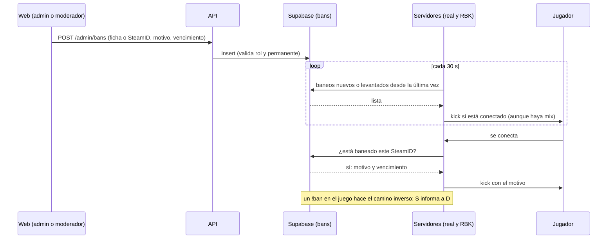

# Plan: baneos de los servidores gestionados desde la web

> Planeación original. Estado: **propuesta**, pendiente de aprobación.

Hoy cada servidor banea por su cuenta con el `basebans` de SourceMod (`banned_user.cfg`). Un baneado en el servidor real puede entrar a RBK, y la web no se entera de nada. Con este plan, la base pasa a ser la lista única de baneos: se banea desde la web o desde el juego, y todos los servidores la aplican.

## Decisiones tomadas

| Tema | Decisión | Por qué / quién |
|---|---|---|
| Alcance | Un baneo vale en **todos los servidores**, incluido RBK | Daniel, 2026-10-25 |
| Quién banea desde la web | Admins y moderadores. **Solo un admin puede banear de forma permanente**; el moderador siempre pone un vencimiento | Daniel, 2026-10-25 |
| Mix en curso | El baneo se aplica **en el momento**: se echa al jugador aunque esté jugando | Daniel, 2026-10-25 |
| Visibilidad | Lista de baneos **pública** | Daniel, 2026-10-25 |
| Avisos | **Sin** Discord ni notificación al jugador | Daniel, 2026-10-25 |
| Fuente de verdad | La tabla `bans` de Supabase; los servidores consultan y obedecen | Una sola lista para todos los servidores y para la web |
| Qué se banea | La **ficha** si el SteamID tiene una (vale para todos sus SteamID, también los que sume después); si no tiene, el SteamID solo | Un SteamID no es una cuenta de Steam, y una ficha puede tener varios: banear uno solo deja entrar con otro |
| Baneos del juego | `!ban` y `!unban` siguen funcionando y se informan a la base | Los admins y moderadores del juego no cambian su forma de trabajar |
| Historial | Un baneo no se borra: se levanta, y queda quién y cuándo | Auditoría |
| Sin conexión con Supabase | El plugin sigue aplicando los baneos que ya conoce (copia local); uno desconocido no bloquea a nadie | Que una caída de Supabase no deje entrar a los baneados ni frene a los demás |
| Descartado: SourceBans++ | No | Necesita MySQL y un panel PHP aparte, fuera de la web y de Supabase |
| Descartado: RCON desde la API | No | Hay que guardar contraseñas RCON, el baneo se pierde si el servidor está caído y cada servidor sigue con su lista |

## 1. El flujo completo

## 2. Base de datos (replanteo `31`)

### Tabla `bans`

| Columna | Qué guarda |
|---|---|
| `id` | uuid |
| `player_id` | La ficha baneada (null si el SteamID no tiene ficha) |
| `steam_id` | El SteamID64 con el que se baneó (siempre, aunque haya ficha) |
| `nick` | Último nick conocido, para la lista pública |
| `reason` | Motivo, obligatorio (texto libre, con largo máximo) |
| `expires_at` | Vencimiento; null = permanente |
| `source` | `web`, `server` o `import` |
| `created_by` | Cuenta web que baneó (si fue desde la web) |
| `created_by_steam`, `created_by_name` | Admin del juego que baneó (si fue con `!ban`) |
| `server_id` | Servidor donde se puso (si fue desde el juego) |
| `created_at` | Fecha |
| `lifted_at`, `lifted_by`, `lifted_by_steam`, `lift_reason` | Si se levantó, cuándo, quién y por qué |

Un baneo está **activo** si `lifted_at` es null y (`expires_at` es null o futuro).

### Rol de moderador en la web

- `profiles.role` suma `moderator` (hoy: `user`, `organizer`, `admin`) y una función `is_moderator()` (moderador o admin).
- Cómo se asigna el rol y su relación con el grupo `Moderador` de SourceMod se resuelve en la implementación, junto con el pendiente de roles de la plataforma (`docs/bitacora/2026-10-18-layout-autenticado/PLAN.md`).

### Reglas (en la base, no solo en la API)

- Banear: `is_moderator()`. `expires_at` null solo con `is_admin()`.
- Levantar o cambiar el vencimiento: el admin cualquiera; el moderador, los que puso él (propuesta). Un moderador no puede volver permanente un baneo.
- No dos baneos activos para la misma ficha (o el mismo SteamID sin ficha): el nuevo reemplaza al anterior, que queda levantado con referencia al nuevo.

### Funciones para el plugin (con el token del servidor, como `ingest_server_chunk`)

| Función | Qué hace |
|---|---|
| `server_ban_check(token, steam)` | Si el SteamID (o su ficha) tiene un baneo activo: motivo y vencimiento |
| `server_bans_since(token, cursor)` | Baneos creados, levantados o cambiados desde el cursor, con el SteamID de cada uno (todos los SteamID de la ficha) |
| `server_ban_add(token, steam, admin_steam, admin_name, minutes, reason)` | Un `!ban` del juego (0 minutos = permanente) |
| `server_ban_lift(token, steam, admin_steam)` | Un `!unban` del juego |

### Vista pública

`ban_list`: nick, ficha, SteamID, motivo, fecha, vencimiento, estado (activo, vencido o levantado) y quién lo puso (alias de la cuenta o nombre del admin del juego).

## 3. API

| Endpoint | Quién | Qué |
|---|---|---|
| `GET /api/v1/bans` | Público | Lista paginada, con filtros (estado, búsqueda por nick o SteamID, servidor, origen) y orden (fecha, vencimiento) en el servidor |
| `GET /api/v1/players/{id}/bans` | Público | Los baneos de una ficha |
| `POST /api/v1/admin/bans` | Moderador o admin | Banear una ficha o un SteamID: motivo y duración (o permanente, solo admin) |
| `PATCH /api/v1/admin/bans/{id}` | Moderador o admin | Cambiar el vencimiento o el motivo |
| `POST /api/v1/admin/bans/{id}/lift` | Moderador o admin | Levantar, con motivo |

Los datos de la ficha (`GET /api/v1/players/{id}` y la foto en vivo) suman `ban` (activo o null), para mostrar el aviso sin otra consulta.

## 4. Frontend

- **Página pública "Baneos"**: la lista con sus filtros, enlazada desde el menú o el pie.
- **Administración › Baneos**: la misma lista con acciones (banear, cambiar vencimiento, levantar). El moderador no ve la opción "Permanente".
- **Botón "Banear"** en la ficha del jugador, en el perfil sin reclamar y en la sala del mix, para moderadores y admins. Abre el formulario con el jugador ya elegido.
- **Aviso en la ficha**: "Baneado hasta el AAAA-MM-DD" o "Baneado de forma permanente", con el motivo.

## 5. Plugin `csstv_bans` (nuevo, aparte del reporter)

- **Al conectarse alguien** (`OnClientAuthorized`): `server_ban_check`. Si está baneado, kick con el motivo, el vencimiento y la dirección de la web. Es una consulta asíncrona por conexión.
- **Cada 30 segundos**: `server_bans_since`. Echa a los conectados que aparezcan baneados (aunque haya un mix en curso) y actualiza la copia local `data/csstv/bans.txt`.
- **Sin respuesta de Supabase**: usa la copia local. Un SteamID que no está en la copia entra.
- **`!ban` y `!unban` del juego**: se enganchan con los avisos de SourceMod (`OnBanClient`, `OnBanIdentity`, `OnRemoveBan`) y llaman a `server_ban_add` y `server_ban_lift`. Si falla el envío, se reintenta desde una cola en disco. `basebans` sigue instalado.
- **Al levantarse un baneo** desde la web, el plugin corre `removeid` del SteamID, para que el `banned_user.cfg` local no lo siga bloqueando.
- **Token**: usa el `csstv_server_token` del reporter. Para RBK va en el build licenciado, igual que el reporter.
- **Mix en curso**: el reporter ya registra a quien se va en medio del mix (rondas parciales). El mix sigue con uno menos; el baneado cuenta el ELO por las rondas que jugó, como cualquiera que se va.

### Consecuencia del alcance global

Un `!ban` de un admin de RBK en su servidor también vale en el nuestro. La web muestra en qué servidor y quién lo puso, y un admin lo puede levantar.

## 6. Baneos existentes

Una sola vez, antes de prender el plugin: leer `cfg/banned_user.cfg` del servidor real y de RBK (por SFTP) y cargarlos en `bans` con `source = 'import'`, permanentes y con el motivo "Importado del servidor X". Los repetidos quedan en uno.

## 7. Pruebas

- **Base:** pruebas SQL de las reglas (moderador sin permanente, un activo por ficha, ficha con varios SteamID, vencidos) y de las funciones del plugin con un token válido e inválido.
- **API:** unitarias y de integración (roles, filtros, orden y paginación).
- **Frontend:** Vitest con MSW (lista pública, formulario, aviso en la ficha, moderador sin "Permanente").
- **Plugin:** con bots en el servidor local, con `csstv_send 0` y la cola vacía antes de reiniciar: kick al conectarse, kick por la sincronización con un mix en curso, `!ban` y `!unban` informados, copia local sin red y `removeid` al levantar.

## 8. Requisitos antes de empezar

- Aprobación de este plan.
- **Orden de trabajo:** la base, la API y la web siguen la regla "web primero". El plugin está congelado hasta el final: va al final o como excepción, si Daniel la pide.
- **Corte:** la tabla vive en el replanteo `31`, que se aplica en el corte. El plugin necesita la tabla en producción, así que se despliega en el corte o después, salvo que Daniel decida aplicar antes esa parte en producción.

## 9. Orden de implementación

1. Replanteo `31`: tabla, rol `moderator`, reglas, funciones del plugin, vista pública, inversa y pruebas SQL.
2. API: endpoints, esquemas OpenAPI y pruebas.
3. Frontend: página pública, Administración › Baneos, botón "Banear" y aviso en la ficha.
4. Plugin `csstv_bans`: código, pruebas con bots y build licenciado para RBK.
5. Importación de los `banned_user.cfg` de los dos servidores.
6. Despliegue en el corte: migración, y el plugin en el servidor real y en RBK en la misma tanda.
