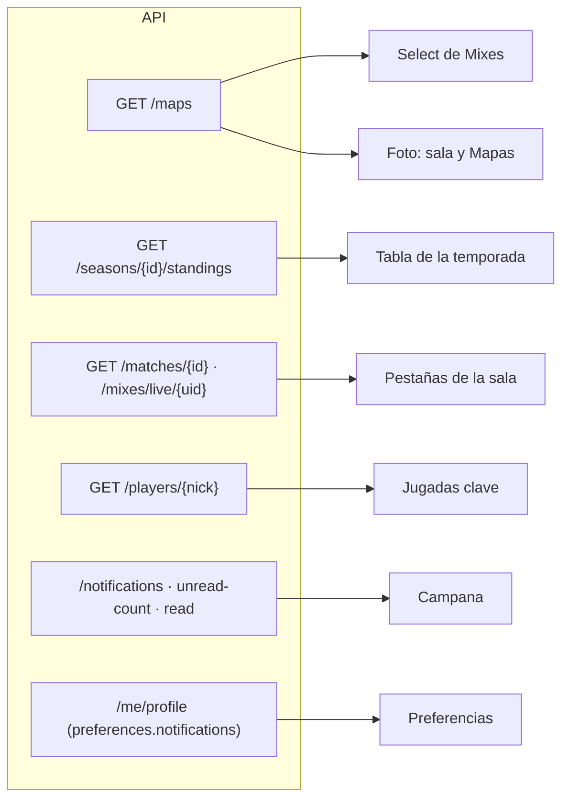
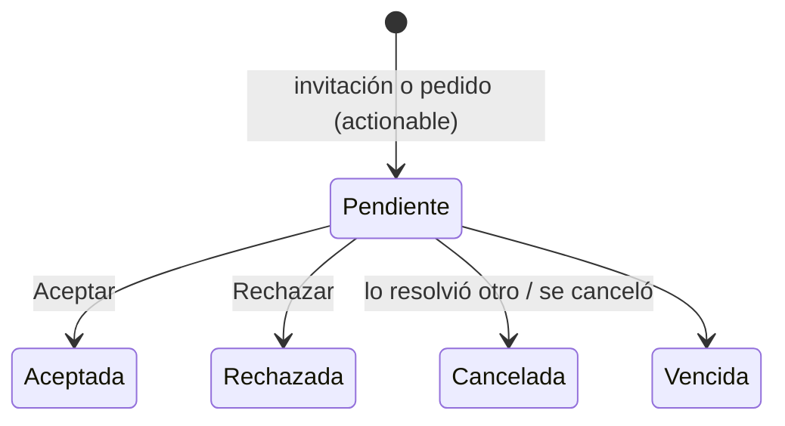

# Ajustes del frontend en los módulos que ya existen: documentación

## Qué hace

Cinco pantallas que ya existían usan ahora lo que el backend entrega desde el replanteo `30` y la API de notificaciones. No hay pantallas nuevas.

- **Mixes:**
  - el listado tiene el select de mapas del catálogo;
  - la sala muestra la foto del mapa buscándolo por versión;
  - las tablas de los dos bandos tienen pestañas de estadísticas: General, Avanzado, Entrada y Clutch.
- **Ranking › Jugadores:** la tabla de una temporada tiene las columnas del Histórico (Equipo, Rating, K/D) y el filtro de nivel. El pico va debajo del ELO.
- **Perfil público:**
  - la pestaña Resumen suma la tarjeta "Jugadas clave";
  - la pestaña Mapas muestra la foto del catálogo en cada versión de un mapa.
- **Campana:** muestra las notificaciones reales de la cuenta, con el contador por ETag y las invitaciones que se aceptan o rechazan desde la lista.
- **Mi perfil › Preferencias:** una tarjeta con un interruptor por categoría de notificaciones.

## Catálogo de mapas (`features/maps/queries.ts`)

- **`mapsOptions`:** pide `GET /maps?include_inactive=true&per=100`. Los retirados también vienen, porque una sala vieja necesita su foto.
- **`mixMapNames`:** los mapas con `active` y `mixes`, en el orden de `position`. Si no hay ninguno, el listado no muestra el select.
- **`mapImage`:** busca el mapa jugado entre el nombre y las `versions` de cada mapa, sin distinguir mayúsculas. `de_inferno_classic` usa la foto de `de_inferno`. Las estadísticas por mapa del perfil siguen separadas por versión, porque la API las agrupa por el nombre exacto.

## Ranking de una temporada

- **Columnas:** #, Jugador, Nivel, ELO (con "máx." debajo), Equipo, Rating, K/D, Mixes, V–D, Medalla y Al cerrar.
- **Equipo:** usa `TeamsCell`, como el Histórico: el equipo más antiguo, "+n" con un tooltip con los demás, o "Sin equipo".
- **Orden:** ELO, Rating, K/D y Mixes se ordenan desde la cabecera (desc → asc → por puesto).
- **Filtro de nivel:** `LevelFilter`, compartido con el Histórico. Se conserva al cambiar de temporada.
- **Consulta:** `toStandingsQuery` manda `level` y cualquier `sort`.

## Sala del mix: pestañas de estadísticas

- **`stats.ts`:** fórmulas puras. Un divisor 0 da "—".
  - El mejor valor de cada columna se calcula entre los dos bandos: el menor en D y en Muertes, y sin marca si todos están en 0 o en Δ ELO.
  - El orden con clic va desc → asc → por rating.
- **Pestaña en la URL:** `?stats=advanced|entry|clutch`, con `roomSearchSchema`. General no va en la URL. El orden por columna es del componente y se reinicia al cambiar de pestaña.

| Pestaña | Columnas |
|---|---|
| General | K · D · A · +/- · K/R · ADR · HS · HS % · 2k · 3k · 4k · 5k · Rating · Δ ELO |
| Avanzado | MK · MK % · RP · Plantadas · Defuses |
| Entrada | Intentos · Elim. · Muertes · Dif. · % intentos · % éxito |
| Clutch | 1v1 a 1v5 · Total, con "Solo clutches ganados." debajo |

- **Clutch:**
  - sin `clutch_data`: "Sin datos de Clutches disponibles.";
  - en vivo: "Los clutches se cuentan al terminar el mix.", y la tabla no tiene Δ ELO.
- **Tablas:** son de ancho fijo, con la columna del jugador fija al desplazar de lado. Así las columnas de los dos bandos quedan alineadas.

## Perfil: "Jugadas clave" (`features/player/KeyPlays.tsx`)

Sale de `stats` de la ficha y va debajo de Logros y Ajustes de ELO:

| Bloque | Qué muestra |
|---|---|
| Multi-kills | 2k, 3k, 4k y 5k, y multi-kills por partida |
| Entradas | % de éxito y entradas por ronda |
| Clutches ganados | 1v1 a 1v5 y el total. El 1v4 y el 1v5 en color primario si son mayores que 0 |
| Objetivos | Plantadas y defuses |

Sin partidas: "Todavía no jugó partidas en el servidor."

## Campana de notificaciones (`features/shell/notifications/`)

- **`queries.ts`:**
  - `unreadCountOptions`: `If-None-Match` con el último ETag; un `304` reusa el valor. Se consulta cada 30 s y al enfocar la pestaña;
  - `notificationsOptions`: se pide solo con el menú abierto;
  - `useMarkRead`: marca leídas ids o todas, y la lista se actualiza sin esperar a la API;
  - `useResolveRequest`: usa `/team-invites/{id}/accept|reject` o `/join-requests/{id}/accept|reject`, la marca leída e invalida las notificaciones y el perfil.
- **`model.ts`:**
  - `describe(n, me)` arma el título, el cuerpo, el icono y el link de los 43 tipos del contrato;
  - un tipo desconocido muestra "Novedad en {categoría}";
  - pestañas: Todas, Sin leer y Solicitudes (las que se responden desde la lista, también las resueltas).
- **Destinatarios:** no hay filtro por capitán: la base decide a quién le llega cada una. Se sacaron la prop `captain` y `seesCaptainNotifications`.

## Preferencias (`features/profile/sections/NotificationPrefsCard.tsx`)

- **Una fila por categoría** de `preferences.notifications`. Administración solo la ve un admin (`getsAdminNotifications`).
- **Al tocar un interruptor:** se ve enseguida, se manda `PATCH /me/profile` con esa sola categoría y, si falla, vuelve atrás.
- **Aclaraciones:** debajo de Equipos y de Cuenta, qué llega siempre. Al final, que apagar una categoría no guarda sus notificaciones.

## Dónde está cada cosa

| Qué | Archivo / ubicación |
|---|---|
| Catálogo de mapas | `src/features/maps/queries.ts` |
| Select de Mixes | `src/features/mixes/MixesList.tsx` |
| Pestañas, columnas y fórmulas | `src/features/mixes/stats.ts`, `StatsTabs.tsx`, `MixRoom.tsx`, `room.ts` |
| Pestaña en la URL | `src/features/mixes/search.ts` (`roomSearchSchema`), `src/routes/_app/match.$id.tsx`, `mixes.live.$uid.tsx`, `MixRoomPages.tsx` |
| Ranking de una temporada | `src/features/ranking/PlayersRanking.tsx`, `search.ts` |
| Jugadas clave | `src/features/player/KeyPlays.tsx`, `tabs.tsx` |
| Campana | `src/features/shell/notifications/` (`model.ts`, `queries.ts`, `NotificationsMenu.tsx`, `InviteDialog.tsx`, `mock.ts` solo para pruebas) |
| Preferencias de notificaciones | `src/features/profile/sections/NotificationPrefsCard.tsx`, `PreferencesSection.tsx` |
| Permisos | `src/auth/permissions.ts` (`getsAdminNotifications`) |
